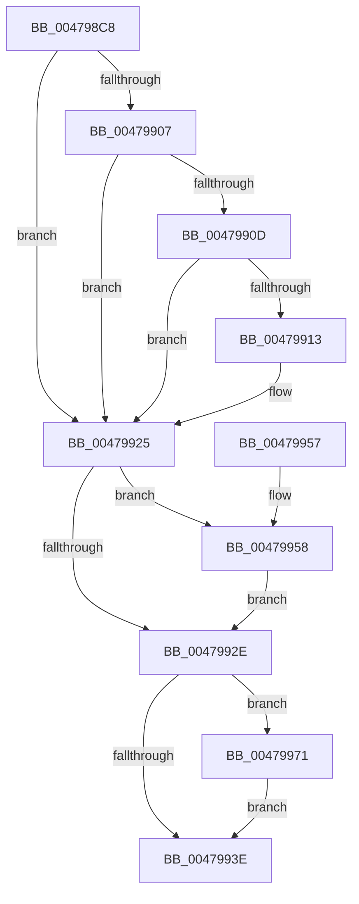

# MiReleaseFaultCharges

- RVA: `0x004798C8`–`0x00479980` (길이 `184` bytes)
- VA: `0x00000001404798C8`
- 실행 섹션: `.text`
- PDB 이름 있음: `예`; PDB Function 태그: `아니요`
- unwind 정보 RVA: `0x000ACFC4`
- 디코드: `56`개 명령, `184/184` bytes 표시
- 미해석 바이트: `0` (있으면 어셈블리에 `.byte`로 보존)

> 이 문서는 커널 이미지의 기계어와 PDB 기호를 분석해 생성했습니다. 4번과 5번은 함수 원형과 자료형을 바이너리 사용 방식에서 추정한 C 해석이며 원본 소스 복구 결과는 아닙니다.

## 1. Dependencies

- 직접 호출 지점: **4**; 고유 호출 대상: **4**
- 직접 호출자로 확인된 함수: **2**
- RIP 상대 이미지 참조: **1**

### Outgoing calls
- `0x004798F8` → [ExAcquireSpinLockExclusive](../24/ExAcquireSpinLockExclusive_function_00248690.md) (function, `0x00248690`)
- `0x0047991D` → [MiDecrementSubsections](../29/MiDecrementSubsections_function_00298B50.md) (function, `0x00298B50`)
- `0x00479934` → [MiCheckControlArea](../28/MiCheckControlArea_function_002861B0.md) (function, `0x002861B0`)
- `0x00479979` → [MiReturnCrossPartitionSectionCharges](../4B/MiReturnCrossPartitionSectionCharges_function_004BA61C.md) (function, `0x004BA61C`)

### Direct callers
- [sub_0027F2A6](../27/Unknown_function_0027F2A6.md) at `0x0027F2A6`
- [MiFaultGetFileExtents](MiFaultGetFileExtents_function_00479758.md) at `0x00479834`

### Static image references
- `0x0047995D` → RVA `0x00E30088` (`.data`; read)

## 2. Other-region calls and transfers

- 다른 실행 섹션으로 향하는 call: **0**
- 별도 외부 분기/꼬리 이동을 확인하지 못했습니다.

## 3. Assembly (complete function range)

```asm
004798C8  48 89 5C 24 08                  mov qword ptr [rsp + 8], rbx
004798CD  48 89 6C 24 10                  mov qword ptr [rsp + 0x10], rbp
004798D2  48 89 74 24 18                  mov qword ptr [rsp + 0x18], rsi
004798D7  57                              push rdi
004798D8  41 56                           push r14
004798DA  41 57                           push r15
004798DC  48 83 EC 20                     sub rsp, 0x20
004798E0  48 8B 19                        mov rbx, qword ptr [rcx]
004798E3  33 ED                           xor ebp, ebp
004798E5  4C 8B F1                        mov r14, rcx
004798E8  33 FF                           xor edi, edi
004798EA  33 F6                           xor esi, esi
004798EC  48 39 73 40                     cmp qword ptr [rbx + 0x40], rsi
004798F0  48 8D 4B 48                     lea rcx, [rbx + 0x48]
004798F4  40 0F 95 C5                     setne bpl
004798F8  E8 93 ED DC FF                  call 0x140248690
004798FD  44 8A F8                        mov r15b, al
00479900  8B 43 38                        mov eax, dword ptr [rbx + 0x38]
00479903  A8 20                           test al, 0x20
00479905  75 1E                           jne 0x140479925
00479907  48 39 73 40                     cmp qword ptr [rbx + 0x40], rsi
0047990B  74 18                           je 0x140479925
0047990D  0F BA E0 0A                     bt eax, 0xa
00479911  72 12                           jb 0x140479925
00479913  44 8D 47 04                     lea r8d, [rdi + 4]
00479917  49 8B D6                        mov rdx, r14
0047991A  49 8B CE                        mov rcx, r14
0047991D  E8 2E F2 E1 FF                  call 0x140298b50
00479922  48 8B F8                        mov rdi, rax
00479925  48 FF 4B 28                     dec qword ptr [rbx + 0x28]
00479929  48 85 FF                        test rdi, rdi
0047992C  75 2A                           jne 0x140479958
0047992E  41 8A D7                        mov dl, r15b
00479931  48 8B CB                        mov rcx, rbx
00479934  E8 77 C8 E0 FF                  call 0x1402861b0
00479939  48 85 FF                        test rdi, rdi
0047993C  75 33                           jne 0x140479971
0047993E  48 8B 5C 24 40                  mov rbx, qword ptr [rsp + 0x40]
00479943  48 8B 6C 24 48                  mov rbp, qword ptr [rsp + 0x48]
00479948  48 8B 74 24 50                  mov rsi, qword ptr [rsp + 0x50]
0047994D  48 83 C4 20                     add rsp, 0x20
00479951  41 5F                           pop r15
00479953  41 5E                           pop r14
00479955  5F                              pop rdi
00479956  C3                              ret
00479957  CC                              int3
00479958  44 0F B7 4B 3C                  movzx r9d, word ptr [rbx + 0x3c]
0047995D  4C 8B 05 24 67 9B 00            mov r8, qword ptr [rip + 0x9b6724]
00479964  41 81 E1 FF 03 00 00            and r9d, 0x3ff
0047996B  4B 8B 34 C8                     mov rsi, qword ptr [r8 + r9*8]
0047996F  EB BD                           jmp 0x14047992e
00479971  4C 8B C7                        mov r8, rdi
00479974  8B D5                           mov edx, ebp
00479976  48 8B CE                        mov rcx, rsi
00479979  E8 9E 0C 04 00                  call 0x1404ba61c
0047997E  EB BE                           jmp 0x14047993e
```

## 4. C-style interpretation (structured pseudocode)

```c
__int64 __fastcall MiReleaseFaultCharges(__int64 a1)
{
    __int64 result;
    __int64 v_rbp;
    __int64 v_rdi;
    __int64 v_rsi;
    __int64 v_rsp;
    unsigned __int64 v_stack_p10;
    unsigned __int64 v_stack_p18;
    unsigned __int64 v_stack_p8;

    v_stack_p8 = v_rbx;
    v_stack_p10 = v_rbp;
    v_stack_p18 = v_rsi;
    v_rsp = (v_rsp) - (32);
    v_rbp = 0;
    v_rdi = 0;
    v_rsi = 0;
    v_rbp = ((*(unsigned __int64 *)(*(unsigned __int64 *)(a1) + 64)) != 0) ? 1 : 0;
    result = ExAcquireSpinLockExclusive(*(unsigned __int64 *)(a1) + 72, a2, a3, a4);
    if ((((unsigned __int8)((unsigned int)(*(unsigned int *)(*(unsigned __int64 *)(a1) + 56)))) & (32)) != 0) goto loc_00479925;
    if ((*(unsigned __int64 *)(*(unsigned __int64 *)(a1) + 64)) == 0) goto loc_00479925;
    result = (unsigned int)(*(unsigned int *)(*(unsigned __int64 *)(a1) + 56));
    if ((*(unsigned __int64 *)(*(unsigned __int64 *)(a1) + 64)) >= 0) {
        a3 = v_rdi + 4;
        a2 = a1;
        a1 = a1;
        result = MiDecrementSubsections(a1, a2, a3, a4);
        v_rdi = result;
    }
    if (v_rdi != 0) goto loc_00479958;
loc_0047992E:
    result = MiCheckControlArea(*(unsigned __int64 *)(a1), (unsigned __int8)((unsigned __int8)(result)), a3, a4);
    if (v_rdi != 0) goto loc_00479971;
loc_0047993E:
    v_rsp = (v_rsp) + (32);
    return result;
loc_00479958:
    a4 = (unsigned int)((*(unsigned __int16 *)(v_stack_p8 + 60)) & (0x3FFULL));
    goto loc_0047992E;
loc_00479971:
    result = MiReturnCrossPartitionSectionCharges(*(unsigned __int64 *)(*(unsigned __int64 *)(v_rip + 10184484) + a4 * 8), (unsigned int)((unsigned int)(v_stack_p10)), v_rdi, a4);
    goto loc_0047993E;
}
```

## 5. (Beta) C Style

```c
int64_t MiReleaseFaultCharges(void *Arg1)
{
    uint8_t *arg1 = (uint8_t *)Arg1;

    int64_t result;
    int64_t local_rbp;
    int64_t local_rdi;
    int64_t local_rsi;
    int64_t local_rsp;
    uint64_t v_stack_p10;
    uint64_t v_stack_p18;
    uint64_t v_stack_p8;

    v_stack_p8 = local_rbx;
    v_stack_p10 = local_rbp;
    v_stack_p18 = local_rsi;
    local_rsp = (local_rsp) - (32);
    local_rbp = 0;
    local_rdi = 0;
    local_rsi = 0;
    local_rbp = ((*(uint64_t *)(*(uint64_t *)(arg1) + 0x40)) != 0) ? 1 : 0;
    result = ExAcquireSpinLockExclusive(*(uint64_t *)(arg1) + 72, a2, a3, a4);
    if ((((uint8_t)((uint32_t)(*(uint32_t *)(*(uint64_t *)(arg1) + 0x38)))) & (32)) != 0) goto loc_00479925;
    if ((*(uint64_t *)(*(uint64_t *)(arg1) + 0x40)) == 0) goto loc_00479925;
    result = (uint32_t)(*(uint32_t *)(*(uint64_t *)(arg1) + 0x38));
    if ((*(uint64_t *)(*(uint64_t *)(arg1) + 0x40)) >= 0) {
        a3 = local_rdi + 4;
        a2 = Arg1;
        Arg1 = Arg1;
        result = MiDecrementSubsections(Arg1, a2, a3, a4);
        local_rdi = result;
    }
    if (local_rdi != 0) goto loc_00479958;
loc_0047992E:
    result = MiCheckControlArea(*(uint64_t *)(arg1), (uint8_t)((uint8_t)(result)), a3, a4);
    if (local_rdi != 0) goto loc_00479971;
loc_0047993E:
    local_rsp = (local_rsp) + (32);
    return result;
loc_00479958:
    a4 = (uint32_t)((*(uint16_t *)(v_stack_p8 + 0x3C)) & (0x3FFULL));
    goto loc_0047992E;
loc_00479971:
    result = MiReturnCrossPartitionSectionCharges(*(uint64_t *)(*(uint64_t *)(v_rip + 0x9B6724) + a4 * 8), (uint32_t)((uint32_t)(v_stack_p10)), local_rdi, a4);
    goto loc_0047993E;
}
```

### 관측된 메모리 오프셋

구조체 형식이 확인되지 않은 접근은 인자 기준의 오프셋으로만 기록했습니다.

| 기준 인자 | 오프셋 표현 | 폭 (bit) | 접근 |
|---|---:|---:|---|
| `Arg1` | `+ 0x0` | `64` | `R` |

## 6. Execution-region graph

[열기: 2D/3D 그래프와 함수 탐색 컨트롤 패널](../../../control-panel.html?section=text&rva=0x004798C8&view=graph)

- 2D 그래프는 위에서 아래로 흐르고, 3D 그래프는 빈 공간을 드래그해 회전합니다. Shift+드래그는 이동, 휠은 확대·축소, 함수 노드 선택은 대상 보고서 이동입니다.

### Static fallback


