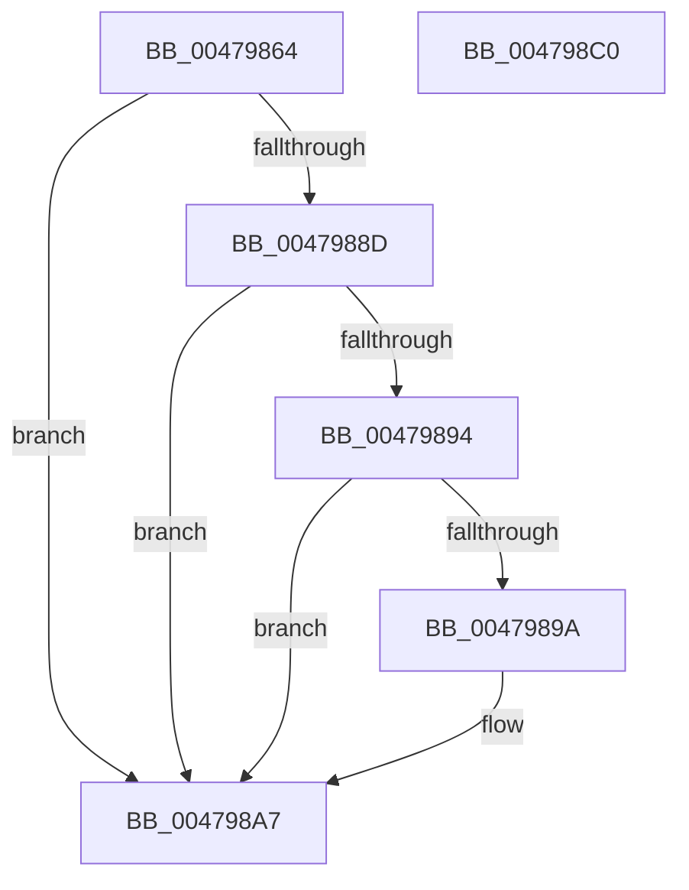

# MiRetainSubsection

- RVA: `0x00479864`–`0x004798C1` (길이 `93` bytes)
- VA: `0x0000000140479864`
- 실행 섹션: `.text`
- PDB 이름 있음: `예`; PDB Function 태그: `아니요`
- unwind 정보 RVA: `0x00060BC4`
- 디코드: `27`개 명령, `93/93` bytes 표시
- 미해석 바이트: `0` (있으면 어셈블리에 `.byte`로 보존)

> 이 문서는 커널 이미지의 기계어와 PDB 기호를 분석해 생성했습니다. 4번과 5번은 함수 원형과 자료형을 바이너리 사용 방식에서 추정한 C 해석이며 원본 소스 복구 결과는 아닙니다.

## 1. Dependencies

- 직접 호출 지점: **3**; 고유 호출 대상: **3**
- 직접 호출자로 확인된 함수: **2**
- RIP 상대 이미지 참조: **0**

### Outgoing calls
- `0x0047987D` → [ExAcquireSpinLockExclusiveAtDpcLevel](../24/ExAcquireSpinLockExclusiveAtDpcLevel_function_00248E80.md) (function, `0x00248E80`)
- `0x004798A2` → [MiIncrementSubsectionViewCount](../24/MiIncrementSubsectionViewCount_function_00249440.md) (function, `0x00249440`)
- `0x004798AB` → [ExReleaseSpinLockExclusiveFromDpcLevel](../24/ExReleaseSpinLockExclusiveFromDpcLevel_function_002497E0.md) (function, `0x002497E0`)

### Direct callers
- [sub_0027F36E](../27/Unknown_function_0027F36E.md) at `0x0027F426`
- [MiFaultGetFileExtents](MiFaultGetFileExtents_function_00479758.md) at `0x004797C9`

### Static image references
- 디코드된 RIP-relative 메모리 참조가 없습니다.

## 2. Other-region calls and transfers

- 다른 실행 섹션으로 향하는 call: **0**
- 별도 외부 분기/꼬리 이동을 확인하지 못했습니다.

## 3. Assembly (complete function range)

```asm
00479864  48 89 5C 24 08                  mov qword ptr [rsp + 8], rbx
00479869  48 89 74 24 10                  mov qword ptr [rsp + 0x10], rsi
0047986E  57                              push rdi
0047986F  48 83 EC 20                     sub rsp, 0x20
00479873  48 8B 19                        mov rbx, qword ptr [rcx]
00479876  48 8B F1                        mov rsi, rcx
00479879  48 8D 4B 48                     lea rcx, [rbx + 0x48]
0047987D  E8 FE F5 DC FF                  call 0x140248e80
00479882  48 FF 43 28                     inc qword ptr [rbx + 0x28]
00479886  8B 43 38                        mov eax, dword ptr [rbx + 0x38]
00479889  A8 20                           test al, 0x20
0047988B  75 1A                           jne 0x1404798a7
0047988D  48 83 7B 40 00                  cmp qword ptr [rbx + 0x40], 0
00479892  74 13                           je 0x1404798a7
00479894  0F BA E0 0A                     bt eax, 0xa
00479898  72 0D                           jb 0x1404798a7
0047989A  BA 04 00 00 00                  mov edx, 4
0047989F  48 8B CE                        mov rcx, rsi
004798A2  E8 99 FB DC FF                  call 0x140249440
004798A7  48 8D 4B 48                     lea rcx, [rbx + 0x48]
004798AB  E8 30 FF DC FF                  call 0x1402497e0
004798B0  48 8B 5C 24 30                  mov rbx, qword ptr [rsp + 0x30]
004798B5  48 8B 74 24 38                  mov rsi, qword ptr [rsp + 0x38]
004798BA  48 83 C4 20                     add rsp, 0x20
004798BE  5F                              pop rdi
004798BF  C3                              ret
004798C0  CC                              int3
```

## 4. C-style interpretation (structured pseudocode)

```c
__int64 __fastcall MiRetainSubsection(__int64 a1)
{
    __int64 result;
    __int64 v_rsp;
    unsigned __int64 v_stack_p10;
    unsigned __int64 v_stack_p8;

    v_stack_p8 = v_rbx;
    v_stack_p10 = v_rsi;
    v_rsp = (v_rsp) - (32);
    result = ExAcquireSpinLockExclusiveAtDpcLevel(*(unsigned __int64 *)(a1) + 72, a2, a3, a4);
    if ((((unsigned __int8)((unsigned int)(*(unsigned int *)(*(unsigned __int64 *)(a1) + 56)))) & (32)) != 0) goto loc_004798A7;
    if ((*(unsigned __int64 *)(*(unsigned __int64 *)(a1) + 64)) == 0) goto loc_004798A7;
    result = (unsigned int)(*(unsigned int *)(*(unsigned __int64 *)(a1) + 56));
    if ((*(unsigned __int64 *)(*(unsigned __int64 *)(a1) + 64)) >= 0) {
        a2 = 4;
        a1 = a1;
        result = MiIncrementSubsectionViewCount(a1, a2, a3, a4);
    }
    result = ExReleaseSpinLockExclusiveFromDpcLevel(*(unsigned __int64 *)(a1) + 72, a2, a3, a4);
    v_rsp = (v_rsp) + (32);
    return result;
}
```

## 5. (Beta) C Style

```c
int64_t MiRetainSubsection(void *Arg1)
{
    uint8_t *arg1 = (uint8_t *)Arg1;

    int64_t result;
    int64_t local_rsp;
    uint64_t v_stack_p10;
    uint64_t v_stack_p8;

    v_stack_p8 = local_rbx;
    v_stack_p10 = local_rsi;
    local_rsp = (local_rsp) - (32);
    result = ExAcquireSpinLockExclusiveAtDpcLevel(*(uint64_t *)(arg1) + 72, a2, a3, a4);
    if ((((uint8_t)((uint32_t)(*(uint32_t *)(*(uint64_t *)(arg1) + 0x38)))) & (32)) != 0) goto loc_004798A7;
    if ((*(uint64_t *)(*(uint64_t *)(arg1) + 0x40)) == 0) goto loc_004798A7;
    result = (uint32_t)(*(uint32_t *)(*(uint64_t *)(arg1) + 0x38));
    if ((*(uint64_t *)(*(uint64_t *)(arg1) + 0x40)) >= 0) {
        a2 = 4;
        Arg1 = Arg1;
        result = MiIncrementSubsectionViewCount(Arg1, a2, a3, a4);
    }
    result = ExReleaseSpinLockExclusiveFromDpcLevel(*(uint64_t *)(arg1) + 72, a2, a3, a4);
    local_rsp = (local_rsp) + (32);
    return result;
}
```

### 관측된 메모리 오프셋

구조체 형식이 확인되지 않은 접근은 인자 기준의 오프셋으로만 기록했습니다.

| 기준 인자 | 오프셋 표현 | 폭 (bit) | 접근 |
|---|---:|---:|---|
| `Arg1` | `+ 0x0` | `64` | `R` |

## 6. Execution-region graph

[열기: 2D/3D 그래프와 함수 탐색 컨트롤 패널](../../../control-panel.html?section=text&rva=0x00479864&view=graph)

- 2D 그래프는 위에서 아래로 흐르고, 3D 그래프는 빈 공간을 드래그해 회전합니다. Shift+드래그는 이동, 휠은 확대·축소, 함수 노드 선택은 대상 보고서 이동입니다.

### Static fallback


