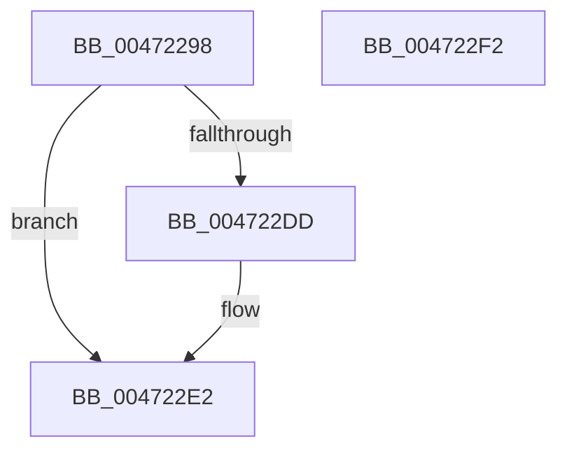

# MiReuseUltraPageTable

- RVA: `0x00472298`–`0x004722F3` (길이 `91` bytes)
- VA: `0x0000000140472298`
- 실행 섹션: `.text`
- PDB 이름 있음: `예`; PDB Function 태그: `아니요`
- unwind 정보 RVA: `0x00060BC4`
- 디코드: `25`개 명령, `91/91` bytes 표시
- 미해석 바이트: `0` (있으면 어셈블리에 `.byte`로 보존)

> 이 문서는 커널 이미지의 기계어와 PDB 기호를 분석해 생성했습니다. 4번과 5번은 함수 원형과 자료형을 바이너리 사용 방식에서 추정한 C 해석이며 원본 소스 복구 결과는 아닙니다.

## 1. Dependencies

- 직접 호출 지점: **2**; 고유 호출 대상: **2**
- 직접 호출자로 확인된 함수: **1**
- RIP 상대 이미지 참조: **0**

### Outgoing calls
- `0x004722B4` → [MI_PAGE_TO_FULL_COLOR](../33/MI_PAGE_TO_FULL_COLOR_function_00337820.md) (function, `0x00337820`)
- `0x004722D3` → [MiManageUltraSpacePageTable](../2D/MiManageUltraSpacePageTable_function_002DCAF0.md) (function, `0x002DCAF0`)

### Direct callers
- [MiGetUltraMapping](../32/MiGetUltraMapping_function_00323270.md) at `0x003235F5`
- [MiGetUltraMapping](../32/MiGetUltraMapping_function_00323270.md) at `0x00323689`

### Static image references
- 디코드된 RIP-relative 메모리 참조가 없습니다.

## 2. Other-region calls and transfers

- 다른 실행 섹션으로 향하는 call: **0**
- 별도 외부 분기/꼬리 이동을 확인하지 못했습니다.

## 3. Assembly (complete function range)

```asm
00472298  48 89 5C 24 08                  mov qword ptr [rsp + 8], rbx
0047229D  48 89 74 24 10                  mov qword ptr [rsp + 0x10], rsi
004722A2  57                              push rdi
004722A3  48 83 EC 20                     sub rsp, 0x20
004722A7  8B F2                           mov esi, edx
004722A9  48 8B F9                        mov rdi, rcx
004722AC  48 8B 5C F1 08                  mov rbx, qword ptr [rcx + rsi*8 + 8]
004722B1  48 8B CB                        mov rcx, rbx
004722B4  E8 67 55 EC FF                  call 0x140337820
004722B9  48 8D 0C 5B                     lea rcx, [rbx + rbx*2]
004722BD  48 C1 E1 04                     shl rcx, 4
004722C1  48 BA 00 00 00 00 00 DE FF FF   movabs rdx, 0xffffde0000000000
004722CB  48 03 CA                        add rcx, rdx
004722CE  45 33 C0                        xor r8d, r8d
004722D1  8B D0                           mov edx, eax
004722D3  E8 18 A8 E6 FF                  call 0x1402dcaf0
004722D8  48 3B C3                        cmp rax, rbx
004722DB  74 05                           je 0x1404722e2
004722DD  48 89 44 F7 08                  mov qword ptr [rdi + rsi*8 + 8], rax
004722E2  48 8B 5C 24 30                  mov rbx, qword ptr [rsp + 0x30]
004722E7  48 8B 74 24 38                  mov rsi, qword ptr [rsp + 0x38]
004722EC  48 83 C4 20                     add rsp, 0x20
004722F0  5F                              pop rdi
004722F1  C3                              ret
004722F2  CC                              int3
```

## 4. C-style interpretation (structured pseudocode)

```c
__int64 __fastcall MiReuseUltraPageTable(__int64 a1, int a2, int a3)
{
    __int64 result;
    __int64 v_rsp;
    unsigned __int64 v_stack_p10;
    unsigned __int64 v_stack_p8;

    v_stack_p8 = v_rbx;
    v_stack_p10 = v_rsi;
    v_rsp = (v_rsp) - (32);
    result = MI_PAGE_TO_FULL_COLOR(*(unsigned __int64 *)(a1 + (unsigned int)(a2) * 8 + 8), a2, a3, a4);
    a1 = (*(unsigned __int64 *)(a1 + (unsigned int)(a2) * 8 + 8) + *(unsigned __int64 *)(a1 + (unsigned int)(a2) * 8 + 8) * 2) << (4);
    a1 = (a1) + (a2);
    a3 = 0;
    result = MiManageUltraSpacePageTable(a1, (unsigned int)((unsigned int)(result)), a3, a4);
    if (result != (*(unsigned __int64 *)(a1 + (unsigned int)(a2) * 8 + 8))) {
        *(unsigned __int64 *)(a1 + (unsigned int)(a2) * 8 + 8) = result;
    }
    v_rsp = (v_rsp) + (32);
    return result;
}
```

## 5. (Beta) C Style

```c
int64_t MiReuseUltraPageTable(void *Arg1, int32_t Arg2, int32_t Arg3)
{
    uint8_t *arg1 = (uint8_t *)Arg1;

    int64_t result;
    int64_t local_rsp;
    uint64_t v_stack_p10;
    uint64_t v_stack_p8;

    v_stack_p8 = local_rbx;
    v_stack_p10 = local_rsi;
    local_rsp = (local_rsp) - (32);
    result = MI_PAGE_TO_FULL_COLOR(*(uint64_t *)(arg1 + (uint32_t)(Arg2) * 8 + 0x8), Arg2, Arg3, a4);
    Arg1 = (*(uint64_t *)(arg1 + (uint32_t)(Arg2) * 8 + 0x8) + *(uint64_t *)(arg1 + (uint32_t)(Arg2) * 8 + 0x8) * 2) << (4);
    Arg1 = (Arg1) + (Arg2);
    Arg3 = 0;
    result = MiManageUltraSpacePageTable(Arg1, (uint32_t)((uint32_t)(result)), Arg3, a4);
    if (result != (*(uint64_t *)(arg1 + (uint32_t)(Arg2) * 8 + 0x8))) {
        *(uint64_t *)(arg1 + (uint32_t)(Arg2) * 8 + 0x8) = result;
    }
    local_rsp = (local_rsp) + (32);
    return result;
}
```

### 관측된 메모리 오프셋

구조체 형식이 확인되지 않은 접근은 인자 기준의 오프셋으로만 기록했습니다.

| 기준 인자 | 오프셋 표현 | 폭 (bit) | 접근 |
|---|---:|---:|---|
| `Arg1` | `+ 0x8 + rsi*8` | `64` | `R` |
| `Arg1` | `+ 0x8 + rsi*8` | `64` | `W` |

## 6. Execution-region graph

[열기: 2D/3D 그래프와 함수 탐색 컨트롤 패널](../../../control-panel.html?section=text&rva=0x00472298&view=graph)

- 2D 그래프는 위에서 아래로 흐르고, 3D 그래프는 빈 공간을 드래그해 회전합니다. Shift+드래그는 이동, 휠은 확대·축소, 함수 노드 선택은 대상 보고서 이동입니다.

### Static fallback


