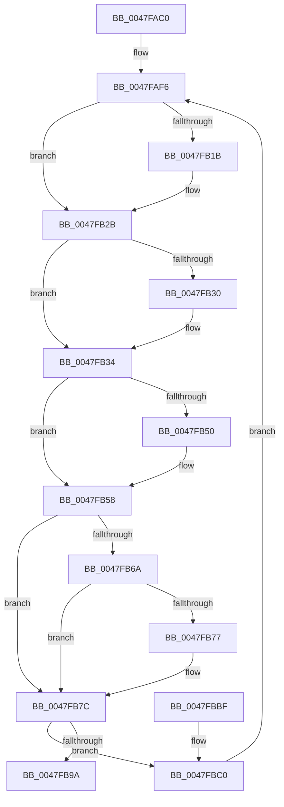

# MiSendParkedCoreUpdateToAllChildPartitions

- RVA: `0x0047FAC0`–`0x0047FBD1` (길이 `273` bytes)
- VA: `0x000000014047FAC0`
- 실행 섹션: `.text`
- PDB 이름 있음: `예`; PDB Function 태그: `아니요`
- unwind 정보 RVA: `0x000AE258`
- 디코드: `68`개 명령, `273/273` bytes 표시
- 미해석 바이트: `0` (있으면 어셈블리에 `.byte`로 보존)

> 이 문서는 커널 이미지의 기계어와 PDB 기호를 분석해 생성했습니다. 4번과 5번은 함수 원형과 자료형을 바이너리 사용 방식에서 추정한 C 해석이며 원본 소스 복구 결과는 아닙니다.

## 1. Dependencies

- 직접 호출 지점: **9**; 고유 호출 대상: **8**
- 직접 호출자로 확인된 함수: **0**
- RIP 상대 이미지 참조: **5**

### Outgoing calls
- `0x0047FB06` → [KeAbPreAcquire](../21/KeAbPreAcquire_function_00210230.md) (function, `0x00210230`)
- `0x0047FB26` → [ExfAcquirePushLockSharedEx](../21/ExfAcquirePushLockSharedEx_function_0021044C.md) (function, `0x0021044C`)
- `0x0047FB3D` → [MiIterateOverPartitions](MiIterateOverPartitions_function_0047FC14.md) (function, `0x0047FC14`)
- `0x0047FB53` → [ExfReleasePushLockShared](../26/ExfReleasePushLockShared_function_00263440.md) (function, `0x00263440`)
- `0x0047FB5B` → [KeAbPostRelease](../2E/KeAbPostRelease_function_002E1600.md) (function, `0x002E1600`)
- `0x0047FB77` → [KiCheckForKernelApcDelivery](../2E/KiCheckForKernelApcDelivery_function_002E2C80.md) (function, `0x002E2C80`)
- `0x0047FB83` → [ExAcquireSpinLockExclusive](../24/ExAcquireSpinLockExclusive_function_00248690.md) (function, `0x00248690`)
- `0x0047FBA1` → [MiReleaseSpinLockExclusive](../24/MiReleaseSpinLockExclusive_function_002482C0.md) (function, `0x002482C0`)
- `0x0047FBC7` → [MiReleaseSpinLockExclusive](../24/MiReleaseSpinLockExclusive_function_002482C0.md) (function, `0x002482C0`)

### Direct callers
- 이 함수 시작 RVA로 연결되는 직접 call은 확인되지 않았습니다. 간접 호출은 완전히 역산할 수 없습니다.

### Static image references
- `0x0047FAE1` → RVA `0x00E30048` (`.data`; read)
- `0x0047FB36` → RVA `0x00305810` (`MiMoveBackgroundZeroThreads`; read)
- `0x0047FB7C` → RVA `0x00E2ED40` (`.data`; read)
- `0x0047FB88` → RVA `0x00E2EE68` (`.data`; read)
- `0x0047FB9A` → RVA `0x00E2EE68` (`.data`; write)

## 2. Other-region calls and transfers

- 다른 실행 섹션으로 향하는 call: **0**
- 별도 외부 분기/꼬리 이동을 확인하지 못했습니다.

## 3. Assembly (complete function range)

```asm
0047FAC0  48 89 5C 24 08                  mov qword ptr [rsp + 8], rbx
0047FAC5  48 89 6C 24 18                  mov qword ptr [rsp + 0x18], rbp
0047FACA  48 89 74 24 20                  mov qword ptr [rsp + 0x20], rsi
0047FACF  57                              push rdi
0047FAD0  41 54                           push r12
0047FAD2  41 57                           push r15
0047FAD4  48 83 EC 20                     sub rsp, 0x20
0047FAD8  65 48 8B 1C 25 88 01 00 00      mov rbx, qword ptr gs:[0x188]
0047FAE1  48 8D 35 60 05 9B 00            lea rsi, [rip + 0x9b0560]
0047FAE8  41 BC 11 00 00 00               mov r12d, 0x11
0047FAEE  45 33 FF                        xor r15d, r15d
0047FAF1  41 8D 6C 24 F0                  lea ebp, [r12 - 0x10]
0047FAF6  66 FF 8B E6 01 00 00            dec word ptr [rbx + 0x1e6]
0047FAFD  45 33 C0                        xor r8d, r8d
0047FB00  33 D2                           xor edx, edx
0047FB02  48 8B CE                        mov rcx, rsi
0047FB05  90                              nop
0047FB06  E8 25 07 D9 FF                  call 0x140210230
0047FB0B  48 8B F8                        mov rdi, rax
0047FB0E  33 C0                           xor eax, eax
0047FB10  F0 4C 0F B1 25 2F 05 9B 00      lock cmpxchg qword ptr [rip + 0x9b052f], r12
0047FB19  74 10                           je 0x14047fb2b
0047FB1B  4C 8B CE                        mov r9, rsi
0047FB1E  4C 8B C7                        mov r8, rdi
0047FB21  33 D2                           xor edx, edx
0047FB23  48 8B CE                        mov rcx, rsi
0047FB26  E8 21 09 D9 FF                  call 0x14021044c
0047FB2B  48 85 FF                        test rdi, rdi
0047FB2E  74 04                           je 0x14047fb34
0047FB30  40 88 6F 0A                     mov byte ptr [rdi + 0xa], bpl
0047FB34  33 D2                           xor edx, edx
0047FB36  48 8D 0D D3 5C E8 FF            lea rcx, [rip - 0x17a32d]
0047FB3D  E8 D2 00 00 00                  call 0x14047fc14
0047FB42  49 8B C4                        mov rax, r12
0047FB45  F0 4C 0F B1 3D FA 04 9B 00      lock cmpxchg qword ptr [rip + 0x9b04fa], r15
0047FB4E  74 08                           je 0x14047fb58
0047FB50  48 8B CE                        mov rcx, rsi
0047FB53  E8 E8 38 DE FF                  call 0x140263440
0047FB58  48 8B CE                        mov rcx, rsi
0047FB5B  E8 A0 1A E6 FF                  call 0x1402e1600
0047FB60  90                              nop
0047FB61  66 01 AB E6 01 00 00            add word ptr [rbx + 0x1e6], bp
0047FB68  75 12                           jne 0x14047fb7c
0047FB6A  48 8D 83 98 00 00 00            lea rax, [rbx + 0x98]
0047FB71  90                              nop
0047FB72  48 39 00                        cmp qword ptr [rax], rax
0047FB75  74 05                           je 0x14047fb7c
0047FB77  E8 04 31 E6 FF                  call 0x1402e2c80
0047FB7C  48 8D 0D BD F1 9A 00            lea rcx, [rip + 0x9af1bd]
0047FB83  E8 08 8B DC FF                  call 0x140248690
0047FB88  48 39 2D D9 F2 9A 00            cmp qword ptr [rip + 0x9af2d9], rbp
0047FB8F  48 8D 0D AA F1 9A 00            lea rcx, [rip + 0x9af1aa]
0047FB96  8A D0                           mov dl, al
0047FB98  75 26                           jne 0x14047fbc0
0047FB9A  4C 89 3D C7 F2 9A 00            mov qword ptr [rip + 0x9af2c7], r15
0047FBA1  E8 1A 87 DC FF                  call 0x1402482c0
0047FBA6  48 8B 5C 24 40                  mov rbx, qword ptr [rsp + 0x40]
0047FBAB  48 8B 6C 24 50                  mov rbp, qword ptr [rsp + 0x50]
0047FBB0  48 8B 74 24 58                  mov rsi, qword ptr [rsp + 0x58]
0047FBB5  48 83 C4 20                     add rsp, 0x20
0047FBB9  41 5F                           pop r15
0047FBBB  41 5C                           pop r12
0047FBBD  5F                              pop rdi
0047FBBE  C3                              ret
0047FBBF  CC                              int3
0047FBC0  48 89 2D A1 F2 9A 00            mov qword ptr [rip + 0x9af2a1], rbp
0047FBC7  E8 F4 86 DC FF                  call 0x1402482c0
0047FBCC  E9 25 FF FF FF                  jmp 0x14047faf6
```

## 4. C-style interpretation (structured pseudocode)

```c
__int64 __fastcall MiSendParkedCoreUpdateToAllChildPartitions(__int64 a1, int a2, int a3)
{
    __int64 result;
    __int64 v_r15;
    __int64 v_rsp;
    unsigned __int64 v_stack_p18;
    unsigned __int64 v_stack_p20;
    unsigned __int64 v_stack_p8;

    v_stack_p8 = v_rbx;
    v_stack_p18 = v_rbp;
    v_stack_p20 = v_rsi;
    v_rsp = (v_rsp) - (32);
    v_r15 = 0;
loc_0047FAF6:
    a3 = 0;
    a2 = 0;
    result = KeAbPreAcquire(v_rip + 10159456, a2, a3, a4);
    result = 0;
    if (!(condition_is_equal)) {
        a4 = v_rip + 10159456;
        a3 = 0;
        a2 = 0;
        a1 = v_rip + 10159456;
        result = ExfAcquirePushLockSharedEx(a1, a2, a3, a4);
    }
    if (result != 0) {
        *(unsigned __int8 *)(result + 10) = (unsigned __int8)(17 - 16);
    }
    a2 = 0;
    result = MiIterateOverPartitions(v_rip - 1549101, a2, a3, a4);
    result = 17;
    if (!(condition_is_equal)) {
        a1 = v_rip + 10159456;
        result = ExfReleasePushLockShared(a1, a2, a3, a4);
    }
    result = KeAbPostRelease(v_rip + 10159456, a2, a3, a4);
    if (condition_is_not_equal) goto loc_0047FB7C;
    result = *(unsigned __int64 *)(gs_base + (0 + 392)) + 152;
    if ((*(unsigned __int64 *)(*(unsigned __int64 *)(gs_base + (0 + 392)) + 152)) != (*(unsigned __int64 *)(gs_base + (0 + 392)) + 152)) {
        result = KiCheckForKernelApcDelivery(v_rip + 10159456, a2, a3, a4);
    }
    result = ExAcquireSpinLockExclusive(v_rip + 10154429, a2, a3, a4);
    if ((*(unsigned __int64 *)(v_rip + 10154713)) != (17 - 16)) goto loc_0047FBC0;
    *(unsigned __int64 *)(v_rip + 10154695) = 0;
    result = MiReleaseSpinLockExclusive(v_rip + 10154410, (unsigned __int8)(result), a3, a4);
    v_rsp = (v_rsp) + (32);
    return result;
loc_0047FBC0:
    *(unsigned __int64 *)(v_rip + 10154657) = v_stack_p18;
    result = MiReleaseSpinLockExclusive(v_rip + 10154410, (unsigned __int8)(result), a3, a4);
    goto loc_0047FAF6;
}
```

## 5. (Beta) C Style

```c
int64_t MiSendParkedCoreUpdateToAllChildPartitions(int64_t Arg1, int32_t Arg2, int32_t Arg3)
{
    int64_t result;
    int64_t local_r15;
    int64_t local_rsp;
    uint64_t v_stack_p18;
    uint64_t v_stack_p20;
    uint64_t v_stack_p8;

    v_stack_p8 = local_rbx;
    v_stack_p18 = local_rbp;
    v_stack_p20 = local_rsi;
    local_rsp = (local_rsp) - (32);
    local_r15 = 0;
loc_0047FAF6:
    Arg3 = 0;
    Arg2 = 0;
    result = KeAbPreAcquire(v_rip + 10159456, Arg2, Arg3, a4);
    result = 0;
    if (!(condition_is_equal)) {
        a4 = v_rip + 10159456;
        Arg3 = 0;
        Arg2 = 0;
        Arg1 = v_rip + 10159456;
        result = ExfAcquirePushLockSharedEx(Arg1, Arg2, Arg3, a4);
    }
    if (result != 0) {
        *(uint8_t *)(result + 0xA) = (uint8_t)(17 - 16);
    }
    Arg2 = 0;
    result = MiIterateOverPartitions(v_rip - 1549101, Arg2, Arg3, a4);
    result = 17;
    if (!(condition_is_equal)) {
        Arg1 = v_rip + 10159456;
        result = ExfReleasePushLockShared(Arg1, Arg2, Arg3, a4);
    }
    result = KeAbPostRelease(v_rip + 10159456, Arg2, Arg3, a4);
    if (condition_is_not_equal) goto loc_0047FB7C;
    result = *(uint64_t *)(gs_base + (0 + 0x188)) + 152;
    if ((*(uint64_t *)(*(uint64_t *)(gs_base + (0 + 0x188)) + 0x98)) != (*(uint64_t *)(gs_base + (0 + 0x188)) + 152)) {
        result = KiCheckForKernelApcDelivery(v_rip + 10159456, Arg2, Arg3, a4);
    }
    result = ExAcquireSpinLockExclusive(v_rip + 10154429, Arg2, Arg3, a4);
    if ((*(uint64_t *)(v_rip + 0x9AF2D9)) != (17 - 16)) goto loc_0047FBC0;
    *(uint64_t *)(v_rip + 0x9AF2C7) = 0;
    result = MiReleaseSpinLockExclusive(v_rip + 10154410, (uint8_t)(result), Arg3, a4);
    local_rsp = (local_rsp) + (32);
    return result;
loc_0047FBC0:
    *(uint64_t *)(v_rip + 0x9AF2A1) = v_stack_p18;
    result = MiReleaseSpinLockExclusive(v_rip + 10154410, (uint8_t)(result), Arg3, a4);
    goto loc_0047FAF6;
}
```

## 6. Execution-region graph

[열기: 2D/3D 그래프와 함수 탐색 컨트롤 패널](../../../control-panel.html?section=text&rva=0x0047FAC0&view=graph)

- 2D 그래프는 위에서 아래로 흐르고, 3D 그래프는 빈 공간을 드래그해 회전합니다. Shift+드래그는 이동, 휠은 확대·축소, 함수 노드 선택은 대상 보고서 이동입니다.

### Static fallback


