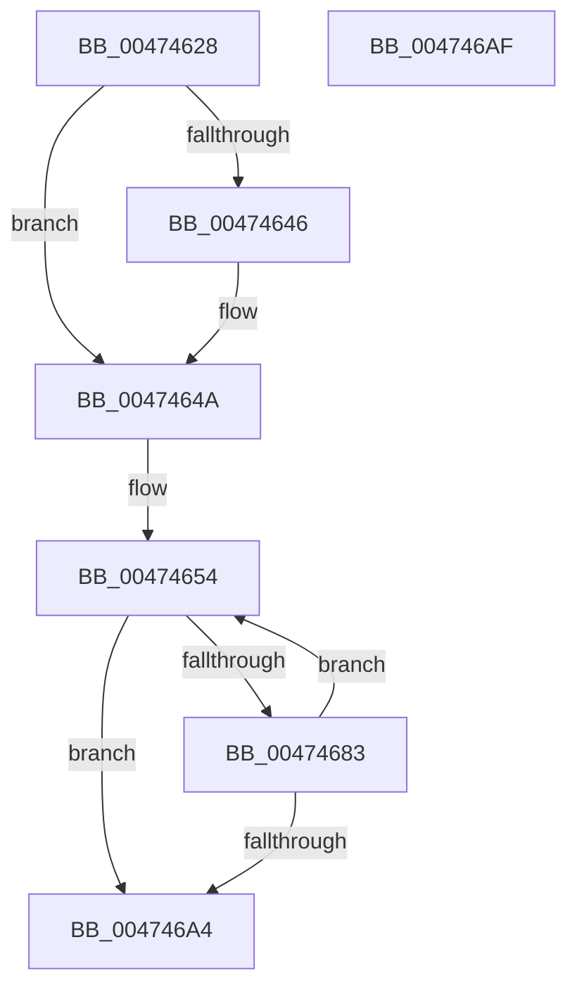

# MiSkipFractionalPagefileRegion

- RVA: `0x00474628`–`0x004746B0` (길이 `136` bytes)
- VA: `0x0000000140474628`
- 실행 섹션: `.text`
- PDB 이름 있음: `예`; PDB Function 태그: `아니요`
- unwind 정보 RVA: `0x000DB714`
- 디코드: `38`개 명령, `136/136` bytes 표시
- 미해석 바이트: `0` (있으면 어셈블리에 `.byte`로 보존)

> 이 문서는 커널 이미지의 기계어와 PDB 기호를 분석해 생성했습니다. 4번과 5번은 함수 원형과 자료형을 바이너리 사용 방식에서 추정한 C 해석이며 원본 소스 복구 결과는 아닙니다.

## 1. Dependencies

- 직접 호출 지점: **0**; 고유 호출 대상: **0**
- 직접 호출자로 확인된 함수: **1**
- RIP 상대 이미지 참조: **0**

### Outgoing calls
- 직접 디코드된 call 명령이 없습니다.

### Direct callers
- [MiQueryAddressState](../32/MiQueryAddressState_function_0032C380.md) at `0x0032D2C8`

### Static image references
- 디코드된 RIP-relative 메모리 참조가 없습니다.

## 2. Other-region calls and transfers

- 다른 실행 섹션으로 향하는 call: **0**
- 별도 외부 분기/꼬리 이동을 확인하지 못했습니다.

## 3. Assembly (complete function range)

```asm
00474628  48 8B 42 08                     mov rax, qword ptr [rdx + 8]
0047462C  4C 8B D1                        mov r10, rcx
0047462F  44 8B 4A 2C                     mov r9d, dword ptr [rdx + 0x2c]
00474633  4A 8D 14 C8                     lea rdx, [rax + r9*8]
00474637  48 8B C2                        mov rax, rdx
0047463A  48 2B C1                        sub rax, rcx
0047463D  48 C1 F8 03                     sar rax, 3
00474641  49 3B C0                        cmp rax, r8
00474644  76 04                           jbe 0x14047464a
00474646  4A 8D 14 C1                     lea rdx, [rcx + r8*8]
0047464A  49 B9 00 00 00 00 80 F6 FF FF   movabs r9, 0xfffff68000000000
00474654  4D 8B C2                        mov r8, r10
00474657  48 B8 F8 FF FF FF 7F 00 00 00   movabs rax, 0x7ffffffff8
00474661  49 C1 E8 09                     shr r8, 9
00474665  4C 23 C0                        and r8, rax
00474668  49 8B C1                        mov rax, r9
0047466B  4C 03 C0                        add r8, rax
0047466E  49 8B 00                        mov rax, qword ptr [r8]
00474671  48 A9 E0 03 00 00               test rax, 0x3e0
00474677  0F 94 C1                        sete cl
0047467A  A8 01                           test al, 1
0047467C  0F 94 C0                        sete al
0047467F  84 C8                           test al, cl
00474681  74 21                           je 0x1404746a4
00474683  4D 8B D0                        mov r10, r8
00474686  49 C1 E2 19                     shl r10, 0x19
0047468A  49 8B C9                        mov rcx, r9
0047468D  48 C1 E1 19                     shl rcx, 0x19
00474691  4C 2B D1                        sub r10, rcx
00474694  49 81 C2 00 00 00 10            add r10, 0x10000000
0047469B  49 C1 FA 10                     sar r10, 0x10
0047469F  4C 3B D2                        cmp r10, rdx
004746A2  72 B0                           jb 0x140474654
004746A4  4C 3B D2                        cmp r10, rdx
004746A7  49 0F 46 D2                     cmovbe rdx, r10
004746AB  48 8B C2                        mov rax, rdx
004746AE  C3                              ret
004746AF  CC                              int3
```

## 4. C-style interpretation (structured pseudocode)

```c
__int64 __fastcall MiSkipFractionalPagefileRegion(__int64 a1, __int64 a2, __int64 a3)
{
    __int64 result;
    __int64 v_r10;

    result = (*(unsigned __int64 *)(a2 + 8) + (unsigned int)(*(unsigned int *)(a2 + 44)) * 8) - (a1);
    result = (result) >> (3);
    if (result >= = a3) {
        a2 = a1 + a3 * 8;
    }
loc_00474654:
    a3 = (a1) >> (9);
    a3 = (a3) & (result);
    a3 = (a3) + ((unsigned int)(*(unsigned int *)(a2 + 44)));
    a1 = (((*(unsigned __int64 *)(a3)) & (992)) == 0) ? 1 : 0;
    result = ((((unsigned __int8)(*(unsigned __int64 *)(a3))) & (1)) == 0) ? 1 : 0;
    if ((((unsigned __int8)(result)) & ((unsigned __int8)(a1))) == 0) goto loc_004746A4;
    v_r10 = (a3) << (25);
    a1 = ((unsigned int)(*(unsigned int *)(a2 + 44))) << (25);
    v_r10 = (v_r10) - (a1);
    v_r10 = (v_r10) + (0x10000000ULL);
    v_r10 = (v_r10) >> (16);
    if (v_r10 < a2) goto loc_00474654;
loc_004746A4:
    if (v_r10 <= a2) { a2 = v_r10; }
    return a2;
}
```

## 5. (Beta) C Style

```c
void *MiSkipFractionalPagefileRegion(void *Arg1, void *Arg2, int64_t Arg3)
{
    uint8_t *arg1 = (uint8_t *)Arg1;
    uint8_t *arg2 = (uint8_t *)Arg2;

    int64_t result;
    int64_t local_r10;

    result = (*(uint64_t *)(arg2 + 0x8) + (uint32_t)(*(uint32_t *)(arg2 + 0x2C)) * 8) - (Arg1);
    result = (result) >> (3);
    if (result >= = Arg3) {
        Arg2 = Arg1 + Arg3 * 8;
    }
loc_00474654:
    Arg3 = (Arg1) >> (9);
    Arg3 = (Arg3) & (result);
    Arg3 = (Arg3) + ((uint32_t)(*(uint32_t *)(arg2 + 0x2C)));
    Arg1 = (((*(uint64_t *)(Arg3)) & (992)) == 0) ? 1 : 0;
    result = ((((uint8_t)(*(uint64_t *)(Arg3))) & (1)) == 0) ? 1 : 0;
    if ((((uint8_t)(result)) & ((uint8_t)(Arg1))) == 0) goto loc_004746A4;
    local_r10 = (Arg3) << (25);
    Arg1 = ((uint32_t)(*(uint32_t *)(arg2 + 0x2C))) << (25);
    local_r10 = (local_r10) - (Arg1);
    local_r10 = (local_r10) + (0x10000000ULL);
    local_r10 = (local_r10) >> (16);
    if (local_r10 < Arg2) goto loc_00474654;
loc_004746A4:
    if (local_r10 <= Arg2) { Arg2 = local_r10; }
    return Arg2;
}
```

### 관측된 메모리 오프셋

구조체 형식이 확인되지 않은 접근은 인자 기준의 오프셋으로만 기록했습니다.

| 기준 인자 | 오프셋 표현 | 폭 (bit) | 접근 |
|---|---:|---:|---|
| `Arg1` | `+ 0x0 + r8*8` | `64` | `R` |
| `Arg2` | `+ 0x8` | `64` | `R` |
| `Arg2` | `+ 0x2C` | `32` | `R` |

## 6. Execution-region graph

[열기: 2D/3D 그래프와 함수 탐색 컨트롤 패널](../../../control-panel.html?section=text&rva=0x00474628&view=graph)

- 2D 그래프는 위에서 아래로 흐르고, 3D 그래프는 빈 공간을 드래그해 회전합니다. Shift+드래그는 이동, 휠은 확대·축소, 함수 노드 선택은 대상 보고서 이동입니다.

### Static fallback


