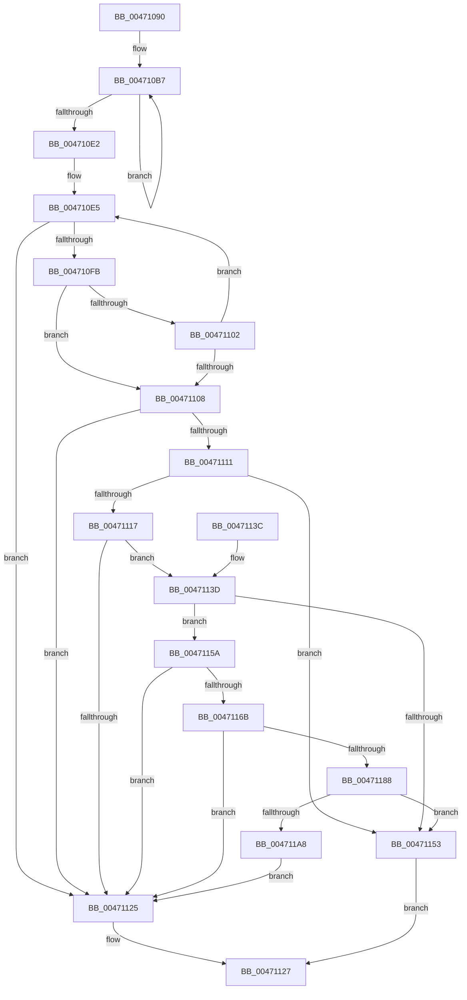

# MiSmallVaStillMapsFrame

- RVA: `0x00471090`–`0x004711AD` (길이 `285` bytes)
- VA: `0x0000000140471090`
- 실행 섹션: `.text`
- PDB 이름 있음: `예`; PDB Function 태그: `아니요`
- unwind 정보 RVA: `0x000ABDE4`
- 디코드: `75`개 명령, `285/285` bytes 표시
- 미해석 바이트: `0` (있으면 어셈블리에 `.byte`로 보존)

> 이 문서는 커널 이미지의 기계어와 PDB 기호를 분석해 생성했습니다. 4번과 5번은 함수 원형과 자료형을 바이너리 사용 방식에서 추정한 C 해석이며 원본 소스 복구 결과는 아닙니다.

## 1. Dependencies

- 직접 호출 지점: **2**; 고유 호출 대상: **1**
- 직접 호출자로 확인된 함수: **3**
- RIP 상대 이미지 참조: **0**

### Outgoing calls
- `0x004710F2` → [MI_READ_PTE_LOCK_FREE](../28/MI_READ_PTE_LOCK_FREE_function_002828A0.md) (function, `0x002828A0`)
- `0x0047111C` → [MI_READ_PTE_LOCK_FREE](../28/MI_READ_PTE_LOCK_FREE_function_002828A0.md) (function, `0x002828A0`)

### Direct callers
- [sub_0028E4EC](../28/Unknown_function_0028E4EC.md) at `0x0028E716`
- [MiStealPage](../2B/MiStealPage_function_002B28D0.md) at `0x002B3BB5`
- [MiLockStealUserVm](../2B/MiLockStealUserVm_function_002B3EDC.md) at `0x002B435C`

### Static image references
- 디코드된 RIP-relative 메모리 참조가 없습니다.

## 2. Other-region calls and transfers

- 다른 실행 섹션으로 향하는 call: **0**
- 별도 외부 분기/꼬리 이동을 확인하지 못했습니다.

## 3. Assembly (complete function range)

```asm
00471090  48 8B C4                        mov rax, rsp
00471093  48 89 58 10                     mov qword ptr [rax + 0x10], rbx
00471097  48 89 68 18                     mov qword ptr [rax + 0x18], rbp
0047109B  48 89 70 20                     mov qword ptr [rax + 0x20], rsi
0047109F  57                              push rdi
004710A0  48 83 EC 40                     sub rsp, 0x40
004710A4  0F 57 C0                        xorps xmm0, xmm0
004710A7  48 8B DA                        mov rbx, rdx
004710AA  0F 11 40 D8                     movups xmmword ptr [rax - 0x28], xmm0
004710AE  0F 11 40 E8                     movups xmmword ptr [rax - 0x18], xmm0
004710B2  33 C0                           xor eax, eax
004710B4  8D 70 04                        lea esi, [rax + 4]
004710B7  48 C1 E9 09                     shr rcx, 9
004710BB  48 BA F8 FF FF FF 7F 00 00 00   movabs rdx, 0x7ffffffff8
004710C5  48 23 CA                        and rcx, rdx
004710C8  48 BA 00 00 00 00 80 F6 FF FF   movabs rdx, 0xfffff68000000000
004710D2  48 03 CA                        add rcx, rdx
004710D5  48 89 4C C4 20                  mov qword ptr [rsp + rax*8 + 0x20], rcx
004710DA  48 FF C0                        inc rax
004710DD  48 3B C6                        cmp rax, rsi
004710E0  7C D5                           jl 0x1404710b7
004710E2  48 8B FE                        mov rdi, rsi
004710E5  48 8B 4C FC 18                  mov rcx, qword ptr [rsp + rdi*8 + 0x18]
004710EA  8D 6E FF                        lea ebp, [rsi - 1]
004710ED  48 FF CF                        dec rdi
004710F0  8B F5                           mov esi, ebp
004710F2  E8 A9 17 E1 FF                  call 0x1402828a0
004710F7  A8 01                           test al, 1
004710F9  74 2A                           je 0x140471125
004710FB  25 80 00 00 00                  and eax, 0x80
00471100  75 06                           jne 0x140471108
00471102  48 83 FF 01                     cmp rdi, 1
00471106  75 DD                           jne 0x1404710e5
00471108  48 F7 D8                        neg rax
0047110B  1B C9                           sbb ecx, ecx
0047110D  85 CD                           test ebp, ecx
0047110F  75 14                           jne 0x140471125
00471111  48 83 FB FF                     cmp rbx, -1
00471115  74 3C                           je 0x140471153
00471117  48 8B 4C 24 20                  mov rcx, qword ptr [rsp + 0x20]
0047111C  E8 7F 17 E1 FF                  call 0x1402828a0
00471121  A8 01                           test al, 1
00471123  75 18                           jne 0x14047113d
00471125  33 C0                           xor eax, eax
00471127  48 8B 5C 24 58                  mov rbx, qword ptr [rsp + 0x58]
0047112C  48 8B 6C 24 60                  mov rbp, qword ptr [rsp + 0x60]
00471131  48 8B 74 24 68                  mov rsi, qword ptr [rsp + 0x68]
00471136  48 83 C4 40                     add rsp, 0x40
0047113A  5F                              pop rdi
0047113B  C3                              ret
0047113C  CC                              int3
0047113D  48 C1 E8 0C                     shr rax, 0xc
00471141  48 BA FF FF FF FF FF 00 00 00   movabs rdx, 0xffffffffff
0047114B  48 23 C2                        and rax, rdx
0047114E  48 3B C3                        cmp rax, rbx
00471151  75 07                           jne 0x14047115a
00471153  B8 01 00 00 00                  mov eax, 1
00471158  EB CD                           jmp 0x140471127
0047115A  48 B8 68 DF BE 7D FB F6 FF FF   movabs rax, 0xfffff6fb7dbedf68
00471164  48 39 44 24 20                  cmp qword ptr [rsp + 0x20], rax
00471169  75 BA                           jne 0x140471125
0047116B  48 8D 0C 5B                     lea rcx, [rbx + rbx*2]
0047116F  48 03 C9                        add rcx, rcx
00471172  48 B8 28 00 00 00 00 DE FF FF   movabs rax, 0xffffde0000000028
0047117C  48 8B 0C C8                     mov rcx, qword ptr [rax + rcx*8]
00471180  48 23 CA                        and rcx, rdx
00471183  48 3B CB                        cmp rcx, rbx
00471186  75 9D                           jne 0x140471125
00471188  65 48 8B 0C 25 88 01 00 00      mov rcx, qword ptr gs:[0x188]
00471191  48 8B 91 B8 00 00 00            mov rdx, qword ptr [rcx + 0xb8]
00471198  48 8B 8A 58 01 00 00            mov rcx, qword ptr [rdx + 0x158]
0047119F  48 C1 E9 0C                     shr rcx, 0xc
004711A3  48 3B D9                        cmp rbx, rcx
004711A6  74 AB                           je 0x140471153
004711A8  E9 78 FF FF FF                  jmp 0x140471125
```

## 4. C-style interpretation (structured pseudocode)

```c
__int64 __fastcall MiSmallVaStillMapsFrame(__int64 a1, __int64 a2)
{
    __int64 result;
    __int64 v_rdi;
    __int64 v_rsp;
    unsigned __int64 v_stack_m28;
    unsigned __int64 v_stack_p10;
    unsigned __int64 v_stack_p18;
    unsigned __int64 v_stack_p20;

    *(unsigned __int64 *)(v_rsp + 16) = v_rbx;
    *(unsigned __int64 *)(v_rsp + 24) = v_rbp;
    *(unsigned __int64 *)(v_rsp + 32) = v_rsi;
    v_rsp = (v_rsp) - (64);
    *(unsigned __int64 *)(v_rsp - 40) = v_xmm0;
    *(unsigned __int64 *)(v_rsp - 24) = v_xmm0;
    result = 0;
loc_004710B7:
    a1 = (a1) >> (9);
    a1 = (a1) & (a2);
    a1 = (a1) + (a2);
    *(unsigned __int64 *)(v_rsp + result * 8 + 32) = a1;
    result = (result) + 1;
    if (result < (result + 4)) goto loc_004710B7;
loc_004710E5:
    v_rdi = (result + 4) - 1;
    result = MI_READ_PTE_LOCK_FREE(*(unsigned __int64 *)(v_rsp + result + 4 * 8 + 24), a2, a3, a4);
    if ((((unsigned __int8)(result)) & (1)) == 0) goto loc_00471125;
    result = (unsigned int)((result) & (128));
    if (condition_is_not_equal) goto loc_00471108;
    if (v_rdi != 1) goto loc_004710E5;
loc_00471108:
    result = -(result);
    if ((((unsigned int)(result + 4 - 1)) & ((unsigned int)(*(unsigned __int64 *)(v_rsp + result + 4 * 8 + 24)))) != 0) goto loc_00471125;
    if (a2 == -1) goto loc_00471153;
    result = MI_READ_PTE_LOCK_FREE(v_stack_m28, a2, a3, a4);
    if ((((unsigned __int8)(result)) & (1)) != 0) goto loc_0047113D;
loc_00471125:
    result = 0;
loc_00471127:
    v_rsp = (v_rsp) + (64);
    return result;
loc_0047113D:
    result = (result) >> (12);
    result = (result) & (a2);
    if (result != v_stack_p10) goto loc_0047115A;
loc_00471153:
    goto loc_00471127;
loc_0047115A:
    if (v_stack_p20 != 1) goto loc_00471125;
    a1 = (v_stack_p10 + v_stack_p10 * 2) + (v_stack_p10 + v_stack_p10 * 2);
    a1 = (*(unsigned __int64 *)(1 + a1 * 8)) & (a2);
    if (a1 != v_stack_p10) goto loc_00471125;
    a1 = (*(unsigned __int64 *)(*(unsigned __int64 *)(*(unsigned __int64 *)(gs_base + (0 + 392)) + 184) + 344)) >> (12);
    if (v_stack_p10 == a1) goto loc_00471153;
    goto loc_00471125;
}
```

## 5. (Beta) C Style

```c
int64_t MiSmallVaStillMapsFrame(int64_t Arg1, int64_t Arg2)
{
    int64_t result;
    int64_t local_rdi;
    int64_t local_rsp;
    uint64_t v_stack_m28;
    uint64_t v_stack_p10;
    uint64_t v_stack_p18;
    uint64_t v_stack_p20;

    *(uint64_t *)(local_rsp + 0x10) = local_rbx;
    *(uint64_t *)(local_rsp + 0x18) = local_rbp;
    *(uint64_t *)(local_rsp + 0x20) = local_rsi;
    local_rsp = (local_rsp) - (64);
    *(uint64_t *)(local_rsp - 0x28) = v_xmm0;
    *(uint64_t *)(local_rsp - 0x18) = v_xmm0;
    result = 0;
loc_004710B7:
    Arg1 = (Arg1) >> (9);
    Arg1 = (Arg1) & (Arg2);
    Arg1 = (Arg1) + (Arg2);
    *(uint64_t *)(local_rsp + result * 8 + 0x20) = Arg1;
    result = (result) + 1;
    if (result < (result + 4)) goto loc_004710B7;
loc_004710E5:
    local_rdi = (result + 4) - 1;
    result = MI_READ_PTE_LOCK_FREE(*(uint64_t *)(local_rsp + result + 0x4 * 8 + 0x18), Arg2, a3, a4);
    if ((((uint8_t)(result)) & (1)) == 0) goto loc_00471125;
    result = (uint32_t)((result) & (128));
    if (condition_is_not_equal) goto loc_00471108;
    if (local_rdi != 1) goto loc_004710E5;
loc_00471108:
    result = -(result);
    if ((((uint32_t)(result + 4 - 1)) & ((uint32_t)(*(uint64_t *)(local_rsp + result + 0x4 * 8 + 0x18)))) != 0) goto loc_00471125;
    if (Arg2 == -1) goto loc_00471153;
    result = MI_READ_PTE_LOCK_FREE(v_stack_m28, Arg2, a3, a4);
    if ((((uint8_t)(result)) & (1)) != 0) goto loc_0047113D;
loc_00471125:
    result = 0;
loc_00471127:
    local_rsp = (local_rsp) + (64);
    return result;
loc_0047113D:
    result = (result) >> (12);
    result = (result) & (Arg2);
    if (result != v_stack_p10) goto loc_0047115A;
loc_00471153:
    goto loc_00471127;
loc_0047115A:
    if (v_stack_p20 != 1) goto loc_00471125;
    Arg1 = (v_stack_p10 + v_stack_p10 * 2) + (v_stack_p10 + v_stack_p10 * 2);
    Arg1 = (*(uint64_t *)(1 + Arg1 * 8)) & (Arg2);
    if (Arg1 != v_stack_p10) goto loc_00471125;
    Arg1 = (*(uint64_t *)(*(uint64_t *)(*(uint64_t *)(gs_base + (0 + 0x188)) + 0xB8) + 0x158)) >> (12);
    if (v_stack_p10 == Arg1) goto loc_00471153;
    goto loc_00471125;
}
```

## 6. Execution-region graph

[열기: 2D/3D 그래프와 함수 탐색 컨트롤 패널](../../../control-panel.html?section=text&rva=0x00471090&view=graph)

- 2D 그래프는 위에서 아래로 흐르고, 3D 그래프는 빈 공간을 드래그해 회전합니다. Shift+드래그는 이동, 휠은 확대·축소, 함수 노드 선택은 대상 보고서 이동입니다.

### Static fallback


