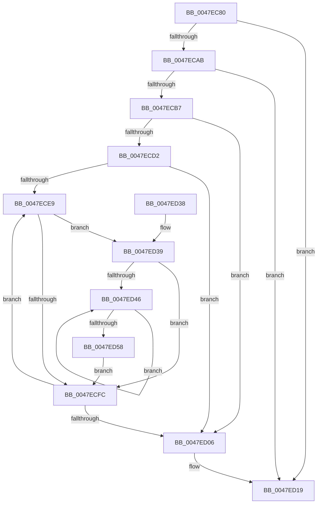

# MiStoreCheckCompleteWriteBatch

- RVA: `0x0047EC80`–`0x0047ED5A` (길이 `218` bytes)
- VA: `0x000000014047EC80`
- 실행 섹션: `.text`
- PDB 이름 있음: `예`; PDB Function 태그: `아니요`
- unwind 정보 RVA: `0x000AE02C`
- 디코드: `61`개 명령, `218/218` bytes 표시
- 미해석 바이트: `0` (있으면 어셈블리에 `.byte`로 보존)

> 이 문서는 커널 이미지의 기계어와 PDB 기호를 분석해 생성했습니다. 4번과 5번은 함수 원형과 자료형을 바이너리 사용 방식에서 추정한 C 해석이며 원본 소스 복구 결과는 아닙니다.

## 1. Dependencies

- 직접 호출 지점: **5**; 고유 호출 대상: **5**
- 직접 호출자로 확인된 함수: **2**
- RIP 상대 이미지 참조: **0**

### Outgoing calls
- `0x0047ECC1` → [ExAcquireSpinLockExclusive](../24/ExAcquireSpinLockExclusive_function_00248690.md) (function, `0x00248690`)
- `0x0047ED0C` → [MiReleaseSpinLockExclusive](../24/MiReleaseSpinLockExclusive_function_002482C0.md) (function, `0x002482C0`)
- `0x0047ED14` → [MiStoreDrainWriteSupports](MiStoreDrainWriteSupports_function_0047EE3C.md) (function, `0x0047EE3C`)
- `0x0047ED39` → [ExpInterlockedFlushSList](../6B/ExpInterlockedFlushSList_function_006BA5F0.md) (function, `0x006BA5F0`)
- `0x0047ED4E` → [ExFreePoolWithTag](../../poolcode/B8/ExFreePoolWithTag_function_00B82870.md) (function, `0x00B82870`)

### Direct callers
- [MiWriteComplete](../40/MiWriteComplete_function_004069B0.md) at `0x00406D4A`
- [MiModifiedPageWriter](MiModifiedPageWriter_function_0047E5F0.md) at `0x0047E765`
- [MiModifiedPageWriter](MiModifiedPageWriter_function_0047E5F0.md) at `0x0047E7C7`

### Static image references
- 디코드된 RIP-relative 메모리 참조가 없습니다.

## 2. Other-region calls and transfers

- 다른 실행 섹션으로 향하는 call: **1**
  - `0x0047ED4E` → [ExFreePoolWithTag](../../poolcode/B8/ExFreePoolWithTag_function_00B82870.md) (`.text` → `POOLCODE`)
- 별도 외부 분기/꼬리 이동을 확인하지 못했습니다.

## 3. Assembly (complete function range)

```asm
0047EC80  48 8B C4                        mov rax, rsp
0047EC83  48 89 58 08                     mov qword ptr [rax + 8], rbx
0047EC87  48 89 68 10                     mov qword ptr [rax + 0x10], rbp
0047EC8B  48 89 70 18                     mov qword ptr [rax + 0x18], rsi
0047EC8F  48 89 78 20                     mov qword ptr [rax + 0x20], rdi
0047EC93  41 54                           push r12
0047EC95  41 56                           push r14
0047EC97  41 57                           push r15
0047EC99  48 83 EC 20                     sub rsp, 0x20
0047EC9D  8B 81 B4 04 00 00               mov eax, dword ptr [rcx + 0x4b4]
0047ECA3  48 8B D9                        mov rbx, rcx
0047ECA6  83 F8 FF                        cmp eax, -1
0047ECA9  74 6E                           je 0x14047ed19
0047ECAB  45 33 E4                        xor r12d, r12d
0047ECAE  44 39 A1 CC 04 00 00            cmp dword ptr [rcx + 0x4cc], r12d
0047ECB5  75 62                           jne 0x14047ed19
0047ECB7  4C 8D B1 A8 06 00 00            lea r14, [rcx + 0x6a8]
0047ECBE  49 8B CE                        mov rcx, r14
0047ECC1  E8 CA 99 DC FF                  call 0x140248690
0047ECC6  44 8A F8                        mov r15b, al
0047ECC9  44 39 A3 4C 05 00 00            cmp dword ptr [rbx + 0x54c], r12d
0047ECD0  75 34                           jne 0x14047ed06
0047ECD2  48 8B 8B B8 00 00 00            mov rcx, qword ptr [rbx + 0xb8]
0047ECD9  41 8B FC                        mov edi, r12d
0047ECDC  48 8B 69 18                     mov rbp, qword ptr [rcx + 0x18]
0047ECE0  44 39 A5 D4 07 00 00            cmp dword ptr [rbp + 0x7d4], r12d
0047ECE7  76 1D                           jbe 0x14047ed06
0047ECE9  8B CF                           mov ecx, edi
0047ECEB  48 C1 E1 04                     shl rcx, 4
0047ECEF  48 03 8D 10 05 00 00            add rcx, qword ptr [rbp + 0x510]
0047ECF6  66 44 39 21                     cmp word ptr [rcx], r12w
0047ECFA  75 3D                           jne 0x14047ed39
0047ECFC  FF C7                           inc edi
0047ECFE  3B BD D4 07 00 00               cmp edi, dword ptr [rbp + 0x7d4]
0047ED04  72 E3                           jb 0x14047ece9
0047ED06  41 8A D7                        mov dl, r15b
0047ED09  49 8B CE                        mov rcx, r14
0047ED0C  E8 AF 95 DC FF                  call 0x1402482c0
0047ED11  48 8B CB                        mov rcx, rbx
0047ED14  E8 23 01 00 00                  call 0x14047ee3c
0047ED19  48 8B 5C 24 40                  mov rbx, qword ptr [rsp + 0x40]
0047ED1E  48 8B 6C 24 48                  mov rbp, qword ptr [rsp + 0x48]
0047ED23  48 8B 74 24 50                  mov rsi, qword ptr [rsp + 0x50]
0047ED28  48 8B 7C 24 58                  mov rdi, qword ptr [rsp + 0x58]
0047ED2D  48 83 C4 20                     add rsp, 0x20
0047ED31  41 5F                           pop r15
0047ED33  41 5E                           pop r14
0047ED35  41 5C                           pop r12
0047ED37  C3                              ret
0047ED38  CC                              int3
0047ED39  E8 B2 B8 23 00                  call 0x1406ba5f0
0047ED3E  48 8B F0                        mov rsi, rax
0047ED41  48 85 C0                        test rax, rax
0047ED44  74 B6                           je 0x14047ecfc
0047ED46  48 8B CE                        mov rcx, rsi
0047ED49  33 D2                           xor edx, edx
0047ED4B  48 8B 36                        mov rsi, qword ptr [rsi]
0047ED4E  E8 1D 3B 70 00                  call 0x140b82870
0047ED53  48 85 F6                        test rsi, rsi
0047ED56  75 EE                           jne 0x14047ed46
0047ED58  EB A2                           jmp 0x14047ecfc
```

## 4. C-style interpretation (structured pseudocode)

```c
__int64 __fastcall MiStoreCheckCompleteWriteBatch(__int64 a1)
{
    __int64 result;
    __int64 v_r12;
    __int64 v_rdi;
    __int64 v_rsp;
    unsigned __int64 v_stack_p10;
    unsigned __int64 v_stack_p18;
    unsigned __int64 v_stack_p20;
    unsigned __int64 v_stack_p8;

    *(unsigned __int64 *)(v_rsp + 8) = v_rbx;
    *(unsigned __int64 *)(v_rsp + 16) = v_rbp;
    *(unsigned __int64 *)(v_rsp + 24) = v_rsi;
    *(unsigned __int64 *)(v_rsp + 32) = v_rdi;
    v_rsp = (v_rsp) - (32);
    if (((unsigned int)((unsigned int)(*(unsigned int *)(a1 + 1204)))) == -1) goto loc_0047ED19;
    v_r12 = 0;
    if ((*(unsigned int *)(a1 + 1228)) != 0) goto loc_0047ED19;
    result = ExAcquireSpinLockExclusive(a1 + 1704, a2, a3, a4);
    if ((*(unsigned int *)(a1 + 1356)) != 0) goto loc_0047ED06;
    if ((*(unsigned int *)(*(unsigned __int64 *)(*(unsigned __int64 *)(a1 + 184) + 24) + 2004)) <= 0) goto loc_0047ED06;
loc_0047ECE9:
    a1 = (0) << (4);
    a1 = (a1) + (*(unsigned __int64 *)(*(unsigned __int64 *)(*(unsigned __int64 *)(a1 + 184) + 24) + 1296));
    if ((*(unsigned __int16 *)(a1)) != 0) goto loc_0047ED39;
loc_0047ECFC:
    v_rdi = (unsigned int)((0) + 1);
    if (((unsigned int)(v_rdi)) < (*(unsigned int *)(*(unsigned __int64 *)(*(unsigned __int64 *)(a1 + 184) + 24) + 2004))) goto loc_0047ECE9;
loc_0047ED06:
    result = MiReleaseSpinLockExclusive(a1 + 1704, (unsigned __int8)((unsigned __int8)(result)), a3, a4);
    result = MiStoreDrainWriteSupports(a1, (unsigned __int8)((unsigned __int8)(result)), a3, a4);
loc_0047ED19:
    v_rsp = (v_rsp) + (32);
    return result;
loc_0047ED39:
    result = ExpInterlockedFlushSList(a1, (unsigned __int8)((unsigned __int8)(result)), a3, a4);
    if (result == 0) goto loc_0047ECFC;
loc_0047ED46:
    a2 = 0;
    result = ExFreePoolWithTag(result, a2, a3, a4);
    if (*(unsigned __int64 *)(result) != 0) goto loc_0047ED46;
    goto loc_0047ECFC;
}
```

## 5. (Beta) C Style

```c
int64_t MiStoreCheckCompleteWriteBatch(void *Arg1)
{
    uint8_t *arg1 = (uint8_t *)Arg1;

    int64_t result;
    int64_t local_r12;
    int64_t local_rdi;
    int64_t local_rsp;
    uint64_t v_stack_p10;
    uint64_t v_stack_p18;
    uint64_t v_stack_p20;
    uint64_t v_stack_p8;

    *(uint64_t *)(local_rsp + 0x8) = local_rbx;
    *(uint64_t *)(local_rsp + 0x10) = local_rbp;
    *(uint64_t *)(local_rsp + 0x18) = local_rsi;
    *(uint64_t *)(local_rsp + 0x20) = local_rdi;
    local_rsp = (local_rsp) - (32);
    if (((uint32_t)((uint32_t)(*(uint32_t *)(arg1 + 0x4B4)))) == -1) goto loc_0047ED19;
    local_r12 = 0;
    if ((*(uint32_t *)(arg1 + 0x4CC)) != 0) goto loc_0047ED19;
    result = ExAcquireSpinLockExclusive(Arg1 + 1704, a2, a3, a4);
    if ((*(uint32_t *)(arg1 + 0x54C)) != 0) goto loc_0047ED06;
    if ((*(uint32_t *)(*(uint64_t *)(*(uint64_t *)(arg1 + 0xB8) + 0x18) + 0x7D4)) <= 0) goto loc_0047ED06;
loc_0047ECE9:
    Arg1 = (0) << (4);
    Arg1 = (Arg1) + (*(uint64_t *)(*(uint64_t *)(*(uint64_t *)(arg1 + 0xB8) + 0x18) + 0x510));
    if ((*(uint16_t *)(arg1)) != 0) goto loc_0047ED39;
loc_0047ECFC:
    local_rdi = (uint32_t)((0) + 1);
    if (((uint32_t)(local_rdi)) < (*(uint32_t *)(*(uint64_t *)(*(uint64_t *)(arg1 + 0xB8) + 0x18) + 0x7D4))) goto loc_0047ECE9;
loc_0047ED06:
    result = MiReleaseSpinLockExclusive(Arg1 + 1704, (uint8_t)((uint8_t)(result)), a3, a4);
    result = MiStoreDrainWriteSupports(Arg1, (uint8_t)((uint8_t)(result)), a3, a4);
loc_0047ED19:
    local_rsp = (local_rsp) + (32);
    return result;
loc_0047ED39:
    result = ExpInterlockedFlushSList(Arg1, (uint8_t)((uint8_t)(result)), a3, a4);
    if (result == 0) goto loc_0047ECFC;
loc_0047ED46:
    a2 = 0;
    result = ExFreePoolWithTag(result, a2, a3, a4);
    if (*(uint64_t *)(result) != 0) goto loc_0047ED46;
    goto loc_0047ECFC;
}
```

### 관측된 메모리 오프셋

구조체 형식이 확인되지 않은 접근은 인자 기준의 오프셋으로만 기록했습니다.

| 기준 인자 | 오프셋 표현 | 폭 (bit) | 접근 |
|---|---:|---:|---|
| `Arg1` | `+ 0xB8` | `64` | `R` |
| `Arg1` | `+ 0x4B4` | `32` | `R` |
| `Arg1` | `+ 0x4CC` | `32` | `R` |
| `Arg1` | `+ 0x54C` | `32` | `R` |
| `Arg1` | `+ 0x6A8` | `64` | `R` |

## 6. Execution-region graph

[열기: 2D/3D 그래프와 함수 탐색 컨트롤 패널](../../../control-panel.html?section=text&rva=0x0047EC80&view=graph)

- 2D 그래프는 위에서 아래로 흐르고, 3D 그래프는 빈 공간을 드래그해 회전합니다. Shift+드래그는 이동, 휠은 확대·축소, 함수 노드 선택은 대상 보고서 이동입니다.

### Static fallback


