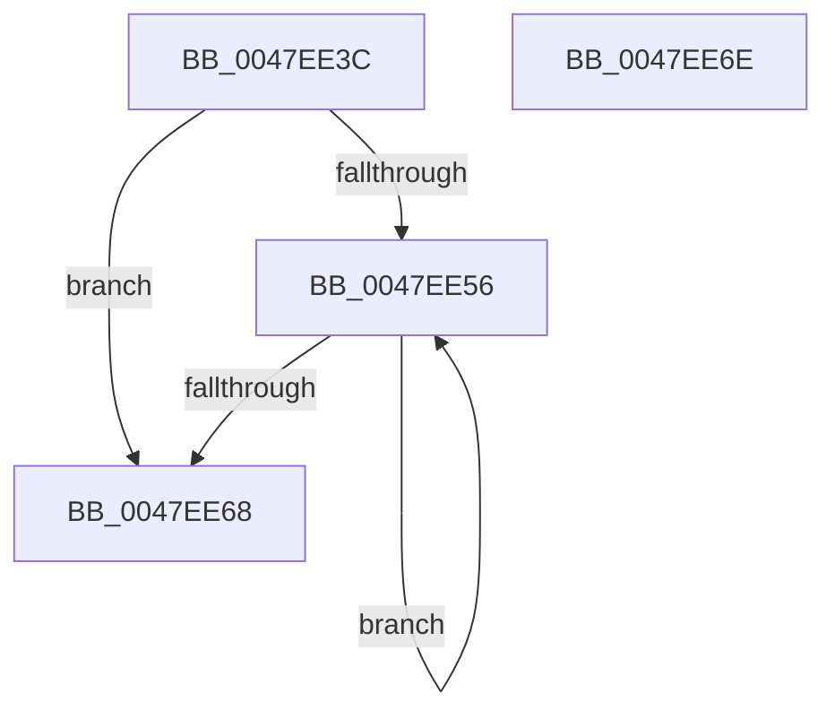

# MiStoreDrainWriteSupports

- RVA: `0x0047EE3C`–`0x0047EE6F` (길이 `51` bytes)
- VA: `0x000000014047EE3C`
- 실행 섹션: `.text`
- PDB 이름 있음: `예`; PDB Function 태그: `아니요`
- unwind 정보 RVA: `0x0005CF00`
- 디코드: `17`개 명령, `51/51` bytes 표시
- 미해석 바이트: `0` (있으면 어셈블리에 `.byte`로 보존)

> 이 문서는 커널 이미지의 기계어와 PDB 기호를 분석해 생성했습니다. 4번과 5번은 함수 원형과 자료형을 바이너리 사용 방식에서 추정한 C 해석이며 원본 소스 복구 결과는 아닙니다.

## 1. Dependencies

- 직접 호출 지점: **2**; 고유 호출 대상: **2**
- 직접 호출자로 확인된 함수: **2**
- RIP 상대 이미지 참조: **0**

### Outgoing calls
- `0x0047EE49` → [ExpInterlockedFlushSList](../6B/ExpInterlockedFlushSList_function_006BA5F0.md) (function, `0x006BA5F0`)
- `0x0047EE5E` → [ExFreePoolWithTag](../../poolcode/B8/ExFreePoolWithTag_function_00B82870.md) (function, `0x00B82870`)

### Direct callers
- [MiStoreCheckCompleteWriteBatch](MiStoreCheckCompleteWriteBatch_function_0047EC80.md) at `0x0047ED14`
- [MiStoreDeletePartition](../69/MiStoreDeletePartition_function_006926F4.md) at `0x00692824`

### Static image references
- 디코드된 RIP-relative 메모리 참조가 없습니다.

## 2. Other-region calls and transfers

- 다른 실행 섹션으로 향하는 call: **1**
  - `0x0047EE5E` → [ExFreePoolWithTag](../../poolcode/B8/ExFreePoolWithTag_function_00B82870.md) (`.text` → `POOLCODE`)
- 별도 외부 분기/꼬리 이동을 확인하지 못했습니다.

## 3. Assembly (complete function range)

```asm
0047EE3C  40 53                           push rbx
0047EE3E  48 83 EC 20                     sub rsp, 0x20
0047EE42  48 81 C1 60 05 00 00            add rcx, 0x560
0047EE49  E8 A2 B7 23 00                  call 0x1406ba5f0
0047EE4E  48 8B D8                        mov rbx, rax
0047EE51  48 85 C0                        test rax, rax
0047EE54  74 12                           je 0x14047ee68
0047EE56  48 8B CB                        mov rcx, rbx
0047EE59  33 D2                           xor edx, edx
0047EE5B  48 8B 1B                        mov rbx, qword ptr [rbx]
0047EE5E  E8 0D 3A 70 00                  call 0x140b82870
0047EE63  48 85 DB                        test rbx, rbx
0047EE66  75 EE                           jne 0x14047ee56
0047EE68  48 83 C4 20                     add rsp, 0x20
0047EE6C  5B                              pop rbx
0047EE6D  C3                              ret
0047EE6E  CC                              int3
```

## 4. C-style interpretation (structured pseudocode)

```c
__int64 __fastcall MiStoreDrainWriteSupports(__int64 a1, int a2)
{
    __int64 result;
    __int64 v_rsp;

    v_rsp = (v_rsp) - (32);
    a1 = (a1) + (0x560ULL);
    result = ExpInterlockedFlushSList(a1, a2, a3, a4);
    if (result == 0) goto loc_0047EE68;
loc_0047EE56:
    a2 = 0;
    result = ExFreePoolWithTag(result, a2, a3, a4);
    if (*(unsigned __int64 *)(result) != 0) goto loc_0047EE56;
loc_0047EE68:
    v_rsp = (v_rsp) + (32);
    return result;
}
```

## 5. (Beta) C Style

```c
int64_t MiStoreDrainWriteSupports(int64_t Arg1, int32_t Arg2)
{
    int64_t result;
    int64_t local_rsp;

    local_rsp = (local_rsp) - (32);
    Arg1 = (Arg1) + (0x560ULL);
    result = ExpInterlockedFlushSList(Arg1, Arg2, a3, a4);
    if (result == 0) goto loc_0047EE68;
loc_0047EE56:
    Arg2 = 0;
    result = ExFreePoolWithTag(result, Arg2, a3, a4);
    if (*(uint64_t *)(result) != 0) goto loc_0047EE56;
loc_0047EE68:
    local_rsp = (local_rsp) + (32);
    return result;
}
```

## 6. Execution-region graph

[열기: 2D/3D 그래프와 함수 탐색 컨트롤 패널](../../../control-panel.html?section=text&rva=0x0047EE3C&view=graph)

- 2D 그래프는 위에서 아래로 흐르고, 3D 그래프는 빈 공간을 드래그해 회전합니다. Shift+드래그는 이동, 휠은 확대·축소, 함수 노드 선택은 대상 보고서 이동입니다.

### Static fallback


