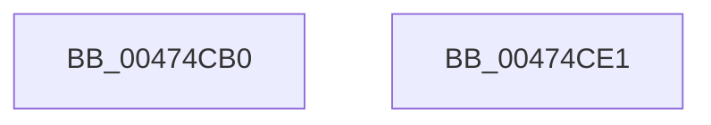

# MiStoreGetVadForAddress

- RVA: `0x00474CB0`–`0x00474CE2` (길이 `50` bytes)
- VA: `0x0000000140474CB0`
- 실행 섹션: `.text`
- PDB 이름 있음: `예`; PDB Function 태그: `아니요`
- unwind 정보 RVA: `0x0005CF00`
- 디코드: `17`개 명령, `50/50` bytes 표시
- 미해석 바이트: `0` (있으면 어셈블리에 `.byte`로 보존)

> 이 문서는 커널 이미지의 기계어와 PDB 기호를 분석해 생성했습니다. 4번과 5번은 함수 원형과 자료형을 바이너리 사용 방식에서 추정한 C 해석이며 원본 소스 복구 결과는 아닙니다.

## 1. Dependencies

- 직접 호출 지점: **3**; 고유 호출 대상: **3**
- 직접 호출자로 확인된 함수: **2**
- RIP 상대 이미지 참조: **0**

### Outgoing calls
- `0x00474CBB` → [MiLockVadTree](../27/MiLockVadTree_function_0027C0F0.md) (function, `0x0027C0F0`)
- `0x00474CC6` → [MiLocateAddress](../31/MiLocateAddress_function_003168D0.md) (function, `0x003168D0`)
- `0x00474CD3` → [MiUnlockVadTree](../29/MiUnlockVadTree_function_00297020.md) (function, `0x00297020`)

### Direct callers
- [MmStoreDecommitVirtualMemory](MmStoreDecommitVirtualMemory_function_00474BF0.md) at `0x00474C31`
- [MmStoreIsVirtualAddressPoisoned](../69/MmStoreIsVirtualAddressPoisoned_function_00693120.md) at `0x00693152`

### Static image references
- 디코드된 RIP-relative 메모리 참조가 없습니다.

## 2. Other-region calls and transfers

- 다른 실행 섹션으로 향하는 call: **0**
- 별도 외부 분기/꼬리 이동을 확인하지 못했습니다.

## 3. Assembly (complete function range)

```asm
00474CB0  40 53                           push rbx
00474CB2  48 83 EC 20                     sub rsp, 0x20
00474CB6  48 8B D9                        mov rbx, rcx
00474CB9  33 C9                           xor ecx, ecx
00474CBB  E8 30 74 E0 FF                  call 0x14027c0f0
00474CC0  48 8B CB                        mov rcx, rbx
00474CC3  44 8A D8                        mov r11b, al
00474CC6  E8 05 1C EA FF                  call 0x1403168d0
00474CCB  41 8A D3                        mov dl, r11b
00474CCE  33 C9                           xor ecx, ecx
00474CD0  48 8B D8                        mov rbx, rax
00474CD3  E8 48 23 E2 FF                  call 0x140297020
00474CD8  48 8B C3                        mov rax, rbx
00474CDB  48 83 C4 20                     add rsp, 0x20
00474CDF  5B                              pop rbx
00474CE0  C3                              ret
00474CE1  CC                              int3
```

## 4. C-style interpretation (structured pseudocode)

```c
__int64 __fastcall MiStoreGetVadForAddress(__int64 a1)
{
    __int64 result;
    __int64 v_rsp;

    v_rsp = (v_rsp) - (32);
    a1 = 0;
    result = MiLockVadTree(a1, a2, a3, a4);
    result = MiLocateAddress(0, a2, a3, a4);
    a1 = 0;
    result = MiUnlockVadTree(a1, (unsigned __int8)((unsigned __int8)(result)), a3, a4);
    v_rsp = (v_rsp) + (32);
    return result;
}
```

## 5. (Beta) C Style

```c
int64_t MiStoreGetVadForAddress(int64_t Arg1)
{
    int64_t result;
    int64_t local_rsp;

    local_rsp = (local_rsp) - (32);
    Arg1 = 0;
    result = MiLockVadTree(Arg1, a2, a3, a4);
    result = MiLocateAddress(0, a2, a3, a4);
    Arg1 = 0;
    result = MiUnlockVadTree(Arg1, (uint8_t)((uint8_t)(result)), a3, a4);
    local_rsp = (local_rsp) + (32);
    return result;
}
```

## 6. Execution-region graph

[열기: 2D/3D 그래프와 함수 탐색 컨트롤 패널](../../../control-panel.html?section=text&rva=0x00474CB0&view=graph)

- 2D 그래프는 위에서 아래로 흐르고, 3D 그래프는 빈 공간을 드래그해 회전합니다. Shift+드래그는 이동, 휠은 확대·축소, 함수 노드 선택은 대상 보고서 이동입니다.

### Static fallback


