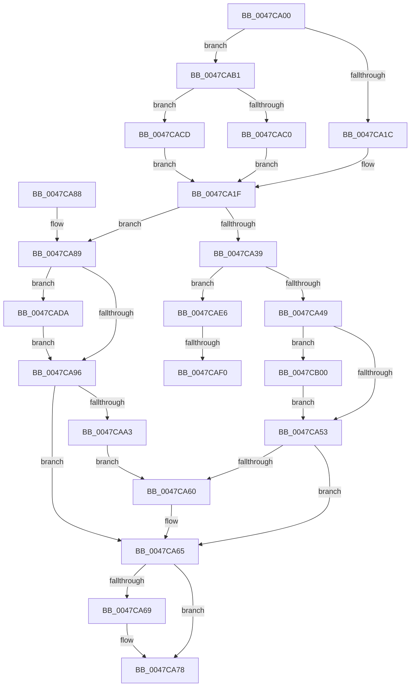

# MiSyncCommitSignals

- RVA: `0x0047CA00`–`0x0047CB16` (길이 `278` bytes)
- VA: `0x000000014047CA00`
- 실행 섹션: `.text`
- PDB 이름 있음: `예`; PDB Function 태그: `예`
- unwind 정보 RVA: `0x000AD83C`
- 디코드: `68`개 명령, `278/278` bytes 표시
- 미해석 바이트: `0` (있으면 어셈블리에 `.byte`로 보존)

> 이 문서는 커널 이미지의 기계어와 PDB 기호를 분석해 생성했습니다. 4번과 5번은 함수 원형과 자료형을 바이너리 사용 방식에서 추정한 C 해석이며 원본 소스 복구 결과는 아닙니다.

## 1. Dependencies

- 직접 호출 지점: **9**; 고유 호출 대상: **5**
- 직접 호출자로 확인된 함수: **1**
- RIP 상대 이미지 참조: **0**

### Outgoing calls
- `0x0047CA60` → [KeResetEvent](../24/KeResetEvent_function_00248350.md) (function, `0x00248350`)
- `0x0047CA73` → [MiReleaseSpinLockExclusive](../24/MiReleaseSpinLockExclusive_function_002482C0.md) (function, `0x002482C0`)
- `0x0047CAA3` → [KeResetEvent](../24/KeResetEvent_function_00248350.md) (function, `0x00248350`)
- `0x0047CAC3` → [ExAcquireSpinLockExclusiveAtDpcLevel](../24/ExAcquireSpinLockExclusiveAtDpcLevel_function_00248E80.md) (function, `0x00248E80`)
- `0x0047CACD` → [ExAcquireSpinLockExclusive](../24/ExAcquireSpinLockExclusive_function_00248690.md) (function, `0x00248690`)
- `0x0047CADF` → [KeSetEvent](../33/KeSetEvent_function_0033F310.md) (function, `0x0033F310`)
- `0x0047CAF5` → [KeSetEvent](../33/KeSetEvent_function_0033F310.md) (function, `0x0033F310`)
- `0x0047CB00` → [KeResetEvent](../24/KeResetEvent_function_00248350.md) (function, `0x00248350`)
- `0x0047CB0C` → [KeResetEvent](../24/KeResetEvent_function_00248350.md) (function, `0x00248350`)

### Direct callers
- [MiComputeCommitThresholds](MiComputeCommitThresholds_function_0047C904.md) at `0x0047C9CF`

### Static image references
- 디코드된 RIP-relative 메모리 참조가 없습니다.

## 2. Other-region calls and transfers

- 다른 실행 섹션으로 향하는 call: **0**
- call이 아닌 외부 분기/꼬리 이동: **2**
  - `0x0047CAEA` → [sub_006F4B72](../6F/Unknown_function_006F4B72.md) (`tail-transfer`)
  - `0x0047CAFB` → [sub_006F4B72](../6F/Unknown_function_006F4B72.md) (`tail-transfer`)

## 3. Assembly (complete function range)

```asm
0047CA00  48 89 5C 24 08                  mov qword ptr [rsp + 8], rbx
0047CA05  48 89 74 24 10                  mov qword ptr [rsp + 0x10], rsi
0047CA0A  57                              push rdi
0047CA0B  48 83 EC 20                     sub rsp, 0x20
0047CA0F  8B F2                           mov esi, edx
0047CA11  48 8B D9                        mov rbx, rcx
0047CA14  85 D2                           test edx, edx
0047CA16  0F 84 95 00 00 00               je 0x14047cab1
0047CA1C  40 B7 11                        mov dil, 0x11
0047CA1F  48 8B 93 40 4B 00 00            mov rdx, qword ptr [rbx + 0x4b40]
0047CA26  48 8B 83 D8 41 00 00            mov rax, qword ptr [rbx + 0x41d8]
0047CA2D  4C 8B 83 E0 41 00 00            mov r8, qword ptr [rbx + 0x41e0]
0047CA34  48 3B D0                        cmp rdx, rax
0047CA37  72 50                           jb 0x14047ca89
0047CA39  48 8B 8B 30 01 00 00            mov rcx, qword ptr [rbx + 0x130]
0047CA40  49 3B D0                        cmp rdx, r8
0047CA43  0F 83 9D 00 00 00               jae 0x14047cae6
0047CA49  83 79 04 01                     cmp dword ptr [rcx + 4], 1
0047CA4D  0F 84 AD 00 00 00               je 0x14047cb00
0047CA53  48 8B 8B 28 01 00 00            mov rcx, qword ptr [rbx + 0x128]
0047CA5A  83 79 04 01                     cmp dword ptr [rcx + 4], 1
0047CA5E  75 05                           jne 0x14047ca65
0047CA60  E8 EB B8 DC FF                  call 0x140248350
0047CA65  85 F6                           test esi, esi
0047CA67  75 0F                           jne 0x14047ca78
0047CA69  48 8D 8B F8 41 00 00            lea rcx, [rbx + 0x41f8]
0047CA70  40 8A D7                        mov dl, dil
0047CA73  E8 48 B8 DC FF                  call 0x1402482c0
0047CA78  48 8B 5C 24 30                  mov rbx, qword ptr [rsp + 0x30]
0047CA7D  48 8B 74 24 38                  mov rsi, qword ptr [rsp + 0x38]
0047CA82  48 83 C4 20                     add rsp, 0x20
0047CA86  5F                              pop rdi
0047CA87  C3                              ret
0047CA88  CC                              int3
0047CA89  48 8B 8B 28 01 00 00            mov rcx, qword ptr [rbx + 0x128]
0047CA90  83 79 04 00                     cmp dword ptr [rcx + 4], 0
0047CA94  74 44                           je 0x14047cada
0047CA96  48 8B 8B 30 01 00 00            mov rcx, qword ptr [rbx + 0x130]
0047CA9D  83 79 04 01                     cmp dword ptr [rcx + 4], 1
0047CAA1  75 C2                           jne 0x14047ca65
0047CAA3  E8 A8 B8 DC FF                  call 0x140248350
0047CAA8  48 8B 8B 38 01 00 00            mov rcx, qword ptr [rbx + 0x138]
0047CAAF  EB AF                           jmp 0x14047ca60
0047CAB1  44 0F 20 C0                     mov rax, cr8
0047CAB5  48 81 C1 F8 41 00 00            add rcx, 0x41f8
0047CABC  3C 02                           cmp al, 2
0047CABE  75 0D                           jne 0x14047cacd
0047CAC0  40 B7 11                        mov dil, 0x11
0047CAC3  E8 B8 C3 DC FF                  call 0x140248e80
0047CAC8  E9 52 FF FF FF                  jmp 0x14047ca1f
0047CACD  E8 BE BB DC FF                  call 0x140248690
0047CAD2  40 8A F8                        mov dil, al
0047CAD5  E9 45 FF FF FF                  jmp 0x14047ca1f
0047CADA  45 33 C0                        xor r8d, r8d
0047CADD  33 D2                           xor edx, edx
0047CADF  E8 2C 28 EC FF                  call 0x14033f310
0047CAE4  EB B0                           jmp 0x14047ca96
0047CAE6  83 79 04 00                     cmp dword ptr [rcx + 4], 0
0047CAEA  0F 85 82 80 27 00               jne 0x1406f4b72
0047CAF0  45 33 C0                        xor r8d, r8d
0047CAF3  33 D2                           xor edx, edx
0047CAF5  E8 16 28 EC FF                  call 0x14033f310
0047CAFA  90                              nop
0047CAFB  E9 72 80 27 00                  jmp 0x1406f4b72
0047CB00  E8 4B B8 DC FF                  call 0x140248350
0047CB05  48 8B 8B 38 01 00 00            mov rcx, qword ptr [rbx + 0x138]
0047CB0C  E8 3F B8 DC FF                  call 0x140248350
0047CB11  E9 3D FF FF FF                  jmp 0x14047ca53
```

## 4. C-style interpretation (structured pseudocode)

```c
__int64 __fastcall MiSyncCommitSignals(__int64 a1, int a2)
{
    __int64 result;
    __int64 v_rsp;
    unsigned __int64 v_stack_p10;
    unsigned __int64 v_stack_p8;

    v_stack_p8 = v_rbx;
    v_stack_p10 = v_rsi;
    v_rsp = (v_rsp) - (32);
    if (a2 == 0) goto loc_0047CAB1;
loc_0047CA1F:
    if ((*(unsigned __int64 *)(a1 + 19264)) < (*(unsigned __int64 *)(a1 + 16856))) goto loc_0047CA89;
    if ((*(unsigned __int64 *)(a1 + 19264)) >= (*(unsigned __int64 *)(a1 + 16864))) goto loc_0047CAE6;
    if ((*(unsigned int *)(*(unsigned __int64 *)(a1 + 304) + 4)) == 1) goto loc_0047CB00;
loc_0047CA53:
    result = *(unsigned __int64 *)(a1 + 16856);
    if ((*(unsigned int *)(*(unsigned __int64 *)(a1 + 296) + 4)) == 1) {
        result = KeResetEvent(*(unsigned __int64 *)(a1 + 296), *(unsigned __int64 *)(a1 + 19264), *(unsigned __int64 *)(a1 + 16864), a4);
    }
    if ((unsigned int)((unsigned int)(a2)) == 0) {
        a1 = a1 + 16888;
        a2 = 17;
        result = MiReleaseSpinLockExclusive(a1, a2, *(unsigned __int64 *)(a1 + 16864), a4);
    }
    v_rsp = (v_rsp) + (32);
    return result;
loc_0047CA89:
    if ((*(unsigned int *)(*(unsigned __int64 *)(v_stack_p8 + 296) + 4)) == 0) goto loc_0047CADA;
loc_0047CA96:
    if ((*(unsigned int *)(*(unsigned __int64 *)(v_stack_p8 + 304) + 4)) != 1) goto loc_0047CA65;
    result = KeResetEvent(*(unsigned __int64 *)(v_stack_p8 + 304), a2, *(unsigned __int64 *)(a1 + 16864), a4);
    goto loc_0047CA60;
loc_0047CAB1:
    a1 = (*(unsigned __int64 *)(v_stack_p8 + 312)) + (0x41F8ULL);
    if (((unsigned __int8)(v_cr8)) != 2) goto loc_0047CACD;
    result = ExAcquireSpinLockExclusiveAtDpcLevel(a1, a2, *(unsigned __int64 *)(a1 + 16864), a4);
    goto loc_0047CA1F;
loc_0047CACD:
    result = ExAcquireSpinLockExclusive(a1, a2, *(unsigned __int64 *)(a1 + 16864), a4);
    goto loc_0047CA1F;
loc_0047CADA:
    a3 = 0;
    a2 = 0;
    result = KeSetEvent(a1, a2, a3, a4);
    goto loc_0047CA96;
loc_0047CAE6:
    a3 = 0;
    a2 = 0;
    result = KeSetEvent(a1, a2, a3, a4);
loc_0047CB00:
    result = KeResetEvent(a1, a2, a3, a4);
    result = KeResetEvent(*(unsigned __int64 *)(v_stack_p8 + 312), a2, a3, a4);
    goto loc_0047CA53;
}
```

## 5. (Beta) C Style

```c
int64_t MiSyncCommitSignals(void *Arg1, int32_t Arg2)
{
    uint8_t *arg1 = (uint8_t *)Arg1;

    int64_t result;
    int64_t local_rsp;
    uint64_t v_stack_p10;
    uint64_t v_stack_p8;

    v_stack_p8 = local_rbx;
    v_stack_p10 = local_rsi;
    local_rsp = (local_rsp) - (32);
    if (Arg2 == 0) goto loc_0047CAB1;
loc_0047CA1F:
    if ((*(uint64_t *)(arg1 + 0x4B40)) < (*(uint64_t *)(arg1 + 0x41D8))) goto loc_0047CA89;
    if ((*(uint64_t *)(arg1 + 0x4B40)) >= (*(uint64_t *)(arg1 + 0x41E0))) goto loc_0047CAE6;
    if ((*(uint32_t *)(*(uint64_t *)(arg1 + 0x130) + 0x4)) == 1) goto loc_0047CB00;
loc_0047CA53:
    result = *(uint64_t *)(arg1 + 0x41D8);
    if ((*(uint32_t *)(*(uint64_t *)(arg1 + 0x128) + 0x4)) == 1) {
        result = KeResetEvent(*(uint64_t *)(arg1 + 0x128), *(uint64_t *)(arg1 + 0x4B40), *(uint64_t *)(arg1 + 0x41E0), a4);
    }
    if ((uint32_t)((uint32_t)(Arg2)) == 0) {
        Arg1 = Arg1 + 16888;
        Arg2 = 17;
        result = MiReleaseSpinLockExclusive(Arg1, Arg2, *(uint64_t *)(arg1 + 0x41E0), a4);
    }
    local_rsp = (local_rsp) + (32);
    return result;
loc_0047CA89:
    if ((*(uint32_t *)(*(uint64_t *)(v_stack_p8 + 0x128) + 0x4)) == 0) goto loc_0047CADA;
loc_0047CA96:
    if ((*(uint32_t *)(*(uint64_t *)(v_stack_p8 + 0x130) + 0x4)) != 1) goto loc_0047CA65;
    result = KeResetEvent(*(uint64_t *)(v_stack_p8 + 0x130), Arg2, *(uint64_t *)(arg1 + 0x41E0), a4);
    goto loc_0047CA60;
loc_0047CAB1:
    Arg1 = (*(uint64_t *)(v_stack_p8 + 0x138)) + (0x41F8ULL);
    if (((uint8_t)(v_cr8)) != 2) goto loc_0047CACD;
    result = ExAcquireSpinLockExclusiveAtDpcLevel(Arg1, Arg2, *(uint64_t *)(arg1 + 0x41E0), a4);
    goto loc_0047CA1F;
loc_0047CACD:
    result = ExAcquireSpinLockExclusive(Arg1, Arg2, *(uint64_t *)(arg1 + 0x41E0), a4);
    goto loc_0047CA1F;
loc_0047CADA:
    a3 = 0;
    Arg2 = 0;
    result = KeSetEvent(Arg1, Arg2, a3, a4);
    goto loc_0047CA96;
loc_0047CAE6:
    a3 = 0;
    Arg2 = 0;
    result = KeSetEvent(Arg1, Arg2, a3, a4);
loc_0047CB00:
    result = KeResetEvent(Arg1, Arg2, a3, a4);
    result = KeResetEvent(*(uint64_t *)(v_stack_p8 + 0x138), Arg2, a3, a4);
    goto loc_0047CA53;
}
```

### 관측된 메모리 오프셋

구조체 형식이 확인되지 않은 접근은 인자 기준의 오프셋으로만 기록했습니다.

| 기준 인자 | 오프셋 표현 | 폭 (bit) | 접근 |
|---|---:|---:|---|
| `Arg1` | `+ 0x128` | `64` | `R` |
| `Arg1` | `+ 0x130` | `64` | `R` |
| `Arg1` | `+ 0x138` | `64` | `R` |
| `Arg1` | `+ 0x41D8` | `64` | `R` |
| `Arg1` | `+ 0x41E0` | `64` | `R` |
| `Arg1` | `+ 0x41F8` | `64` | `R` |
| `Arg1` | `+ 0x4B40` | `64` | `R` |

## 6. Execution-region graph

[열기: 2D/3D 그래프와 함수 탐색 컨트롤 패널](../../../control-panel.html?section=text&rva=0x0047CA00&view=graph)

- 2D 그래프는 위에서 아래로 흐르고, 3D 그래프는 빈 공간을 드래그해 회전합니다. Shift+드래그는 이동, 휠은 확대·축소, 함수 노드 선택은 대상 보고서 이동입니다.

### Static fallback


