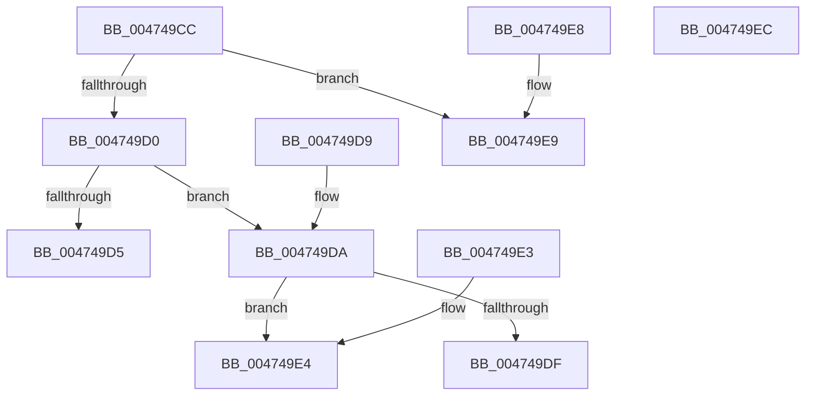

# MiTranslateCacheAttribute

- RVA: `0x004749CC`–`0x004749ED` (길이 `33` bytes)
- VA: `0x00000001404749CC`
- 실행 섹션: `.text`
- PDB 이름 있음: `예`; PDB Function 태그: `아니요`
- unwind 정보 RVA: `0x000DB714`
- 디코드: `18`개 명령, `33/33` bytes 표시
- 미해석 바이트: `0` (있으면 어셈블리에 `.byte`로 보존)

> 이 문서는 커널 이미지의 기계어와 PDB 기호를 분석해 생성했습니다. 4번과 5번은 함수 원형과 자료형을 바이너리 사용 방식에서 추정한 C 해석이며 원본 소스 복구 결과는 아닙니다.

## 1. Dependencies

- 직접 호출 지점: **0**; 고유 호출 대상: **0**
- 직접 호출자로 확인된 함수: **1**
- RIP 상대 이미지 참조: **0**

### Outgoing calls
- 직접 디코드된 call 명령이 없습니다.

### Direct callers
- [MiCombineInitialInstance](../22/MiCombineInitialInstance_function_0022BC0C.md) at `0x0022BEB5`

### Static image references
- 디코드된 RIP-relative 메모리 참조가 없습니다.

## 2. Other-region calls and transfers

- 다른 실행 섹션으로 향하는 call: **0**
- 별도 외부 분기/꼬리 이동을 확인하지 못했습니다.

## 3. Assembly (complete function range)

```asm
004749CC  85 C9                           test ecx, ecx
004749CE  74 19                           je 0x1404749e9
004749D0  83 E9 01                        sub ecx, 1
004749D3  75 05                           jne 0x1404749da
004749D5  8D 41 01                        lea eax, [rcx + 1]
004749D8  C3                              ret
004749D9  CC                              int3
004749DA  83 F9 01                        cmp ecx, 1
004749DD  75 05                           jne 0x1404749e4
004749DF  8D 41 01                        lea eax, [rcx + 1]
004749E2  C3                              ret
004749E3  CC                              int3
004749E4  83 C8 FF                        or eax, 0xffffffff
004749E7  C3                              ret
004749E8  CC                              int3
004749E9  33 C0                           xor eax, eax
004749EB  C3                              ret
004749EC  CC                              int3
```

## 4. C-style interpretation (structured pseudocode)

```c
__int64 __fastcall MiTranslateCacheAttribute(int a1)
{
    __int64 result;

    if (a1 == 0) goto loc_004749E9;
    a1 = (unsigned int)((a1) - (1));
    if (condition_is_not_equal) goto loc_004749DA;
    return a1 + 1;
loc_004749DA:
    if (a1 != 1) goto loc_004749E4;
    return a1 + 1;
loc_004749E4:
    result = (unsigned int)((a1 + 1) | (0xFFFFFFFFULL));
    return result;
loc_004749E9:
    result = 0;
    return result;
}
```

## 5. (Beta) C Style

```c
int64_t MiTranslateCacheAttribute(int32_t Arg1)
{
    int64_t result;

    if (Arg1 == 0) goto loc_004749E9;
    Arg1 = (uint32_t)((Arg1) - (1));
    if (condition_is_not_equal) goto loc_004749DA;
    return Arg1 + 1;
loc_004749DA:
    if (Arg1 != 1) goto loc_004749E4;
    return Arg1 + 1;
loc_004749E4:
    result = (uint32_t)((Arg1 + 1) | (0xFFFFFFFFULL));
    return result;
loc_004749E9:
    result = 0;
    return result;
}
```

## 6. Execution-region graph

[열기: 2D/3D 그래프와 함수 탐색 컨트롤 패널](../../../control-panel.html?section=text&rva=0x004749CC&view=graph)

- 2D 그래프는 위에서 아래로 흐르고, 3D 그래프는 빈 공간을 드래그해 회전합니다. Shift+드래그는 이동, 휠은 확대·축소, 함수 노드 선택은 대상 보고서 이동입니다.

### Static fallback


