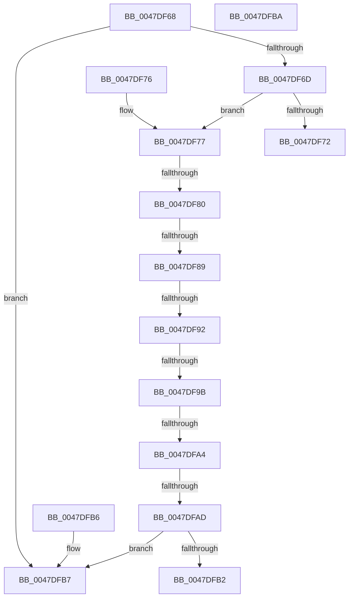

# MiTranslateWsType

- RVA: `0x0047DF68`–`0x0047DFBB` (길이 `83` bytes)
- VA: `0x000000014047DF68`
- 실행 섹션: `.text`
- PDB 이름 있음: `예`; PDB Function 태그: `예`
- unwind 정보 RVA: `0x000DB714`
- 디코드: `27`개 명령, `83/83` bytes 표시
- 미해석 바이트: `0` (있으면 어셈블리에 `.byte`로 보존)

> 이 문서는 커널 이미지의 기계어와 PDB 기호를 분석해 생성했습니다. 4번과 5번은 함수 원형과 자료형을 바이너리 사용 방식에서 추정한 C 해석이며 원본 소스 복구 결과는 아닙니다.

## 1. Dependencies

- 직접 호출 지점: **0**; 고유 호출 대상: **0**
- 직접 호출자로 확인된 함수: **2**
- RIP 상대 이미지 참조: **0**

### Outgoing calls
- 직접 디코드된 call 명령이 없습니다.

### Direct callers
- [MmGetWorkingSetLeafSize](MmGetWorkingSetLeafSize_function_0047DEF8.md) at `0x0047DF38`
- [MiInitializeSystemWorkingSetList](../../page/7F/MiInitializeSystemWorkingSetList_function_007FB7D4.md) at `0x007FB7F9`

### Static image references
- 디코드된 RIP-relative 메모리 참조가 없습니다.

## 2. Other-region calls and transfers

- 다른 실행 섹션으로 향하는 call: **0**
- call이 아닌 외부 분기/꼬리 이동: **6**
  - `0x0047DF7A` → `0x006F4BEF` (`tail-transfer`)
  - `0x0047DF83` → `0x006F4BE8` (`tail-transfer`)
  - `0x0047DF8C` → `0x006F4BE1` (`tail-transfer`)
  - `0x0047DF95` → `0x006F4BDA` (`tail-transfer`)
  - `0x0047DF9E` → `0x006F4BD3` (`tail-transfer`)
  - `0x0047DFA7` → `0x006F4BCC` (`tail-transfer`)

## 3. Assembly (complete function range)

```asm
0047DF68  83 E9 01                        sub ecx, 1
0047DF6B  74 4A                           je 0x14047dfb7
0047DF6D  83 E9 01                        sub ecx, 1
0047DF70  75 05                           jne 0x14047df77
0047DF72  8D 41 03                        lea eax, [rcx + 3]
0047DF75  C3                              ret
0047DF76  CC                              int3
0047DF77  83 E9 01                        sub ecx, 1
0047DF7A  0F 84 6F 6C 27 00               je 0x1406f4bef
0047DF80  83 E9 01                        sub ecx, 1
0047DF83  0F 84 5F 6C 27 00               je 0x1406f4be8
0047DF89  83 E9 01                        sub ecx, 1
0047DF8C  0F 84 4F 6C 27 00               je 0x1406f4be1
0047DF92  83 E9 01                        sub ecx, 1
0047DF95  0F 84 3F 6C 27 00               je 0x1406f4bda
0047DF9B  83 E9 01                        sub ecx, 1
0047DF9E  0F 84 2F 6C 27 00               je 0x1406f4bd3
0047DFA4  83 E9 01                        sub ecx, 1
0047DFA7  0F 84 1F 6C 27 00               je 0x1406f4bcc
0047DFAD  83 F9 01                        cmp ecx, 1
0047DFB0  75 05                           jne 0x14047dfb7
0047DFB2  8D 41 07                        lea eax, [rcx + 7]
0047DFB5  C3                              ret
0047DFB6  CC                              int3
0047DFB7  33 C0                           xor eax, eax
0047DFB9  C3                              ret
0047DFBA  CC                              int3
```

## 4. C-style interpretation (structured pseudocode)

```c
__int64 __fastcall MiTranslateWsType(int a1)
{
    __int64 result;

    a1 = (unsigned int)((a1) - (1));
    if (condition_is_equal) goto loc_0047DFB7;
    a1 = (unsigned int)((a1) - (1));
    if (condition_is_not_equal) goto loc_0047DF77;
    return a1 + 3;
loc_0047DF77:
    a1 = (unsigned int)((a1) - (1));
    a1 = (unsigned int)((a1) - (1));
    a1 = (unsigned int)((a1) - (1));
    a1 = (unsigned int)((a1) - (1));
    a1 = (unsigned int)((a1) - (1));
    a1 = (unsigned int)((a1) - (1));
    if (a1 != 1) goto loc_0047DFB7;
    return a1 + 7;
loc_0047DFB7:
    result = 0;
    return result;
}
```

## 5. (Beta) C Style

```c
void *MiTranslateWsType(void *Arg1)
{
    uint8_t *arg1 = (uint8_t *)Arg1;

    int64_t result;

    Arg1 = (uint32_t)((Arg1) - (1));
    if (condition_is_equal) goto loc_0047DFB7;
    Arg1 = (uint32_t)((Arg1) - (1));
    if (condition_is_not_equal) goto loc_0047DF77;
    return Arg1 + 3;
loc_0047DF77:
    Arg1 = (uint32_t)((Arg1) - (1));
    Arg1 = (uint32_t)((Arg1) - (1));
    Arg1 = (uint32_t)((Arg1) - (1));
    Arg1 = (uint32_t)((Arg1) - (1));
    Arg1 = (uint32_t)((Arg1) - (1));
    Arg1 = (uint32_t)((Arg1) - (1));
    if (Arg1 != 1) goto loc_0047DFB7;
    return Arg1 + 7;
loc_0047DFB7:
    result = 0;
    return result;
}
```

### 관측된 메모리 오프셋

구조체 형식이 확인되지 않은 접근은 인자 기준의 오프셋으로만 기록했습니다.

| 기준 인자 | 오프셋 표현 | 폭 (bit) | 접근 |
|---|---:|---:|---|
| `Arg1` | `+ 0x3` | `32` | `R` |

## 6. Execution-region graph

[열기: 2D/3D 그래프와 함수 탐색 컨트롤 패널](../../../control-panel.html?section=text&rva=0x0047DF68&view=graph)

- 2D 그래프는 위에서 아래로 흐르고, 3D 그래프는 빈 공간을 드래그해 회전합니다. Shift+드래그는 이동, 휠은 확대·축소, 함수 노드 선택은 대상 보고서 이동입니다.

### Static fallback


