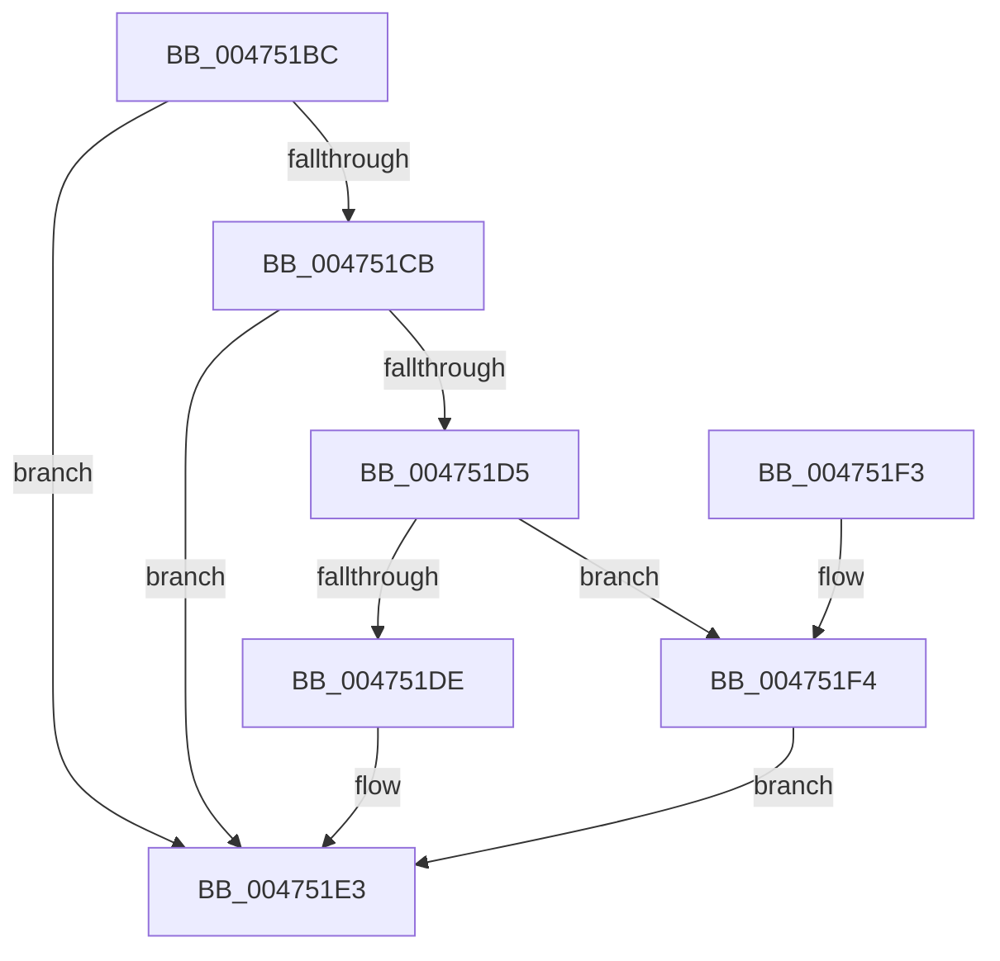

# MmFreeAccessPfnBuffer

- RVA: `0x004751BC`–`0x004751FB` (길이 `63` bytes)
- VA: `0x00000001404751BC`
- 실행 섹션: `.text`
- PDB 이름 있음: `예`; PDB Function 태그: `아니요`
- unwind 정보 RVA: `0x0005DAC8`
- 디코드: `21`개 명령, `63/63` bytes 표시
- 미해석 바이트: `0` (있으면 어셈블리에 `.byte`로 보존)

> 이 문서는 커널 이미지의 기계어와 PDB 기호를 분석해 생성했습니다. 4번과 5번은 함수 원형과 자료형을 바이너리 사용 방식에서 추정한 C 해석이며 원본 소스 복구 결과는 아닙니다.

## 1. Dependencies

- 직접 호출 지점: **3**; 고유 호출 대상: **3**
- 직접 호출자로 확인된 함수: **4**
- RIP 상대 이미지 참조: **0**

### Outgoing calls
- `0x004751DE` → [ObfDereferenceObjectWithTag](../2F/ObfDereferenceObjectWithTag_function_002F78E0.md) (function, `0x002F78E0`)
- `0x004751E8` → [ExFreePoolWithTag](../../poolcode/B8/ExFreePoolWithTag_function_00B82870.md) (function, `0x00B82870`)
- `0x004751F4` → [ObDereferenceObjectDeferDeleteWithTag](../26/ObDereferenceObjectDeferDeleteWithTag_function_00263EA0.md) (function, `0x00263EA0`)

### Direct callers
- [PfpReturnAccessBuffer](../48/PfpReturnAccessBuffer_function_00488A80.md) at `0x00488BBD`
- [sub_0097C0F8](../../page/97/Unknown_function_0097C0F8.md) at `0x0097C238`
- [sub_0097C2ED](../../page/97/Unknown_function_0097C2ED.md) at `0x0097C3AF`
- [PfTAccessTracingCleanup](../../pagelk/B6/PfTAccessTracingCleanup_function_00B6B8AC.md) at `0x00B6B92E`

### Static image references
- 디코드된 RIP-relative 메모리 참조가 없습니다.

## 2. Other-region calls and transfers

- 다른 실행 섹션으로 향하는 call: **1**
  - `0x004751E8` → [ExFreePoolWithTag](../../poolcode/B8/ExFreePoolWithTag_function_00B82870.md) (`.text` → `POOLCODE`)
- 별도 외부 분기/꼬리 이동을 확인하지 못했습니다.

## 3. Assembly (complete function range)

```asm
004751BC  40 53                           push rbx
004751BE  48 83 EC 20                     sub rsp, 0x20
004751C2  83 79 08 00                     cmp dword ptr [rcx + 8], 0
004751C6  48 8B D9                        mov rbx, rcx
004751C9  75 18                           jne 0x1404751e3
004751CB  48 8B 49 38                     mov rcx, qword ptr [rcx + 0x38]
004751CF  48 83 F9 01                     cmp rcx, 1
004751D3  76 0E                           jbe 0x1404751e3
004751D5  84 D2                           test dl, dl
004751D7  BA 4D 6D 41 4C                  mov edx, 0x4c416d4d
004751DC  75 16                           jne 0x1404751f4
004751DE  E8 FD 26 E8 FF                  call 0x1402f78e0
004751E3  33 D2                           xor edx, edx
004751E5  48 8B CB                        mov rcx, rbx
004751E8  E8 83 D6 70 00                  call 0x140b82870
004751ED  48 83 C4 20                     add rsp, 0x20
004751F1  5B                              pop rbx
004751F2  C3                              ret
004751F3  CC                              int3
004751F4  E8 A7 EC DE FF                  call 0x140263ea0
004751F9  EB E8                           jmp 0x1404751e3
```

## 4. C-style interpretation (structured pseudocode)

```c
__int64 __fastcall MmFreeAccessPfnBuffer(__int64 a1, unsigned __int8 a2)
{
    __int64 result;
    __int64 v_rsp;

    v_rsp = (v_rsp) - (32);
    if ((*(unsigned int *)(a1 + 8)) != 0) goto loc_004751E3;
    if ((*(unsigned __int64 *)(a1 + 56)) <= 1) goto loc_004751E3;
    if (a2 != 0) goto loc_004751F4;
    result = ObfDereferenceObjectWithTag(*(unsigned __int64 *)(a1 + 56), (unsigned int)(0x4C416D4DULL), a3, a4);
loc_004751E3:
    a2 = 0;
    result = ExFreePoolWithTag(a1, a2, a3, a4);
    v_rsp = (v_rsp) + (32);
    return result;
loc_004751F4:
    result = ObDereferenceObjectDeferDeleteWithTag(a1, a2, a3, a4);
    goto loc_004751E3;
}
```

## 5. (Beta) C Style

```c
int64_t MmFreeAccessPfnBuffer(void *Arg1, uint8_t Arg2)
{
    uint8_t *arg1 = (uint8_t *)Arg1;

    int64_t result;
    int64_t local_rsp;

    local_rsp = (local_rsp) - (32);
    if ((*(uint32_t *)(arg1 + 0x8)) != 0) goto loc_004751E3;
    if ((*(uint64_t *)(arg1 + 0x38)) <= 1) goto loc_004751E3;
    if (Arg2 != 0) goto loc_004751F4;
    result = ObfDereferenceObjectWithTag(*(uint64_t *)(arg1 + 0x38), (uint32_t)(0x4C416D4DULL), a3, a4);
loc_004751E3:
    Arg2 = 0;
    result = ExFreePoolWithTag(Arg1, Arg2, a3, a4);
    local_rsp = (local_rsp) + (32);
    return result;
loc_004751F4:
    result = ObDereferenceObjectDeferDeleteWithTag(Arg1, Arg2, a3, a4);
    goto loc_004751E3;
}
```

### 관측된 메모리 오프셋

구조체 형식이 확인되지 않은 접근은 인자 기준의 오프셋으로만 기록했습니다.

| 기준 인자 | 오프셋 표현 | 폭 (bit) | 접근 |
|---|---:|---:|---|
| `Arg1` | `+ 0x8` | `32` | `R` |
| `Arg1` | `+ 0x38` | `64` | `R` |

## 6. Execution-region graph

[열기: 2D/3D 그래프와 함수 탐색 컨트롤 패널](../../../control-panel.html?section=text&rva=0x004751BC&view=graph)

- 2D 그래프는 위에서 아래로 흐르고, 3D 그래프는 빈 공간을 드래그해 회전합니다. Shift+드래그는 이동, 휠은 확대·축소, 함수 노드 선택은 대상 보고서 이동입니다.

### Static fallback


