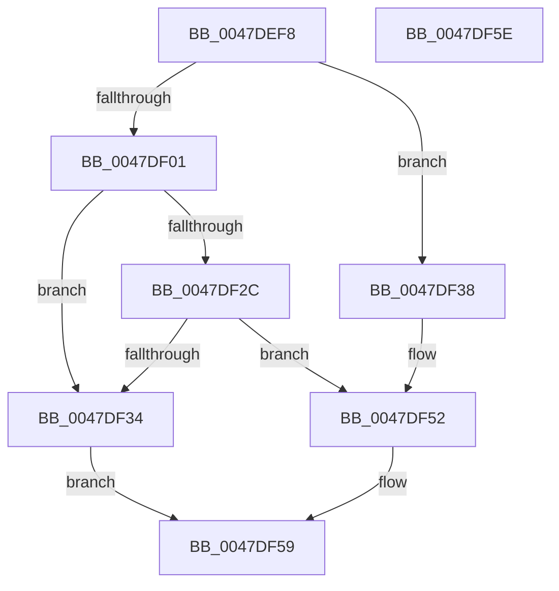

# MmGetWorkingSetLeafSize

- RVA: `0x0047DEF8`–`0x0047DF5F` (길이 `103` bytes)
- VA: `0x000000014047DEF8`
- 실행 섹션: `.text`
- PDB 이름 있음: `예`; PDB Function 태그: `아니요`
- unwind 정보 RVA: `0x0005C788`
- 디코드: `24`개 명령, `103/103` bytes 표시
- 미해석 바이트: `0` (있으면 어셈블리에 `.byte`로 보존)

> 이 문서는 커널 이미지의 기계어와 PDB 기호를 분석해 생성했습니다. 4번과 5번은 함수 원형과 자료형을 바이너리 사용 방식에서 추정한 C 해석이며 원본 소스 복구 결과는 아닙니다.

## 1. Dependencies

- 직접 호출 지점: **1**; 고유 호출 대상: **1**
- 직접 호출자로 확인된 함수: **1**
- RIP 상대 이미지 참조: **2**

### Outgoing calls
- `0x0047DF38` → [MiTranslateWsType](MiTranslateWsType_function_0047DF68.md) (function, `0x0047DF68`)

### Direct callers
- [ExpQuerySystemPerformanceInformation](../../page/9D/ExpQuerySystemPerformanceInformation_function_009D648C.md) at `0x009D6793`
- [ExpQuerySystemPerformanceInformation](../../page/9D/ExpQuerySystemPerformanceInformation_function_009D648C.md) at `0x009D67A7`

### Static image references
- `0x0047DF11` → RVA `0x00E30088` (`.data`; read)
- `0x0047DF48` → RVA `0x00E37D00` (`.data`; read)

## 2. Other-region calls and transfers

- 다른 실행 섹션으로 향하는 call: **0**
- 별도 외부 분기/꼬리 이동을 확인하지 못했습니다.

## 3. Assembly (complete function range)

```asm
0047DEF8  48 83 EC 28                     sub rsp, 0x28
0047DEFC  83 F9 01                        cmp ecx, 1
0047DEFF  75 37                           jne 0x14047df38
0047DF01  65 48 8B 04 25 88 01 00 00      mov rax, qword ptr gs:[0x188]
0047DF0A  48 8B 88 B8 00 00 00            mov rcx, qword ptr [rax + 0xb8]
0047DF11  48 8B 05 70 21 9B 00            mov rax, qword ptr [rip + 0x9b2170]
0047DF18  0F B7 91 AE 04 00 00            movzx edx, word ptr [rcx + 0x4ae]
0047DF1F  48 8B 04 D0                     mov rax, qword ptr [rax + rdx*8]
0047DF23  80 B8 5C 48 00 00 00            cmp byte ptr [rax + 0x485c], 0
0047DF2A  74 08                           je 0x14047df34
0047DF2C  48 05 80 49 00 00               add rax, 0x4980
0047DF32  75 1E                           jne 0x14047df52
0047DF34  33 C0                           xor eax, eax
0047DF36  EB 21                           jmp 0x14047df59
0047DF38  E8 2B 00 00 00                  call 0x14047df68
0047DF3D  48 63 C8                        movsxd rcx, eax
0047DF40  48 8D 04 89                     lea rax, [rcx + rcx*4]
0047DF44  48 C1 E0 06                     shl rax, 6
0047DF48  48 8D 0D B1 9D 9B 00            lea rcx, [rip + 0x9b9db1]
0047DF4F  48 03 C1                        add rax, rcx
0047DF52  48 8B 80 80 00 00 00            mov rax, qword ptr [rax + 0x80]
0047DF59  48 83 C4 28                     add rsp, 0x28
0047DF5D  C3                              ret
0047DF5E  CC                              int3
```

## 4. C-style interpretation (structured pseudocode)

```c
__int64 __fastcall MmGetWorkingSetLeafSize(int a1)
{
    __int64 result;
    __int64 v_rsp;

    v_rsp = (v_rsp) - (40);
    if (a1 != 1) goto loc_0047DF38;
    if ((*(unsigned __int8 *)(*(unsigned __int64 *)(*(unsigned __int64 *)(v_rip + 10166640) + *(unsigned __int16 *)(*(unsigned __int64 *)(*(unsigned __int64 *)(gs_base + (0 + 392)) + 184) + 1198) * 8) + 18524)) == 0) goto loc_0047DF34;
    result = (*(unsigned __int64 *)(*(unsigned __int64 *)(v_rip + 10166640) + *(unsigned __int16 *)(*(unsigned __int64 *)(*(unsigned __int64 *)(gs_base + (0 + 392)) + 184) + 1198) * 8)) + (0x4980ULL);
    if (condition_is_not_equal) goto loc_0047DF52;
loc_0047DF34:
    result = 0;
    goto loc_0047DF59;
loc_0047DF38:
    result = MiTranslateWsType(*(unsigned __int64 *)(*(unsigned __int64 *)(gs_base + (0 + 392)) + 184), *(unsigned __int16 *)(*(unsigned __int64 *)(*(unsigned __int64 *)(gs_base + (0 + 392)) + 184) + 1198), a3, a4);
    result = ((int)((unsigned int)(result)) + (int)((unsigned int)(result)) * 4) << (6);
    result = (result) + (v_rip + 10198449);
loc_0047DF52:
loc_0047DF59:
    v_rsp = (v_rsp) + (40);
    return *(unsigned __int64 *)(result + 128);
}
```

## 5. (Beta) C Style

```c
int64_t MmGetWorkingSetLeafSize(int32_t Arg1)
{
    int64_t result;
    int64_t local_rsp;

    local_rsp = (local_rsp) - (40);
    if (Arg1 != 1) goto loc_0047DF38;
    if ((*(uint8_t *)(*(uint64_t *)(*(uint64_t *)(v_rip + 0x9B2170) + *(uint16_t *)(*(uint64_t *)(*(uint64_t *)(gs_base + (0 + 0x188)) + 0xB8) + 0x4AE) * 8) + 0x485C)) == 0) goto loc_0047DF34;
    result = (*(uint64_t *)(*(uint64_t *)(v_rip + 0x9B2170) + *(uint16_t *)(*(uint64_t *)(*(uint64_t *)(gs_base + (0 + 0x188)) + 0xB8) + 0x4AE) * 8)) + (0x4980ULL);
    if (condition_is_not_equal) goto loc_0047DF52;
loc_0047DF34:
    result = 0;
    goto loc_0047DF59;
loc_0047DF38:
    result = MiTranslateWsType(*(uint64_t *)(*(uint64_t *)(gs_base + (0 + 0x188)) + 0xB8), *(uint16_t *)(*(uint64_t *)(*(uint64_t *)(gs_base + (0 + 0x188)) + 0xB8) + 0x4AE), a3, a4);
    result = ((int32_t)((uint32_t)(result)) + (int32_t)((uint32_t)(result)) * 4) << (6);
    result = (result) + (v_rip + 10198449);
loc_0047DF52:
loc_0047DF59:
    local_rsp = (local_rsp) + (40);
    return *(uint64_t *)(result + 0x80);
}
```

## 6. Execution-region graph

[열기: 2D/3D 그래프와 함수 탐색 컨트롤 패널](../../../control-panel.html?section=text&rva=0x0047DEF8&view=graph)

- 2D 그래프는 위에서 아래로 흐르고, 3D 그래프는 빈 공간을 드래그해 회전합니다. Shift+드래그는 이동, 휠은 확대·축소, 함수 노드 선택은 대상 보고서 이동입니다.

### Static fallback


