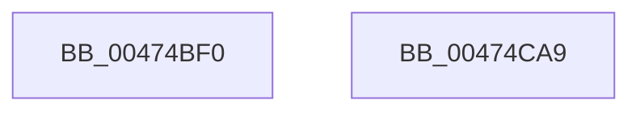

# MmStoreDecommitVirtualMemory

- RVA: `0x00474BF0`–`0x00474CAA` (길이 `186` bytes)
- VA: `0x0000000140474BF0`
- 실행 섹션: `.text`
- PDB 이름 있음: `예`; PDB Function 태그: `아니요`
- unwind 정보 RVA: `0x00087D9C`
- 디코드: `43`개 명령, `186/186` bytes 표시
- 미해석 바이트: `0` (있으면 어셈블리에 `.byte`로 보존)

> 이 문서는 커널 이미지의 기계어와 PDB 기호를 분석해 생성했습니다. 4번과 5번은 함수 원형과 자료형을 바이너리 사용 방식에서 추정한 C 해석이며 원본 소스 복구 결과는 아닙니다.

## 1. Dependencies

- 직접 호출 지점: **2**; 고유 호출 대상: **2**
- 직접 호출자로 확인된 함수: **3**
- RIP 상대 이미지 참조: **0**

### Outgoing calls
- `0x00474C31` → [MiStoreGetVadForAddress](MiStoreGetVadForAddress_function_00474CB0.md) (function, `0x00474CB0`)
- `0x00474C8F` → [MiDecommitPages](../24/MiDecommitPages_function_00241BD0.md) (function, `0x00241BD0`)

### Direct callers
- [SMKM_STORE&lt;SM_TRAITS&gt;::SmStReleaseVirtualRegion](../3A/SMKM_STORE_SM_TRAITS_SmStReleaseVirtualRegion_function_003AF338.md) at `0x003AF3E4`
- [SmKmStoreHelperCommandCleanup](../4D/SmKmStoreHelperCommandCleanup_function_004D03FC.md) at `0x004D049E`
- [ST_STORE&lt;SM_TRAITS&gt;::StCompactionPerformEmergency](../4E/ST_STORE_SM_TRAITS_StCompactionPerformEmergency_function_004EB170.md) at `0x004EB387`

### Static image references
- 디코드된 RIP-relative 메모리 참조가 없습니다.

## 2. Other-region calls and transfers

- 다른 실행 섹션으로 향하는 call: **0**
- 별도 외부 분기/꼬리 이동을 확인하지 못했습니다.

## 3. Assembly (complete function range)

```asm
00474BF0  48 89 5C 24 08                  mov qword ptr [rsp + 8], rbx
00474BF5  48 89 74 24 10                  mov qword ptr [rsp + 0x10], rsi
00474BFA  57                              push rdi
00474BFB  48 81 EC 80 00 00 00            sub rsp, 0x80
00474C02  0F 57 C0                        xorps xmm0, xmm0
00474C05  33 C0                           xor eax, eax
00474C07  0F 11 44 24 40                  movups xmmword ptr [rsp + 0x40], xmm0
00474C0C  48 89 44 24 70                  mov qword ptr [rsp + 0x70], rax
00474C11  48 8B FA                        mov rdi, rdx
00474C14  0F 11 44 24 50                  movups xmmword ptr [rsp + 0x50], xmm0
00474C19  48 8B D9                        mov rbx, rcx
00474C1C  0F 11 44 24 60                  movups xmmword ptr [rsp + 0x60], xmm0
00474C21  65 48 8B 04 25 88 01 00 00      mov rax, qword ptr gs:[0x188]
00474C2A  48 8B B0 B8 00 00 00            mov rsi, qword ptr [rax + 0xb8]
00474C31  E8 7A 00 00 00                  call 0x140474cb0
00474C36  48 B9 F8 FF FF FF 7F 00 00 00   movabs rcx, 0x7ffffffff8
00474C40  48 8D 57 FF                     lea rdx, [rdi - 1]
00474C44  48 03 D3                        add rdx, rbx
00474C47  4C 8B C3                        mov r8, rbx
00474C4A  48 C1 EA 09                     shr rdx, 9
00474C4E  48 23 D1                        and rdx, rcx
00474C51  49 C1 E8 09                     shr r8, 9
00474C55  4C 23 C1                        and r8, rcx
00474C58  49 2B D0                        sub rdx, r8
00474C5B  48 C1 FA 03                     sar rdx, 3
00474C5F  48 FF C2                        inc rdx
00474C62  48 B9 00 00 00 00 80 F6 FF FF   movabs rcx, 0xfffff68000000000
00474C6C  49 03 C8                        add rcx, r8
00474C6F  4C 8B CE                        mov r9, rsi
00474C72  4C 8D 44 24 40                  lea r8, [rsp + 0x40]
00474C77  4C 89 44 24 38                  mov qword ptr [rsp + 0x38], r8
00474C7C  45 33 C0                        xor r8d, r8d
00474C7F  48 83 64 24 30 00               and qword ptr [rsp + 0x30], 0
00474C85  83 64 24 28 00                  and dword ptr [rsp + 0x28], 0
00474C8A  48 89 44 24 20                  mov qword ptr [rsp + 0x20], rax
00474C8F  E8 3C CF DC FF                  call 0x140241bd0
00474C94  4C 8D 9C 24 80 00 00 00         lea r11, [rsp + 0x80]
00474C9C  49 8B 5B 10                     mov rbx, qword ptr [r11 + 0x10]
00474CA0  49 8B 73 18                     mov rsi, qword ptr [r11 + 0x18]
00474CA4  49 8B E3                        mov rsp, r11
00474CA7  5F                              pop rdi
00474CA8  C3                              ret
00474CA9  CC                              int3
```

## 4. C-style interpretation (structured pseudocode)

```c
__int64 __fastcall MmStoreDecommitVirtualMemory(__int64 a1, __int64 a2)
{
    __int64 result;
    __int64 v_rsp;
    unsigned __int64 v_stack_m18;
    unsigned __int64 v_stack_m28;
    unsigned __int64 v_stack_m38;
    unsigned __int64 v_stack_m48;
    unsigned __int64 v_stack_m50;
    unsigned __int64 v_stack_m58;
    unsigned int v_stack_m60;
    unsigned __int64 v_stack_m68;
    unsigned __int64 v_stack_m8;
    unsigned __int64 v_stack_p10;
    unsigned __int64 v_stack_p8;

    v_stack_p8 = v_rbx;
    v_stack_p10 = v_rsi;
    v_rsp = (v_rsp) - (128);
    result = 0;
    v_stack_m48 = v_xmm0;
    v_stack_m18 = 0;
    v_stack_m38 = v_xmm0;
    v_stack_m28 = v_xmm0;
    result = MiStoreGetVadForAddress(a1, a2, a3, a4);
    a2 = (a2 - 1) + (a1);
    a2 = (a2) >> (9);
    a2 = (a2) & (a1);
    a3 = (a1) >> (9);
    a3 = (a3) & (a1);
    a2 = (a2) - (a3);
    a2 = (a2) >> (3);
    a2 = (a2) + 1;
    a1 = (a1) + (a3);
    v_stack_m50 = v_stack_m48;
    a3 = 0;
    v_stack_m68 = result;
    result = MiDecommitPages(a1, a2, a3, *(unsigned __int64 *)(*(unsigned __int64 *)(gs_base + (0 + 392)) + 184));
    return result;
}
```

## 5. (Beta) C Style

```c
int64_t MmStoreDecommitVirtualMemory(int64_t Arg1, void *Arg2)
{
    uint8_t *arg2 = (uint8_t *)Arg2;

    int64_t result;
    int64_t local_rsp;
    uint64_t v_stack_m18;
    uint64_t v_stack_m28;
    uint64_t v_stack_m38;
    uint64_t v_stack_m48;
    uint64_t v_stack_m50;
    uint64_t v_stack_m58;
    uint32_t v_stack_m60;
    uint64_t v_stack_m68;
    uint64_t v_stack_m8;
    uint64_t v_stack_p10;
    uint64_t v_stack_p8;

    v_stack_p8 = local_rbx;
    v_stack_p10 = local_rsi;
    local_rsp = (local_rsp) - (128);
    result = 0;
    v_stack_m48 = v_xmm0;
    v_stack_m18 = 0;
    v_stack_m38 = v_xmm0;
    v_stack_m28 = v_xmm0;
    result = MiStoreGetVadForAddress(Arg1, Arg2, a3, a4);
    Arg2 = (Arg2 - 1) + (Arg1);
    Arg2 = (Arg2) >> (9);
    Arg2 = (Arg2) & (Arg1);
    a3 = (Arg1) >> (9);
    a3 = (a3) & (Arg1);
    Arg2 = (Arg2) - (a3);
    Arg2 = (Arg2) >> (3);
    Arg2 = (Arg2) + 1;
    Arg1 = (Arg1) + (a3);
    v_stack_m50 = v_stack_m48;
    a3 = 0;
    v_stack_m68 = result;
    result = MiDecommitPages(Arg1, Arg2, a3, *(uint64_t *)(*(uint64_t *)(gs_base + (0 + 0x188)) + 0xB8));
    return result;
}
```

### 관측된 메모리 오프셋

구조체 형식이 확인되지 않은 접근은 인자 기준의 오프셋으로만 기록했습니다.

| 기준 인자 | 오프셋 표현 | 폭 (bit) | 접근 |
|---|---:|---:|---|
| `Arg2` | `- 0x1` | `64` | `R` |

## 6. Execution-region graph

[열기: 2D/3D 그래프와 함수 탐색 컨트롤 패널](../../../control-panel.html?section=text&rva=0x00474BF0&view=graph)

- 2D 그래프는 위에서 아래로 흐르고, 3D 그래프는 빈 공간을 드래그해 회전합니다. Shift+드래그는 이동, 휠은 확대·축소, 함수 노드 선택은 대상 보고서 이동입니다.

### Static fallback


