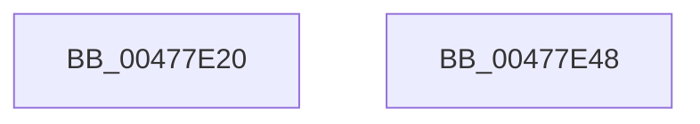

# NtReadVirtualMemoryEx

- RVA: `0x00477E20`–`0x00477E49` (길이 `41` bytes)
- VA: `0x0000000140477E20`
- 실행 섹션: `.text`
- PDB 이름 있음: `예`; PDB Function 태그: `아니요`
- unwind 정보 RVA: `0x00063458`
- 디코드: `10`개 명령, `41/41` bytes 표시
- 미해석 바이트: `0` (있으면 어셈블리에 `.byte`로 보존)

> 이 문서는 커널 이미지의 기계어와 PDB 기호를 분석해 생성했습니다. 4번과 5번은 함수 원형과 자료형을 바이너리 사용 방식에서 추정한 C 해석이며 원본 소스 복구 결과는 아닙니다.

## 1. Dependencies

- 직접 호출 지점: **1**; 고유 호출 대상: **1**
- 직접 호출자로 확인된 함수: **0**
- RIP 상대 이미지 참조: **0**

### Outgoing calls
- `0x00477E3E` → [MiReadWriteVirtualMemory](../../page/9B/MiReadWriteVirtualMemory_function_009BB4E0.md) (function, `0x009BB4E0`)

### Direct callers
- 이 함수 시작 RVA로 연결되는 직접 call은 확인되지 않았습니다. 간접 호출은 완전히 역산할 수 없습니다.

### Static image references
- 디코드된 RIP-relative 메모리 참조가 없습니다.

## 2. Other-region calls and transfers

- 다른 실행 섹션으로 향하는 call: **1**
  - `0x00477E3E` → [MiReadWriteVirtualMemory](../../page/9B/MiReadWriteVirtualMemory_function_009BB4E0.md) (`.text` → `PAGE`)
- 별도 외부 분기/꼬리 이동을 확인하지 못했습니다.

## 3. Assembly (complete function range)

```asm
00477E20  48 83 EC 48                     sub rsp, 0x48
00477E24  8B 44 24 78                     mov eax, dword ptr [rsp + 0x78]
00477E28  89 44 24 30                     mov dword ptr [rsp + 0x30], eax
00477E2C  48 8B 44 24 70                  mov rax, qword ptr [rsp + 0x70]
00477E31  C7 44 24 28 10 00 00 00         mov dword ptr [rsp + 0x28], 0x10
00477E39  48 89 44 24 20                  mov qword ptr [rsp + 0x20], rax
00477E3E  E8 9D 36 54 00                  call 0x1409bb4e0
00477E43  48 83 C4 48                     add rsp, 0x48
00477E47  C3                              ret
00477E48  CC                              int3
```

## 4. C-style interpretation (structured pseudocode)

```c
__int64 __fastcall NtReadVirtualMemoryEx(__int64 a1, __int64 a2, __int64 a3, __int64 a4, __int64 a5, unsigned int a6)
{
    __int64 result;
    __int64 v_rsp;
    unsigned int v_stack_m18;
    unsigned int v_stack_m20;
    unsigned __int64 v_stack_m28;

    v_rsp = (v_rsp) - (72);
    v_stack_m18 = (unsigned int)((unsigned int)(a6));
    v_stack_m20 = 16;
    v_stack_m28 = a5;
    result = MiReadWriteVirtualMemory(a1, a2, a3, a4);
    v_rsp = (v_rsp) + (72);
    return result;
}
```

## 5. (Beta) C Style

```c
int64_t NtReadVirtualMemoryEx(int64_t Arg1, int64_t Arg2, int64_t Arg3, int64_t Arg4, int64_t Arg5, uint32_t Arg6)
{
    int64_t result;
    int64_t local_rsp;
    uint32_t v_stack_m18;
    uint32_t v_stack_m20;
    uint64_t v_stack_m28;

    local_rsp = (local_rsp) - (72);
    v_stack_m18 = (uint32_t)((uint32_t)(Arg6));
    v_stack_m20 = 16;
    v_stack_m28 = Arg5;
    result = MiReadWriteVirtualMemory(Arg1, Arg2, Arg3, Arg4);
    local_rsp = (local_rsp) + (72);
    return result;
}
```

## 6. Execution-region graph

[열기: 2D/3D 그래프와 함수 탐색 컨트롤 패널](../../../control-panel.html?section=text&rva=0x00477E20&view=graph)

- 2D 그래프는 위에서 아래로 흐르고, 3D 그래프는 빈 공간을 드래그해 회전합니다. Shift+드래그는 이동, 휠은 확대·축소, 함수 노드 선택은 대상 보고서 이동입니다.

### Static fallback


