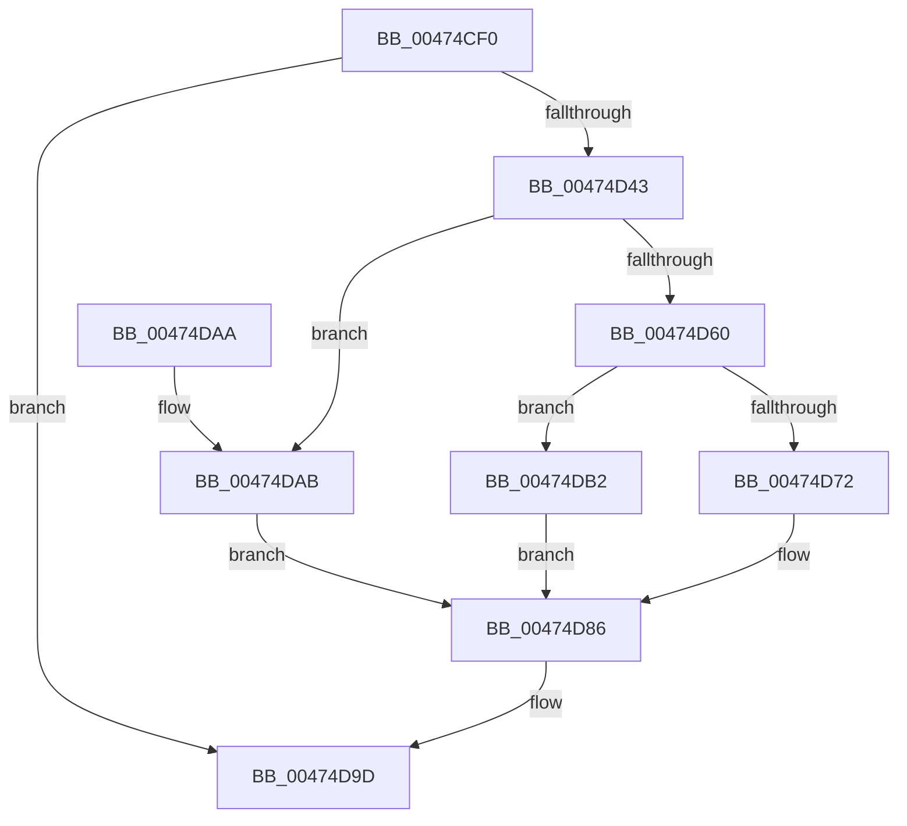

# NtWorkerFactoryWorkerReady

- RVA: `0x00474CF0`–`0x00474DB9` (길이 `201` bytes)
- VA: `0x0000000140474CF0`
- 실행 섹션: `.text`
- PDB 이름 있음: `예`; PDB Function 태그: `아니요`
- unwind 정보 RVA: `0x000ACA74`
- 디코드: `51`개 명령, `201/201` bytes 표시
- 미해석 바이트: `0` (있으면 어셈블리에 `.byte`로 보존)

> 이 문서는 커널 이미지의 기계어와 PDB 기호를 분석해 생성했습니다. 4번과 5번은 함수 원형과 자료형을 바이너리 사용 방식에서 추정한 C 해석이며 원본 소스 복구 결과는 아닙니다.

## 1. Dependencies

- 직접 호출 지점: **4**; 고유 호출 대상: **4**
- 직접 호출자로 확인된 함수: **0**
- RIP 상대 이미지 참조: **1**

### Outgoing calls
- `0x00474D38` → [ObReferenceObjectByHandle](../../page/86/ObReferenceObjectByHandle_function_00868DB0.md) (function, `0x00868DB0`)
- `0x00474D51` → [KeAcquireInStackQueuedSpinLock](../27/KeAcquireInStackQueuedSpinLock_function_002757A0.md) (function, `0x002757A0`)
- `0x00474D8B` → [KeReleaseInStackQueuedSpinLock](../34/KeReleaseInStackQueuedSpinLock_function_00342CE0.md) (function, `0x00342CE0`)
- `0x00474D98` → [ObfDereferenceObjectWithTag](../2F/ObfDereferenceObjectWithTag_function_002F78E0.md) (function, `0x002F78E0`)

### Direct callers
- 이 함수 시작 RVA로 연결되는 직접 call은 확인되지 않았습니다. 간접 호출은 완전히 역산할 수 없습니다.

### Static image references
- `0x00474D1D` → RVA `0x00FC51E0` (`ALMOSTRO`; read)

## 2. Other-region calls and transfers

- 다른 실행 섹션으로 향하는 call: **1**
  - `0x00474D38` → [ObReferenceObjectByHandle](../../page/86/ObReferenceObjectByHandle_function_00868DB0.md) (`.text` → `PAGE`)
- 별도 외부 분기/꼬리 이동을 확인하지 못했습니다.

## 3. Assembly (complete function range)

```asm
00474CF0  4C 8B DC                        mov r11, rsp
00474CF3  49 89 5B 08                     mov qword ptr [r11 + 8], rbx
00474CF7  57                              push rdi
00474CF8  48 83 EC 50                     sub rsp, 0x50
00474CFC  49 83 63 D0 00                  and qword ptr [r11 - 0x30], 0
00474D01  33 C0                           xor eax, eax
00474D03  0F 57 C0                        xorps xmm0, xmm0
00474D06  BA 10 00 00 00                  mov edx, 0x10
00474D0B  0F 11 44 24 30                  movups xmmword ptr [rsp + 0x30], xmm0
00474D10  49 89 43 E8                     mov qword ptr [r11 - 0x18], rax
00474D14  65 48 8B 04 25 88 01 00 00      mov rax, qword ptr gs:[0x188]
00474D1D  4C 8B 05 BC 04 B5 00            mov r8, qword ptr [rip + 0xb504bc]
00474D24  49 83 63 10 00                  and qword ptr [r11 + 0x10], 0
00474D29  44 8A 88 32 02 00 00            mov r9b, byte ptr [rax + 0x232]
00474D30  49 8D 43 10                     lea rax, [r11 + 0x10]
00474D34  49 89 43 C8                     mov qword ptr [r11 - 0x38], rax
00474D38  E8 73 40 3F 00                  call 0x140868db0
00474D3D  8B F8                           mov edi, eax
00474D3F  85 C0                           test eax, eax
00474D41  78 5A                           js 0x140474d9d
00474D43  48 8B 5C 24 68                  mov rbx, qword ptr [rsp + 0x68]
00474D48  48 8D 54 24 30                  lea rdx, [rsp + 0x30]
00474D4D  48 8B 4B 10                     mov rcx, qword ptr [rbx + 0x10]
00474D51  E8 4A 0A E0 FF                  call 0x1402757a0
00474D56  8B 83 90 01 00 00               mov eax, dword ptr [rbx + 0x190]
00474D5C  85 C0                           test eax, eax
00474D5E  74 4B                           je 0x140474dab
00474D60  FF C8                           dec eax
00474D62  89 83 90 01 00 00               mov dword ptr [rbx + 0x190], eax
00474D68  8B 83 88 01 00 00               mov eax, dword ptr [rbx + 0x188]
00474D6E  85 C0                           test eax, eax
00474D70  74 40                           je 0x140474db2
00474D72  FF 83 80 01 00 00               inc dword ptr [rbx + 0x180]
00474D78  FF C8                           dec eax
00474D7A  FF 83 84 01 00 00               inc dword ptr [rbx + 0x184]
00474D80  89 83 88 01 00 00               mov dword ptr [rbx + 0x188], eax
00474D86  48 8D 4C 24 30                  lea rcx, [rsp + 0x30]
00474D8B  E8 50 DF EC FF                  call 0x140342ce0
00474D90  BA 44 66 6C 74                  mov edx, 0x746c6644
00474D95  48 8B CB                        mov rcx, rbx
00474D98  E8 43 2B E8 FF                  call 0x1402f78e0
00474D9D  48 8B 5C 24 60                  mov rbx, qword ptr [rsp + 0x60]
00474DA2  8B C7                           mov eax, edi
00474DA4  48 83 C4 50                     add rsp, 0x50
00474DA8  5F                              pop rdi
00474DA9  C3                              ret
00474DAA  CC                              int3
00474DAB  BF 01 00 00 C0                  mov edi, 0xc0000001
00474DB0  EB D4                           jmp 0x140474d86
00474DB2  BF 0A 01 00 C0                  mov edi, 0xc000010a
00474DB7  EB CD                           jmp 0x140474d86
```

## 4. C-style interpretation (structured pseudocode)

```c
__int64 __fastcall NtWorkerFactoryWorkerReady(void)
{
    __int64 result;
    __int64 v_rsp;
    unsigned __int64 v_stack_m28;
    unsigned __int64 v_stack_p10;
    unsigned __int64 v_stack_p8;

    *(unsigned __int64 *)(v_rsp + 8) = v_rbx;
    v_rsp = (v_rsp) - (80);
    result = 0;
    v_stack_m28 = v_xmm0;
    *(unsigned __int64 *)(v_rsp - 24) = 0;
    *(unsigned __int64 *)(v_rsp - 56) = v_rsp + 16;
    result = ObReferenceObjectByHandle(a1, 16, *(unsigned __int64 *)(v_rip + 11863228), *(unsigned __int8 *)(*(unsigned __int64 *)(gs_base + (0 + 392)) + 562));
    if (sign_flag) goto loc_00474D9D;
    result = KeAcquireInStackQueuedSpinLock(*(unsigned __int64 *)(v_stack_p10 + 16), v_stack_m28, *(unsigned __int64 *)(v_rip + 11863228), *(unsigned __int8 *)(*(unsigned __int64 *)(gs_base + (0 + 392)) + 562));
    if ((unsigned int)((unsigned int)(*(unsigned int *)(v_stack_p10 + 400))) == 0) goto loc_00474DAB;
    result = (unsigned int)(((unsigned int)(*(unsigned int *)(v_stack_p10 + 400))) - 1);
    *(unsigned int *)(v_stack_p10 + 400) = (unsigned int)(result);
    if ((unsigned int)((unsigned int)(*(unsigned int *)(v_stack_p10 + 392))) == 0) goto loc_00474DB2;
    result = (unsigned int)(((unsigned int)(*(unsigned int *)(v_stack_p10 + 392))) - 1);
    *(unsigned int *)(v_stack_p10 + 392) = (unsigned int)(result);
loc_00474D86:
    result = KeReleaseInStackQueuedSpinLock(v_stack_m28, v_stack_m28, *(unsigned __int64 *)(v_rip + 11863228), *(unsigned __int8 *)(*(unsigned __int64 *)(gs_base + (0 + 392)) + 562));
    result = ObfDereferenceObjectWithTag(v_stack_p10, (unsigned int)(0x746C6644ULL), *(unsigned __int64 *)(v_rip + 11863228), *(unsigned __int8 *)(*(unsigned __int64 *)(gs_base + (0 + 392)) + 562));
loc_00474D9D:
    v_rsp = (v_rsp) + (80);
    return (unsigned int)((unsigned int)((unsigned int)((unsigned int)(result))));
loc_00474DAB:
    goto loc_00474D86;
loc_00474DB2:
    goto loc_00474D86;
}
```

## 5. (Beta) C Style

```c
void NtWorkerFactoryWorkerReady(void)
{
    int64_t result;
    int64_t local_rsp;
    uint64_t v_stack_m28;
    uint64_t v_stack_p10;
    uint64_t v_stack_p8;

    *(uint64_t *)(local_rsp + 0x8) = local_rbx;
    local_rsp = (local_rsp) - (80);
    result = 0;
    v_stack_m28 = v_xmm0;
    *(uint64_t *)(local_rsp - 0x18) = 0;
    *(uint64_t *)(local_rsp - 0x38) = local_rsp + 16;
    result = ObReferenceObjectByHandle(a1, 16, *(uint64_t *)(v_rip + 0xB504BC), *(uint8_t *)(*(uint64_t *)(gs_base + (0 + 0x188)) + 0x232));
    if (sign_flag) goto loc_00474D9D;
    result = KeAcquireInStackQueuedSpinLock(*(uint64_t *)(v_stack_p10 + 0x10), v_stack_m28, *(uint64_t *)(v_rip + 0xB504BC), *(uint8_t *)(*(uint64_t *)(gs_base + (0 + 0x188)) + 0x232));
    if ((uint32_t)((uint32_t)(*(uint32_t *)(v_stack_p10 + 0x190))) == 0) goto loc_00474DAB;
    result = (uint32_t)(((uint32_t)(*(uint32_t *)(v_stack_p10 + 0x190))) - 1);
    *(uint32_t *)(v_stack_p10 + 0x190) = (uint32_t)(result);
    if ((uint32_t)((uint32_t)(*(uint32_t *)(v_stack_p10 + 0x188))) == 0) goto loc_00474DB2;
    result = (uint32_t)(((uint32_t)(*(uint32_t *)(v_stack_p10 + 0x188))) - 1);
    *(uint32_t *)(v_stack_p10 + 0x188) = (uint32_t)(result);
loc_00474D86:
    result = KeReleaseInStackQueuedSpinLock(v_stack_m28, v_stack_m28, *(uint64_t *)(v_rip + 0xB504BC), *(uint8_t *)(*(uint64_t *)(gs_base + (0 + 0x188)) + 0x232));
    result = ObfDereferenceObjectWithTag(v_stack_p10, (uint32_t)(0x746C6644ULL), *(uint64_t *)(v_rip + 0xB504BC), *(uint8_t *)(*(uint64_t *)(gs_base + (0 + 0x188)) + 0x232));
loc_00474D9D:
    local_rsp = (local_rsp) + (80);
    return (uint32_t)((uint32_t)((uint32_t)((uint32_t)(result))));
loc_00474DAB:
    goto loc_00474D86;
loc_00474DB2:
    goto loc_00474D86;
}
```

## 6. Execution-region graph

[열기: 2D/3D 그래프와 함수 탐색 컨트롤 패널](../../../control-panel.html?section=text&rva=0x00474CF0&view=graph)

- 2D 그래프는 위에서 아래로 흐르고, 3D 그래프는 빈 공간을 드래그해 회전합니다. Shift+드래그는 이동, 휠은 확대·축소, 함수 노드 선택은 대상 보고서 이동입니다.

### Static fallback


