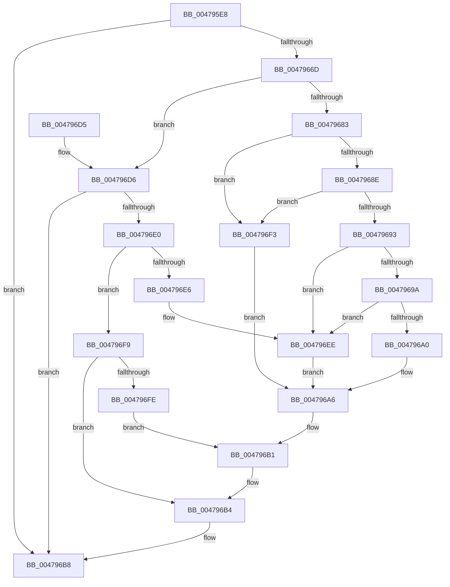

# PerfLogExecutiveResourceAcquire

- RVA: `0x004795E8`–`0x00479700` (길이 `280` bytes)
- VA: `0x00000001404795E8`
- 실행 섹션: `.text`
- PDB 이름 있음: `예`; PDB Function 태그: `아니요`
- unwind 정보 RVA: `0x000ACF84`
- 디코드: `79`개 명령, `280/280` bytes 표시
- 미해석 바이트: `0` (있으면 어셈블리에 `.byte`로 보존)

> 이 문서는 커널 이미지의 기계어와 PDB 기호를 분석해 생성했습니다. 4번과 5번은 함수 원형과 자료형을 바이너리 사용 방식에서 추정한 C 해석이며 원본 소스 복구 결과는 아닙니다.

## 1. Dependencies

- 직접 호출 지점: **1**; 고유 호출 대상: **1**
- 직접 호출자로 확인된 함수: **4**
- RIP 상대 이미지 참조: **0**

### Outgoing calls
- `0x00479660` → [EtwpGetTrackingLockSlotForThread](../21/EtwpGetTrackingLockSlotForThread_function_00215B34.md) (function, `0x00215B34`)

### Direct callers
- [ExpAcquireSharedStarveExclusive](../34/ExpAcquireSharedStarveExclusive_function_003411C0.md) at `0x003415D9`
- [ExpAcquireSharedStarveExclusive](../34/ExpAcquireSharedStarveExclusive_function_003411C0.md) at `0x003416A9`
- [ExpAcquireSharedStarveExclusive](../34/ExpAcquireSharedStarveExclusive_function_003411C0.md) at `0x0034173F`
- [ExAcquireSharedWaitForExclusive](../3D/ExAcquireSharedWaitForExclusive_function_003D43F0.md) at `0x003D4665`
- [ExAcquireSharedWaitForExclusive](../3D/ExAcquireSharedWaitForExclusive_function_003D43F0.md) at `0x003D4687`
- [ExAcquireSharedWaitForExclusive](../3D/ExAcquireSharedWaitForExclusive_function_003D43F0.md) at `0x003D46A3`
- [ExpTryToAcquireResourceExclusiveLite](../65/ExpTryToAcquireResourceExclusiveLite_function_00658FEC.md) at `0x006590ED`
- [sub_006E96C4](../6E/Unknown_function_006E96C4.md) at `0x006E97DB`

### Static image references
- 디코드된 RIP-relative 메모리 참조가 없습니다.

## 2. Other-region calls and transfers

- 다른 실행 섹션으로 향하는 call: **0**
- 별도 외부 분기/꼬리 이동을 확인하지 못했습니다.

## 3. Assembly (complete function range)

```asm
004795E8  48 89 5C 24 10                  mov qword ptr [rsp + 0x10], rbx
004795ED  48 89 6C 24 18                  mov qword ptr [rsp + 0x18], rbp
004795F2  48 89 74 24 20                  mov qword ptr [rsp + 0x20], rsi
004795F7  57                              push rdi
004795F8  41 54                           push r12
004795FA  41 55                           push r13
004795FC  41 56                           push r14
004795FE  41 57                           push r15
00479600  48 83 EC 20                     sub rsp, 0x20
00479604  83 64 24 50 00                  and dword ptr [rsp + 0x50], 0
00479609  45 8B F1                        mov r14d, r9d
0047960C  41 8B D8                        mov ebx, r8d
0047960F  4C 8B D2                        mov r10, rdx
00479612  8B E9                           mov ebp, ecx
00479614  0F 31                           rdtsc
00479616  65 48 8B 34 25 20 00 00 00      mov rsi, qword ptr gs:[0x20]
0047961F  41 BD 01 00 00 00               mov r13d, 1
00479625  48 C1 E2 20                     shl rdx, 0x20
00479629  48 0B C2                        or rax, rdx
0047962C  C6 44 24 53 00                  mov byte ptr [rsp + 0x53], 0
00479631  8B D1                           mov edx, ecx
00479633  48 8B F8                        mov rdi, rax
00479636  44 0F B6 BE D0 00 00 00         movzx r15d, byte ptr [rsi + 0xd0]
0047963E  81 E2 00 00 FF FF               and edx, 0xffff0000
00479644  44 8A A6 D1 00 00 00            mov r12b, byte ptr [rsi + 0xd1]
0047964B  49 8B CA                        mov rcx, r10
0047964E  44 01 AE 70 8F 00 00            add dword ptr [rsi + 0x8f70], r13d
00479655  66 44 89 7C 24 50               mov word ptr [rsp + 0x50], r15w
0047965B  44 88 64 24 52                  mov byte ptr [rsp + 0x52], r12b
00479660  E8 CF C4 D9 FF                  call 0x140215b34
00479665  48 8B D0                        mov rdx, rax
00479668  48 85 C0                        test rax, rax
0047966B  74 4B                           je 0x1404796b8
0047966D  44 01 AE 74 8F 00 00            add dword ptr [rsi + 0x8f74], r13d
00479674  8D 8D DF FF FE FF               lea ecx, [rbp - 0x10021]
0047967A  B8 DF FF FF FF                  mov eax, 0xffffffdf
0047967F  85 C8                           test eax, ecx
00479681  75 53                           jne 0x1404796d6
00479683  8B 42 20                        mov eax, dword ptr [rdx + 0x20]
00479686  48 89 7A 08                     mov qword ptr [rdx + 8], rdi
0047968A  85 C0                           test eax, eax
0047968C  74 65                           je 0x1404796f3
0047968E  83 F8 04                        cmp eax, 4
00479691  75 60                           jne 0x1404796f3
00479693  66 44 39 7A 18                  cmp word ptr [rdx + 0x18], r15w
00479698  75 54                           jne 0x1404796ee
0047969A  44 38 62 1A                     cmp byte ptr [rdx + 0x1a], r12b
0047969E  75 4E                           jne 0x1404796ee
004796A0  48 2B 3A                        sub rdi, qword ptr [rdx]
004796A3  48 89 3A                        mov qword ptr [rdx], rdi
004796A6  8B 44 24 50                     mov eax, dword ptr [rsp + 0x50]
004796AA  89 42 18                        mov dword ptr [rdx + 0x18], eax
004796AD  44 89 72 2C                     mov dword ptr [rdx + 0x2c], r14d
004796B1  89 5A 24                        mov dword ptr [rdx + 0x24], ebx
004796B4  44 89 6A 20                     mov dword ptr [rdx + 0x20], r13d
004796B8  48 8B 5C 24 58                  mov rbx, qword ptr [rsp + 0x58]
004796BD  48 8B 6C 24 60                  mov rbp, qword ptr [rsp + 0x60]
004796C2  48 8B 74 24 68                  mov rsi, qword ptr [rsp + 0x68]
004796C7  48 83 C4 20                     add rsp, 0x20
004796CB  41 5F                           pop r15
004796CD  41 5E                           pop r14
004796CF  41 5D                           pop r13
004796D1  41 5C                           pop r12
004796D3  5F                              pop rdi
004796D4  C3                              ret
004796D5  CC                              int3
004796D6  8D 8D CF FF FE FF               lea ecx, [rbp - 0x10031]
004796DC  85 C8                           test eax, ecx
004796DE  75 D8                           jne 0x1404796b8
004796E0  83 7A 20 00                     cmp dword ptr [rdx + 0x20], 0
004796E4  75 13                           jne 0x1404796f9
004796E6  48 C7 42 08 02 00 00 00         mov qword ptr [rdx + 8], 2
004796EE  4C 89 2A                        mov qword ptr [rdx], r13
004796F1  EB B3                           jmp 0x1404796a6
004796F3  48 83 22 00                     and qword ptr [rdx], 0
004796F7  EB AD                           jmp 0x1404796a6
004796F9  39 5A 24                        cmp dword ptr [rdx + 0x24], ebx
004796FC  73 B6                           jae 0x1404796b4
004796FE  EB B1                           jmp 0x1404796b1
```

## 4. C-style interpretation (structured pseudocode)

```c
__int64 __fastcall PerfLogExecutiveResourceAcquire(int a1, __int64 a2, int a3, int a4)
{
    __int64 result;
    __int64 v_rdi;
    __int64 v_rsp;
    unsigned __int64 v_stack_p10;
    unsigned __int64 v_stack_p18;
    unsigned __int64 v_stack_p20;
    unsigned int v_stack_p8;
    unsigned __int8 v_stack_pA;
    unsigned __int8 v_stack_pB;

    v_stack_p10 = v_rbx;
    v_stack_p18 = v_rbp;
    v_stack_p20 = v_rsi;
    v_rsp = (v_rsp) - (32);
    a2 = (a2) << (32);
    result = (result) | (a2);
    v_stack_pB = 0;
    a2 = (unsigned int)(((unsigned int)(a1)) & (0xFFFF0000ULL));
    v_stack_p8 = (unsigned __int16)(*(unsigned __int8 *)(*(unsigned __int64 *)(gs_base + (0 + 32)) + 208));
    v_stack_pA = (unsigned __int8)(*(unsigned __int8 *)(*(unsigned __int64 *)(gs_base + (0 + 32)) + 209));
    result = EtwpGetTrackingLockSlotForThread(a2, a2, a3, a4);
    if (result == 0) goto loc_004796B8;
    if ((((unsigned int)((unsigned int)(0xFFFFFFDFULL))) & ((unsigned int)((unsigned int)(a1) - 65569))) != 0) goto loc_004796D6;
    *(unsigned __int64 *)(result + 8) = result;
    if ((unsigned int)((unsigned int)(*(unsigned int *)(result + 32))) == 0) goto loc_004796F3;
    if (((unsigned int)((unsigned int)(*(unsigned int *)(result + 32)))) != 4) goto loc_004796F3;
    if ((*(unsigned __int16 *)(result + 24)) != ((unsigned __int16)(*(unsigned __int8 *)(*(unsigned __int64 *)(gs_base + (0 + 32)) + 208)))) goto loc_004796EE;
    if ((*(unsigned __int8 *)(result + 26)) != ((unsigned __int8)(*(unsigned __int8 *)(*(unsigned __int64 *)(gs_base + (0 + 32)) + 209)))) goto loc_004796EE;
    v_rdi = (result) - (*(unsigned __int64 *)(result));
    *(unsigned __int64 *)(result) = v_rdi;
loc_004796A6:
    *(unsigned int *)(result + 24) = (unsigned int)((unsigned int)(v_stack_p8));
    *(unsigned int *)(result + 44) = (unsigned int)((unsigned int)(a4));
loc_004796B1:
    *(unsigned int *)(result + 36) = (unsigned int)((unsigned int)(a3));
loc_004796B4:
    *(unsigned int *)(result + 32) = 1;
loc_004796B8:
    v_rsp = (v_rsp) + (32);
    return (unsigned int)(v_stack_p8);
loc_004796D6:
    if ((((unsigned int)((unsigned int)(v_stack_p8))) & ((unsigned int)(v_stack_p18 - 65585))) != 0) goto loc_004796B8;
    if ((*(unsigned int *)(result + 32)) != 0) goto loc_004796F9;
    *(unsigned __int64 *)(result + 8) = 2;
loc_004796EE:
    *(unsigned __int64 *)(result) = 1;
    goto loc_004796A6;
loc_004796F3:
    goto loc_004796A6;
loc_004796F9:
    if ((*(unsigned int *)(result + 36)) >= ((unsigned int)(v_stack_p10))) goto loc_004796B4;
    goto loc_004796B1;
}
```

## 5. (Beta) C Style

```c
int64_t PerfLogExecutiveResourceAcquire(void *Arg1, int64_t Arg2, int32_t Arg3, int32_t Arg4)
{
    uint8_t *arg1 = (uint8_t *)Arg1;

    int64_t result;
    int64_t local_rdi;
    int64_t local_rsp;
    uint64_t v_stack_p10;
    uint64_t v_stack_p18;
    uint64_t v_stack_p20;
    uint32_t v_stack_p8;
    uint8_t v_stack_pA;
    uint8_t v_stack_pB;

    v_stack_p10 = local_rbx;
    v_stack_p18 = local_rbp;
    v_stack_p20 = local_rsi;
    local_rsp = (local_rsp) - (32);
    Arg2 = (Arg2) << (32);
    result = (result) | (Arg2);
    v_stack_pB = 0;
    Arg2 = (uint32_t)(((uint32_t)(Arg1)) & (0xFFFF0000ULL));
    v_stack_p8 = (uint16_t)(*(uint8_t *)(*(uint64_t *)(gs_base + (0 + 0x20)) + 0xD0));
    v_stack_pA = (uint8_t)(*(uint8_t *)(*(uint64_t *)(gs_base + (0 + 0x20)) + 0xD1));
    result = EtwpGetTrackingLockSlotForThread(Arg2, Arg2, Arg3, Arg4);
    if (result == 0) goto loc_004796B8;
    if ((((uint32_t)((uint32_t)(0xFFFFFFDFULL))) & ((uint32_t)((uint32_t)(Arg1) - 65569))) != 0) goto loc_004796D6;
    *(uint64_t *)(result + 0x8) = result;
    if ((uint32_t)((uint32_t)(*(uint32_t *)(result + 0x20))) == 0) goto loc_004796F3;
    if (((uint32_t)((uint32_t)(*(uint32_t *)(result + 0x20)))) != 4) goto loc_004796F3;
    if ((*(uint16_t *)(result + 0x18)) != ((uint16_t)(*(uint8_t *)(*(uint64_t *)(gs_base + (0 + 0x20)) + 0xD0)))) goto loc_004796EE;
    if ((*(uint8_t *)(result + 0x1A)) != ((uint8_t)(*(uint8_t *)(*(uint64_t *)(gs_base + (0 + 0x20)) + 0xD1)))) goto loc_004796EE;
    local_rdi = (result) - (*(uint64_t *)(result));
    *(uint64_t *)(result) = local_rdi;
loc_004796A6:
    *(uint32_t *)(result + 0x18) = (uint32_t)((uint32_t)(v_stack_p8));
    *(uint32_t *)(result + 0x2C) = (uint32_t)((uint32_t)(Arg4));
loc_004796B1:
    *(uint32_t *)(result + 0x24) = (uint32_t)((uint32_t)(Arg3));
loc_004796B4:
    *(uint32_t *)(result + 0x20) = 1;
loc_004796B8:
    local_rsp = (local_rsp) + (32);
    return (uint32_t)(v_stack_p8);
loc_004796D6:
    if ((((uint32_t)((uint32_t)(v_stack_p8))) & ((uint32_t)(v_stack_p18 - 65585))) != 0) goto loc_004796B8;
    if ((*(uint32_t *)(result + 0x20)) != 0) goto loc_004796F9;
    *(uint64_t *)(result + 0x8) = 2;
loc_004796EE:
    *(uint64_t *)(result) = 1;
    goto loc_004796A6;
loc_004796F3:
    goto loc_004796A6;
loc_004796F9:
    if ((*(uint32_t *)(result + 0x24)) >= ((uint32_t)(v_stack_p10))) goto loc_004796B4;
    goto loc_004796B1;
}
```

### 관측된 메모리 오프셋

구조체 형식이 확인되지 않은 접근은 인자 기준의 오프셋으로만 기록했습니다.

| 기준 인자 | 오프셋 표현 | 폭 (bit) | 접근 |
|---|---:|---:|---|
| `Arg1` | `- 0x10031` | `32` | `R` |
| `Arg1` | `- 0x10021` | `32` | `R` |

## 6. Execution-region graph

[열기: 2D/3D 그래프와 함수 탐색 컨트롤 패널](../../../control-panel.html?section=text&rva=0x004795E8&view=graph)

- 2D 그래프는 위에서 아래로 흐르고, 3D 그래프는 빈 공간을 드래그해 회전합니다. Shift+드래그는 이동, 휠은 확대·축소, 함수 노드 선택은 대상 보고서 이동입니다.

### Static fallback


