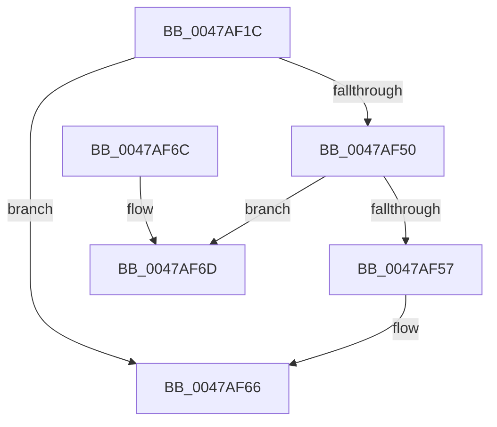

# PfpFileCheckAttributesForPrefetch

- RVA: `0x0047AF1C`–`0x0047AF89` (길이 `109` bytes)
- VA: `0x000000014047AF1C`
- 실행 섹션: `.text`
- PDB 이름 있음: `예`; PDB Function 태그: `아니요`
- unwind 정보 RVA: `0x000AD3C4`
- 디코드: `32`개 명령, `109/109` bytes 표시
- 미해석 바이트: `0` (있으면 어셈블리에 `.byte`로 보존)

> 이 문서는 커널 이미지의 기계어와 PDB 기호를 분석해 생성했습니다. 4번과 5번은 함수 원형과 자료형을 바이너리 사용 방식에서 추정한 C 해석이며 원본 소스 복구 결과는 아닙니다.

## 1. Dependencies

- 직접 호출 지점: **2**; 고유 호출 대상: **2**
- 직접 호출자로 확인된 함수: **2**
- RIP 상대 이미지 참조: **0**

### Outgoing calls
- `0x0047AF47` → [NtQueryInformationFile](../../page/8A/NtQueryInformationFile_function_008AD630.md) (function, `0x008AD630`)
- `0x0047AF83` → [KeBugCheckEx](../4F/KeBugCheckEx_function_004FD660.md) (function, `0x004FD660`)

### Direct callers
- [PfSnGetSectionObject](../../page/8A/PfSnGetSectionObject_function_008A9448.md) at `0x008A9590`
- [PfpFileBuildReadSupport](../../page/93/PfpFileBuildReadSupport_function_0093B504.md) at `0x0093B681`

### Static image references
- 디코드된 RIP-relative 메모리 참조가 없습니다.

## 2. Other-region calls and transfers

- 다른 실행 섹션으로 향하는 call: **1**
  - `0x0047AF47` → [NtQueryInformationFile](../../page/8A/NtQueryInformationFile_function_008AD630.md) (`.text` → `PAGE`)
- 별도 외부 분기/꼬리 이동을 확인하지 못했습니다.

## 3. Assembly (complete function range)

```asm
0047AF1C  48 8B C4                        mov rax, rsp
0047AF1F  53                              push rbx
0047AF20  48 83 EC 40                     sub rsp, 0x40
0047AF24  48 83 60 18 00                  and qword ptr [rax + 0x18], 0
0047AF29  4C 8D 40 18                     lea r8, [rax + 0x18]
0047AF2D  8B DA                           mov ebx, edx
0047AF2F  C7 40 D8 23 00 00 00            mov dword ptr [rax - 0x28], 0x23
0047AF36  0F 57 C0                        xorps xmm0, xmm0
0047AF39  48 8D 50 E8                     lea rdx, [rax - 0x18]
0047AF3D  41 B9 08 00 00 00               mov r9d, 8
0047AF43  0F 11 40 E8                     movups xmmword ptr [rax - 0x18], xmm0
0047AF47  E8 E4 26 43 00                  call 0x1408ad630
0047AF4C  85 C0                           test eax, eax
0047AF4E  78 16                           js 0x14047af66
0047AF50  3D 03 01 00 00                  cmp eax, 0x103
0047AF55  74 16                           je 0x14047af6d
0047AF57  8B 44 24 60                     mov eax, dword ptr [rsp + 0x60]
0047AF5B  23 C3                           and eax, ebx
0047AF5D  F7 D8                           neg eax
0047AF5F  1B C0                           sbb eax, eax
0047AF61  25 A4 00 00 C0                  and eax, 0xc00000a4
0047AF66  48 83 C4 40                     add rsp, 0x40
0047AF6A  5B                              pop rbx
0047AF6B  C3                              ret
0047AF6C  CC                              int3
0047AF6D  48 83 64 24 20 00               and qword ptr [rsp + 0x20], 0
0047AF73  45 33 C9                        xor r9d, r9d
0047AF76  45 33 C0                        xor r8d, r8d
0047AF79  BA 7C 28 00 00                  mov edx, 0x287c
0047AF7E  B9 91 01 00 00                  mov ecx, 0x191
0047AF83  E8 D8 26 08 00                  call 0x1404fd660
0047AF88  CC                              int3
```

## 4. C-style interpretation (structured pseudocode)

```c
__int64 __fastcall PfpFileCheckAttributesForPrefetch(__int64 a1, int a2)
{
    __int64 result;
    __int64 v_rsp;
    unsigned int v_stack_p18;
    unsigned __int64 v_stack_p20;

    v_rsp = (v_rsp) - (64);
    *(unsigned int *)(v_rsp - 40) = 35;
    *(unsigned __int64 *)(v_rsp - 24) = v_xmm0;
    result = NtQueryInformationFile(a1, v_rsp - 24, v_rsp + 24, 8);
    if (sign_flag) goto loc_0047AF66;
    if (((unsigned int)(result)) == 259) goto loc_0047AF6D;
    result = (unsigned int)(((unsigned int)(v_stack_p18)) & ((unsigned int)((unsigned int)(a2))));
    result = (unsigned int)(-(result));
    result = (unsigned int)((result) & (0xC00000A4ULL));
loc_0047AF66:
    v_rsp = (v_rsp) + (64);
    return result;
loc_0047AF6D:
    a4 = 0;
    a3 = 0;
    result = KeBugCheckEx(401, (unsigned int)(0x287CULL), a3, a4);
    return result;
}
```

## 5. (Beta) C Style

```c
int64_t PfpFileCheckAttributesForPrefetch(int64_t Arg1, int32_t Arg2)
{
    int64_t result;
    int64_t local_rsp;
    uint32_t v_stack_p18;
    uint64_t v_stack_p20;

    local_rsp = (local_rsp) - (64);
    *(uint32_t *)(local_rsp - 0x28) = 35;
    *(uint64_t *)(local_rsp - 0x18) = v_xmm0;
    result = NtQueryInformationFile(Arg1, local_rsp - 24, local_rsp + 24, 8);
    if (sign_flag) goto loc_0047AF66;
    if (((uint32_t)(result)) == 259) goto loc_0047AF6D;
    result = (uint32_t)(((uint32_t)(v_stack_p18)) & ((uint32_t)((uint32_t)(Arg2))));
    result = (uint32_t)(-(result));
    result = (uint32_t)((result) & (0xC00000A4ULL));
loc_0047AF66:
    local_rsp = (local_rsp) + (64);
    return result;
loc_0047AF6D:
    a4 = 0;
    a3 = 0;
    result = KeBugCheckEx(401, (uint32_t)(0x287CULL), a3, a4);
    return result;
}
```

## 6. Execution-region graph

[열기: 2D/3D 그래프와 함수 탐색 컨트롤 패널](../../../control-panel.html?section=text&rva=0x0047AF1C&view=graph)

- 2D 그래프는 위에서 아래로 흐르고, 3D 그래프는 빈 공간을 드래그해 회전합니다. Shift+드래그는 이동, 휠은 확대·축소, 함수 노드 선택은 대상 보고서 이동입니다.

### Static fallback


