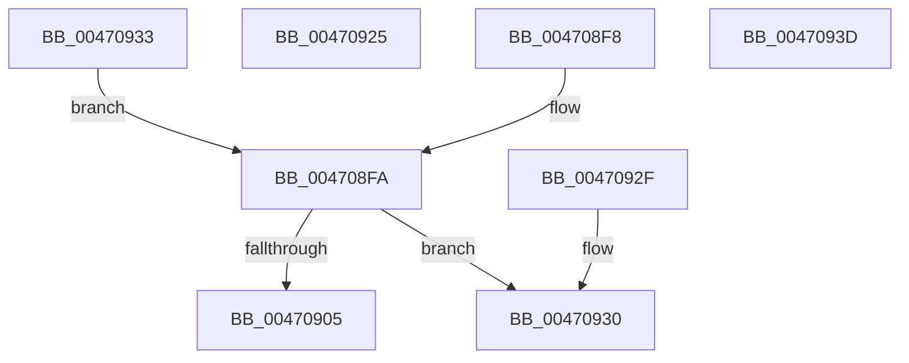

# PipAreDriversLoadedWorker

- RVA: `0x004708F8`–`0x00470963` (길이 `107` bytes)
- VA: `0x00000001404708F8`
- 실행 섹션: `.text`
- PDB 이름 있음: `예`; PDB Function 태그: `아니요`
- unwind 정보 RVA: `0x000DB714`
- 디코드: `40`개 명령, `107/107` bytes 표시
- 미해석 바이트: `0` (있으면 어셈블리에 `.byte`로 보존)

> 이 문서는 커널 이미지의 기계어와 PDB 기호를 분석해 생성했습니다. 4번과 5번은 함수 원형과 자료형을 바이너리 사용 방식에서 추정한 C 해석이며 원본 소스 복구 결과는 아닙니다.

## 1. Dependencies

- 직접 호출 지점: **0**; 고유 호출 대상: **0**
- 직접 호출자로 확인된 함수: **3**
- RIP 상대 이미지 참조: **1**

### Outgoing calls
- 직접 디코드된 call 명령이 없습니다.

### Direct callers
- [PipSetDevNodeState](PipSetDevNodeState_function_00470708.md) at `0x0047075E`
- [PipSetDevNodeState](PipSetDevNodeState_function_00470708.md) at `0x004707E9`
- [PipAreDriversLoaded](PipAreDriversLoaded_function_004708D4.md) at `0x004708E7`
- [PipRestoreDevNodeState](../5A/PipRestoreDevNodeState_function_005A7100.md) at `0x005A71B3`
- [PipRestoreDevNodeState](../5A/PipRestoreDevNodeState_function_005A7100.md) at `0x005A71BF`

### Static image references
- `0x00470908` → RVA `0x00000000` (`image boundary/outside`; read)

## 2. Other-region calls and transfers

- 다른 실행 섹션으로 향하는 call: **0**
- 별도 외부 분기/꼬리 이동을 확인하지 못했습니다.

## 3. Assembly (complete function range)

```asm
004708F8  66 90                           nop
004708FA  81 C1 00 FD FF FF               add ecx, 0xfffffd00
00470900  83 F9 16                        cmp ecx, 0x16
00470903  77 2B                           ja 0x140470930
00470905  48 63 C1                        movsxd rax, ecx
00470908  4C 8D 05 F1 F6 B8 FF            lea r8, [rip - 0x47090f]
0047090F  41 0F B6 84 00 4C 09 47 00      movzx eax, byte ptr [r8 + rax + 0x47094c]
00470918  41 8B 8C 80 40 09 47 00         mov ecx, dword ptr [r8 + rax*4 + 0x470940]
00470920  49 03 C8                        add rcx, r8
00470923  FF E1                           jmp rcx
00470925  CC                              int3
00470926  CC                              int3
00470927  CC                              int3
00470928  CC                              int3
00470929  B8 01 00 00 00                  mov eax, 1
0047092E  C3                              ret
0047092F  CC                              int3
00470930  33 C0                           xor eax, eax
00470932  C3                              ret
00470933  CC                              int3
00470934  8B CA                           mov ecx, edx
00470936  BA 00 03 00 00                  mov edx, 0x300
0047093B  EB BD                           jmp 0x1404708fa
0047093D  0F 1F 00                        nop dword ptr [rax]
00470940  30 09                           xor byte ptr [rcx], cl
00470942  47 00 29                        add byte ptr [r9], r13b
00470945  09 47 00                        or dword ptr [rdi], eax
00470948  34 09                           xor al, 9
0047094A  47 00 00                        add byte ptr [r8], r8b
0047094D  00 00                           add byte ptr [rax], al
0047094F  00 00                           add byte ptr [rax], al
00470951  01 01                           add dword ptr [rcx], eax
00470953  01 01                           add dword ptr [rcx], eax
00470955  01 01                           add dword ptr [rcx], eax
00470957  01 01                           add dword ptr [rcx], eax
00470959  01 01                           add dword ptr [rcx], eax
0047095B  01 02                           add dword ptr [rdx], eax
0047095D  01 01                           add dword ptr [rcx], eax
0047095F  01 00                           add dword ptr [rax], eax
00470961  01 00                           add dword ptr [rax], eax
```

## 4. C-style interpretation (structured pseudocode)

```c
__int64 __fastcall PipAreDriversLoadedWorker(int a1, int a2, __int64 a3, __int64 a4)
{
    __int64 result;

loc_004708FA:
    a1 = (unsigned int)((a1) + (0xFFFFFD00ULL));
    if (a1 > 22) goto loc_00470930;
    a1 = ((unsigned int)(*(unsigned int *)(v_rip - 4655375 + *(unsigned __int8 *)(v_rip - 4655375 + (int)(a1) * 1 + 4655436) * 4 + 4655424))) + (v_rip - 4655375);
loc_00470930:
    result = 0;
    return result;
}
```

## 5. (Beta) C Style

```c
int64_t PipAreDriversLoadedWorker(int32_t Arg1, int32_t Arg2, int64_t Arg3, int64_t Arg4)
{
    int64_t result;

loc_004708FA:
    Arg1 = (uint32_t)((Arg1) + (0xFFFFFD00ULL));
    if (Arg1 > 22) goto loc_00470930;
    Arg1 = ((uint32_t)(*(uint32_t *)(v_rip - 0x47090F + *(uint8_t *)(v_rip - 0x47090F + (int32_t)(Arg1) * 1 + 0x47094C) * 4 + 0x470940))) + (v_rip - 4655375);
loc_00470930:
    result = 0;
    return result;
}
```

## 6. Execution-region graph

[열기: 2D/3D 그래프와 함수 탐색 컨트롤 패널](../../../control-panel.html?section=text&rva=0x004708F8&view=graph)

- 2D 그래프는 위에서 아래로 흐르고, 3D 그래프는 빈 공간을 드래그해 회전합니다. Shift+드래그는 이동, 휠은 확대·축소, 함수 노드 선택은 대상 보고서 이동입니다.

### Static fallback


