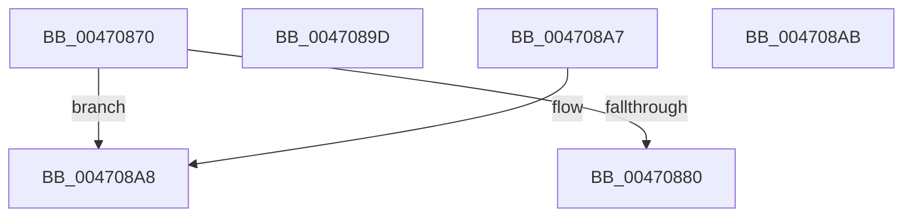

# PipIsDevNodeDNStarted

- RVA: `0x00470870`–`0x004708CB` (길이 `91` bytes)
- VA: `0x0000000140470870`
- 실행 섹션: `.text`
- PDB 이름 있음: `예`; PDB Function 태그: `아니요`
- unwind 정보 RVA: `0x000DB714`
- 디코드: `33`개 명령, `91/91` bytes 표시
- 미해석 바이트: `0` (있으면 어셈블리에 `.byte`로 보존)

> 이 문서는 커널 이미지의 기계어와 PDB 기호를 분석해 생성했습니다. 4번과 5번은 함수 원형과 자료형을 바이너리 사용 방식에서 추정한 C 해석이며 원본 소스 복구 결과는 아닙니다.

## 1. Dependencies

- 직접 호출 지점: **0**; 고유 호출 대상: **0**
- 직접 호출자로 확인된 함수: **11**
- RIP 상대 이미지 참조: **1**

### Outgoing calls
- 직접 디코드된 call 명령이 없습니다.

### Direct callers
- [PipSetDevNodeState](PipSetDevNodeState_function_00470708.md) at `0x00470769`
- [PipSetDevNodeState](PipSetDevNodeState_function_00470708.md) at `0x004707F6`
- [PipSetDevNodeState](PipSetDevNodeState_function_00470708.md) at `0x00470811`
- [PipRestoreDevNodeState](../5A/PipRestoreDevNodeState_function_005A7100.md) at `0x005A7135`
- [PipRestoreDevNodeState](../5A/PipRestoreDevNodeState_function_005A7100.md) at `0x005A71CC`
- [PipRestoreDevNodeState](../5A/PipRestoreDevNodeState_function_005A7100.md) at `0x005A71E7`
- [IoReportDetectedDevice](../../page/72/IoReportDetectedDevice_function_00725CD0.md) at `0x007266F1`
- [PiControlGetUserFlagsFromDeviceNode](../../page/8E/PiControlGetUserFlagsFromDeviceNode_function_008E5888.md) at `0x008E58B5`
- [PiDevCfgConfigureDevice](../../page/97/PiDevCfgConfigureDevice_function_00977BB4.md) at `0x00979BE6`
- [PnpCheckForActiveDependencies](../../page/A0/PnpCheckForActiveDependencies_function_00A06DA4.md) at `0x00A06DB3`
- [PnpProcessDependencyRelations](../../page/A0/PnpProcessDependencyRelations_function_00A07548.md) at `0x00A07625`
- [PiControlGetDevicePowerData](../../page/A7/PiControlGetDevicePowerData_function_00A7A808.md) at `0x00A7A87E`
- [PnpRequestDeviceRemovalWorker](../../page/A8/PnpRequestDeviceRemovalWorker_function_00A8F958.md) at `0x00A8FA57`
- [PnpDriverLoadingFailed](../../page/AB/PnpDriverLoadingFailed_function_00AB8928.md) at `0x00AB8AD6`
- [PiDevCfgLogDeviceStarted](../../page/AB/PiDevCfgLogDeviceStarted_function_00ABEC8C.md) at `0x00ABEEE2`
- [PiDevCfgLogDeviceStarted](../../page/AB/PiDevCfgLogDeviceStarted_function_00ABEC8C.md) at `0x00ABEF01`

### Static image references
- `0x00470880` → RVA `0x00000000` (`image boundary/outside`; read)

## 2. Other-region calls and transfers

- 다른 실행 섹션으로 향하는 call: **0**
- 별도 외부 분기/꼬리 이동을 확인하지 못했습니다.

## 3. Assembly (complete function range)

```asm
00470870  8B 81 2C 01 00 00               mov eax, dword ptr [rcx + 0x12c]
00470876  2D 00 03 00 00                  sub eax, 0x300
0047087B  83 F8 16                        cmp eax, 0x16
0047087E  77 28                           ja 0x1404708a8
00470880  48 8D 15 79 F7 B8 FF            lea rdx, [rip - 0x470887]
00470887  48 98                           cdqe
00470889  0F B6 84 02 B4 08 47 00         movzx eax, byte ptr [rdx + rax + 0x4708b4]
00470891  8B 8C 82 AC 08 47 00            mov ecx, dword ptr [rdx + rax*4 + 0x4708ac]
00470898  48 03 CA                        add rcx, rdx
0047089B  FF E1                           jmp rcx
0047089D  CC                              int3
0047089E  CC                              int3
0047089F  CC                              int3
004708A0  CC                              int3
004708A1  B8 01 00 00 00                  mov eax, 1
004708A6  C3                              ret
004708A7  CC                              int3
004708A8  33 C0                           xor eax, eax
004708AA  C3                              ret
004708AB  CC                              int3
004708AC  A8 08                           test al, 8
004708AE  47 00 A1 08 47 00 00            add byte ptr [r9 + 0x4708], r12b
004708B5  00 00                           add byte ptr [rax], al
004708B7  00 00                           add byte ptr [rax], al
004708B9  00 00                           add byte ptr [rax], al
004708BB  01 01                           add dword ptr [rcx], eax
004708BD  01 01                           add dword ptr [rcx], eax
004708BF  01 01                           add dword ptr [rcx], eax
004708C1  01 01                           add dword ptr [rcx], eax
004708C3  01 00                           add dword ptr [rax], eax
004708C5  00 00                           add byte ptr [rax], al
004708C7  00 00                           add byte ptr [rax], al
004708C9  00 00                           add byte ptr [rax], al
```

## 4. C-style interpretation (structured pseudocode)

```c
__int64 __fastcall PipIsDevNodeDNStarted(__int64 a1, __int64 a2, __int64 a3, __int64 a4)
{
    __int64 result;

    result = (unsigned int)(((unsigned int)(*(unsigned int *)(a1 + 300))) - (768));
    if (((unsigned int)(result)) > 22) goto loc_004708A8;
    a1 = ((unsigned int)(*(unsigned int *)(v_rip - 4655239 + *(unsigned __int8 *)(v_rip - 4655239 + result * 1 + 4655284) * 4 + 4655276))) + (v_rip - 4655239);
loc_004708A8:
    result = 0;
    return result;
}
```

## 5. (Beta) C Style

```c
int64_t PipIsDevNodeDNStarted(void *Arg1, int64_t Arg2, int64_t Arg3, int64_t Arg4)
{
    uint8_t *arg1 = (uint8_t *)Arg1;

    int64_t result;

    result = (uint32_t)(((uint32_t)(*(uint32_t *)(arg1 + 0x12C))) - (768));
    if (((uint32_t)(result)) > 22) goto loc_004708A8;
    Arg1 = ((uint32_t)(*(uint32_t *)(v_rip - 0x470887 + *(uint8_t *)(v_rip - 0x470887 + result * 1 + 0x4708B4) * 4 + 0x4708AC))) + (v_rip - 4655239);
loc_004708A8:
    result = 0;
    return result;
}
```

### 관측된 메모리 오프셋

구조체 형식이 확인되지 않은 접근은 인자 기준의 오프셋으로만 기록했습니다.

| 기준 인자 | 오프셋 표현 | 폭 (bit) | 접근 |
|---|---:|---:|---|
| `Arg1` | `+ 0x12C` | `32` | `R` |

## 6. Execution-region graph

[열기: 2D/3D 그래프와 함수 탐색 컨트롤 패널](../../../control-panel.html?section=text&rva=0x00470870&view=graph)

- 2D 그래프는 위에서 아래로 흐르고, 3D 그래프는 빈 공간을 드래그해 회전합니다. Shift+드래그는 이동, 휠은 확대·축소, 함수 노드 선택은 대상 보고서 이동입니다.

### Static fallback


