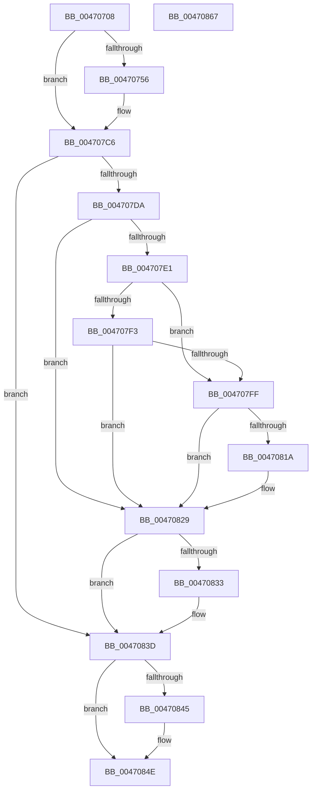

# PipSetDevNodeState

- RVA: `0x00470708`–`0x00470868` (길이 `352` bytes)
- VA: `0x0000000140470708`
- 실행 섹션: `.text`
- PDB 이름 있음: `예`; PDB Function 태그: `아니요`
- unwind 정보 RVA: `0x00060300`
- 디코드: `89`개 명령, `352/352` bytes 표시
- 미해석 바이트: `0` (있으면 어셈블리에 `.byte`로 보존)

> 이 문서는 커널 이미지의 기계어와 PDB 기호를 분석해 생성했습니다. 4번과 5번은 함수 원형과 자료형을 바이너리 사용 방식에서 추정한 C 해석이며 원본 소스 복구 결과는 아닙니다.

## 1. Dependencies

- 직접 호출 지점: **11**; 고유 호출 대상: **7**
- 직접 호출자로 확인된 함수: **27**
- RIP 상대 이미지 참조: **1**

### Outgoing calls
- `0x00470734` → [KeAcquireSpinLockRaiseToDpc](../20/KeAcquireSpinLockRaiseToDpc_function_00208470.md) (function, `0x00208470`)
- `0x0047075E` → [PipAreDriversLoadedWorker](PipAreDriversLoadedWorker_function_004708F8.md) (function, `0x004708F8`)
- `0x00470769` → [PipIsDevNodeDNStarted](PipIsDevNodeDNStarted_function_00470870.md) (function, `0x00470870`)
- `0x004707D0` → [KeReleaseSpinLock](../39/KeReleaseSpinLock_function_00392BA0.md) (function, `0x00392BA0`)
- `0x004707E9` → [PipAreDriversLoadedWorker](PipAreDriversLoadedWorker_function_004708F8.md) (function, `0x004708F8`)
- `0x004707F6` → [PipIsDevNodeDNStarted](PipIsDevNodeDNStarted_function_00470870.md) (function, `0x00470870`)
- `0x00470809` → [PnpRaiseNtPlugPlayDevicePropertyChangeEvent](../../page/8F/PnpRaiseNtPlugPlayDevicePropertyChangeEvent_function_008F7D80.md) (function, `0x008F7D80`)
- `0x00470811` → [PipIsDevNodeDNStarted](PipIsDevNodeDNStarted_function_00470870.md) (function, `0x00470870`)
- `0x00470824` → [PnpRaiseNtPlugPlayDevicePropertyChangeEvent](../../page/8F/PnpRaiseNtPlugPlayDevicePropertyChangeEvent_function_008F7D80.md) (function, `0x008F7D80`)
- `0x00470838` → [PpDevCfgTraceDeviceStart](../../page/8F/PpDevCfgTraceDeviceStart_function_008F9908.md) (function, `0x008F9908`)
- `0x00470849` → [PnpRemoveDeviceActionRequests](../4E/PnpRemoveDeviceActionRequests_function_004E89A4.md) (function, `0x004E89A4`)

### Direct callers
- [PnpRemoveLockedDeviceNode](PnpRemoveLockedDeviceNode_function_004702AC.md) at `0x004703FC`
- [sub_006F3B38](../6F/Unknown_function_006F3B38.md) at `0x006F3B82`
- [IoReportDetectedDevice](../../page/72/IoReportDetectedDevice_function_00725CD0.md) at `0x0072645C`
- [IoReportDetectedDevice](../../page/72/IoReportDetectedDevice_function_00725CD0.md) at `0x00726744`
- [PnpRestartDeviceNode](../../page/72/PnpRestartDeviceNode_function_0072CD60.md) at `0x0072CE40`
- [PnpQueryRemoveLockedDeviceNode](../../page/72/PnpQueryRemoveLockedDeviceNode_function_0072D210.md) at `0x0072D293`
- [PiInitializeDevice](../../page/73/PiInitializeDevice_function_0073EC5C.md) at `0x0073EEC9`
- [PnpQueryStopDeviceNode](../../page/73/PnpQueryStopDeviceNode_function_0073F47C.md) at `0x0073F4EE`
- [PnpStopDeviceSubtree](../../page/73/PnpStopDeviceSubtree_function_0073F8AC.md) at `0x0073F8EE`
- [PipProcessRestartPhase2](../../page/74/PipProcessRestartPhase2_function_007408B8.md) at `0x00740951`
- [PipEnumerateCompleted](../../page/8F/PipEnumerateCompleted_function_008F7B1C.md) at `0x008F7BBA`
- [PipEnumerateDevice](../../page/8F/PipEnumerateDevice_function_008F99E4.md) at `0x008F9A4F`
- [PipEnumerateDevice](../../page/8F/PipEnumerateDevice_function_008F99E4.md) at `0x008F9B38`
- [PnpDeviceCompletionProcessCompletedRequest](../../page/8F/PnpDeviceCompletionProcessCompletedRequest_function_008FB654.md) at `0x008FB67F`
- [PipProcessStartPhase3](../../page/8F/PipProcessStartPhase3_function_008FBAF8.md) at `0x008FBBCC`
- [PnpStartDeviceNode](../../page/8F/PnpStartDeviceNode_function_008FE38C.md) at `0x008FE489`
- [PnpStartDeviceNode](../../page/8F/PnpStartDeviceNode_function_008FE38C.md) at `0x008FE51B`
- [PipProcessStartPhase2](../../page/94/PipProcessStartPhase2_function_0094EE60.md) at `0x0094EEA7`
- [PipCallDriverAddDeviceQueryRoutine](../../page/99/PipCallDriverAddDeviceQueryRoutine_function_00996604.md) at `0x00996AC0`
- [PnpSurpriseRemoveLockedDeviceNode](../../page/A0/PnpSurpriseRemoveLockedDeviceNode_function_00A08370.md) at `0x00A08411`
- [PnpSurpriseRemoveLockedDeviceNode](../../page/A0/PnpSurpriseRemoveLockedDeviceNode_function_00A08370.md) at `0x00A08474`
- [PnpSurpriseRemoveLockedDeviceNode](../../page/A0/PnpSurpriseRemoveLockedDeviceNode_function_00A08370.md) at `0x00A08485`
- [PnpSurpriseRemoveLockedDeviceNode](../../page/A0/PnpSurpriseRemoveLockedDeviceNode_function_00A08370.md) at `0x00A084FA`
- [PipCallDriverAddDevice](../../page/A2/PipCallDriverAddDevice_function_00A272E0.md) at `0x00A277D5`
- [PipCallDriverAddDevice](../../page/A2/PipCallDriverAddDevice_function_00A272E0.md) at `0x00A27AD1`
- [PiProcessNewDeviceNode](../../page/A2/PiProcessNewDeviceNode_function_00A28F20.md) at `0x00A29344`
- [PnpProcessAssignResources](../../page/A2/PnpProcessAssignResources_function_00A2A950.md) at `0x00A2AAA1`
- [PnpRequestDeviceRemovalWorker](../../page/A8/PnpRequestDeviceRemovalWorker_function_00A8F958.md) at `0x00A8F99C`
- [PipDeviceRemovalCheckDeviceNodeState](../../page/A8/PipDeviceRemovalCheckDeviceNodeState_function_00A8FA68.md) at `0x00A8FAAF`
- [PnpDriverLoadingFailed](../../page/AB/PnpDriverLoadingFailed_function_00AB8928.md) at `0x00AB8B49`
- [IopFindLegacyDeviceNode](../../page/AC/IopFindLegacyDeviceNode_function_00AC7338.md) at `0x00AC7486`
- [sub_00B38858](../../page/B3/Unknown_function_00B38858.md) at `0x00B388C6`
- [sub_00B420B0](../../page/B4/Unknown_function_00B420B0.md) at `0x00B42191`
- [IopInitializePlugPlayServices](../../init/C2/IopInitializePlugPlayServices_function_00C2F298.md) at `0x00C2FDB4`

### Static image references
- `0x00470725` → RVA `0x00F8AD90` (`.data`; read)

## 2. Other-region calls and transfers

- 다른 실행 섹션으로 향하는 call: **3**
  - `0x00470809` → [PnpRaiseNtPlugPlayDevicePropertyChangeEvent](../../page/8F/PnpRaiseNtPlugPlayDevicePropertyChangeEvent_function_008F7D80.md) (`.text` → `PAGE`)
  - `0x00470824` → [PnpRaiseNtPlugPlayDevicePropertyChangeEvent](../../page/8F/PnpRaiseNtPlugPlayDevicePropertyChangeEvent_function_008F7D80.md) (`.text` → `PAGE`)
  - `0x00470838` → [PpDevCfgTraceDeviceStart](../../page/8F/PpDevCfgTraceDeviceStart_function_008F9908.md) (`.text` → `PAGE`)
- 별도 외부 분기/꼬리 이동을 확인하지 못했습니다.

## 3. Assembly (complete function range)

```asm
00470708  48 89 5C 24 08                  mov qword ptr [rsp + 8], rbx
0047070D  48 89 6C 24 10                  mov qword ptr [rsp + 0x10], rbp
00470712  48 89 74 24 18                  mov qword ptr [rsp + 0x18], rsi
00470717  57                              push rdi
00470718  41 56                           push r14
0047071A  41 57                           push r15
0047071C  48 83 EC 20                     sub rsp, 0x20
00470720  48 8B D9                        mov rbx, rcx
00470723  8B EA                           mov ebp, edx
00470725  48 8D 0D 64 A6 B1 00            lea rcx, [rip + 0xb1a664]
0047072C  45 33 FF                        xor r15d, r15d
0047072F  33 F6                           xor esi, esi
00470731  45 32 F6                        xor r14b, r14b
00470734  E8 37 7D D9 FF                  call 0x140208470
00470739  44 8B 93 2C 01 00 00            mov r10d, dword ptr [rbx + 0x12c]
00470740  48 8D BB 30 01 00 00            lea rdi, [rbx + 0x130]
00470747  4C 8B 8B 78 03 00 00            mov r9, qword ptr [rbx + 0x378]
0047074E  44 8A D8                        mov r11b, al
00470751  44 3B D5                        cmp r10d, ebp
00470754  74 70                           je 0x1404707c6
00470756  8B 8B 2C 01 00 00               mov ecx, dword ptr [rbx + 0x12c]
0047075C  8B 17                           mov edx, dword ptr [rdi]
0047075E  E8 95 01 00 00                  call 0x1404708f8
00470763  48 8B CB                        mov rcx, rbx
00470766  44 8B F8                        mov r15d, eax
00470769  E8 02 01 00 00                  call 0x140470870
0047076E  89 AB 2C 01 00 00               mov dword ptr [rbx + 0x12c], ebp
00470774  8B F0                           mov esi, eax
00470776  44 89 93 30 01 00 00            mov dword ptr [rbx + 0x130], r10d
0047077D  41 B6 01                        mov r14b, 1
00470780  48 A1 14 00 00 00 80 F7 FF FF   movabs rax, qword ptr [0xfffff78000000014]
0047078A  8B 8B 84 01 00 00               mov ecx, dword ptr [rbx + 0x184]
00470790  48 89 83 78 03 00 00            mov qword ptr [rbx + 0x378], rax
00470797  B8 CD CC CC CC                  mov eax, 0xcccccccd
0047079C  4C 89 8B 80 03 00 00            mov qword ptr [rbx + 0x380], r9
004707A3  44 89 94 8B 34 01 00 00         mov dword ptr [rbx + rcx*4 + 0x134], r10d
004707AB  8B 8B 84 01 00 00               mov ecx, dword ptr [rbx + 0x184]
004707B1  FF C1                           inc ecx
004707B3  F7 E1                           mul ecx
004707B5  C1 EA 04                        shr edx, 4
004707B8  8D 04 92                        lea eax, [rdx + rdx*4]
004707BB  C1 E0 02                        shl eax, 2
004707BE  2B C8                           sub ecx, eax
004707C0  89 8B 84 01 00 00               mov dword ptr [rbx + 0x184], ecx
004707C6  41 8A D3                        mov dl, r11b
004707C9  48 8D 0D C0 A5 B1 00            lea rcx, [rip + 0xb1a5c0]
004707D0  E8 CB 23 F2 FF                  call 0x140392ba0
004707D5  45 84 F6                        test r14b, r14b
004707D8  74 63                           je 0x14047083d
004707DA  48 83 7B 30 00                  cmp qword ptr [rbx + 0x30], 0
004707DF  74 48                           je 0x140470829
004707E1  8B 8B 2C 01 00 00               mov ecx, dword ptr [rbx + 0x12c]
004707E7  8B 17                           mov edx, dword ptr [rdi]
004707E9  E8 0A 01 00 00                  call 0x1404708f8
004707EE  41 3B C7                        cmp eax, r15d
004707F1  75 0C                           jne 0x1404707ff
004707F3  48 8B CB                        mov rcx, rbx
004707F6  E8 75 00 00 00                  call 0x140470870
004707FB  3B C6                           cmp eax, esi
004707FD  74 2A                           je 0x140470829
004707FF  48 8B 53 30                     mov rdx, qword ptr [rbx + 0x30]
00470803  41 B8 0B 00 00 00               mov r8d, 0xb
00470809  E8 72 75 48 00                  call 0x1408f7d80
0047080E  48 8B CB                        mov rcx, rbx
00470811  E8 5A 00 00 00                  call 0x140470870
00470816  3B C6                           cmp eax, esi
00470818  74 0F                           je 0x140470829
0047081A  48 8B 53 30                     mov rdx, qword ptr [rbx + 0x30]
0047081E  41 B8 1A 00 00 00               mov r8d, 0x1a
00470824  E8 57 75 48 00                  call 0x1408f7d80
00470829  8B 83 C0 02 00 00               mov eax, dword ptr [rbx + 0x2c0]
0047082F  A8 01                           test al, 1
00470831  74 0A                           je 0x14047083d
00470833  B2 01                           mov dl, 1
00470835  48 8B CB                        mov rcx, rbx
00470838  E8 CB 90 48 00                  call 0x1408f9908
0047083D  81 FD 16 03 00 00               cmp ebp, 0x316
00470843  75 09                           jne 0x14047084e
00470845  48 8B 4B 20                     mov rcx, qword ptr [rbx + 0x20]
00470849  E8 56 81 07 00                  call 0x1404e89a4
0047084E  48 8B 5C 24 40                  mov rbx, qword ptr [rsp + 0x40]
00470853  48 8B 6C 24 48                  mov rbp, qword ptr [rsp + 0x48]
00470858  48 8B 74 24 50                  mov rsi, qword ptr [rsp + 0x50]
0047085D  48 83 C4 20                     add rsp, 0x20
00470861  41 5F                           pop r15
00470863  41 5E                           pop r14
00470865  5F                              pop rdi
00470866  C3                              ret
00470867  CC                              int3
```

## 4. C-style interpretation (structured pseudocode)

```c
__int64 __fastcall PipSetDevNodeState(__int64 a1, int a2)
{
    __int64 result;
    __int64 v_r14;
    __int64 v_r15;
    __int64 v_rsi;
    __int64 v_rsp;
    unsigned __int64 v_stack_p10;
    unsigned __int64 v_stack_p18;
    unsigned __int64 v_stack_p8;

    v_stack_p8 = v_rbx;
    v_stack_p10 = v_rbp;
    v_stack_p18 = v_rsi;
    v_rsp = (v_rsp) - (32);
    v_r15 = 0;
    v_rsi = 0;
    v_r14 = 0;
    result = KeAcquireSpinLockRaiseToDpc(v_rip + 11642468, a2, a3, a4);
    if (((unsigned int)((unsigned int)(*(unsigned int *)(a1 + 300)))) != ((unsigned int)((unsigned int)(a2)))) {
        a1 = *(unsigned int *)(a1 + 300);
        a2 = *(unsigned int *)(a1 + 304);
        result = PipAreDriversLoadedWorker(a1, a2, a3, *(unsigned __int64 *)(a1 + 888));
        a1 = a1;
        v_r15 = (unsigned int)(result);
        result = PipIsDevNodeDNStarted(a1, a2, a3, *(unsigned __int64 *)(a1 + 888));
        *(unsigned int *)(a1 + 300) = (unsigned int)((unsigned int)(a2));
        v_rsi = (unsigned int)(result);
        *(unsigned int *)(a1 + 304) = (unsigned int)((unsigned int)(*(unsigned int *)(a1 + 300)));
        v_r14 = 1;
        a1 = *(unsigned int *)(a1 + 388);
        *(unsigned __int64 *)(a1 + 888) = result;
        result = 0xCCCCCCCDULL;
        *(unsigned __int64 *)(a1 + 896) = *(unsigned __int64 *)(a1 + 888);
        *(unsigned int *)(a1 + a1 * 4 + 308) = (unsigned int)((unsigned int)(*(unsigned int *)(a1 + 300)));
        a1 = *(unsigned int *)(a1 + 388);
        a1 = (unsigned int)((a1) + 1);
        a2 = (unsigned int)((a2) >> (4));
        result = a2 + a2 * 4;
        result = (unsigned int)((result) << (2));
        a1 = (unsigned int)((a1) - ((unsigned int)(result)));
        *(unsigned int *)(a1 + 388) = (unsigned int)(a1);
    }
    result = KeReleaseSpinLock(v_rip + 11642304, (unsigned __int8)((unsigned __int8)(result)), a3, *(unsigned __int64 *)(a1 + 888));
    if ((unsigned __int8)(v_r14) == 0) goto loc_0047083D;
    if ((*(unsigned __int64 *)(a1 + 48)) == 0) goto loc_00470829;
    result = PipAreDriversLoadedWorker((unsigned int)(*(unsigned int *)(a1 + 300)), (unsigned int)(*(unsigned int *)(a1 + 304)), a3, *(unsigned __int64 *)(a1 + 888));
    if (((unsigned int)(result)) != ((unsigned int)(v_r15))) goto loc_004707FF;
    result = PipIsDevNodeDNStarted(a1, (unsigned int)(*(unsigned int *)(a1 + 304)), a3, *(unsigned __int64 *)(a1 + 888));
    if (((unsigned int)(result)) == ((unsigned int)(v_rsi))) goto loc_00470829;
loc_004707FF:
    result = PnpRaiseNtPlugPlayDevicePropertyChangeEvent(a1, *(unsigned __int64 *)(a1 + 48), 11, *(unsigned __int64 *)(a1 + 888));
    result = PipIsDevNodeDNStarted(a1, *(unsigned __int64 *)(a1 + 48), 11, *(unsigned __int64 *)(a1 + 888));
    if (((unsigned int)(result)) != ((unsigned int)(v_rsi))) {
        a2 = *(unsigned __int64 *)(a1 + 48);
        a3 = 26;
        result = PnpRaiseNtPlugPlayDevicePropertyChangeEvent(a1, a2, a3, *(unsigned __int64 *)(a1 + 888));
    }
    result = (unsigned int)(*(unsigned int *)(a1 + 704));
    if ((((unsigned __int8)((unsigned int)(*(unsigned int *)(a1 + 704)))) & (1)) != 0) {
        a2 = 1;
        a1 = a1;
        result = PpDevCfgTraceDeviceStart(a1, a2, a3, *(unsigned __int64 *)(a1 + 888));
    }
    if (((unsigned int)((unsigned int)(a2))) == 790) {
        a1 = *(unsigned __int64 *)(a1 + 32);
        result = PnpRemoveDeviceActionRequests(a1, a2, a3, *(unsigned __int64 *)(a1 + 888));
    }
    v_rsp = (v_rsp) + (32);
    return result;
}
```

## 5. (Beta) C Style

```c
int64_t PipSetDevNodeState(void *Arg1, int32_t Arg2)
{
    uint8_t *arg1 = (uint8_t *)Arg1;

    int64_t result;
    int64_t local_r14;
    int64_t local_r15;
    int64_t local_rsi;
    int64_t local_rsp;
    uint64_t v_stack_p10;
    uint64_t v_stack_p18;
    uint64_t v_stack_p8;

    v_stack_p8 = local_rbx;
    v_stack_p10 = local_rbp;
    v_stack_p18 = local_rsi;
    local_rsp = (local_rsp) - (32);
    local_r15 = 0;
    local_rsi = 0;
    local_r14 = 0;
    result = KeAcquireSpinLockRaiseToDpc(v_rip + 11642468, Arg2, a3, a4);
    if (((uint32_t)((uint32_t)(*(uint32_t *)(arg1 + 0x12C)))) != ((uint32_t)((uint32_t)(Arg2)))) {
        Arg1 = *(uint32_t *)(arg1 + 0x12C);
        Arg2 = *(uint32_t *)(arg1 + 0x130);
        result = PipAreDriversLoadedWorker(Arg1, Arg2, a3, *(uint64_t *)(arg1 + 0x378));
        Arg1 = Arg1;
        local_r15 = (uint32_t)(result);
        result = PipIsDevNodeDNStarted(Arg1, Arg2, a3, *(uint64_t *)(arg1 + 0x378));
        *(uint32_t *)(arg1 + 0x12C) = (uint32_t)((uint32_t)(Arg2));
        local_rsi = (uint32_t)(result);
        *(uint32_t *)(arg1 + 0x130) = (uint32_t)((uint32_t)(*(uint32_t *)(arg1 + 0x12C)));
        local_r14 = 1;
        Arg1 = *(uint32_t *)(arg1 + 0x184);
        *(uint64_t *)(arg1 + 0x378) = result;
        result = 0xCCCCCCCDULL;
        *(uint64_t *)(arg1 + 0x380) = *(uint64_t *)(arg1 + 0x378);
        *(uint32_t *)(arg1 + arg1 * 4 + 0x134) = (uint32_t)((uint32_t)(*(uint32_t *)(arg1 + 0x12C)));
        Arg1 = *(uint32_t *)(arg1 + 0x184);
        Arg1 = (uint32_t)((Arg1) + 1);
        Arg2 = (uint32_t)((Arg2) >> (4));
        result = Arg2 + Arg2 * 4;
        result = (uint32_t)((result) << (2));
        Arg1 = (uint32_t)((Arg1) - ((uint32_t)(result)));
        *(uint32_t *)(arg1 + 0x184) = (uint32_t)(Arg1);
    }
    result = KeReleaseSpinLock(v_rip + 11642304, (uint8_t)((uint8_t)(result)), a3, *(uint64_t *)(arg1 + 0x378));
    if ((uint8_t)(local_r14) == 0) goto loc_0047083D;
    if ((*(uint64_t *)(arg1 + 0x30)) == 0) goto loc_00470829;
    result = PipAreDriversLoadedWorker((uint32_t)(*(uint32_t *)(arg1 + 0x12C)), (uint32_t)(*(uint32_t *)(arg1 + 0x130)), a3, *(uint64_t *)(arg1 + 0x378));
    if (((uint32_t)(result)) != ((uint32_t)(local_r15))) goto loc_004707FF;
    result = PipIsDevNodeDNStarted(Arg1, (uint32_t)(*(uint32_t *)(arg1 + 0x130)), a3, *(uint64_t *)(arg1 + 0x378));
    if (((uint32_t)(result)) == ((uint32_t)(local_rsi))) goto loc_00470829;
loc_004707FF:
    result = PnpRaiseNtPlugPlayDevicePropertyChangeEvent(Arg1, *(uint64_t *)(arg1 + 0x30), 11, *(uint64_t *)(arg1 + 0x378));
    result = PipIsDevNodeDNStarted(Arg1, *(uint64_t *)(arg1 + 0x30), 11, *(uint64_t *)(arg1 + 0x378));
    if (((uint32_t)(result)) != ((uint32_t)(local_rsi))) {
        Arg2 = *(uint64_t *)(arg1 + 0x30);
        a3 = 26;
        result = PnpRaiseNtPlugPlayDevicePropertyChangeEvent(Arg1, Arg2, a3, *(uint64_t *)(arg1 + 0x378));
    }
    result = (uint32_t)(*(uint32_t *)(arg1 + 0x2C0));
    if ((((uint8_t)((uint32_t)(*(uint32_t *)(arg1 + 0x2C0)))) & (1)) != 0) {
        Arg2 = 1;
        Arg1 = Arg1;
        result = PpDevCfgTraceDeviceStart(Arg1, Arg2, a3, *(uint64_t *)(arg1 + 0x378));
    }
    if (((uint32_t)((uint32_t)(Arg2))) == 790) {
        Arg1 = *(uint64_t *)(arg1 + 0x20);
        result = PnpRemoveDeviceActionRequests(Arg1, Arg2, a3, *(uint64_t *)(arg1 + 0x378));
    }
    local_rsp = (local_rsp) + (32);
    return result;
}
```

### 관측된 메모리 오프셋

구조체 형식이 확인되지 않은 접근은 인자 기준의 오프셋으로만 기록했습니다.

| 기준 인자 | 오프셋 표현 | 폭 (bit) | 접근 |
|---|---:|---:|---|
| `Arg1` | `+ 0x0` | `32` | `R` |
| `Arg1` | `+ 0x20` | `64` | `R` |
| `Arg1` | `+ 0x30` | `64` | `R` |
| `Arg1` | `+ 0x12C` | `32` | `R` |
| `Arg1` | `+ 0x12C` | `32` | `W` |
| `Arg1` | `+ 0x130` | `32` | `W` |
| `Arg1` | `+ 0x130` | `64` | `R` |
| `Arg1` | `+ 0x134 + rcx*4` | `32` | `W` |
| `Arg1` | `+ 0x184` | `32` | `R` |
| `Arg1` | `+ 0x184` | `32` | `W` |
| `Arg1` | `+ 0x2C0` | `32` | `R` |
| `Arg1` | `+ 0x378` | `64` | `R` |
| `Arg1` | `+ 0x378` | `64` | `W` |
| `Arg1` | `+ 0x380` | `64` | `W` |

## 6. Execution-region graph

[열기: 2D/3D 그래프와 함수 탐색 컨트롤 패널](../../../control-panel.html?section=text&rva=0x00470708&view=graph)

- 2D 그래프는 위에서 아래로 흐르고, 3D 그래프는 빈 공간을 드래그해 회전합니다. Shift+드래그는 이동, 휠은 확대·축소, 함수 노드 선택은 대상 보고서 이동입니다.

### Static fallback


