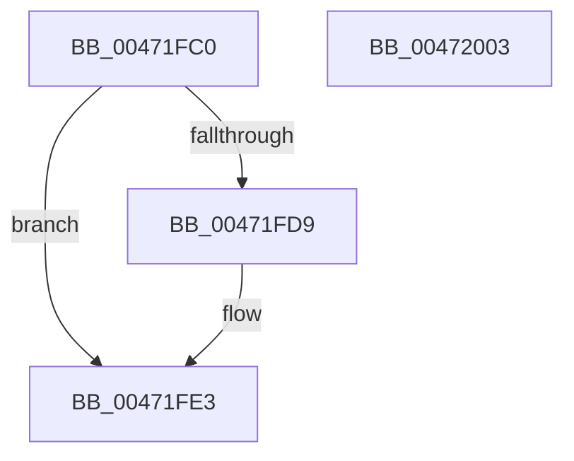

# PnpDeviceCompletionRequestDestroyWorkItem

- RVA: `0x00471FC0`–`0x00472004` (길이 `68` bytes)
- VA: `0x0000000140471FC0`
- 실행 섹션: `.text`
- PDB 이름 있음: `예`; PDB Function 태그: `아니요`
- unwind 정보 RVA: `0x0005CAAC`
- 디코드: `20`개 명령, `68/68` bytes 표시
- 미해석 바이트: `0` (있으면 어셈블리에 `.byte`로 보존)

> 이 문서는 커널 이미지의 기계어와 PDB 기호를 분석해 생성했습니다. 4번과 5번은 함수 원형과 자료형을 바이너리 사용 방식에서 추정한 C 해석이며 원본 소스 복구 결과는 아닙니다.

## 1. Dependencies

- 직접 호출 지점: **3**; 고유 호출 대상: **3**
- 직접 호출자로 확인된 함수: **1**
- RIP 상대 이미지 참조: **0**

### Outgoing calls
- `0x00471FD9` → [PnpDisableWatchdog](../../page/95/PnpDisableWatchdog_function_00955B00.md) (function, `0x00955B00`)
- `0x00471FE6` → [IoFreeWorkItem](IoFreeWorkItem_function_00472010.md) (function, `0x00472010`)
- `0x00471FF3` → [ExFreePoolWithTag](../../poolcode/B8/ExFreePoolWithTag_function_00B82870.md) (function, `0x00B82870`)

### Direct callers
- [sub_00393FDE](../39/Unknown_function_00393FDE.md) at `0x00393FF9`

### Static image references
- 디코드된 RIP-relative 메모리 참조가 없습니다.

## 2. Other-region calls and transfers

- 다른 실행 섹션으로 향하는 call: **2**
  - `0x00471FD9` → [PnpDisableWatchdog](../../page/95/PnpDisableWatchdog_function_00955B00.md) (`.text` → `PAGE`)
  - `0x00471FF3` → [ExFreePoolWithTag](../../poolcode/B8/ExFreePoolWithTag_function_00B82870.md) (`.text` → `POOLCODE`)
- 별도 외부 분기/꼬리 이동을 확인하지 못했습니다.

## 3. Assembly (complete function range)

```asm
00471FC0  48 89 5C 24 08                  mov qword ptr [rsp + 8], rbx
00471FC5  57                              push rdi
00471FC6  48 83 EC 20                     sub rsp, 0x20
00471FCA  48 8B 4A 40                     mov rcx, qword ptr [rdx + 0x40]
00471FCE  49 8B F8                        mov rdi, r8
00471FD1  48 8B DA                        mov rbx, rdx
00471FD4  48 85 C9                        test rcx, rcx
00471FD7  74 0A                           je 0x140471fe3
00471FD9  E8 22 3B 4E 00                  call 0x140955b00
00471FDE  48 83 63 40 00                  and qword ptr [rbx + 0x40], 0
00471FE3  48 8B CF                        mov rcx, rdi
00471FE6  E8 25 00 00 00                  call 0x140472010
00471FEB  BA 50 6E 70 31                  mov edx, 0x31706e50
00471FF0  48 8B CB                        mov rcx, rbx
00471FF3  E8 78 08 71 00                  call 0x140b82870
00471FF8  48 8B 5C 24 30                  mov rbx, qword ptr [rsp + 0x30]
00471FFD  48 83 C4 20                     add rsp, 0x20
00472001  5F                              pop rdi
00472002  C3                              ret
00472003  CC                              int3
```

## 4. C-style interpretation (structured pseudocode)

```c
__int64 __fastcall PnpDeviceCompletionRequestDestroyWorkItem(__int64 a1, __int64 a2, __int64 a3)
{
    __int64 result;
    __int64 v_rsp;
    unsigned __int64 v_stack_p8;

    v_stack_p8 = v_rbx;
    v_rsp = (v_rsp) - (32);
    if (*(unsigned __int64 *)(a2 + 64) != 0) {
        result = PnpDisableWatchdog(*(unsigned __int64 *)(a2 + 64), a2, a3, a4);
    }
    result = IoFreeWorkItem(a3, a2, a3, a4);
    result = ExFreePoolWithTag(a2, (unsigned int)(0x31706E50ULL), a3, a4);
    v_rsp = (v_rsp) + (32);
    return result;
}
```

## 5. (Beta) C Style

```c
int64_t PnpDeviceCompletionRequestDestroyWorkItem(int64_t Arg1, void *Arg2, int64_t Arg3)
{
    uint8_t *arg2 = (uint8_t *)Arg2;

    int64_t result;
    int64_t local_rsp;
    uint64_t v_stack_p8;

    v_stack_p8 = local_rbx;
    local_rsp = (local_rsp) - (32);
    if (*(uint64_t *)(arg2 + 0x40) != 0) {
        result = PnpDisableWatchdog(*(uint64_t *)(arg2 + 0x40), Arg2, Arg3, a4);
    }
    result = IoFreeWorkItem(Arg3, Arg2, Arg3, a4);
    result = ExFreePoolWithTag(Arg2, (uint32_t)(0x31706E50ULL), Arg3, a4);
    local_rsp = (local_rsp) + (32);
    return result;
}
```

### 관측된 메모리 오프셋

구조체 형식이 확인되지 않은 접근은 인자 기준의 오프셋으로만 기록했습니다.

| 기준 인자 | 오프셋 표현 | 폭 (bit) | 접근 |
|---|---:|---:|---|
| `Arg2` | `+ 0x40` | `64` | `R` |
| `Arg2` | `+ 0x40` | `64` | `R/W` |

## 6. Execution-region graph

[열기: 2D/3D 그래프와 함수 탐색 컨트롤 패널](../../../control-panel.html?section=text&rva=0x00471FC0&view=graph)

- 2D 그래프는 위에서 아래로 흐르고, 3D 그래프는 빈 공간을 드래그해 회전합니다. Shift+드래그는 이동, 휠은 확대·축소, 함수 노드 선택은 대상 보고서 이동입니다.

### Static fallback


