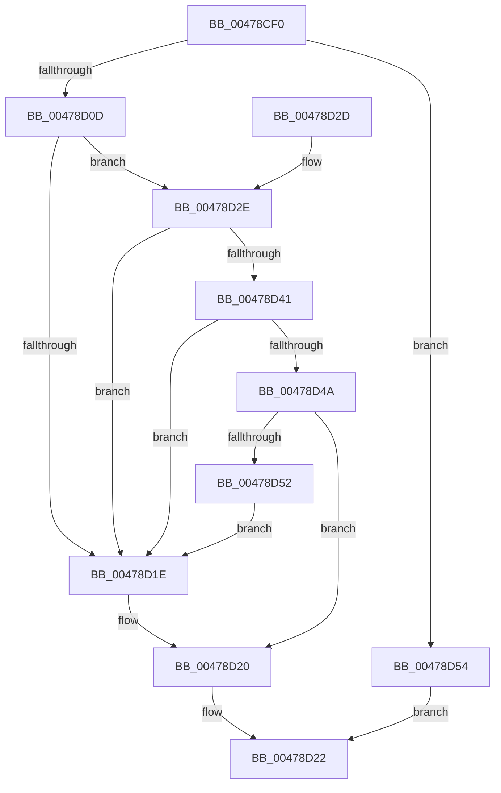

# PnpIsSafeToExamineUserModeTeb

- RVA: `0x00478CF0`–`0x00478D58` (길이 `104` bytes)
- VA: `0x0000000140478CF0`
- 실행 섹션: `.text`
- PDB 이름 있음: `예`; PDB Function 태그: `아니요`
- unwind 정보 RVA: `0x000ACE78`
- 디코드: `28`개 명령, `104/104` bytes 표시
- 미해석 바이트: `0` (있으면 어셈블리에 `.byte`로 보존)

> 이 문서는 커널 이미지의 기계어와 PDB 기호를 분석해 생성했습니다. 4번과 5번은 함수 원형과 자료형을 바이너리 사용 방식에서 추정한 C 해석이며 원본 소스 복구 결과는 아닙니다.

## 1. Dependencies

- 직접 호출 지점: **1**; 고유 호출 대상: **1**
- 직접 호출자로 확인된 함수: **3**
- RIP 상대 이미지 참조: **0**

### Outgoing calls
- `0x00478D41` → [KeGetEffectiveIrql](../2F/KeGetEffectiveIrql_function_002F8030.md) (function, `0x002F8030`)

### Direct callers
- [IopInitActivityIdIrp](../45/IopInitActivityIdIrp_function_0045B014.md) at `0x0045B0CB`
- [PnpRequestDeviceAction](PnpRequestDeviceAction_function_00477FF8.md) at `0x00478145`
- [PnpInsertEventInQueue](../../page/95/PnpInsertEventInQueue_function_00951B78.md) at `0x00951C0D`

### Static image references
- 디코드된 RIP-relative 메모리 참조가 없습니다.

## 2. Other-region calls and transfers

- 다른 실행 섹션으로 향하는 call: **0**
- 별도 외부 분기/꼬리 이동을 확인하지 못했습니다.

## 3. Assembly (complete function range)

```asm
00478CF0  48 89 5C 24 08                  mov qword ptr [rsp + 8], rbx
00478CF5  57                              push rdi
00478CF6  48 83 EC 20                     sub rsp, 0x20
00478CFA  65 48 8B 04 25 88 01 00 00      mov rax, qword ptr gs:[0x188]
00478D03  B3 01                           mov bl, 1
00478D05  38 98 4A 02 00 00               cmp byte ptr [rax + 0x24a], bl
00478D0B  74 47                           je 0x140478d54
00478D0D  65 48 8B 3C 25 88 01 00 00      mov rdi, qword ptr gs:[0x188]
00478D16  38 9F 32 02 00 00               cmp byte ptr [rdi + 0x232], bl
00478D1C  74 10                           je 0x140478d2e
00478D1E  32 DB                           xor bl, bl
00478D20  8A C3                           mov al, bl
00478D22  48 8B 5C 24 30                  mov rbx, qword ptr [rsp + 0x30]
00478D27  48 83 C4 20                     add rsp, 0x20
00478D2B  5F                              pop rdi
00478D2C  C3                              ret
00478D2D  CC                              int3
00478D2E  65 48 8B 04 25 88 01 00 00      mov rax, qword ptr gs:[0x188]
00478D37  66 83 B8 E6 01 00 00 00         cmp word ptr [rax + 0x1e6], 0
00478D3F  75 DD                           jne 0x140478d1e
00478D41  E8 EA F2 E7 FF                  call 0x1402f8030
00478D46  3A C3                           cmp al, bl
00478D48  73 D4                           jae 0x140478d1e
00478D4A  38 9F AE 05 00 00               cmp byte ptr [rdi + 0x5ae], bl
00478D50  76 CE                           jbe 0x140478d20
00478D52  EB CA                           jmp 0x140478d1e
00478D54  32 C0                           xor al, al
00478D56  EB CA                           jmp 0x140478d22
```

## 4. C-style interpretation (structured pseudocode)

```c
__int64 __fastcall PnpIsSafeToExamineUserModeTeb(void)
{
    __int64 result;
    __int64 v_rbx;
    __int64 v_rsp;
    unsigned __int64 v_stack_p8;

    v_stack_p8 = v_rbx;
    v_rsp = (v_rsp) - (32);
    if ((*(unsigned __int8 *)(*(unsigned __int64 *)(gs_base + (0 + 392)) + 586)) == 1) goto loc_00478D54;
    if ((*(unsigned __int8 *)(*(unsigned __int64 *)(gs_base + (0 + 392)) + 562)) == 1) goto loc_00478D2E;
loc_00478D1E:
    v_rbx = 0;
loc_00478D20:
loc_00478D22:
    v_rsp = (v_rsp) + (32);
    return 0;
loc_00478D2E:
    if ((*(unsigned __int16 *)(*(unsigned __int64 *)(gs_base + (0 + 392)) + 486)) != 0) goto loc_00478D1E;
    result = KeGetEffectiveIrql(a1, a2, a3, a4);
    if (((unsigned __int8)(result)) >= ((unsigned __int8)(v_stack_p8))) goto loc_00478D1E;
    if ((*(unsigned __int8 *)(*(unsigned __int64 *)(gs_base + (0 + 392)) + 1454)) <= ((unsigned __int8)(v_stack_p8))) goto loc_00478D20;
    goto loc_00478D1E;
loc_00478D54:
    result = 0;
    goto loc_00478D22;
}
```

## 5. (Beta) C Style

```c
void PnpIsSafeToExamineUserModeTeb(void)
{
    int64_t result;
    int64_t local_rbx;
    int64_t local_rsp;
    uint64_t v_stack_p8;

    v_stack_p8 = local_rbx;
    local_rsp = (local_rsp) - (32);
    if ((*(uint8_t *)(*(uint64_t *)(gs_base + (0 + 0x188)) + 0x24A)) == 1) goto loc_00478D54;
    if ((*(uint8_t *)(*(uint64_t *)(gs_base + (0 + 0x188)) + 0x232)) == 1) goto loc_00478D2E;
loc_00478D1E:
    local_rbx = 0;
loc_00478D20:
loc_00478D22:
    local_rsp = (local_rsp) + (32);
    return 0;
loc_00478D2E:
    if ((*(uint16_t *)(*(uint64_t *)(gs_base + (0 + 0x188)) + 0x1E6)) != 0) goto loc_00478D1E;
    result = KeGetEffectiveIrql(a1, a2, a3, a4);
    if (((uint8_t)(result)) >= ((uint8_t)(v_stack_p8))) goto loc_00478D1E;
    if ((*(uint8_t *)(*(uint64_t *)(gs_base + (0 + 0x188)) + 0x5AE)) <= ((uint8_t)(v_stack_p8))) goto loc_00478D20;
    goto loc_00478D1E;
loc_00478D54:
    result = 0;
    goto loc_00478D22;
}
```

## 6. Execution-region graph

[열기: 2D/3D 그래프와 함수 탐색 컨트롤 패널](../../../control-panel.html?section=text&rva=0x00478CF0&view=graph)

- 2D 그래프는 위에서 아래로 흐르고, 3D 그래프는 빈 공간을 드래그해 회전합니다. Shift+드래그는 이동, 휠은 확대·축소, 함수 노드 선택은 대상 보고서 이동입니다.

### Static fallback


