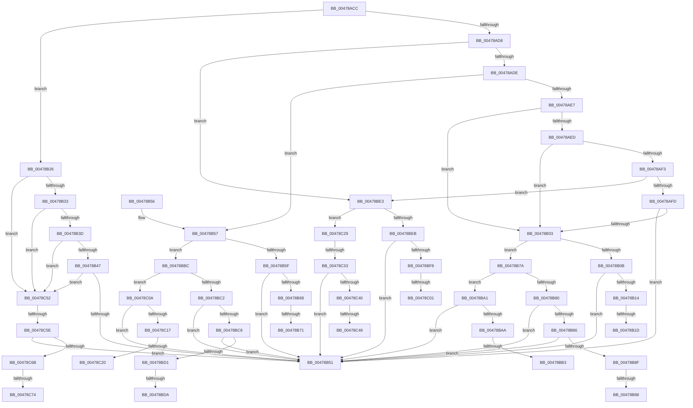

# PnpLogActionQueueEvent

- RVA: `0x00478ACC`–`0x00478C7D` (길이 `433` bytes)
- VA: `0x0000000140478ACC`
- 실행 섹션: `.text`
- PDB 이름 있음: `예`; PDB Function 태그: `예`
- unwind 정보 RVA: `0x000ACE5C`
- 디코드: `104`개 명령, `433/433` bytes 표시
- 미해석 바이트: `0` (있으면 어셈블리에 `.byte`로 보존)

> 이 문서는 커널 이미지의 기계어와 PDB 기호를 분석해 생성했습니다. 4번과 5번은 함수 원형과 자료형을 바이너리 사용 방식에서 추정한 C 해석이며 원본 소스 복구 결과는 아닙니다.

## 1. Dependencies

- 직접 호출 지점: **0**; 고유 호출 대상: **0**
- 직접 호출자로 확인된 함수: **2**
- RIP 상대 이미지 참조: **2**

### Outgoing calls
- 직접 디코드된 call 명령이 없습니다.

### Direct callers
- [PnpRequestDeviceAction](PnpRequestDeviceAction_function_00477FF8.md) at `0x00478179`
- [PnpDeviceActionWorker](PnpDeviceActionWorker_function_00478400.md) at `0x00478661`
- [PnpDeviceActionWorker](PnpDeviceActionWorker_function_00478400.md) at `0x004786CD`

### Static image references
- `0x00478B0B` → RVA `0x00EF012B` (`.data`; read)
- `0x00478C5E` → RVA `0x00EF0129` (`.data`; read)

## 2. Other-region calls and transfers

- 다른 실행 섹션으로 향하는 call: **0**
- call이 아닌 외부 분기/꼬리 이동: **20**
  - `0x00478B17` → [sub_006F4704](../6F/Unknown_function_006F4704.md) (`tail-transfer`)
  - `0x00478B21` → [sub_006F4704](../6F/Unknown_function_006F4704.md) (`tail-transfer`)
  - `0x00478B6B` → [sub_006F4704 + 0x30](../6F/Unknown_function_006F4704.md) (`tail-transfer`)
  - `0x00478B75` → [sub_006F4704 + 0x30](../6F/Unknown_function_006F4704.md) (`tail-transfer`)
  - `0x00478B92` → [sub_006F4704 + 0x20](../6F/Unknown_function_006F4704.md) (`tail-transfer`)
  - `0x00478B9C` → [sub_006F4704 + 0x20](../6F/Unknown_function_006F4704.md) (`tail-transfer`)
  - `0x00478BAD` → [sub_006F4704 + 0x10](../6F/Unknown_function_006F4704.md) (`tail-transfer`)
  - `0x00478BB7` → [sub_006F4704 + 0x10](../6F/Unknown_function_006F4704.md) (`tail-transfer`)
  - `0x00478BD4` → [sub_006F4704 + 0x42](../6F/Unknown_function_006F4704.md) (`tail-transfer`)
  - `0x00478BDE` → [sub_006F4704 + 0x42](../6F/Unknown_function_006F4704.md) (`tail-transfer`)
  - `0x00478BFB` → [sub_006F4704 + 0x54](../6F/Unknown_function_006F4704.md) (`tail-transfer`)
  - `0x00478C05` → [sub_006F4704 + 0x54](../6F/Unknown_function_006F4704.md) (`tail-transfer`)
  - `0x00478C1A` → [sub_006F4704 + 0x39](../6F/Unknown_function_006F4704.md) (`tail-transfer`)
  - `0x00478C24` → [sub_006F4704 + 0x39](../6F/Unknown_function_006F4704.md) (`tail-transfer`)
  - `0x00478C2D` → [sub_006F4704 + 0x6E](../6F/Unknown_function_006F4704.md) (`tail-transfer`)
  - `0x00478C43` → [sub_006F4704 + 0x61](../6F/Unknown_function_006F4704.md) (`tail-transfer`)
  - `0x00478C4D` → [sub_006F4704 + 0x61](../6F/Unknown_function_006F4704.md) (`tail-transfer`)
  - `0x00478C58` → [sub_006F4704 + 0xAD](../6F/Unknown_function_006F4704.md) (`tail-transfer`)
  - `0x00478C6E` → [sub_006F4704 + 0xA0](../6F/Unknown_function_006F4704.md) (`tail-transfer`)
  - `0x00478C78` → [sub_006F4704 + 0xA0](../6F/Unknown_function_006F4704.md) (`tail-transfer`)

## 3. Assembly (complete function range)

```asm
00478ACC  48 83 EC 38                     sub rsp, 0x38
00478AD0  45 8B D9                        mov r11d, r9d
00478AD3  83 FA 10                        cmp edx, 0x10
00478AD6  7F 4E                           jg 0x140478b26
00478AD8  0F 84 05 01 00 00               je 0x140478be3
00478ADE  44 8B D2                        mov r10d, edx
00478AE1  41 83 EA 08                     sub r10d, 8
00478AE5  74 70                           je 0x140478b57
00478AE7  41 83 EA 01                     sub r10d, 1
00478AEB  74 16                           je 0x140478b03
00478AED  41 83 EA 01                     sub r10d, 1
00478AF1  74 10                           je 0x140478b03
00478AF3  41 83 EA 02                     sub r10d, 2
00478AF7  0F 84 E6 00 00 00               je 0x140478be3
00478AFD  41 83 FA 02                     cmp r10d, 2
00478B01  75 4E                           jne 0x140478b51
00478B03  45 33 C9                        xor r9d, r9d
00478B06  45 85 C0                        test r8d, r8d
00478B09  75 6F                           jne 0x140478b7a
00478B0B  F6 05 19 76 A7 00 10            test byte ptr [rip + 0xa77619], 0x10
00478B12  74 3D                           je 0x140478b51
00478B14  48 85 C9                        test rcx, rcx
00478B17  0F 84 E7 BB 27 00               je 0x1406f4704
00478B1D  4C 8B 49 30                     mov r9, qword ptr [rcx + 0x30]
00478B21  E9 DE BB 27 00                  jmp 0x1406f4704
00478B26  44 8B CA                        mov r9d, edx
00478B29  41 83 E9 15                     sub r9d, 0x15
00478B2D  0F 84 1F 01 00 00               je 0x140478c52
00478B33  41 83 E9 01                     sub r9d, 1
00478B37  0F 84 15 01 00 00               je 0x140478c52
00478B3D  41 83 E9 01                     sub r9d, 1
00478B41  0F 84 0B 01 00 00               je 0x140478c52
00478B47  41 83 F9 01                     cmp r9d, 1
00478B4B  0F 84 01 01 00 00               je 0x140478c52
00478B51  48 83 C4 38                     add rsp, 0x38
00478B55  C3                              ret
00478B56  CC                              int3
00478B57  45 33 C9                        xor r9d, r9d
00478B5A  45 85 C0                        test r8d, r8d
00478B5D  75 5D                           jne 0x140478bbc
00478B5F  F6 05 C5 75 A7 00 10            test byte ptr [rip + 0xa775c5], 0x10
00478B66  74 E9                           je 0x140478b51
00478B68  48 85 C9                        test rcx, rcx
00478B6B  0F 84 C3 BB 27 00               je 0x1406f4734
00478B71  4C 8B 49 30                     mov r9, qword ptr [rcx + 0x30]
00478B75  E9 BA BB 27 00                  jmp 0x1406f4734
00478B7A  41 83 F8 01                     cmp r8d, 1
00478B7E  74 21                           je 0x140478ba1
00478B80  41 83 F8 02                     cmp r8d, 2
00478B84  75 CB                           jne 0x140478b51
00478B86  F6 05 9E 75 A7 00 10            test byte ptr [rip + 0xa7759e], 0x10
00478B8D  74 C2                           je 0x140478b51
00478B8F  48 85 C9                        test rcx, rcx
00478B92  0F 84 8C BB 27 00               je 0x1406f4724
00478B98  4C 8B 49 30                     mov r9, qword ptr [rcx + 0x30]
00478B9C  E9 83 BB 27 00                  jmp 0x1406f4724
00478BA1  F6 05 83 75 A7 00 10            test byte ptr [rip + 0xa77583], 0x10
00478BA8  74 A7                           je 0x140478b51
00478BAA  48 85 C9                        test rcx, rcx
00478BAD  0F 84 61 BB 27 00               je 0x1406f4714
00478BB3  4C 8B 49 30                     mov r9, qword ptr [rcx + 0x30]
00478BB7  E9 58 BB 27 00                  jmp 0x1406f4714
00478BBC  41 83 F8 01                     cmp r8d, 1
00478BC0  74 48                           je 0x140478c0a
00478BC2  41 83 F8 02                     cmp r8d, 2
00478BC6  75 89                           jne 0x140478b51
00478BC8  F6 05 5C 75 A7 00 10            test byte ptr [rip + 0xa7755c], 0x10
00478BCF  74 80                           je 0x140478b51
00478BD1  48 85 C9                        test rcx, rcx
00478BD4  0F 84 6C BB 27 00               je 0x1406f4746
00478BDA  4C 8B 49 30                     mov r9, qword ptr [rcx + 0x30]
00478BDE  E9 63 BB 27 00                  jmp 0x1406f4746
00478BE3  45 33 C9                        xor r9d, r9d
00478BE6  45 85 C0                        test r8d, r8d
00478BE9  75 3E                           jne 0x140478c29
00478BEB  F6 05 39 75 A7 00 20            test byte ptr [rip + 0xa77539], 0x20
00478BF2  0F 84 59 FF FF FF               je 0x140478b51
00478BF8  48 85 C9                        test rcx, rcx
00478BFB  0F 84 57 BB 27 00               je 0x1406f4758
00478C01  4C 8B 49 30                     mov r9, qword ptr [rcx + 0x30]
00478C05  E9 4E BB 27 00                  jmp 0x1406f4758
00478C0A  F6 05 1A 75 A7 00 10            test byte ptr [rip + 0xa7751a], 0x10
00478C11  0F 84 3A FF FF FF               je 0x140478b51
00478C17  48 85 C9                        test rcx, rcx
00478C1A  0F 84 1D BB 27 00               je 0x1406f473d
00478C20  4C 8B 49 30                     mov r9, qword ptr [rcx + 0x30]
00478C24  E9 14 BB 27 00                  jmp 0x1406f473d
00478C29  41 83 F8 01                     cmp r8d, 1
00478C2D  0F 85 3F BB 27 00               jne 0x1406f4772
00478C33  F6 05 F1 74 A7 00 20            test byte ptr [rip + 0xa774f1], 0x20
00478C3A  0F 84 11 FF FF FF               je 0x140478b51
00478C40  48 85 C9                        test rcx, rcx
00478C43  0F 84 1C BB 27 00               je 0x1406f4765
00478C49  4C 8B 49 30                     mov r9, qword ptr [rcx + 0x30]
00478C4D  E9 13 BB 27 00                  jmp 0x1406f4765
00478C52  45 33 C9                        xor r9d, r9d
00478C55  45 85 C0                        test r8d, r8d
00478C58  0F 85 53 BB 27 00               jne 0x1406f47b1
00478C5E  F6 05 C4 74 A7 00 40            test byte ptr [rip + 0xa774c4], 0x40
00478C65  0F 84 E6 FE FF FF               je 0x140478b51
00478C6B  48 85 C9                        test rcx, rcx
00478C6E  0F 84 30 BB 27 00               je 0x1406f47a4
00478C74  4C 8B 49 30                     mov r9, qword ptr [rcx + 0x30]
00478C78  E9 27 BB 27 00                  jmp 0x1406f47a4
```

## 4. C-style interpretation (structured pseudocode)

```c
void __fastcall PnpLogActionQueueEvent(__int64 a1, int a2, int a3, int a4)
{
    __int64 v_r10;
    __int64 v_rsp;

    v_rsp = (v_rsp) - (56);
    if (a2 > 16) goto loc_00478B26;
    if (a2 == 16) goto loc_00478BE3;
    v_r10 = (unsigned int)(((unsigned int)(a2)) - (8));
    if (condition_is_equal) goto loc_00478B57;
    v_r10 = (unsigned int)((v_r10) - (1));
    if (condition_is_equal) goto loc_00478B03;
    v_r10 = (unsigned int)((v_r10) - (1));
    if (condition_is_equal) goto loc_00478B03;
    v_r10 = (unsigned int)((v_r10) - (2));
    if (condition_is_equal) goto loc_00478BE3;
    if (((unsigned int)(v_r10)) != 2) goto loc_00478B51;
loc_00478B03:
    a4 = 0;
    if (a3 != 0) goto loc_00478B7A;
    if (((*(unsigned __int8 *)(v_rip + 10974745)) & (16)) == 0) goto loc_00478B51;
loc_00478B26:
    a4 = (unsigned int)(((unsigned int)(a2)) - (21));
    if (condition_is_equal) goto loc_00478C52;
    a4 = (unsigned int)((a4) - (1));
    if (condition_is_equal) goto loc_00478C52;
    a4 = (unsigned int)((a4) - (1));
    if (condition_is_equal) goto loc_00478C52;
    if (a4 == 1) goto loc_00478C52;
loc_00478B51:
    v_rsp = (v_rsp) + (56);
    return;
loc_00478B57:
    a4 = 0;
    if (a3 != 0) goto loc_00478BBC;
    if (((*(unsigned __int8 *)(v_rip + 10974661)) & (16)) == 0) goto loc_00478B51;
loc_00478B7A:
    if (a3 == 1) goto loc_00478BA1;
    if (a3 != 2) goto loc_00478B51;
    if (((*(unsigned __int8 *)(v_rip + 10974622)) & (16)) == 0) goto loc_00478B51;
loc_00478BA1:
    if (((*(unsigned __int8 *)(v_rip + 10974595)) & (16)) == 0) goto loc_00478B51;
loc_00478BBC:
    if (a3 == 1) goto loc_00478C0A;
    if (a3 != 2) goto loc_00478B51;
    if (((*(unsigned __int8 *)(v_rip + 10974556)) & (16)) == 0) goto loc_00478B51;
loc_00478BE3:
    a4 = 0;
    if (a3 != 0) goto loc_00478C29;
    if (((*(unsigned __int8 *)(v_rip + 10974521)) & (32)) == 0) goto loc_00478B51;
loc_00478C0A:
    if (((*(unsigned __int8 *)(v_rip + 10974490)) & (16)) == 0) goto loc_00478B51;
loc_00478C29:
    if (((*(unsigned __int8 *)(v_rip + 10974449)) & (32)) == 0) goto loc_00478B51;
loc_00478C52:
    a4 = 0;
    if (((*(unsigned __int8 *)(v_rip + 10974404)) & (64)) == 0) goto loc_00478B51;
}
```

## 5. (Beta) C Style

```c
void PnpLogActionQueueEvent(int64_t Arg1, int32_t Arg2, int32_t Arg3, int32_t Arg4)
{
    int64_t local_r10;
    int64_t local_rsp;

    local_rsp = (local_rsp) - (56);
    if (Arg2 > 16) goto loc_00478B26;
    if (Arg2 == 16) goto loc_00478BE3;
    local_r10 = (uint32_t)(((uint32_t)(Arg2)) - (8));
    if (condition_is_equal) goto loc_00478B57;
    local_r10 = (uint32_t)((local_r10) - (1));
    if (condition_is_equal) goto loc_00478B03;
    local_r10 = (uint32_t)((local_r10) - (1));
    if (condition_is_equal) goto loc_00478B03;
    local_r10 = (uint32_t)((local_r10) - (2));
    if (condition_is_equal) goto loc_00478BE3;
    if (((uint32_t)(local_r10)) != 2) goto loc_00478B51;
loc_00478B03:
    Arg4 = 0;
    if (Arg3 != 0) goto loc_00478B7A;
    if (((*(uint8_t *)(v_rip + 0xA77619)) & (16)) == 0) goto loc_00478B51;
loc_00478B26:
    Arg4 = (uint32_t)(((uint32_t)(Arg2)) - (21));
    if (condition_is_equal) goto loc_00478C52;
    Arg4 = (uint32_t)((Arg4) - (1));
    if (condition_is_equal) goto loc_00478C52;
    Arg4 = (uint32_t)((Arg4) - (1));
    if (condition_is_equal) goto loc_00478C52;
    if (Arg4 == 1) goto loc_00478C52;
loc_00478B51:
    local_rsp = (local_rsp) + (56);
    return;
loc_00478B57:
    Arg4 = 0;
    if (Arg3 != 0) goto loc_00478BBC;
    if (((*(uint8_t *)(v_rip + 0xA775C5)) & (16)) == 0) goto loc_00478B51;
loc_00478B7A:
    if (Arg3 == 1) goto loc_00478BA1;
    if (Arg3 != 2) goto loc_00478B51;
    if (((*(uint8_t *)(v_rip + 0xA7759E)) & (16)) == 0) goto loc_00478B51;
loc_00478BA1:
    if (((*(uint8_t *)(v_rip + 0xA77583)) & (16)) == 0) goto loc_00478B51;
loc_00478BBC:
    if (Arg3 == 1) goto loc_00478C0A;
    if (Arg3 != 2) goto loc_00478B51;
    if (((*(uint8_t *)(v_rip + 0xA7755C)) & (16)) == 0) goto loc_00478B51;
loc_00478BE3:
    Arg4 = 0;
    if (Arg3 != 0) goto loc_00478C29;
    if (((*(uint8_t *)(v_rip + 0xA77539)) & (32)) == 0) goto loc_00478B51;
loc_00478C0A:
    if (((*(uint8_t *)(v_rip + 0xA7751A)) & (16)) == 0) goto loc_00478B51;
loc_00478C29:
    if (((*(uint8_t *)(v_rip + 0xA774F1)) & (32)) == 0) goto loc_00478B51;
loc_00478C52:
    Arg4 = 0;
    if (((*(uint8_t *)(v_rip + 0xA774C4)) & (64)) == 0) goto loc_00478B51;
}
```

## 6. Execution-region graph

[열기: 2D/3D 그래프와 함수 탐색 컨트롤 패널](../../../control-panel.html?section=text&rva=0x00478ACC&view=graph)

- 2D 그래프는 위에서 아래로 흐르고, 3D 그래프는 빈 공간을 드래그해 회전합니다. Shift+드래그는 이동, 휠은 확대·축소, 함수 노드 선택은 대상 보고서 이동입니다.

### Static fallback


