# PnpRemoveLockedDeviceNode

- RVA: `0x004702AC`–`0x004706FF` (길이 `1,107` bytes)
- VA: `0x00000001404702AC`
- 실행 섹션: `.text`
- PDB 이름 있음: `예`; PDB Function 태그: `예`
- unwind 정보 RVA: `0x000ABD08`
- 디코드: `284`개 명령, `1,107/1,107` bytes 표시
- 미해석 바이트: `0` (있으면 어셈블리에 `.byte`로 보존)

> 이 문서는 커널 이미지의 기계어와 PDB 기호를 분석해 생성했습니다. 4번과 5번은 함수 원형과 자료형을 바이너리 사용 방식에서 추정한 C 해석이며 원본 소스 복구 결과는 아닙니다.

## 1. Dependencies

- 직접 호출 지점: **30**; 고유 호출 대상: **22**
- 직접 호출자로 확인된 함수: **1**
- RIP 상대 이미지 참조: **1**

### Outgoing calls
- `0x004702D7` → [PpHotSwapInitRemovalPolicy](../../page/AB/PpHotSwapInitRemovalPolicy_function_00ABBEC0.md) (function, `0x00ABBEC0`)
- `0x00470358` → [KeAcquireQueuedSpinLock](../27/KeAcquireQueuedSpinLock_function_00273D80.md) (function, `0x00273D80`)
- `0x0047038E` → [KeReleaseQueuedSpinLock](../27/KeReleaseQueuedSpinLock_function_00272540.md) (function, `0x00272540`)
- `0x004703C2` → [KeAcquireQueuedSpinLock](../27/KeAcquireQueuedSpinLock_function_00273D80.md) (function, `0x00273D80`)
- `0x004703E1` → [KeReleaseQueuedSpinLock](../27/KeReleaseQueuedSpinLock_function_00272540.md) (function, `0x00272540`)
- `0x004703FC` → [PipSetDevNodeState](PipSetDevNodeState_function_00470708.md) (function, `0x00470708`)
- `0x00470413` → [PnpDeleteAllDependencyRelations](../../page/A0/PnpDeleteAllDependencyRelations_function_00A06724.md) (function, `0x00A06724`)
- `0x00470421` → [PiDmaGuardProcessPostRemove](../../page/AA/PiDmaGuardProcessPostRemove_function_00AA3D40.md) (function, `0x00AA3D40`)
- `0x0047043D` → [PnpRaiseNtPlugPlayDevicePropertyChangeEvent](../../page/8F/PnpRaiseNtPlugPlayDevicePropertyChangeEvent_function_008F7D80.md) (function, `0x008F7D80`)
- `0x0047047E` → [PipClearDevNodeProblem](../../page/A2/PipClearDevNodeProblem_function_00A27C8C.md) (function, `0x00A27C8C`)
- `0x0047048E` → [PipSetDevNodeProblem](../../page/8F/PipSetDevNodeProblem_function_008FDE0C.md) (function, `0x008FDE0C`)
- `0x004704BA` → [PpProfileCommitTransitioningDock](../../page/73/PpProfileCommitTransitioningDock_function_00737A4C.md) (function, `0x00737A4C`)
- `0x004704CE` → [PipSetDevNodeUserFlags](../../page/8F/PipSetDevNodeUserFlags_function_008FB8FC.md) (function, `0x008FB8FC`)
- `0x004704DB` → [IopRemoveDevice](../../page/8F/IopRemoveDevice_function_008FC7FC.md) (function, `0x008FC7FC`)
- `0x004704E5` → [PipClearDevNodeUserFlags](../../page/A2/PipClearDevNodeUserFlags_function_00A2ABC4.md) (function, `0x00A2ABC4`)
- `0x0047050C` → [IopReleaseDeviceResources](../../page/A0/IopReleaseDeviceResources_function_00A0867C.md) (function, `0x00A0867C`)
- `0x00470530` → [ExAllocatePool2](../../poolcode/B8/ExAllocatePool2_function_00B820F0.md) (function, `0x00B820F0`)
- `0x0047054B` → [ExAllocatePool2](../../poolcode/B8/ExAllocatePool2_function_00B820F0.md) (function, `0x00B820F0`)
- `0x00470570` → [ObfReferenceObjectWithTag](../21/ObfReferenceObjectWithTag_function_00210710.md) (function, `0x00210710`)
- `0x004705E3` → [KeAcquireQueuedSpinLock](../27/KeAcquireQueuedSpinLock_function_00273D80.md) (function, `0x00273D80`)
- `0x0047060B` → [KeReleaseQueuedSpinLock](../27/KeReleaseQueuedSpinLock_function_00272540.md) (function, `0x00272540`)
- `0x00470614` → [PnpUnloadAttachedDriver](../../page/AA/PnpUnloadAttachedDriver_function_00AA80E8.md) (function, `0x00AA80E8`)
- `0x00470621` → [ObfDereferenceObjectWithTag](../2F/ObfDereferenceObjectWithTag_function_002F78E0.md) (function, `0x002F78E0`)
- `0x00470634` → [ExFreePoolWithTag](../../poolcode/B8/ExFreePoolWithTag_function_00B82870.md) (function, `0x00B82870`)
- `0x0047063E` → [ExFreePoolWithTag](../../poolcode/B8/ExFreePoolWithTag_function_00B82870.md) (function, `0x00B82870`)
- `0x00470681` → [PipRestoreDevNodeState](../5A/PipRestoreDevNodeState_function_005A7100.md) (function, `0x005A7100`)
- `0x00470698` → [ExFreePoolWithTag](../../poolcode/B8/ExFreePoolWithTag_function_00B82870.md) (function, `0x00B82870`)
- `0x004706A8` → [PnpDisableDeviceInterfaces](../../page/A0/PnpDisableDeviceInterfaces_function_00A0885C.md) (function, `0x00A0885C`)
- `0x004706B8` → [PipIsProblemReadonly](../../page/72/PipIsProblemReadonly_function_0072DA44.md) (function, `0x0072DA44`)
- `0x004706CB` → [PipIsProblemReadonly](../../page/72/PipIsProblemReadonly_function_0072DA44.md) (function, `0x0072DA44`)

### Direct callers
- [PnpDeleteLockedDeviceNode](../../page/A0/PnpDeleteLockedDeviceNode_function_00A09DC4.md) at `0x00A09E24`

### Static image references
- `0x00470312` → RVA `0x00000000` (`image boundary/outside`; read)

## 2. Other-region calls and transfers

- 다른 실행 섹션으로 향하는 call: **20**
  - `0x004702D7` → [PpHotSwapInitRemovalPolicy](../../page/AB/PpHotSwapInitRemovalPolicy_function_00ABBEC0.md) (`.text` → `PAGE`)
  - `0x00470413` → [PnpDeleteAllDependencyRelations](../../page/A0/PnpDeleteAllDependencyRelations_function_00A06724.md) (`.text` → `PAGE`)
  - `0x00470421` → [PiDmaGuardProcessPostRemove](../../page/AA/PiDmaGuardProcessPostRemove_function_00AA3D40.md) (`.text` → `PAGE`)
  - `0x0047043D` → [PnpRaiseNtPlugPlayDevicePropertyChangeEvent](../../page/8F/PnpRaiseNtPlugPlayDevicePropertyChangeEvent_function_008F7D80.md) (`.text` → `PAGE`)
  - `0x0047047E` → [PipClearDevNodeProblem](../../page/A2/PipClearDevNodeProblem_function_00A27C8C.md) (`.text` → `PAGE`)
  - `0x0047048E` → [PipSetDevNodeProblem](../../page/8F/PipSetDevNodeProblem_function_008FDE0C.md) (`.text` → `PAGE`)
  - `0x004704BA` → [PpProfileCommitTransitioningDock](../../page/73/PpProfileCommitTransitioningDock_function_00737A4C.md) (`.text` → `PAGE`)
  - `0x004704CE` → [PipSetDevNodeUserFlags](../../page/8F/PipSetDevNodeUserFlags_function_008FB8FC.md) (`.text` → `PAGE`)
  - `0x004704DB` → [IopRemoveDevice](../../page/8F/IopRemoveDevice_function_008FC7FC.md) (`.text` → `PAGE`)
  - `0x004704E5` → [PipClearDevNodeUserFlags](../../page/A2/PipClearDevNodeUserFlags_function_00A2ABC4.md) (`.text` → `PAGE`)
  - `0x0047050C` → [IopReleaseDeviceResources](../../page/A0/IopReleaseDeviceResources_function_00A0867C.md) (`.text` → `PAGE`)
  - `0x00470530` → [ExAllocatePool2](../../poolcode/B8/ExAllocatePool2_function_00B820F0.md) (`.text` → `POOLCODE`)
  - `0x0047054B` → [ExAllocatePool2](../../poolcode/B8/ExAllocatePool2_function_00B820F0.md) (`.text` → `POOLCODE`)
  - `0x00470614` → [PnpUnloadAttachedDriver](../../page/AA/PnpUnloadAttachedDriver_function_00AA80E8.md) (`.text` → `PAGE`)
  - `0x00470634` → [ExFreePoolWithTag](../../poolcode/B8/ExFreePoolWithTag_function_00B82870.md) (`.text` → `POOLCODE`)
  - `0x0047063E` → [ExFreePoolWithTag](../../poolcode/B8/ExFreePoolWithTag_function_00B82870.md) (`.text` → `POOLCODE`)
  - `0x00470698` → [ExFreePoolWithTag](../../poolcode/B8/ExFreePoolWithTag_function_00B82870.md) (`.text` → `POOLCODE`)
  - `0x004706A8` → [PnpDisableDeviceInterfaces](../../page/A0/PnpDisableDeviceInterfaces_function_00A0885C.md) (`.text` → `PAGE`)
  - `0x004706B8` → [PipIsProblemReadonly](../../page/72/PipIsProblemReadonly_function_0072DA44.md) (`.text` → `PAGE`)
  - `0x004706CB` → [PipIsProblemReadonly](../../page/72/PipIsProblemReadonly_function_0072DA44.md) (`.text` → `PAGE`)
- call이 아닌 외부 분기/꼬리 이동: **2**
  - `0x0047065A` → [sub_006F3B38](../6F/Unknown_function_006F3B38.md) (`tail-transfer`)
  - `0x00470669` → [sub_006F3B38](../6F/Unknown_function_006F3B38.md) (`tail-transfer`)

## 3. Assembly (complete function range)

```asm
004702AC  48 89 5C 24 10                  mov qword ptr [rsp + 0x10], rbx
004702B1  44 89 44 24 18                  mov dword ptr [rsp + 0x18], r8d
004702B6  55                              push rbp
004702B7  56                              push rsi
004702B8  57                              push rdi
004702B9  41 54                           push r12
004702BB  41 55                           push r13
004702BD  41 56                           push r14
004702BF  41 57                           push r15
004702C1  48 83 EC 20                     sub rsp, 0x20
004702C5  4C 8B 79 20                     mov r15, qword ptr [rcx + 0x20]
004702C9  44 8B EA                        mov r13d, edx
004702CC  4C 89 7C 24 60                  mov qword ptr [rsp + 0x60], r15
004702D1  48 8B D9                        mov rbx, rcx
004702D4  45 33 F6                        xor r14d, r14d
004702D7  E8 E4 BB 64 00                  call 0x140abbec0
004702DC  48 8B 79 08                     mov rdi, qword ptr [rcx + 8]
004702E0  BD 00 02 00 00                  mov ebp, 0x200
004702E5  48 85 FF                        test rdi, rdi
004702E8  0F 85 61 03 00 00               jne 0x14047064f
004702EE  8B 83 2C 01 00 00               mov eax, dword ptr [rbx + 0x12c]
004702F4  2D 10 03 00 00                  sub eax, 0x310
004702F9  83 F8 01                        cmp eax, 1
004702FC  0F 86 6C 03 00 00               jbe 0x14047066e
00470302  8B 83 2C 01 00 00               mov eax, dword ptr [rbx + 0x12c]
00470308  05 00 FD FF FF                  add eax, 0xfffffd00
0047030D  83 F8 16                        cmp eax, 0x16
00470310  77 21                           ja 0x140470333
00470312  48 8D 15 E7 FC B8 FF            lea rdx, [rip - 0x470319]
00470319  48 98                           cdqe
0047031B  0F B6 84 02 E8 06 47 00         movzx eax, byte ptr [rdx + rax + 0x4706e8]
00470323  8B 8C 82 E0 06 47 00            mov ecx, dword ptr [rdx + rax*4 + 0x4706e0]
0047032A  48 03 CA                        add rcx, rdx
0047032D  FF E1                           jmp rcx
0047032F  CC                              int3
00470330  CC                              int3
00470331  CC                              int3
00470332  CC                              int3
00470333  40 B5 01                        mov bpl, 1
00470336  49 8B 47 18                     mov rax, qword ptr [r15 + 0x18]
0047033A  48 85 C0                        test rax, rax
0047033D  0F 85 15 01 00 00               jne 0x140470458
00470343  33 F6                           xor esi, esi
00470345  45 33 E4                        xor r12d, r12d
00470348  45 85 F6                        test r14d, r14d
0047034B  0F 85 C5 01 00 00               jne 0x140470516
00470351  BF 0A 00 00 00                  mov edi, 0xa
00470356  8B CF                           mov ecx, edi
00470358  E8 23 3A E0 FF                  call 0x140273d80
0047035D  44 8A C0                        mov r8b, al
00470360  48 8B D6                        mov rdx, rsi
00470363  41 B9 FB FF FF FF               mov r9d, 0xfffffffb
00470369  48 85 F6                        test rsi, rsi
0047036C  0F 85 32 02 00 00               jne 0x1404705a4
00470372  49 8B 87 38 01 00 00            mov rax, qword ptr [r15 + 0x138]
00470379  41 8A D0                        mov dl, r8b
0047037C  48 8B CF                        mov rcx, rdi
0047037F  44 21 48 20                     and dword ptr [rax + 0x20], r9d
00470383  49 8B 87 38 01 00 00            mov rax, qword ptr [r15 + 0x138]
0047038A  83 48 20 08                     or dword ptr [rax + 0x20], 8
0047038E  E8 AD 21 E0 FF                  call 0x140272540
00470393  40 84 ED                        test bpl, bpl
00470396  0F 85 28 01 00 00               jne 0x1404704c4
0047039C  48 8D BB 8C 01 00 00            lea rdi, [rbx + 0x18c]
004703A3  8B 07                           mov eax, dword ptr [rdi]
004703A5  A8 10                           test al, 0x10
004703A7  0F 84 EB 00 00 00               je 0x140470498
004703AD  33 ED                           xor ebp, ebp
004703AF  4C 8B F6                        mov r14, rsi
004703B2  48 85 F6                        test rsi, rsi
004703B5  0F 85 18 02 00 00               jne 0x1404705d3
004703BB  BE 0A 00 00 00                  mov esi, 0xa
004703C0  8B CE                           mov ecx, esi
004703C2  E8 B9 39 E0 FF                  call 0x140273d80
004703C7  49 8B 97 38 01 00 00            mov rdx, qword ptr [r15 + 0x138]
004703CE  8B CE                           mov ecx, esi
004703D0  83 62 20 F7                     and dword ptr [rdx + 0x20], 0xfffffff7
004703D4  49 8B 97 38 01 00 00            mov rdx, qword ptr [r15 + 0x138]
004703DB  83 4A 20 10                     or dword ptr [rdx + 0x20], 0x10
004703DF  8A D0                           mov dl, al
004703E1  E8 5A 21 E0 FF                  call 0x140272540
004703E6  8B 83 8C 01 00 00               mov eax, dword ptr [rbx + 0x18c]
004703EC  BA 14 03 00 00                  mov edx, 0x314
004703F1  A8 10                           test al, 0x10
004703F3  0F 84 A1 01 00 00               je 0x14047059a
004703F9  48 8B CB                        mov rcx, rbx
004703FC  E8 07 03 00 00                  call 0x140470708
00470401  45 85 ED                        test r13d, r13d
00470404  75 5E                           jne 0x140470464
00470406  8B 83 8C 01 00 00               mov eax, dword ptr [rbx + 0x18c]
0047040C  A8 10                           test al, 0x10
0047040E  75 08                           jne 0x140470418
00470410  49 8B CF                        mov rcx, r15
00470413  E8 0C 63 59 00                  call 0x140a06724
00470418  41 B0 01                        mov r8b, 1
0047041B  41 8B D5                        mov edx, r13d
0047041E  48 8B CB                        mov rcx, rbx
00470421  E8 1A 39 63 00                  call 0x140aa3d40
00470426  48 8B 53 30                     mov rdx, qword ptr [rbx + 0x30]
0047042A  0F BA B3 C0 02 00 00 11         btr dword ptr [rbx + 0x2c0], 0x11
00470432  48 85 D2                        test rdx, rdx
00470435  74 0B                           je 0x140470442
00470437  41 B8 17 00 00 00               mov r8d, 0x17
0047043D  E8 3E 79 48 00                  call 0x1408f7d80
00470442  48 8B 5C 24 68                  mov rbx, qword ptr [rsp + 0x68]
00470447  48 83 C4 20                     add rsp, 0x20
0047044B  41 5F                           pop r15
0047044D  41 5E                           pop r14
0047044F  41 5D                           pop r13
00470451  41 5C                           pop r12
00470453  5F                              pop rdi
00470454  5E                              pop rsi
00470455  5D                              pop rbp
00470456  C3                              ret
00470457  CC                              int3
00470458  48 8B 40 18                     mov rax, qword ptr [rax + 0x18]
0047045C  41 FF C6                        inc r14d
0047045F  E9 D6 FE FF FF                  jmp 0x14047033a
00470464  F7 07 00 60 00 00               test dword ptr [rdi], 0x6000
0047046A  74 0F                           je 0x14047047b
0047046C  41 8D 45 EA                     lea eax, [r13 - 0x16]
00470470  A9 FD FF FF FF                  test eax, 0xfffffffd
00470475  0F 85 37 02 00 00               jne 0x1404706b2
0047047B  48 8B CB                        mov rcx, rbx
0047047E  E8 09 78 5B 00                  call 0x140a27c8c
00470483  44 8B 44 24 70                  mov r8d, dword ptr [rsp + 0x70]
00470488  41 8B D5                        mov edx, r13d
0047048B  48 8B CB                        mov rcx, rbx
0047048E  E8 79 D9 48 00                  call 0x1408fde0c
00470493  E9 6E FF FF FF                  jmp 0x140470406
00470498  8B 83 38 02 00 00               mov eax, dword ptr [rbx + 0x238]
0047049E  BA 03 00 00 00                  mov edx, 3
004704A3  3B C2                           cmp eax, edx
004704A5  74 10                           je 0x1404704b7
004704A7  83 F8 04                        cmp eax, 4
004704AA  0F 85 FD FE FF FF               jne 0x1404703ad
004704B0  48 8D BB 8C 01 00 00            lea rdi, [rbx + 0x18c]
004704B7  48 8B CB                        mov rcx, rbx
004704BA  E8 8D 75 2C 00                  call 0x140737a4c
004704BF  E9 E9 FE FF FF                  jmp 0x1404703ad
004704C4  BF 00 02 00 00                  mov edi, 0x200
004704C9  48 8B CB                        mov rcx, rbx
004704CC  8B D7                           mov edx, edi
004704CE  E8 29 B4 48 00                  call 0x1408fb8fc
004704D3  BA 02 00 00 00                  mov edx, 2
004704D8  49 8B CF                        mov rcx, r15
004704DB  E8 1C C3 48 00                  call 0x1408fc7fc
004704E0  8B D7                           mov edx, edi
004704E2  48 8B CB                        mov rcx, rbx
004704E5  E8 DA A6 5B 00                  call 0x140a2abc4
004704EA  81 BB 2C 01 00 00 12 03 00 00   cmp dword ptr [rbx + 0x12c], 0x312
004704F4  0F 84 AA 01 00 00               je 0x1404706a4
004704FA  48 8D BB 8C 01 00 00            lea rdi, [rbx + 0x18c]
00470501  48 8B CB                        mov rcx, rbx
00470504  8B 17                           mov edx, dword ptr [rdi]
00470506  C1 EA 04                        shr edx, 4
00470509  83 E2 01                        and edx, 1
0047050C  E8 6B 81 59 00                  call 0x140a0867c
00470511  E9 8D FE FF FF                  jmp 0x1404703a3
00470516  42 8D 04 F5 10 00 00 00         lea eax, [r14*8 + 0x10]
0047051E  B9 40 00 00 00                  mov ecx, 0x40
00470523  41 BE 50 70 64 65               mov r14d, 0x65647050
00470529  8B D0                           mov edx, eax
0047052B  45 8B C6                        mov r8d, r14d
0047052E  8B F8                           mov edi, eax
00470530  E8 BB 1B 71 00                  call 0x140b820f0
00470535  48 8B F0                        mov rsi, rax
00470538  48 85 C0                        test rax, rax
0047053B  0F 84 10 FE FF FF               je 0x140470351
00470541  45 8B C6                        mov r8d, r14d
00470544  8B D7                           mov edx, edi
00470546  B9 00 01 00 00                  mov ecx, 0x100
0047054B  E8 A0 1B 71 00                  call 0x140b820f0
00470550  4C 8B E0                        mov r12, rax
00470553  48 85 C0                        test rax, rax
00470556  0F 84 37 01 00 00               je 0x140470693
0047055C  49 8B 7F 18                     mov rdi, qword ptr [r15 + 0x18]
00470560  4C 8B F6                        mov r14, rsi
00470563  4C 8B F8                        mov r15, rax
00470566  EB 23                           jmp 0x14047058b
00470568  BA 44 66 6C 74                  mov edx, 0x746c6644
0047056D  48 8B CF                        mov rcx, rdi
00470570  E8 9B 01 DA FF                  call 0x140210710
00470575  49 89 3E                        mov qword ptr [r14], rdi
00470578  4D 8D 76 08                     lea r14, [r14 + 8]
0047057C  48 8B 47 08                     mov rax, qword ptr [rdi + 8]
00470580  49 89 07                        mov qword ptr [r15], rax
00470583  4D 8D 7F 08                     lea r15, [r15 + 8]
00470587  48 8B 7F 18                     mov rdi, qword ptr [rdi + 0x18]
0047058B  48 85 FF                        test rdi, rdi
0047058E  75 D8                           jne 0x140470568
00470590  4C 8B 7C 24 60                  mov r15, qword ptr [rsp + 0x60]
00470595  E9 B7 FD FF FF                  jmp 0x140470351
0047059A  BA 16 03 00 00                  mov edx, 0x316
0047059F  E9 55 FE FF FF                  jmp 0x1404703f9
004705A4  48 8B 0E                        mov rcx, qword ptr [rsi]
004705A7  EB 20                           jmp 0x1404705c9
004705A9  48 8B 89 38 01 00 00            mov rcx, qword ptr [rcx + 0x138]
004705B0  44 21 49 20                     and dword ptr [rcx + 0x20], r9d
004705B4  48 8B 02                        mov rax, qword ptr [rdx]
004705B7  48 8D 52 08                     lea rdx, [rdx + 8]
004705BB  48 8B 88 38 01 00 00            mov rcx, qword ptr [rax + 0x138]
004705C2  83 49 20 08                     or dword ptr [rcx + 0x20], 8
004705C6  48 8B 0A                        mov rcx, qword ptr [rdx]
004705C9  48 85 C9                        test rcx, rcx
004705CC  75 DB                           jne 0x1404705a9
004705CE  E9 9F FD FF FF                  jmp 0x140470372
004705D3  48 39 2E                        cmp qword ptr [rsi], rbp
004705D6  74 57                           je 0x14047062f
004705D8  49 8B FC                        mov rdi, r12
004705DB  48 2B FE                        sub rdi, rsi
004705DE  B9 0A 00 00 00                  mov ecx, 0xa
004705E3  E8 98 37 E0 FF                  call 0x140273d80
004705E8  49 8B 0E                        mov rcx, qword ptr [r14]
004705EB  48 8B 91 38 01 00 00            mov rdx, qword ptr [rcx + 0x138]
004705F2  83 62 20 F7                     and dword ptr [rdx + 0x20], 0xfffffff7
004705F6  49 8B 0E                        mov rcx, qword ptr [r14]
004705F9  48 8B 91 38 01 00 00            mov rdx, qword ptr [rcx + 0x138]
00470600  B9 0A 00 00 00                  mov ecx, 0xa
00470605  83 4A 20 10                     or dword ptr [rdx + 0x20], 0x10
00470609  8A D0                           mov dl, al
0047060B  E8 30 1F E0 FF                  call 0x140272540
00470610  4A 8B 0C 37                     mov rcx, qword ptr [rdi + r14]
00470614  E8 CF 7A 63 00                  call 0x140aa80e8
00470619  49 8B 0E                        mov rcx, qword ptr [r14]
0047061C  BA 44 66 6C 74                  mov edx, 0x746c6644
00470621  E8 BA 72 E8 FF                  call 0x1402f78e0
00470626  4D 8D 76 08                     lea r14, [r14 + 8]
0047062A  49 39 2E                        cmp qword ptr [r14], rbp
0047062D  75 AF                           jne 0x1404705de
0047062F  33 D2                           xor edx, edx
00470631  48 8B CE                        mov rcx, rsi
00470634  E8 37 22 71 00                  call 0x140b82870
00470639  33 D2                           xor edx, edx
0047063B  49 8B CC                        mov rcx, r12
0047063E  E8 2D 22 71 00                  call 0x140b82870
00470643  48 8D BB 8C 01 00 00            lea rdi, [rbx + 0x18c]
0047064A  E9 6C FD FF FF                  jmp 0x1404703bb
0047064F  8B 87 8C 01 00 00               mov eax, dword ptr [rdi + 0x18c]
00470655  48 8B 37                        mov rsi, qword ptr [rdi]
00470658  A8 10                           test al, 0x10
0047065A  0F 84 D8 34 28 00               je 0x1406f3b38
00470660  83 E0 EF                        and eax, 0xffffffef
00470663  89 87 8C 01 00 00               mov dword ptr [rdi + 0x18c], eax
00470669  E9 CA 34 28 00                  jmp 0x1406f3b38
0047066E  81 BB 30 01 00 00 13 03 00 00   cmp dword ptr [rbx + 0x130], 0x313
00470678  0F 84 C4 FD FF FF               je 0x140470442
0047067E  48 8B CB                        mov rcx, rbx
00470681  E8 7A 6A 13 00                  call 0x1405a7100
00470686  E9 77 FC FF FF                  jmp 0x140470302
0047068B  40 32 ED                        xor bpl, bpl
0047068E  E9 A3 FC FF FF                  jmp 0x140470336
00470693  33 D2                           xor edx, edx
00470695  48 8B CE                        mov rcx, rsi
00470698  E8 D3 21 71 00                  call 0x140b82870
0047069D  33 F6                           xor esi, esi
0047069F  E9 AD FC FF FF                  jmp 0x140470351
004706A4  48 8D 4B 28                     lea rcx, [rbx + 0x28]
004706A8  E8 AF 81 59 00                  call 0x140a0885c
004706AD  E9 48 FE FF FF                  jmp 0x1404704fa
004706B2  41 8B D5                        mov edx, r13d
004706B5  48 8B CB                        mov rcx, rbx
004706B8  E8 87 D3 2B 00                  call 0x14072da44
004706BD  85 C0                           test eax, eax
004706BF  0F 84 41 FD FF FF               je 0x140470406
004706C5  8B 93 94 01 00 00               mov edx, dword ptr [rbx + 0x194]
004706CB  E8 74 D3 2B 00                  call 0x14072da44
004706D0  85 C0                           test eax, eax
004706D2  0F 85 2E FD FF FF               jne 0x140470406
004706D8  E9 9E FD FF FF                  jmp 0x14047047b
004706DD  0F 1F 00                        nop dword ptr [rax]
004706E0  33 03                           xor eax, dword ptr [rbx]
004706E2  47 00 8B 06 47 00 00            add byte ptr [r11 + 0x4706], r9b
004706E9  00 00                           add byte ptr [rax], al
004706EB  00 00                           add byte ptr [rax], al
004706ED  00 00                           add byte ptr [rax], al
004706EF  00 00                           add byte ptr [rax], al
004706F1  00 00                           add byte ptr [rax], al
004706F3  00 00                           add byte ptr [rax], al
004706F5  00 00                           add byte ptr [rax], al
004706F7  00 00                           add byte ptr [rax], al
004706F9  00 00                           add byte ptr [rax], al
004706FB  00 00                           add byte ptr [rax], al
004706FD  00 01                           add byte ptr [rcx], al
```

## 4. C-style interpretation (structured pseudocode)

```c
__int64 __fastcall PnpRemoveLockedDeviceNode(__int64 a1, int a2, int a3)
{
    __int64 result;
    __int64 v_r12;
    __int64 v_r14;
    __int64 v_rbp;
    __int64 v_rdi;
    __int64 v_rsi;
    __int64 v_rsp;
    unsigned __int64 v_stack_p10;
    unsigned int v_stack_p18;
    unsigned __int64 v_stack_p60;
    unsigned int v_stack_p70;
    unsigned __int64 v_stack_p8;

    v_stack_p10 = v_rbx;
    v_stack_p18 = a3;
    v_rsp = (v_rsp) - (32);
    v_stack_p8 = *(unsigned __int64 *)(a1 + 32);
    v_r14 = 0;
    result = PpHotSwapInitRemovalPolicy(a1, a2, a3, a4);
    if (*(unsigned __int64 *)(a1 + 8) != 0) goto loc_0047064F;
    result = (unsigned int)(((unsigned int)(*(unsigned int *)(a1 + 300))) - (784));
    if (((unsigned int)(result)) <= 1) goto loc_0047066E;
loc_00470302:
    result = (unsigned int)(((unsigned int)(*(unsigned int *)(a1 + 300))) + (0xFFFFFD00ULL));
    if (((unsigned int)(result)) > 22) goto loc_00470333;
    a1 = ((unsigned int)(*(unsigned int *)(v_rip - 4653849 + *(unsigned __int8 *)(v_rip - 4653849 + result * 1 + 4654824) * 4 + 4654816))) + (v_rip - 4653849);
loc_00470333:
loc_00470336:
loc_0047033A:
    if (*(unsigned __int64 *)(*(unsigned __int64 *)(a1 + 32) + 24) != 0) goto loc_00470458;
    v_rsi = 0;
    v_r12 = 0;
    if (0 != 0) goto loc_00470516;
loc_00470351:
    result = KeAcquireQueuedSpinLock(10, v_rip - 4653849, a3, a4);
    if (0 != 0) goto loc_004705A4;
loc_00470372:
    result = KeReleaseQueuedSpinLock(10, (unsigned __int8)((unsigned __int8)(result)), (unsigned __int8)(result), (unsigned int)(0xFFFFFFFBULL));
    if (1 != 0) goto loc_004704C4;
loc_004703A3:
    if ((((unsigned __int8)((unsigned int)(*(unsigned int *)(a1 + 396)))) & (16)) == 0) goto loc_00470498;
loc_004703AD:
    v_rbp = 0;
    if (0 != 0) goto loc_004705D3;
loc_004703BB:
    result = KeAcquireQueuedSpinLock(10, (unsigned __int8)((unsigned __int8)(result)), (unsigned __int8)(result), (unsigned int)(0xFFFFFFFBULL));
    result = KeReleaseQueuedSpinLock(10, (unsigned __int8)(result), (unsigned __int8)(result), (unsigned int)(0xFFFFFFFBULL));
    if ((((unsigned __int8)((unsigned int)(*(unsigned int *)(a1 + 396)))) & (16)) == 0) goto loc_0047059A;
loc_004703F9:
    result = PipSetDevNodeState(a1, 788, (unsigned __int8)(result), (unsigned int)(0xFFFFFFFBULL));
    if ((unsigned int)((unsigned int)(a2)) != 0) goto loc_00470464;
loc_00470406:
    result = (unsigned int)(*(unsigned int *)(a1 + 396));
    if ((((unsigned __int8)((unsigned int)(*(unsigned int *)(a1 + 396)))) & (16)) == 0) {
        a1 = *(unsigned __int64 *)(a1 + 32);
        result = PnpDeleteAllDependencyRelations(a1, 788, (unsigned __int8)(result), (unsigned int)(0xFFFFFFFBULL));
    }
    result = PiDmaGuardProcessPostRemove(a1, (unsigned int)((unsigned int)((unsigned int)(a2))), 1, (unsigned int)(0xFFFFFFFBULL));
    if (*(unsigned __int64 *)(a1 + 48) != 0) {
        a3 = 23;
        result = PnpRaiseNtPlugPlayDevicePropertyChangeEvent(a1, *(unsigned __int64 *)(a1 + 48), a3, (unsigned int)(0xFFFFFFFBULL));
    }
    v_rsp = (v_rsp) + (32);
    return result;
loc_00470458:
    v_r14 = (unsigned int)((0) + 1);
    goto loc_0047033A;
loc_00470464:
    if (((*(unsigned int *)(a1 + 396)) & (0x6000ULL)) == 0) goto loc_0047047B;
    if ((((unsigned int)((unsigned int)(a2) - 22)) & (0xFFFFFFFDULL)) != 0) goto loc_004706B2;
loc_0047047B:
    result = PipClearDevNodeProblem(v_stack_p10, *(unsigned __int64 *)(a1 + 48), a3, (unsigned int)(0xFFFFFFFBULL));
    result = PipSetDevNodeProblem(v_stack_p10, (unsigned int)((unsigned int)((unsigned int)(a2))), (unsigned int)(v_stack_p70), (unsigned int)(0xFFFFFFFBULL));
    goto loc_00470406;
loc_00470498:
    if (((unsigned int)((unsigned int)(*(unsigned int *)(v_stack_p10 + 568)))) == 3) goto loc_004704B7;
    if (((unsigned int)((unsigned int)(*(unsigned int *)(v_stack_p10 + 568)))) != 4) goto loc_004703AD;
loc_004704B7:
    result = PpProfileCommitTransitioningDock(v_stack_p10, 3, (unsigned int)(v_stack_p70), (unsigned int)(0xFFFFFFFBULL));
    goto loc_004703AD;
loc_004704C4:
    result = PipSetDevNodeUserFlags(v_stack_p10, 512, (unsigned int)(v_stack_p70), (unsigned int)(0xFFFFFFFBULL));
    result = IopRemoveDevice(*(unsigned __int64 *)(a1 + 32), 2, (unsigned int)(v_stack_p70), (unsigned int)(0xFFFFFFFBULL));
    result = PipClearDevNodeUserFlags(v_stack_p10, 512, (unsigned int)(v_stack_p70), (unsigned int)(0xFFFFFFFBULL));
    if ((*(unsigned int *)(v_stack_p10 + 300)) == 786) goto loc_004706A4;
loc_004704FA:
    a2 = (unsigned int)(((unsigned int)(*(unsigned int *)(v_stack_p10 + 396))) >> (4));
    a2 = (unsigned int)((a2) & (1));
    result = IopReleaseDeviceResources(v_stack_p10, a2, (unsigned int)(v_stack_p70), (unsigned int)(0xFFFFFFFBULL));
    goto loc_004703A3;
loc_00470516:
    result = ExAllocatePool2(64, (unsigned int)((unsigned int)(v_r14 * 8 + 16)), (unsigned int)((unsigned int)((unsigned int)(0x65647050ULL))), (unsigned int)(0xFFFFFFFBULL));
    if (result == 0) goto loc_00470351;
    result = ExAllocatePool2(256, (unsigned int)((unsigned int)((unsigned int)((unsigned int)(v_r14 * 8 + 16)))), (unsigned int)((unsigned int)((unsigned int)(0x65647050ULL))), (unsigned int)(0xFFFFFFFBULL));
    if (result == 0) goto loc_00470693;
    goto loc_0047058B;
loc_00470568:
    result = ObfReferenceObjectWithTag(*(unsigned __int64 *)(*(unsigned __int64 *)(a1 + 32) + 24), (unsigned int)(0x746C6644ULL), (unsigned int)((unsigned int)((unsigned int)(0x65647050ULL))), (unsigned int)(0xFFFFFFFBULL));
    *(unsigned __int64 *)(result) = *(unsigned __int64 *)(*(unsigned __int64 *)(a1 + 32) + 24);
    *(unsigned __int64 *)(result) = *(unsigned __int64 *)(*(unsigned __int64 *)(*(unsigned __int64 *)(a1 + 32) + 24) + 8);
loc_0047058B:
    if (*(unsigned __int64 *)(*(unsigned __int64 *)(*(unsigned __int64 *)(a1 + 32) + 24) + 24) != 0) goto loc_00470568;
    goto loc_00470351;
loc_0047059A:
    goto loc_004703F9;
loc_004705A4:
    goto loc_004705C9;
loc_004705A9:
loc_004705C9:
    if (*(unsigned __int64 *)(790 + 8) != 0) goto loc_004705A9;
    goto loc_00470372;
loc_004705D3:
    if ((*(unsigned __int64 *)(result)) == 0) goto loc_0047062F;
    v_rdi = (result) - (result);
loc_004705DE:
    result = KeAcquireQueuedSpinLock(10, 790 + 8, (unsigned int)((unsigned int)((unsigned int)(0x65647050ULL))), (unsigned int)(0xFFFFFFFBULL));
    result = KeReleaseQueuedSpinLock(10, (unsigned __int8)(result), (unsigned int)((unsigned int)((unsigned int)(0x65647050ULL))), (unsigned int)(0xFFFFFFFBULL));
    result = PnpUnloadAttachedDriver(*(unsigned __int64 *)(v_rdi + result + 8 * 1), (unsigned __int8)(result), (unsigned int)((unsigned int)((unsigned int)(0x65647050ULL))), (unsigned int)(0xFFFFFFFBULL));
    result = ObfDereferenceObjectWithTag(*(unsigned __int64 *)(result + 8), (unsigned int)(0x746C6644ULL), (unsigned int)((unsigned int)((unsigned int)(0x65647050ULL))), (unsigned int)(0xFFFFFFFBULL));
    if ((*(unsigned __int64 *)(result + 8 + 8)) != 0) goto loc_004705DE;
loc_0047062F:
    a2 = 0;
    result = ExFreePoolWithTag(result, a2, (unsigned int)((unsigned int)((unsigned int)(0x65647050ULL))), (unsigned int)(0xFFFFFFFBULL));
    a2 = 0;
    result = ExFreePoolWithTag(result, a2, (unsigned int)((unsigned int)((unsigned int)(0x65647050ULL))), (unsigned int)(0xFFFFFFFBULL));
    goto loc_004703BB;
loc_0047064F:
    result = (unsigned int)(((unsigned int)(*(unsigned int *)(v_stack_p10 + 396 + 396))) & (0xFFFFFFEFULL));
    *(unsigned int *)(v_stack_p10 + 396 + 396) = (unsigned int)(result);
loc_0047066E:
    if ((*(unsigned int *)(v_stack_p10 + 304)) == 787) goto loc_00470442;
    result = PipRestoreDevNodeState(v_stack_p10, a2, (unsigned int)((unsigned int)((unsigned int)(0x65647050ULL))), (unsigned int)(0xFFFFFFFBULL));
    goto loc_00470302;
loc_00470693:
    a2 = 0;
    result = ExFreePoolWithTag(*(unsigned __int64 *)(v_stack_p10 + 396), a2, (unsigned int)((unsigned int)((unsigned int)(0x65647050ULL))), (unsigned int)(0xFFFFFFFBULL));
    v_rsi = 0;
    goto loc_00470351;
loc_004706A4:
    result = PnpDisableDeviceInterfaces(v_stack_p10 + 40, a2, (unsigned int)((unsigned int)((unsigned int)(0x65647050ULL))), (unsigned int)(0xFFFFFFFBULL));
    goto loc_004704FA;
loc_004706B2:
    result = PipIsProblemReadonly(v_stack_p10, (unsigned int)((unsigned int)((unsigned int)(a2))), (unsigned int)((unsigned int)((unsigned int)(0x65647050ULL))), (unsigned int)(0xFFFFFFFBULL));
    if ((unsigned int)(result) == 0) goto loc_00470406;
    result = PipIsProblemReadonly(v_stack_p10, (unsigned int)(*(unsigned int *)(v_stack_p10 + 404)), (unsigned int)((unsigned int)((unsigned int)(0x65647050ULL))), (unsigned int)(0xFFFFFFFBULL));
    if ((unsigned int)(result) != 0) goto loc_00470406;
    goto loc_0047047B;
}
```

## 5. (Beta) C Style

```c
int64_t PnpRemoveLockedDeviceNode(void *Arg1, int32_t Arg2, int32_t Arg3)
{
    uint8_t *arg1 = (uint8_t *)Arg1;

    int64_t result;
    int64_t local_r12;
    int64_t local_r14;
    int64_t local_rbp;
    int64_t local_rdi;
    int64_t local_rsi;
    int64_t local_rsp;
    uint64_t v_stack_p10;
    uint32_t v_stack_p18;
    uint64_t v_stack_p60;
    uint32_t v_stack_p70;
    uint64_t v_stack_p8;

    v_stack_p10 = local_rbx;
    v_stack_p18 = Arg3;
    local_rsp = (local_rsp) - (32);
    v_stack_p8 = *(uint64_t *)(arg1 + 0x20);
    local_r14 = 0;
    result = PpHotSwapInitRemovalPolicy(Arg1, Arg2, Arg3, a4);
    if (*(uint64_t *)(arg1 + 0x8) != 0) goto loc_0047064F;
    result = (uint32_t)(((uint32_t)(*(uint32_t *)(arg1 + 0x12C))) - (784));
    if (((uint32_t)(result)) <= 1) goto loc_0047066E;
loc_00470302:
    result = (uint32_t)(((uint32_t)(*(uint32_t *)(arg1 + 0x12C))) + (0xFFFFFD00ULL));
    if (((uint32_t)(result)) > 22) goto loc_00470333;
    Arg1 = ((uint32_t)(*(uint32_t *)(v_rip - 0x470319 + *(uint8_t *)(v_rip - 0x470319 + result * 1 + 0x4706E8) * 4 + 0x4706E0))) + (v_rip - 4653849);
loc_00470333:
loc_00470336:
loc_0047033A:
    if (*(uint64_t *)(*(uint64_t *)(arg1 + 0x20) + 0x18) != 0) goto loc_00470458;
    local_rsi = 0;
    local_r12 = 0;
    if (0 != 0) goto loc_00470516;
loc_00470351:
    result = KeAcquireQueuedSpinLock(10, v_rip - 4653849, Arg3, a4);
    if (0 != 0) goto loc_004705A4;
loc_00470372:
    result = KeReleaseQueuedSpinLock(10, (uint8_t)((uint8_t)(result)), (uint8_t)(result), (uint32_t)(0xFFFFFFFBULL));
    if (1 != 0) goto loc_004704C4;
loc_004703A3:
    if ((((uint8_t)((uint32_t)(*(uint32_t *)(arg1 + 0x18C)))) & (16)) == 0) goto loc_00470498;
loc_004703AD:
    local_rbp = 0;
    if (0 != 0) goto loc_004705D3;
loc_004703BB:
    result = KeAcquireQueuedSpinLock(10, (uint8_t)((uint8_t)(result)), (uint8_t)(result), (uint32_t)(0xFFFFFFFBULL));
    result = KeReleaseQueuedSpinLock(10, (uint8_t)(result), (uint8_t)(result), (uint32_t)(0xFFFFFFFBULL));
    if ((((uint8_t)((uint32_t)(*(uint32_t *)(arg1 + 0x18C)))) & (16)) == 0) goto loc_0047059A;
loc_004703F9:
    result = PipSetDevNodeState(Arg1, 788, (uint8_t)(result), (uint32_t)(0xFFFFFFFBULL));
    if ((uint32_t)((uint32_t)(Arg2)) != 0) goto loc_00470464;
loc_00470406:
    result = (uint32_t)(*(uint32_t *)(arg1 + 0x18C));
    if ((((uint8_t)((uint32_t)(*(uint32_t *)(arg1 + 0x18C)))) & (16)) == 0) {
        Arg1 = *(uint64_t *)(arg1 + 0x20);
        result = PnpDeleteAllDependencyRelations(Arg1, 788, (uint8_t)(result), (uint32_t)(0xFFFFFFFBULL));
    }
    result = PiDmaGuardProcessPostRemove(Arg1, (uint32_t)((uint32_t)((uint32_t)(Arg2))), 1, (uint32_t)(0xFFFFFFFBULL));
    if (*(uint64_t *)(arg1 + 0x30) != 0) {
        Arg3 = 23;
        result = PnpRaiseNtPlugPlayDevicePropertyChangeEvent(Arg1, *(uint64_t *)(arg1 + 0x30), Arg3, (uint32_t)(0xFFFFFFFBULL));
    }
    local_rsp = (local_rsp) + (32);
    return result;
loc_00470458:
    local_r14 = (uint32_t)((0) + 1);
    goto loc_0047033A;
loc_00470464:
    if (((*(uint32_t *)(arg1 + 0x18C)) & (0x6000ULL)) == 0) goto loc_0047047B;
    if ((((uint32_t)((uint32_t)(Arg2) - 22)) & (0xFFFFFFFDULL)) != 0) goto loc_004706B2;
loc_0047047B:
    result = PipClearDevNodeProblem(v_stack_p10, *(uint64_t *)(arg1 + 0x30), Arg3, (uint32_t)(0xFFFFFFFBULL));
    result = PipSetDevNodeProblem(v_stack_p10, (uint32_t)((uint32_t)((uint32_t)(Arg2))), (uint32_t)(v_stack_p70), (uint32_t)(0xFFFFFFFBULL));
    goto loc_00470406;
loc_00470498:
    if (((uint32_t)((uint32_t)(*(uint32_t *)(v_stack_p10 + 0x238)))) == 3) goto loc_004704B7;
    if (((uint32_t)((uint32_t)(*(uint32_t *)(v_stack_p10 + 0x238)))) != 4) goto loc_004703AD;
loc_004704B7:
    result = PpProfileCommitTransitioningDock(v_stack_p10, 3, (uint32_t)(v_stack_p70), (uint32_t)(0xFFFFFFFBULL));
    goto loc_004703AD;
loc_004704C4:
    result = PipSetDevNodeUserFlags(v_stack_p10, 512, (uint32_t)(v_stack_p70), (uint32_t)(0xFFFFFFFBULL));
    result = IopRemoveDevice(*(uint64_t *)(arg1 + 0x20), 2, (uint32_t)(v_stack_p70), (uint32_t)(0xFFFFFFFBULL));
    result = PipClearDevNodeUserFlags(v_stack_p10, 512, (uint32_t)(v_stack_p70), (uint32_t)(0xFFFFFFFBULL));
    if ((*(uint32_t *)(v_stack_p10 + 0x12C)) == 786) goto loc_004706A4;
loc_004704FA:
    Arg2 = (uint32_t)(((uint32_t)(*(uint32_t *)(v_stack_p10 + 0x18C))) >> (4));
    Arg2 = (uint32_t)((Arg2) & (1));
    result = IopReleaseDeviceResources(v_stack_p10, Arg2, (uint32_t)(v_stack_p70), (uint32_t)(0xFFFFFFFBULL));
    goto loc_004703A3;
loc_00470516:
    result = ExAllocatePool2(64, (uint32_t)((uint32_t)(local_r14 * 8 + 16)), (uint32_t)((uint32_t)((uint32_t)(0x65647050ULL))), (uint32_t)(0xFFFFFFFBULL));
    if (result == 0) goto loc_00470351;
    result = ExAllocatePool2(256, (uint32_t)((uint32_t)((uint32_t)((uint32_t)(local_r14 * 8 + 16)))), (uint32_t)((uint32_t)((uint32_t)(0x65647050ULL))), (uint32_t)(0xFFFFFFFBULL));
    if (result == 0) goto loc_00470693;
    goto loc_0047058B;
loc_00470568:
    result = ObfReferenceObjectWithTag(*(uint64_t *)(*(uint64_t *)(arg1 + 0x20) + 0x18), (uint32_t)(0x746C6644ULL), (uint32_t)((uint32_t)((uint32_t)(0x65647050ULL))), (uint32_t)(0xFFFFFFFBULL));
    *(uint64_t *)(result) = *(uint64_t *)(*(uint64_t *)(arg1 + 0x20) + 0x18);
    *(uint64_t *)(result) = *(uint64_t *)(*(uint64_t *)(*(uint64_t *)(arg1 + 0x20) + 0x18) + 0x8);
loc_0047058B:
    if (*(uint64_t *)(*(uint64_t *)(*(uint64_t *)(arg1 + 0x20) + 0x18) + 0x18) != 0) goto loc_00470568;
    goto loc_00470351;
loc_0047059A:
    goto loc_004703F9;
loc_004705A4:
    goto loc_004705C9;
loc_004705A9:
loc_004705C9:
    if (*(uint64_t *)(790 + 0x8) != 0) goto loc_004705A9;
    goto loc_00470372;
loc_004705D3:
    if ((*(uint64_t *)(result)) == 0) goto loc_0047062F;
    local_rdi = (result) - (result);
loc_004705DE:
    result = KeAcquireQueuedSpinLock(10, 790 + 8, (uint32_t)((uint32_t)((uint32_t)(0x65647050ULL))), (uint32_t)(0xFFFFFFFBULL));
    result = KeReleaseQueuedSpinLock(10, (uint8_t)(result), (uint32_t)((uint32_t)((uint32_t)(0x65647050ULL))), (uint32_t)(0xFFFFFFFBULL));
    result = PnpUnloadAttachedDriver(*(uint64_t *)(local_rdi + result + 0x8 * 1), (uint8_t)(result), (uint32_t)((uint32_t)((uint32_t)(0x65647050ULL))), (uint32_t)(0xFFFFFFFBULL));
    result = ObfDereferenceObjectWithTag(*(uint64_t *)(result + 0x8), (uint32_t)(0x746C6644ULL), (uint32_t)((uint32_t)((uint32_t)(0x65647050ULL))), (uint32_t)(0xFFFFFFFBULL));
    if ((*(uint64_t *)(result + 0x8 + 0x8)) != 0) goto loc_004705DE;
loc_0047062F:
    Arg2 = 0;
    result = ExFreePoolWithTag(result, Arg2, (uint32_t)((uint32_t)((uint32_t)(0x65647050ULL))), (uint32_t)(0xFFFFFFFBULL));
    Arg2 = 0;
    result = ExFreePoolWithTag(result, Arg2, (uint32_t)((uint32_t)((uint32_t)(0x65647050ULL))), (uint32_t)(0xFFFFFFFBULL));
    goto loc_004703BB;
loc_0047064F:
    result = (uint32_t)(((uint32_t)(*(uint32_t *)(v_stack_p10 + 0x18C + 0x18C))) & (0xFFFFFFEFULL));
    *(uint32_t *)(v_stack_p10 + 0x18C + 0x18C) = (uint32_t)(result);
loc_0047066E:
    if ((*(uint32_t *)(v_stack_p10 + 0x130)) == 787) goto loc_00470442;
    result = PipRestoreDevNodeState(v_stack_p10, Arg2, (uint32_t)((uint32_t)((uint32_t)(0x65647050ULL))), (uint32_t)(0xFFFFFFFBULL));
    goto loc_00470302;
loc_00470693:
    Arg2 = 0;
    result = ExFreePoolWithTag(*(uint64_t *)(v_stack_p10 + 0x18C), Arg2, (uint32_t)((uint32_t)((uint32_t)(0x65647050ULL))), (uint32_t)(0xFFFFFFFBULL));
    local_rsi = 0;
    goto loc_00470351;
loc_004706A4:
    result = PnpDisableDeviceInterfaces(v_stack_p10 + 40, Arg2, (uint32_t)((uint32_t)((uint32_t)(0x65647050ULL))), (uint32_t)(0xFFFFFFFBULL));
    goto loc_004704FA;
loc_004706B2:
    result = PipIsProblemReadonly(v_stack_p10, (uint32_t)((uint32_t)((uint32_t)(Arg2))), (uint32_t)((uint32_t)((uint32_t)(0x65647050ULL))), (uint32_t)(0xFFFFFFFBULL));
    if ((uint32_t)(result) == 0) goto loc_00470406;
    result = PipIsProblemReadonly(v_stack_p10, (uint32_t)(*(uint32_t *)(v_stack_p10 + 0x194)), (uint32_t)((uint32_t)((uint32_t)(0x65647050ULL))), (uint32_t)(0xFFFFFFFBULL));
    if ((uint32_t)(result) != 0) goto loc_00470406;
    goto loc_0047047B;
}
```

### 관측된 메모리 오프셋

구조체 형식이 확인되지 않은 접근은 인자 기준의 오프셋으로만 기록했습니다.

| 기준 인자 | 오프셋 표현 | 폭 (bit) | 접근 |
|---|---:|---:|---|
| `Arg1` | `+ 0x0` | `32` | `R` |
| `Arg1` | `+ 0x20` | `64` | `R` |
| `Arg1` | `+ 0x28` | `64` | `R` |
| `Arg1` | `+ 0x30` | `64` | `R` |
| `Arg1` | `+ 0x12C` | `32` | `R` |
| `Arg1` | `+ 0x130` | `32` | `R` |
| `Arg1` | `+ 0x18C` | `32` | `R` |
| `Arg1` | `+ 0x18C` | `64` | `R` |
| `Arg1` | `+ 0x194` | `32` | `R` |
| `Arg1` | `+ 0x238` | `32` | `R` |
| `Arg1` | `+ 0x2C0` | `32` | `R/W` |

## 6. Execution-region graph

[열기: 2D/3D 그래프와 함수 탐색 컨트롤 패널](../../../control-panel.html?section=text&rva=0x004702AC&view=graph)

- 2D 그래프는 위에서 아래로 흐르고, 3D 그래프는 빈 공간을 드래그해 회전합니다. Shift+드래그는 이동, 휠은 확대·축소, 함수 노드 선택은 대상 보고서 이동입니다.

### Static fallback

```mermaid
flowchart TD
  bb_004702AC[BB_004702AC]
  bb_004702EE[BB_004702EE]
  bb_00470302[BB_00470302]
  bb_00470312[BB_00470312]
  bb_0047032F[BB_0047032F]
  bb_00470333[BB_00470333]
  bb_00470336[BB_00470336]
  bb_0047033A[BB_0047033A]
  bb_00470343[BB_00470343]
  bb_00470351[BB_00470351]
  bb_00470372[BB_00470372]
  bb_0047039C[BB_0047039C]
  bb_004703A3[BB_004703A3]
  bb_004703AD[BB_004703AD]
  bb_004703BB[BB_004703BB]
  bb_004703F9[BB_004703F9]
  bb_00470406[BB_00470406]
  bb_00470410[BB_00470410]
  bb_00470418[BB_00470418]
  bb_00470437[BB_00470437]
  bb_00470442[BB_00470442]
  bb_00470457[BB_00470457]
  bb_00470458[BB_00470458]
  bb_00470464[BB_00470464]
  bb_0047046C[BB_0047046C]
  bb_0047047B[BB_0047047B]
  bb_00470498[BB_00470498]
  bb_004704A7[BB_004704A7]
  bb_004704B0[BB_004704B0]
  bb_004704B7[BB_004704B7]
  bb_004704C4[BB_004704C4]
  bb_004704FA[BB_004704FA]
  bb_00470516[BB_00470516]
  bb_00470541[BB_00470541]
  bb_0047055C[BB_0047055C]
  bb_00470568[BB_00470568]
  bb_0047058B[BB_0047058B]
  bb_00470590[BB_00470590]
  bb_0047059A[BB_0047059A]
  bb_004705A4[BB_004705A4]
  bb_004705A9[BB_004705A9]
  bb_004705C9[BB_004705C9]
  bb_004705CE[BB_004705CE]
  bb_004705D3[BB_004705D3]
  bb_004705D8[BB_004705D8]
  bb_004705DE[BB_004705DE]
  bb_0047062F[BB_0047062F]
  bb_0047064F[BB_0047064F]
  bb_00470660[BB_00470660]
  bb_0047066E[BB_0047066E]
  bb_0047067E[BB_0047067E]
  bb_0047068B[BB_0047068B]
  bb_00470693[BB_00470693]
  bb_004706A4[BB_004706A4]
  bb_004706B2[BB_004706B2]
  bb_004706C5[BB_004706C5]
  bb_004706D8[BB_004706D8]
  bb_004706DD[BB_004706DD]
  bb_004702AC -->|branch| bb_0047064F
  bb_004702AC -->|fallthrough| bb_004702EE
  bb_004702EE -->|branch| bb_0047066E
  bb_004702EE -->|fallthrough| bb_00470302
  bb_00470302 -->|branch| bb_00470333
  bb_00470302 -->|fallthrough| bb_00470312
  bb_0047032F -->|flow| bb_00470333
  bb_00470333 -->|flow| bb_00470336
  bb_00470336 -->|flow| bb_0047033A
  bb_0047033A -->|branch| bb_00470458
  bb_0047033A -->|fallthrough| bb_00470343
  bb_00470343 -->|branch| bb_00470516
  bb_00470343 -->|fallthrough| bb_00470351
  bb_00470351 -->|branch| bb_004705A4
  bb_00470351 -->|fallthrough| bb_00470372
  bb_00470372 -->|branch| bb_004704C4
  bb_00470372 -->|fallthrough| bb_0047039C
  bb_0047039C -->|flow| bb_004703A3
  bb_004703A3 -->|branch| bb_00470498
  bb_004703A3 -->|fallthrough| bb_004703AD
  bb_004703AD -->|branch| bb_004705D3
  bb_004703AD -->|fallthrough| bb_004703BB
  bb_004703BB -->|branch| bb_0047059A
  bb_004703BB -->|fallthrough| bb_004703F9
  bb_004703F9 -->|branch| bb_00470464
  bb_004703F9 -->|fallthrough| bb_00470406
  bb_00470406 -->|branch| bb_00470418
  bb_00470406 -->|fallthrough| bb_00470410
  bb_00470410 -->|flow| bb_00470418
  bb_00470418 -->|branch| bb_00470442
  bb_00470418 -->|fallthrough| bb_00470437
  bb_00470437 -->|flow| bb_00470442
  bb_00470457 -->|flow| bb_00470458
  bb_00470458 -->|branch| bb_0047033A
  bb_00470464 -->|branch| bb_0047047B
  bb_00470464 -->|fallthrough| bb_0047046C
  bb_0047046C -->|branch| bb_004706B2
  bb_0047046C -->|fallthrough| bb_0047047B
  bb_0047047B -->|branch| bb_00470406
  bb_00470498 -->|branch| bb_004704B7
  bb_00470498 -->|fallthrough| bb_004704A7
  bb_004704A7 -->|branch| bb_004703AD
  bb_004704A7 -->|fallthrough| bb_004704B0
  bb_004704B0 -->|flow| bb_004704B7
  bb_004704B7 -->|branch| bb_004703AD
  bb_004704C4 -->|branch| bb_004706A4
  bb_004704C4 -->|fallthrough| bb_004704FA
  bb_004704FA -->|branch| bb_004703A3
  bb_00470516 -->|branch| bb_00470351
  bb_00470516 -->|fallthrough| bb_00470541
  bb_00470541 -->|branch| bb_00470693
  bb_00470541 -->|fallthrough| bb_0047055C
  bb_0047055C -->|branch| bb_0047058B
  bb_00470568 -->|flow| bb_0047058B
  bb_0047058B -->|branch| bb_00470568
  bb_0047058B -->|fallthrough| bb_00470590
  bb_00470590 -->|branch| bb_00470351
  bb_0047059A -->|branch| bb_004703F9
  bb_004705A4 -->|branch| bb_004705C9
  bb_004705A9 -->|flow| bb_004705C9
  bb_004705C9 -->|branch| bb_004705A9
  bb_004705C9 -->|fallthrough| bb_004705CE
  bb_004705CE -->|branch| bb_00470372
  bb_004705D3 -->|branch| bb_0047062F
  bb_004705D3 -->|fallthrough| bb_004705D8
  bb_004705D8 -->|flow| bb_004705DE
  bb_004705DE -->|branch| bb_004705DE
  bb_004705DE -->|fallthrough| bb_0047062F
  bb_0047062F -->|branch| bb_004703BB
  bb_0047064F -->|fallthrough| bb_00470660
  bb_0047066E -->|branch| bb_00470442
  bb_0047066E -->|fallthrough| bb_0047067E
  bb_0047067E -->|branch| bb_00470302
  bb_0047068B -->|branch| bb_00470336
  bb_00470693 -->|branch| bb_00470351
  bb_004706A4 -->|branch| bb_004704FA
  bb_004706B2 -->|branch| bb_00470406
  bb_004706B2 -->|fallthrough| bb_004706C5
  bb_004706C5 -->|branch| bb_00470406
  bb_004706C5 -->|fallthrough| bb_004706D8
  bb_004706D8 -->|branch| bb_0047047B
```


