# PnpRequestDeviceAction

- RVA: `0x00477FF8`–`0x004783F4` (길이 `1,020` bytes)
- VA: `0x0000000140477FF8`
- 실행 섹션: `.text`
- PDB 이름 있음: `예`; PDB Function 태그: `아니요`
- unwind 정보 RVA: `0x000ACDF0`
- 디코드: `227`개 명령, `1,020/1,020` bytes 표시
- 미해석 바이트: `0` (있으면 어셈블리에 `.byte`로 보존)

> 이 문서는 커널 이미지의 기계어와 PDB 기호를 분석해 생성했습니다. 4번과 5번은 함수 원형과 자료형을 바이너리 사용 방식에서 추정한 C 해석이며 원본 소스 복구 결과는 아닙니다.

## 1. Dependencies

- 직접 호출 지점: **18**; 고유 호출 대상: **11**
- 직접 호출자로 확인된 함수: **29**
- RIP 상대 이미지 참조: **25**

### Outgoing calls
- `0x00478051` → [ExAllocatePool2](../../poolcode/B8/ExAllocatePool2_function_00B820F0.md) (function, `0x00B820F0`)
- `0x00478087` → [ObfReferenceObjectWithTag](../21/ObfReferenceObjectWithTag_function_00210710.md) (function, `0x00210710`)
- `0x00478145` → [PnpIsSafeToExamineUserModeTeb](PnpIsSafeToExamineUserModeTeb_function_00478CF0.md) (function, `0x00478CF0`)
- `0x00478179` → [PnpLogActionQueueEvent](PnpLogActionQueueEvent_function_00478ACC.md) (function, `0x00478ACC`)
- `0x0047818C` → [KeAcquireSpinLockRaiseToDpc](../20/KeAcquireSpinLockRaiseToDpc_function_00208470.md) (function, `0x00208470`)
- `0x004781AD` → [PopDirectedDripsSetDisengageReason](PopDirectedDripsSetDisengageReason_function_00478D60.md) (function, `0x00478D60`)
- `0x004781BF` → [KeReleaseSpinLock](../39/KeReleaseSpinLock_function_00392BA0.md) (function, `0x00392BA0`)
- `0x004781CB` → [KeAcquireSpinLockRaiseToDpc](../20/KeAcquireSpinLockRaiseToDpc_function_00208470.md) (function, `0x00208470`)
- `0x00478206` → [KeReleaseSpinLock](../39/KeReleaseSpinLock_function_00392BA0.md) (function, `0x00392BA0`)
- `0x00478212` → [KeAcquireSpinLockRaiseToDpc](../20/KeAcquireSpinLockRaiseToDpc_function_00208470.md) (function, `0x00208470`)
- `0x0047828B` → [KeResetEvent](../24/KeResetEvent_function_00248350.md) (function, `0x00248350`)
- `0x0047829A` → [KeReleaseSpinLock](../39/KeReleaseSpinLock_function_00392BA0.md) (function, `0x00392BA0`)
- `0x004782A1` → [PnpDeviceActionWorker](PnpDeviceActionWorker_function_00478400.md) (function, `0x00478400`)
- `0x004782EF` → [KeResetEvent](../24/KeResetEvent_function_00248350.md) (function, `0x00248350`)
- `0x004782FE` → [KeReleaseSpinLock](../39/KeReleaseSpinLock_function_00392BA0.md) (function, `0x00392BA0`)
- `0x0047832B` → [ExQueueWorkItem](../2F/ExQueueWorkItem_function_002F9520.md) (function, `0x002F9520`)
- `0x0047833F` → [KeReleaseSpinLock](../39/KeReleaseSpinLock_function_00392BA0.md) (function, `0x00392BA0`)
- `0x004783E6` → [PiPdcDeactivate](../../page/95/PiPdcDeactivate_function_009552C4.md) (function, `0x009552C4`)

### Direct callers
- [PnpCheckForWaitingReportedDevice](../41/PnpCheckForWaitingReportedDevice_function_0041083C.md) at `0x00410891`
- [IoInvalidateDeviceState](IoInvalidateDeviceState_function_00477F10.md) at `0x00477F6F`
- [IoInvalidateDeviceRelations](../49/IoInvalidateDeviceRelations_function_0049E160.md) at `0x0049E227`
- [PnpInitializeProcessor](../5A/PnpInitializeProcessor_function_005A4ECC.md) at `0x005A4F06`
- [PnpBootPhaseComplete](../../page/72/PnpBootPhaseComplete_function_00723A44.md) at `0x00723B28`
- [IoReportRootDevice](../../page/72/IoReportRootDevice_function_00726780.md) at `0x00726AAA`
- [PipAttemptDependentStart](../../page/72/PipAttemptDependentStart_function_007279F0.md) at `0x00727A5F`
- [IoRequestDeviceRemovalForReset](../../page/72/IoRequestDeviceRemovalForReset_function_0072A770.md) at `0x0072A7D5`
- [PpSystemHiveLimitCallback](../../page/72/PpSystemHiveLimitCallback_function_0072C310.md) at `0x0072C3A2`
- [IopReleaseFilteredBootResources](../../page/72/IopReleaseFilteredBootResources_function_0072EBF8.md) at `0x0072ED16`
- [PiDevCfgProcessDeviceCallback](../../page/73/PiDevCfgProcessDeviceCallback_function_00734080.md) at `0x007342C5`
- [PiDevCfgProcessDeviceCallback](../../page/73/PiDevCfgProcessDeviceCallback_function_00734080.md) at `0x007342E7`
- [PpDevCfgProcessDevices](../../page/73/PpDevCfgProcessDevices_function_007373C0.md) at `0x0073754A`
- [PipDmgRequestRestartOnBlockedDevice](../../page/73/PipDmgRequestRestartOnBlockedDevice_function_0073C1E0.md) at `0x0073C360`
- [PipDmgRequestRestartOnBlockedDevice](../../page/73/PipDmgRequestRestartOnBlockedDevice_function_0073C1E0.md) at `0x0073C384`
- [PipDmgRequestUpdateConsoleLockState](../../page/73/PipDmgRequestUpdateConsoleLockState_function_0073C4B0.md) at `0x0073C611`
- [IopProcessInvalidateBusRelationsRequest](../../page/95/IopProcessInvalidateBusRelationsRequest_function_009539A8.md) at `0x00953A58`
- [PnpInvalidateRelationsInList](../../page/A0/PnpInvalidateRelationsInList_function_00A05DF8.md) at `0x00A05F16`
- [IopReleaseDeviceResources](../../page/A0/IopReleaseDeviceResources_function_00A0867C.md) at `0x00A08736`
- [PnpDriverObjectDereferenceComplete](../../page/AA/PnpDriverObjectDereferenceComplete_function_00AA2F14.md) at `0x00AA2F4E`
- [PiQueueDeviceRequest](../../page/AD/PiQueueDeviceRequest_function_00AD1878.md) at `0x00AD1930`
- [IopResourceRequirementsChanged](../../page/AD/IopResourceRequirementsChanged_function_00ADB7D0.md) at `0x00ADB7FB`
- [sub_00B1D2FE](../../page/B1/Unknown_function_00B1D2FE.md) at `0x00B1D334`
- [sub_00B1D2FE](../../page/B1/Unknown_function_00B1D2FE.md) at `0x00B1D438`
- [sub_00B284C0](../../page/B2/Unknown_function_00B284C0.md) at `0x00B2858D`
- [sub_00B33FE8](../../page/B3/Unknown_function_00B33FE8.md) at `0x00B342E6`
- [sub_00B34472](../../page/B3/Unknown_function_00B34472.md) at `0x00B3449A`
- [sub_00B3ED66](../../page/B3/Unknown_function_00B3ED66.md) at `0x00B3ED86`
- [sub_00B3ED66](../../page/B3/Unknown_function_00B3ED66.md) at `0x00B3EDB5`
- [IopInitializeBootDrivers](../../init/C2/IopInitializeBootDrivers_function_00C2E6F4.md) at `0x00C2ECD6`
- [IopInitializeBootDrivers](../../init/C2/IopInitializeBootDrivers_function_00C2E6F4.md) at `0x00C2ED6E`
- [IopInitializePlugPlayServices](../../init/C2/IopInitializePlugPlayServices_function_00C2F298.md) at `0x00C2FECF`
- [IopInitializePlugPlayServices](../../init/C2/IopInitializePlugPlayServices_function_00C2F298.md) at `0x00C30055`
- [IopInitializeSystemDrivers](../../init/C7/IopInitializeSystemDrivers_function_00C73590.md) at `0x00C7378E`
- [IopInitializeSystemDrivers](../../init/C7/IopInitializeSystemDrivers_function_00C73590.md) at `0x00C737C8`
- [PipInitializeCoreDriversByGroup](../../init/C7/PipInitializeCoreDriversByGroup_function_00C740DC.md) at `0x00C7421C`

### Static image references
- `0x00478023` → RVA `0x000112D0` (`.rdata`; read)
- `0x00478039` → RVA `0x00F8C5E4` (`.data`; read)
- `0x0047806C` → RVA `0x00F8C438` (`.data`; read)
- `0x00478185` → RVA `0x00F0ED00` (`.data`; read)
- `0x00478195` → RVA `0x00F0ED08` (`.data`; read)
- `0x0047819D` → RVA `0x00F0ED08` (`.data`; write)
- `0x004781C4` → RVA `0x00F07450` (`.data`; read)
- `0x004781E0` → RVA `0x00F07458` (`.data`; read/write)
- `0x004781E7` → RVA `0x00F07420` (`.data`; read)
- `0x004781F3` → RVA `0x00F074D0` (`.data`; read)
- `0x0047820B` → RVA `0x00F8AD90` (`.data`; read)
- `0x0047821A` → RVA `0x00F8AD88` (`.data`; read)
- `0x00478221` → RVA `0x00F8AD80` (`.data`; read)
- `0x0047823C` → RVA `0x00F07458` (`.data`; read)
- `0x00478245` → RVA `0x00F074E0` (`.data`; write)
- `0x0047825F` → RVA `0x00F8AD88` (`.data`; write)
- `0x0047827D` → RVA `0x00F8AD40` (`.data`; write)
- `0x00478284` → RVA `0x00F8AD60` (`.data`; read)
- `0x004782CF` → RVA `0x00F8AD40` (`.data`; read)
- `0x004782D8` → RVA `0x00F8C5F9` (`.data`; read)
- `0x00478303` → RVA `0x00478400` (`PnpDeviceActionWorker`; read)
- `0x0047830A` → RVA `0x00F8AD30` (`.data`; write)
- `0x00478311` → RVA `0x00F8AD38` (`.data`; read/write)
- `0x00478319` → RVA `0x00F8AD20` (`.data`; read/write)
- `0x00478324` → RVA `0x00F8AD20` (`.data`; read)

## 2. Other-region calls and transfers

- 다른 실행 섹션으로 향하는 call: **2**
  - `0x00478051` → [ExAllocatePool2](../../poolcode/B8/ExAllocatePool2_function_00B820F0.md) (`.text` → `POOLCODE`)
  - `0x004783E6` → [PiPdcDeactivate](../../page/95/PiPdcDeactivate_function_009552C4.md) (`.text` → `PAGE`)
- 별도 외부 분기/꼬리 이동을 확인하지 못했습니다.

## 3. Assembly (complete function range)

```asm
00477FF8  48 8B C4                        mov rax, rsp
00477FFB  48 89 70 18                     mov qword ptr [rax + 0x18], rsi
00477FFF  4C 89 48 20                     mov qword ptr [rax + 0x20], r9
00478003  89 50 10                        mov dword ptr [rax + 0x10], edx
00478006  48 89 48 08                     mov qword ptr [rax + 8], rcx
0047800A  57                              push rdi
0047800B  41 54                           push r12
0047800D  41 55                           push r13
0047800F  41 56                           push r14
00478011  41 57                           push r15
00478013  48 83 EC 50                     sub rsp, 0x50
00478017  4D 8B F9                        mov r15, r9
0047801A  45 8A F0                        mov r14b, r8b
0047801D  44 8B E2                        mov r12d, edx
00478020  48 8B F1                        mov rsi, rcx
00478023  0F 10 05 A6 92 B9 FF            movups xmm0, xmmword ptr [rip - 0x466d5a]
0047802A  F3 0F 7F 40 C8                  movdqu xmmword ptr [rax - 0x38], xmm0
0047802F  33 FF                           xor edi, edi
00478031  45 33 ED                        xor r13d, r13d
00478034  44 89 6C 24 24                  mov dword ptr [rsp + 0x24], r13d
00478039  39 3D A5 45 B1 00               cmp dword ptr [rip + 0xb145a5], edi
0047803F  0F 85 04 03 00 00               jne 0x140478349
00478045  8D 57 68                        lea edx, [rdi + 0x68]
00478048  8D 4F 40                        lea ecx, [rdi + 0x40]
0047804B  41 B8 50 6E 70 32               mov r8d, 0x32706e50
00478051  E8 9A A0 70 00                  call 0x140b820f0
00478056  48 8B F8                        mov rdi, rax
00478059  48 89 44 24 28                  mov qword ptr [rsp + 0x28], rax
0047805E  48 85 C0                        test rax, rax
00478061  0F 84 ED 02 00 00               je 0x140478354
00478067  48 85 F6                        test rsi, rsi
0047806A  75 13                           jne 0x14047807f
0047806C  48 8B 05 C5 43 B1 00            mov rax, qword ptr [rip + 0xb143c5]
00478073  48 8B 70 20                     mov rsi, qword ptr [rax + 0x20]
00478077  48 89 B4 24 80 00 00 00         mov qword ptr [rsp + 0x80], rsi
0047807F  BA 44 66 6C 74                  mov edx, 0x746c6644
00478084  48 8B CE                        mov rcx, rsi
00478087  E8 84 86 D9 FF                  call 0x140210710
0047808C  48 89 77 10                     mov qword ptr [rdi + 0x10], rsi
00478090  48 8D 47 18                     lea rax, [rdi + 0x18]
00478094  48 89 44 24 30                  mov qword ptr [rsp + 0x30], rax
00478099  44 89 20                        mov dword ptr [rax], r12d
0047809C  44 88 77 1C                     mov byte ptr [rdi + 0x1c], r14b
004780A0  4D 85 FF                        test r15, r15
004780A3  74 09                           je 0x1404780ae
004780A5  41 0F 10 07                     movups xmm0, xmmword ptr [r15]
004780A9  F3 0F 7F 47 20                  movdqu xmmword ptr [rdi + 0x20], xmm0
004780AE  48 8B 84 24 A0 00 00 00         mov rax, qword ptr [rsp + 0xa0]
004780B6  48 89 47 30                     mov qword ptr [rdi + 0x30], rax
004780BA  48 8B 84 24 A8 00 00 00         mov rax, qword ptr [rsp + 0xa8]
004780C2  48 89 47 38                     mov qword ptr [rdi + 0x38], rax
004780C6  48 8D 47 50                     lea rax, [rdi + 0x50]
004780CA  48 89 44 24 38                  mov qword ptr [rsp + 0x38], rax
004780CF  41 BE 01 00 00 00               mov r14d, 1
004780D5  44 89 30                        mov dword ptr [rax], r14d
004780D8  44 88 6F 54                     mov byte ptr [rdi + 0x54], r13b
004780DC  44 88 6F 60                     mov byte ptr [rdi + 0x60], r13b
004780E0  4C 21 6F 58                     and qword ptr [rdi + 0x58], r13
004780E4  41 8B CC                        mov ecx, r12d
004780E7  45 85 E4                        test r12d, r12d
004780EA  0F 84 6F 02 00 00               je 0x14047835f
004780F0  83 E9 06                        sub ecx, 6
004780F3  74 5D                           je 0x140478152
004780F5  83 E9 03                        sub ecx, 3
004780F8  74 58                           je 0x140478152
004780FA  41 2B CE                        sub ecx, r14d
004780FD  74 53                           je 0x140478152
004780FF  83 E9 04                        sub ecx, 4
00478102  74 4E                           je 0x140478152
00478104  83 E9 03                        sub ecx, 3
00478107  0F 84 52 02 00 00               je 0x14047835f
0047810D  41 3B CE                        cmp ecx, r14d
00478110  0F 84 49 02 00 00               je 0x14047835f
00478116  41 8A C6                        mov al, r14b
00478119  84 C0                           test al, al
0047811B  74 35                           je 0x140478152
0047811D  65 8B 04 25 3C 3A 00 00         mov eax, dword ptr gs:[0x3a3c]
00478125  A9 01 00 01 00                  test eax, 0x10001
0047812A  75 26                           jne 0x140478152
0047812C  65 48 8B 04 25 88 01 00 00      mov rax, qword ptr gs:[0x188]
00478135  48 8B 88 30 06 00 00            mov rcx, qword ptr [rax + 0x630]
0047813C  48 85 C9                        test rcx, rcx
0047813F  0F 85 21 02 00 00               jne 0x140478366
00478145  E8 A6 0B 00 00                  call 0x140478cf0
0047814A  84 C0                           test al, al
0047814C  0F 85 22 02 00 00               jne 0x140478374
00478152  0F 10 44 24 40                  movups xmm0, xmmword ptr [rsp + 0x40]
00478157  F3 0F 7F 47 40                  movdqu xmmword ptr [rdi + 0x40], xmm0
0047815C  48 85 F6                        test rsi, rsi
0047815F  0F 84 E9 00 00 00               je 0x14047824e
00478165  48 8B 86 38 01 00 00            mov rax, qword ptr [rsi + 0x138]
0047816C  48 8B 48 28                     mov rcx, qword ptr [rax + 0x28]
00478170  45 33 C9                        xor r9d, r9d
00478173  45 33 C0                        xor r8d, r8d
00478176  41 8B D4                        mov edx, r12d
00478179  E8 4E 09 00 00                  call 0x140478acc
0047817E  48 8B 44 24 30                  mov rax, qword ptr [rsp + 0x30]
00478183  8B 30                           mov esi, dword ptr [rax]
00478185  48 8D 0D 74 6B A9 00            lea rcx, [rip + 0xa96b74]
0047818C  E8 DF 02 D9 FF                  call 0x140208470
00478191  88 44 24 20                     mov byte ptr [rsp + 0x20], al
00478195  8B 15 6D 6B A9 00               mov edx, dword ptr [rip + 0xa96b6d]
0047819B  FF C2                           inc edx
0047819D  89 15 65 6B A9 00               mov dword ptr [rip + 0xa96b65], edx
004781A3  41 3B D6                        cmp edx, r14d
004781A6  75 0E                           jne 0x1404781b6
004781A8  B9 04 00 00 00                  mov ecx, 4
004781AD  E8 AE 0B 00 00                  call 0x140478d60
004781B2  8A 44 24 20                     mov al, byte ptr [rsp + 0x20]
004781B6  8A D0                           mov dl, al
004781B8  48 8D 0D 41 6B A9 00            lea rcx, [rip + 0xa96b41]
004781BF  E8 DC A9 F1 FF                  call 0x140392ba0
004781C4  48 8D 0D 85 F2 A8 00            lea rcx, [rip + 0xa8f285]
004781CB  E8 A0 02 D9 FF                  call 0x140208470
004781D0  44 8A C8                        mov r9b, al
004781D3  49 B8 08 00 00 00 80 F7 FF FF   movabs r8, 0xfffff78000000008
004781DD  4D 8B 00                        mov r8, qword ptr [r8]
004781E0  44 01 35 71 F2 A8 00            add dword ptr [rip + 0xa8f271], r14d
004781E7  48 8D 05 32 F2 A8 00            lea rax, [rip + 0xa8f232]
004781EE  44 01 74 B0 40                  add dword ptr [rax + rsi*4 + 0x40], r14d
004781F3  80 3D D6 F2 A8 00 00            cmp byte ptr [rip + 0xa8f2d6], 0
004781FA  75 38                           jne 0x140478234
004781FC  41 8A D1                        mov dl, r9b
004781FF  48 8D 0D 4A F2 A8 00            lea rcx, [rip + 0xa8f24a]
00478206  E8 95 A9 F1 FF                  call 0x140392ba0
0047820B  48 8D 0D 7E 2B B1 00            lea rcx, [rip + 0xb12b7e]
00478212  E8 59 02 D9 FF                  call 0x140208470
00478217  40 8A F0                        mov sil, al
0047821A  48 8B 05 67 2B B1 00            mov rax, qword ptr [rip + 0xb12b67]
00478221  48 8D 0D 58 2B B1 00            lea rcx, [rip + 0xb12b58]
00478228  48 39 08                        cmp qword ptr [rax], rcx
0047822B  74 28                           je 0x140478255
0047822D  B9 03 00 00 00                  mov ecx, 3
00478232  CD 29                           int 0x29
00478234  44 01 B4 B0 B0 01 00 00         add dword ptr [rax + rsi*4 + 0x1b0], r14d
0047823C  44 39 35 15 F2 A8 00            cmp dword ptr [rip + 0xa8f215], r14d
00478243  75 B7                           jne 0x1404781fc
00478245  4C 89 05 94 F2 A8 00            mov qword ptr [rip + 0xa8f294], r8
0047824C  EB AE                           jmp 0x1404781fc
0047824E  33 C9                           xor ecx, ecx
00478250  E9 1B FF FF FF                  jmp 0x140478170
00478255  48 89 0F                        mov qword ptr [rdi], rcx
00478258  48 89 47 08                     mov qword ptr [rdi + 8], rax
0047825C  48 89 38                        mov qword ptr [rax], rdi
0047825F  48 89 3D 22 2B B1 00            mov qword ptr [rip + 0xb12b22], rdi
00478266  48 8B 84 24 B0 00 00 00         mov rax, qword ptr [rsp + 0xb0]
0047826E  48 85 C0                        test rax, rax
00478271  0F 85 53 01 00 00               jne 0x1404783ca
00478277  41 83 FC 07                     cmp r12d, 7
0047827B  75 4C                           jne 0x1404782c9
0047827D  44 88 35 BC 2A B1 00            mov byte ptr [rip + 0xb12abc], r14b
00478284  48 8D 0D D5 2A B1 00            lea rcx, [rip + 0xb12ad5]
0047828B  E8 C0 00 DD FF                  call 0x140248350
00478290  40 8A D6                        mov dl, sil
00478293  48 8D 0D F6 2A B1 00            lea rcx, [rip + 0xb12af6]
0047829A  E8 01 A9 F1 FF                  call 0x140392ba0
0047829F  33 C9                           xor ecx, ecx
004782A1  E8 5A 01 00 00                  call 0x140478400
004782A6  48 85 FF                        test rdi, rdi
004782A9  0F 84 2B 01 00 00               je 0x1404783da
004782AF  41 8B C5                        mov eax, r13d
004782B2  48 8B B4 24 90 00 00 00         mov rsi, qword ptr [rsp + 0x90]
004782BA  48 83 C4 50                     add rsp, 0x50
004782BE  41 5F                           pop r15
004782C0  41 5E                           pop r14
004782C2  41 5D                           pop r13
004782C4  41 5C                           pop r12
004782C6  5F                              pop rdi
004782C7  C3                              ret
004782C8  CC                              int3
004782C9  41 83 FC 0A                     cmp r12d, 0xa
004782CD  74 AE                           je 0x14047827d
004782CF  80 3D 6A 2A B1 00 00            cmp byte ptr [rip + 0xb12a6a], 0
004782D6  75 5D                           jne 0x140478335
004782D8  80 3D 1A 43 B1 00 00            cmp byte ptr [rip + 0xb1431a], 0
004782DF  74 54                           je 0x140478335
004782E1  44 88 35 58 2A B1 00            mov byte ptr [rip + 0xb12a58], r14b
004782E8  48 8D 0D 71 2A B1 00            lea rcx, [rip + 0xb12a71]
004782EF  E8 5C 00 DD FF                  call 0x140248350
004782F4  40 8A D6                        mov dl, sil
004782F7  48 8D 0D 92 2A B1 00            lea rcx, [rip + 0xb12a92]
004782FE  E8 9D A8 F1 FF                  call 0x140392ba0
00478303  48 8D 05 F6 00 00 00            lea rax, [rip + 0xf6]
0047830A  48 89 05 1F 2A B1 00            mov qword ptr [rip + 0xb12a1f], rax
00478311  48 83 25 1F 2A B1 00 00         and qword ptr [rip + 0xb12a1f], 0
00478319  48 83 25 FF 29 B1 00 00         and qword ptr [rip + 0xb129ff], 0
00478321  41 8B D6                        mov edx, r14d
00478324  48 8D 0D F5 29 B1 00            lea rcx, [rip + 0xb129f5]
0047832B  E8 F0 11 E8 FF                  call 0x1402f9520
00478330  E9 71 FF FF FF                  jmp 0x1404782a6
00478335  40 8A D6                        mov dl, sil
00478338  48 8D 0D 51 2A B1 00            lea rcx, [rip + 0xb12a51]
0047833F  E8 5C A8 F1 FF                  call 0x140392ba0
00478344  E9 5D FF FF FF                  jmp 0x1404782a6
00478349  41 BD 89 01 00 C0               mov r13d, 0xc0000189
0047834F  E9 52 FF FF FF                  jmp 0x1404782a6
00478354  41 BD 9A 00 00 C0               mov r13d, 0xc000009a
0047835A  E9 47 FF FF FF                  jmp 0x1404782a6
0047835F  32 C0                           xor al, al
00478361  E9 B3 FD FF FF                  jmp 0x140478119
00478366  0F 10 01                        movups xmm0, xmmword ptr [rcx]
00478369  F3 0F 7F 44 24 40               movdqu xmmword ptr [rsp + 0x40], xmm0
0047836F  E9 DE FD FF FF                  jmp 0x140478152
00478374  65 48 8B 04 25 30 00 00 00      mov rax, qword ptr gs:[0x30]
0047837D  48 85 C0                        test rax, rax
00478380  74 16                           je 0x140478398
00478382  65 48 8B 04 25 30 00 00 00      mov rax, qword ptr gs:[0x30]
0047838B  0F 10 80 10 17 00 00            movups xmm0, xmmword ptr [rax + 0x1710]
00478392  F3 0F 7F 44 24 40               movdqu xmmword ptr [rsp + 0x40], xmm0
00478398  E9 B5 FD FF FF                  jmp 0x140478152
0047839D  41 BE 01 00 00 00               mov r14d, 1
004783A3  4C 8B BC 24 98 00 00 00         mov r15, qword ptr [rsp + 0x98]
004783AB  44 8B A4 24 88 00 00 00         mov r12d, dword ptr [rsp + 0x88]
004783B3  48 8B B4 24 80 00 00 00         mov rsi, qword ptr [rsp + 0x80]
004783BB  48 8B 7C 24 28                  mov rdi, qword ptr [rsp + 0x28]
004783C0  44 8B 6C 24 24                  mov r13d, dword ptr [rsp + 0x24]
004783C5  E9 88 FD FF FF                  jmp 0x140478152
004783CA  48 8B 4C 24 38                  mov rcx, qword ptr [rsp + 0x38]
004783CF  44 01 31                        add dword ptr [rcx], r14d
004783D2  48 89 38                        mov qword ptr [rax], rdi
004783D5  E9 9D FE FF FF                  jmp 0x140478277
004783DA  4D 85 FF                        test r15, r15
004783DD  0F 84 CC FE FF FF               je 0x1404782af
004783E3  49 8B 0F                        mov rcx, qword ptr [r15]
004783E6  E8 D9 CE 4D 00                  call 0x1409552c4
004783EB  49 83 27 00                     and qword ptr [r15], 0
004783EF  E9 BB FE FF FF                  jmp 0x1404782af
```

## 4. C-style interpretation (structured pseudocode)

```c
__int64 __fastcall PnpRequestDeviceAction(__int64 a1, int a2, unsigned __int8 a3, __int64 a4, __int64 a5, __int64 a6, __int64 a7)
{
    __int64 result;
    __int64 v_r13;
    __int64 v_rdi;
    __int64 v_rsi;
    __int64 v_rsp;
    unsigned __int64 v_stack_m38;
    unsigned __int64 v_stack_m40;
    unsigned __int64 v_stack_m48;
    unsigned __int64 v_stack_m50;
    unsigned int v_stack_m54;
    unsigned __int8 v_stack_m58;
    unsigned __int64 v_stack_p18;
    unsigned int v_stack_p24;
    unsigned __int64 v_stack_p28;
    unsigned __int64 v_stack_p38;
    unsigned __int64 v_stack_p40;
    unsigned __int64 v_stack_p8;
    unsigned __int64 v_stack_p80;
    unsigned int v_stack_p88;
    unsigned __int64 v_stack_p98;

    *(unsigned __int64 *)(v_rsp + 24) = v_rsi;
    *(unsigned __int64 *)(v_rsp + 32) = a4;
    *(unsigned int *)(v_rsp + 16) = a2;
    *(unsigned __int64 *)(v_rsp + 8) = a1;
    v_rsp = (v_rsp) - (80);
    *(unsigned __int64 *)(v_rsp - 56) = v_xmm0;
    v_rdi = 0;
    v_r13 = 0;
    v_stack_m54 = 0;
    if ((*(unsigned int *)(v_rip + 11617701)) != 0) goto loc_00478349;
    result = ExAllocatePool2(v_rdi + 64, v_rdi + 104, (unsigned int)(0x32706E50ULL), a4);
    v_stack_m50 = result;
    if (result == 0) goto loc_00478354;
    v_rsi = a1;
    if (a1 == 0) {
        result = *(unsigned __int64 *)(v_rip + 11617221);
        v_rsi = *(unsigned __int64 *)(result + 32);
        v_stack_p8 = v_rsi;
    }
    result = ObfReferenceObjectWithTag(v_rsi, (unsigned int)(0x746C6644ULL), (unsigned int)(0x32706E50ULL), a4);
    *(unsigned __int64 *)(result + 16) = v_rsi;
    v_stack_m48 = result + 24;
    *(unsigned int *)(result + 24) = (unsigned int)((unsigned int)(a2));
    *(unsigned __int8 *)(result + 28) = a3;
    if (a4 != 0) {
        *(unsigned __int64 *)(result + 32) = v_xmm0;
    }
    *(unsigned __int64 *)(result + 48) = a5;
    *(unsigned __int64 *)(result + 56) = a6;
    v_stack_m40 = result + 80;
    *(unsigned int *)(result + 80) = 1;
    *(unsigned __int8 *)(result + 84) = 0;
    *(unsigned __int8 *)(result + 96) = 0;
    if ((unsigned int)((unsigned int)(a2)) == 0) goto loc_0047835F;
    a1 = (unsigned int)(((unsigned int)((unsigned int)((unsigned int)(a2)))) - (6));
    if (condition_is_equal) goto loc_00478152;
    a1 = (unsigned int)((a1) - (3));
    if (condition_is_equal) goto loc_00478152;
    a1 = (unsigned int)((a1) - (1));
    if (condition_is_equal) goto loc_00478152;
    a1 = (unsigned int)((a1) - (4));
    if (condition_is_equal) goto loc_00478152;
    a1 = (unsigned int)((a1) - (3));
    if (condition_is_equal) goto loc_0047835F;
    if (((unsigned int)(a1)) == 1) goto loc_0047835F;
loc_00478119:
    if (1 == 0) goto loc_00478152;
    if ((((unsigned int)((unsigned int)(*(unsigned int *)(gs_base + (0 + 14908))))) & (0x10001ULL)) != 0) goto loc_00478152;
    if (*(unsigned __int64 *)(*(unsigned __int64 *)(gs_base + (0 + 392)) + 1584) != 0) goto loc_00478366;
    result = PnpIsSafeToExamineUserModeTeb(*(unsigned __int64 *)(*(unsigned __int64 *)(gs_base + (0 + 392)) + 1584), (unsigned int)(0x746C6644ULL), (unsigned int)(0x32706E50ULL), a4);
    if ((unsigned __int8)(result) != 0) goto loc_00478374;
loc_00478152:
    *(unsigned __int64 *)(result + 64) = v_xmm0;
    if (v_rsi == 0) goto loc_0047824E;
loc_00478170:
    a4 = 0;
    a3 = 0;
    result = PnpLogActionQueueEvent(*(unsigned __int64 *)(*(unsigned __int64 *)(v_rsi + 312) + 40), (unsigned int)((unsigned int)((unsigned int)(a2))), a3, a4);
    result = KeAcquireSpinLockRaiseToDpc(v_rip + 11103092, (unsigned int)((unsigned int)((unsigned int)(a2))), a3, a4);
    v_stack_m58 = (unsigned __int8)(result);
    a2 = (unsigned int)(((unsigned int)(*(unsigned int *)(v_rip + 11103085))) + 1);
    *(unsigned int *)(v_rip + 11103077) = a2;
    if (a2 == 1) {
        a1 = 4;
        result = PopDirectedDripsSetDisengageReason(a1, a2, a3, a4);
        result = v_stack_m58;
    }
    result = KeReleaseSpinLock(v_rip + 11103041, (unsigned __int8)(result), a3, a4);
    result = KeAcquireSpinLockRaiseToDpc(v_rip + 11072133, (unsigned __int8)(result), a3, a4);
    if ((*(unsigned __int8 *)(v_rip + 11072214)) != 0) goto loc_00478234;
loc_004781FC:
    result = KeReleaseSpinLock(v_rip + 11072074, (unsigned __int8)((unsigned __int8)(result)), *(unsigned __int64 *)(a3), (unsigned __int8)(result));
    result = KeAcquireSpinLockRaiseToDpc(v_rip + 11611006, (unsigned __int8)((unsigned __int8)(result)), *(unsigned __int64 *)(a3), (unsigned __int8)(result));
    if ((*(unsigned __int64 *)(*(unsigned __int64 *)(v_rip + 11610983))) == (v_rip + 11610968)) goto loc_00478255;
loc_00478234:
    if ((*(unsigned int *)(v_rip + 11072021)) != 1) goto loc_004781FC;
    *(unsigned __int64 *)(v_rip + 11072148) = *(unsigned __int64 *)(a3);
    goto loc_004781FC;
loc_0047824E:
    a1 = 0;
    goto loc_00478170;
loc_00478255:
    *(unsigned __int64 *)(result) = 0;
    *(unsigned __int64 *)(result + 8) = *(unsigned __int64 *)(v_rip + 11610983);
    *(unsigned __int64 *)(*(unsigned __int64 *)(v_rip + 11610983)) = result;
    *(unsigned __int64 *)(v_rip + 11610914) = result;
    if (a7 != 0) goto loc_004783CA;
loc_00478277:
    if (((unsigned int)((unsigned int)(a2))) != 7) goto loc_004782C9;
loc_0047827D:
    *(unsigned __int8 *)(v_rip + 11610812) = 1;
    result = KeResetEvent(v_rip + 11610837, (unsigned __int8)((unsigned __int8)(result)), *(unsigned __int64 *)(a3), (unsigned __int8)(result));
    result = KeReleaseSpinLock(v_rip + 11610870, (unsigned __int8)((unsigned __int8)(result)), *(unsigned __int64 *)(a3), (unsigned __int8)(result));
    a1 = 0;
    result = PnpDeviceActionWorker(a1, (unsigned __int8)((unsigned __int8)(result)), *(unsigned __int64 *)(a3), (unsigned __int8)(result));
loc_004782A6:
    if (result == 0) goto loc_004783DA;
loc_004782AF:
    v_rsp = (v_rsp) + (80);
    return 0;
loc_004782C9:
    if (((unsigned int)((unsigned int)(a2))) == 10) goto loc_0047827D;
    if ((*(unsigned __int8 *)(v_rip + 11610730)) != 0) goto loc_00478335;
    if ((*(unsigned __int8 *)(v_rip + 11617050)) == 0) goto loc_00478335;
    *(unsigned __int8 *)(v_rip + 11610712) = 1;
    result = KeResetEvent(v_rip + 11610737, (unsigned __int8)((unsigned __int8)(result)), *(unsigned __int64 *)(a3), (unsigned __int8)(result));
    result = KeReleaseSpinLock(v_rip + 11610770, (unsigned __int8)(v_stack_p18), *(unsigned __int64 *)(a3), (unsigned __int8)(result));
    *(unsigned __int64 *)(v_rip + 11610655) = v_rip + 246;
    result = ExQueueWorkItem(v_rip + 11610613, 1, *(unsigned __int64 *)(a3), (unsigned __int8)(result));
    goto loc_004782A6;
loc_00478335:
    result = KeReleaseSpinLock(v_rip + 11610705, (unsigned __int8)(v_stack_p18), *(unsigned __int64 *)(a3), (unsigned __int8)(result));
    goto loc_004782A6;
loc_00478349:
    goto loc_004782A6;
loc_00478354:
    goto loc_004782A6;
loc_0047835F:
    result = 0;
    goto loc_00478119;
loc_00478366:
    v_stack_p40 = v_xmm0;
    goto loc_00478152;
loc_00478374:
    result = *(unsigned __int64 *)(gs_base + (0 + 48));
    if (*(unsigned __int64 *)(gs_base + (0 + 48)) != 0) {
        result = *(unsigned __int64 *)(gs_base + (0 + 48));
        v_stack_p40 = v_xmm0;
    }
    goto loc_00478152;
loc_004783CA:
    *(unsigned __int64 *)(result) = result;
    goto loc_00478277;
loc_004783DA:
    if (0 == 0) goto loc_004782AF;
    result = PiPdcDeactivate(*(unsigned __int64 *)(a4), (unsigned __int8)(v_stack_p18), *(unsigned __int64 *)(a3), (unsigned __int8)(result));
    goto loc_004782AF;
}
```

## 5. (Beta) C Style

```c
int64_t PnpRequestDeviceAction(int64_t Arg1, int32_t Arg2, uint8_t Arg3, int64_t Arg4, int64_t Arg5, int64_t Arg6, int64_t Arg7)
{
    int64_t result;
    int64_t local_r13;
    int64_t local_rdi;
    int64_t local_rsi;
    int64_t local_rsp;
    uint64_t v_stack_m38;
    uint64_t v_stack_m40;
    uint64_t v_stack_m48;
    uint64_t v_stack_m50;
    uint32_t v_stack_m54;
    uint8_t v_stack_m58;
    uint64_t v_stack_p18;
    uint32_t v_stack_p24;
    uint64_t v_stack_p28;
    uint64_t v_stack_p38;
    uint64_t v_stack_p40;
    uint64_t v_stack_p8;
    uint64_t v_stack_p80;
    uint32_t v_stack_p88;
    uint64_t v_stack_p98;

    *(uint64_t *)(local_rsp + 0x18) = local_rsi;
    *(uint64_t *)(local_rsp + 0x20) = Arg4;
    *(uint32_t *)(local_rsp + 0x10) = Arg2;
    *(uint64_t *)(local_rsp + 0x8) = Arg1;
    local_rsp = (local_rsp) - (80);
    *(uint64_t *)(local_rsp - 0x38) = v_xmm0;
    local_rdi = 0;
    local_r13 = 0;
    v_stack_m54 = 0;
    if ((*(uint32_t *)(v_rip + 0xB145A5)) != 0) goto loc_00478349;
    result = ExAllocatePool2(local_rdi + 64, local_rdi + 104, (uint32_t)(0x32706E50ULL), Arg4);
    v_stack_m50 = result;
    if (result == 0) goto loc_00478354;
    local_rsi = Arg1;
    if (Arg1 == 0) {
        result = *(uint64_t *)(v_rip + 0xB143C5);
        local_rsi = *(uint64_t *)(result + 0x20);
        v_stack_p8 = local_rsi;
    }
    result = ObfReferenceObjectWithTag(local_rsi, (uint32_t)(0x746C6644ULL), (uint32_t)(0x32706E50ULL), Arg4);
    *(uint64_t *)(result + 0x10) = local_rsi;
    v_stack_m48 = result + 24;
    *(uint32_t *)(result + 0x18) = (uint32_t)((uint32_t)(Arg2));
    *(uint8_t *)(result + 0x1C) = Arg3;
    if (Arg4 != 0) {
        *(uint64_t *)(result + 0x20) = v_xmm0;
    }
    *(uint64_t *)(result + 0x30) = Arg5;
    *(uint64_t *)(result + 0x38) = Arg6;
    v_stack_m40 = result + 80;
    *(uint32_t *)(result + 0x50) = 1;
    *(uint8_t *)(result + 0x54) = 0;
    *(uint8_t *)(result + 0x60) = 0;
    if ((uint32_t)((uint32_t)(Arg2)) == 0) goto loc_0047835F;
    Arg1 = (uint32_t)(((uint32_t)((uint32_t)((uint32_t)(Arg2)))) - (6));
    if (condition_is_equal) goto loc_00478152;
    Arg1 = (uint32_t)((Arg1) - (3));
    if (condition_is_equal) goto loc_00478152;
    Arg1 = (uint32_t)((Arg1) - (1));
    if (condition_is_equal) goto loc_00478152;
    Arg1 = (uint32_t)((Arg1) - (4));
    if (condition_is_equal) goto loc_00478152;
    Arg1 = (uint32_t)((Arg1) - (3));
    if (condition_is_equal) goto loc_0047835F;
    if (((uint32_t)(Arg1)) == 1) goto loc_0047835F;
loc_00478119:
    if (1 == 0) goto loc_00478152;
    if ((((uint32_t)((uint32_t)(*(uint32_t *)(gs_base + (0 + 0x3A3C))))) & (0x10001ULL)) != 0) goto loc_00478152;
    if (*(uint64_t *)(*(uint64_t *)(gs_base + (0 + 0x188)) + 0x630) != 0) goto loc_00478366;
    result = PnpIsSafeToExamineUserModeTeb(*(uint64_t *)(*(uint64_t *)(gs_base + (0 + 0x188)) + 0x630), (uint32_t)(0x746C6644ULL), (uint32_t)(0x32706E50ULL), Arg4);
    if ((uint8_t)(result) != 0) goto loc_00478374;
loc_00478152:
    *(uint64_t *)(result + 0x40) = v_xmm0;
    if (local_rsi == 0) goto loc_0047824E;
loc_00478170:
    Arg4 = 0;
    Arg3 = 0;
    result = PnpLogActionQueueEvent(*(uint64_t *)(*(uint64_t *)(local_rsi + 0x138) + 0x28), (uint32_t)((uint32_t)((uint32_t)(Arg2))), Arg3, Arg4);
    result = KeAcquireSpinLockRaiseToDpc(v_rip + 11103092, (uint32_t)((uint32_t)((uint32_t)(Arg2))), Arg3, Arg4);
    v_stack_m58 = (uint8_t)(result);
    Arg2 = (uint32_t)(((uint32_t)(*(uint32_t *)(v_rip + 0xA96B6D))) + 1);
    *(uint32_t *)(v_rip + 0xA96B65) = Arg2;
    if (Arg2 == 1) {
        Arg1 = 4;
        result = PopDirectedDripsSetDisengageReason(Arg1, Arg2, Arg3, Arg4);
        result = v_stack_m58;
    }
    result = KeReleaseSpinLock(v_rip + 11103041, (uint8_t)(result), Arg3, Arg4);
    result = KeAcquireSpinLockRaiseToDpc(v_rip + 11072133, (uint8_t)(result), Arg3, Arg4);
    if ((*(uint8_t *)(v_rip + 0xA8F2D6)) != 0) goto loc_00478234;
loc_004781FC:
    result = KeReleaseSpinLock(v_rip + 11072074, (uint8_t)((uint8_t)(result)), *(uint64_t *)(Arg3), (uint8_t)(result));
    result = KeAcquireSpinLockRaiseToDpc(v_rip + 11611006, (uint8_t)((uint8_t)(result)), *(uint64_t *)(Arg3), (uint8_t)(result));
    if ((*(uint64_t *)(*(uint64_t *)(v_rip + 0xB12B67))) == (v_rip + 11610968)) goto loc_00478255;
loc_00478234:
    if ((*(uint32_t *)(v_rip + 0xA8F215)) != 1) goto loc_004781FC;
    *(uint64_t *)(v_rip + 0xA8F294) = *(uint64_t *)(Arg3);
    goto loc_004781FC;
loc_0047824E:
    Arg1 = 0;
    goto loc_00478170;
loc_00478255:
    *(uint64_t *)(result) = 0;
    *(uint64_t *)(result + 0x8) = *(uint64_t *)(v_rip + 0xB12B67);
    *(uint64_t *)(*(uint64_t *)(v_rip + 0xB12B67)) = result;
    *(uint64_t *)(v_rip + 0xB12B22) = result;
    if (Arg7 != 0) goto loc_004783CA;
loc_00478277:
    if (((uint32_t)((uint32_t)(Arg2))) != 7) goto loc_004782C9;
loc_0047827D:
    *(uint8_t *)(v_rip + 0xB12ABC) = 1;
    result = KeResetEvent(v_rip + 11610837, (uint8_t)((uint8_t)(result)), *(uint64_t *)(Arg3), (uint8_t)(result));
    result = KeReleaseSpinLock(v_rip + 11610870, (uint8_t)((uint8_t)(result)), *(uint64_t *)(Arg3), (uint8_t)(result));
    Arg1 = 0;
    result = PnpDeviceActionWorker(Arg1, (uint8_t)((uint8_t)(result)), *(uint64_t *)(Arg3), (uint8_t)(result));
loc_004782A6:
    if (result == 0) goto loc_004783DA;
loc_004782AF:
    local_rsp = (local_rsp) + (80);
    return 0;
loc_004782C9:
    if (((uint32_t)((uint32_t)(Arg2))) == 10) goto loc_0047827D;
    if ((*(uint8_t *)(v_rip + 0xB12A6A)) != 0) goto loc_00478335;
    if ((*(uint8_t *)(v_rip + 0xB1431A)) == 0) goto loc_00478335;
    *(uint8_t *)(v_rip + 0xB12A58) = 1;
    result = KeResetEvent(v_rip + 11610737, (uint8_t)((uint8_t)(result)), *(uint64_t *)(Arg3), (uint8_t)(result));
    result = KeReleaseSpinLock(v_rip + 11610770, (uint8_t)(v_stack_p18), *(uint64_t *)(Arg3), (uint8_t)(result));
    *(uint64_t *)(v_rip + 0xB12A1F) = v_rip + 246;
    result = ExQueueWorkItem(v_rip + 11610613, 1, *(uint64_t *)(Arg3), (uint8_t)(result));
    goto loc_004782A6;
loc_00478335:
    result = KeReleaseSpinLock(v_rip + 11610705, (uint8_t)(v_stack_p18), *(uint64_t *)(Arg3), (uint8_t)(result));
    goto loc_004782A6;
loc_00478349:
    goto loc_004782A6;
loc_00478354:
    goto loc_004782A6;
loc_0047835F:
    result = 0;
    goto loc_00478119;
loc_00478366:
    v_stack_p40 = v_xmm0;
    goto loc_00478152;
loc_00478374:
    result = *(uint64_t *)(gs_base + (0 + 0x30));
    if (*(uint64_t *)(gs_base + (0 + 0x30)) != 0) {
        result = *(uint64_t *)(gs_base + (0 + 0x30));
        v_stack_p40 = v_xmm0;
    }
    goto loc_00478152;
loc_004783CA:
    *(uint64_t *)(result) = result;
    goto loc_00478277;
loc_004783DA:
    if (0 == 0) goto loc_004782AF;
    result = PiPdcDeactivate(*(uint64_t *)(Arg4), (uint8_t)(v_stack_p18), *(uint64_t *)(Arg3), (uint8_t)(result));
    goto loc_004782AF;
}
```

## 6. Execution-region graph

[열기: 2D/3D 그래프와 함수 탐색 컨트롤 패널](../../../control-panel.html?section=text&rva=0x00477FF8&view=graph)

- 2D 그래프는 위에서 아래로 흐르고, 3D 그래프는 빈 공간을 드래그해 회전합니다. Shift+드래그는 이동, 휠은 확대·축소, 함수 노드 선택은 대상 보고서 이동입니다.

### Static fallback

```mermaid
flowchart TD
  bb_00477FF8[BB_00477FF8]
  bb_00478045[BB_00478045]
  bb_00478067[BB_00478067]
  bb_0047806C[BB_0047806C]
  bb_0047807F[BB_0047807F]
  bb_004780A5[BB_004780A5]
  bb_004780AE[BB_004780AE]
  bb_004780F0[BB_004780F0]
  bb_004780F5[BB_004780F5]
  bb_004780FA[BB_004780FA]
  bb_004780FF[BB_004780FF]
  bb_00478104[BB_00478104]
  bb_0047810D[BB_0047810D]
  bb_00478116[BB_00478116]
  bb_00478119[BB_00478119]
  bb_0047811D[BB_0047811D]
  bb_0047812C[BB_0047812C]
  bb_00478145[BB_00478145]
  bb_00478152[BB_00478152]
  bb_00478165[BB_00478165]
  bb_00478170[BB_00478170]
  bb_004781A8[BB_004781A8]
  bb_004781B6[BB_004781B6]
  bb_004781FC[BB_004781FC]
  bb_0047822D[BB_0047822D]
  bb_00478234[BB_00478234]
  bb_00478245[BB_00478245]
  bb_0047824E[BB_0047824E]
  bb_00478255[BB_00478255]
  bb_00478277[BB_00478277]
  bb_0047827D[BB_0047827D]
  bb_004782A6[BB_004782A6]
  bb_004782AF[BB_004782AF]
  bb_004782C8[BB_004782C8]
  bb_004782C9[BB_004782C9]
  bb_004782CF[BB_004782CF]
  bb_004782D8[BB_004782D8]
  bb_004782E1[BB_004782E1]
  bb_00478335[BB_00478335]
  bb_00478349[BB_00478349]
  bb_00478354[BB_00478354]
  bb_0047835F[BB_0047835F]
  bb_00478366[BB_00478366]
  bb_00478374[BB_00478374]
  bb_00478382[BB_00478382]
  bb_00478398[BB_00478398]
  bb_0047839D[BB_0047839D]
  bb_004783CA[BB_004783CA]
  bb_004783DA[BB_004783DA]
  bb_004783E3[BB_004783E3]
  bb_00477FF8 -->|branch| bb_00478349
  bb_00477FF8 -->|fallthrough| bb_00478045
  bb_00478045 -->|branch| bb_00478354
  bb_00478045 -->|fallthrough| bb_00478067
  bb_00478067 -->|branch| bb_0047807F
  bb_00478067 -->|fallthrough| bb_0047806C
  bb_0047806C -->|flow| bb_0047807F
  bb_0047807F -->|branch| bb_004780AE
  bb_0047807F -->|fallthrough| bb_004780A5
  bb_004780A5 -->|flow| bb_004780AE
  bb_004780AE -->|branch| bb_0047835F
  bb_004780AE -->|fallthrough| bb_004780F0
  bb_004780F0 -->|branch| bb_00478152
  bb_004780F0 -->|fallthrough| bb_004780F5
  bb_004780F5 -->|branch| bb_00478152
  bb_004780F5 -->|fallthrough| bb_004780FA
  bb_004780FA -->|branch| bb_00478152
  bb_004780FA -->|fallthrough| bb_004780FF
  bb_004780FF -->|branch| bb_00478152
  bb_004780FF -->|fallthrough| bb_00478104
  bb_00478104 -->|branch| bb_0047835F
  bb_00478104 -->|fallthrough| bb_0047810D
  bb_0047810D -->|branch| bb_0047835F
  bb_0047810D -->|fallthrough| bb_00478116
  bb_00478116 -->|flow| bb_00478119
  bb_00478119 -->|branch| bb_00478152
  bb_00478119 -->|fallthrough| bb_0047811D
  bb_0047811D -->|branch| bb_00478152
  bb_0047811D -->|fallthrough| bb_0047812C
  bb_0047812C -->|branch| bb_00478366
  bb_0047812C -->|fallthrough| bb_00478145
  bb_00478145 -->|branch| bb_00478374
  bb_00478145 -->|fallthrough| bb_00478152
  bb_00478152 -->|branch| bb_0047824E
  bb_00478152 -->|fallthrough| bb_00478165
  bb_00478165 -->|flow| bb_00478170
  bb_00478170 -->|branch| bb_004781B6
  bb_00478170 -->|fallthrough| bb_004781A8
  bb_004781A8 -->|flow| bb_004781B6
  bb_004781B6 -->|branch| bb_00478234
  bb_004781B6 -->|fallthrough| bb_004781FC
  bb_004781FC -->|branch| bb_00478255
  bb_004781FC -->|fallthrough| bb_0047822D
  bb_0047822D -->|flow| bb_00478234
  bb_00478234 -->|branch| bb_004781FC
  bb_00478234 -->|fallthrough| bb_00478245
  bb_00478245 -->|branch| bb_004781FC
  bb_0047824E -->|branch| bb_00478170
  bb_00478255 -->|branch| bb_004783CA
  bb_00478255 -->|fallthrough| bb_00478277
  bb_00478277 -->|branch| bb_004782C9
  bb_00478277 -->|fallthrough| bb_0047827D
  bb_0047827D -->|flow| bb_004782A6
  bb_004782A6 -->|branch| bb_004783DA
  bb_004782A6 -->|fallthrough| bb_004782AF
  bb_004782C8 -->|flow| bb_004782C9
  bb_004782C9 -->|branch| bb_0047827D
  bb_004782C9 -->|fallthrough| bb_004782CF
  bb_004782CF -->|branch| bb_00478335
  bb_004782CF -->|fallthrough| bb_004782D8
  bb_004782D8 -->|branch| bb_00478335
  bb_004782D8 -->|fallthrough| bb_004782E1
  bb_004782E1 -->|branch| bb_004782A6
  bb_00478335 -->|branch| bb_004782A6
  bb_00478349 -->|branch| bb_004782A6
  bb_00478354 -->|branch| bb_004782A6
  bb_0047835F -->|branch| bb_00478119
  bb_00478366 -->|branch| bb_00478152
  bb_00478374 -->|branch| bb_00478398
  bb_00478374 -->|fallthrough| bb_00478382
  bb_00478382 -->|flow| bb_00478398
  bb_00478398 -->|branch| bb_00478152
  bb_0047839D -->|branch| bb_00478152
  bb_004783CA -->|branch| bb_00478277
  bb_004783DA -->|branch| bb_004782AF
  bb_004783DA -->|fallthrough| bb_004783E3
  bb_004783E3 -->|branch| bb_004782AF
```


