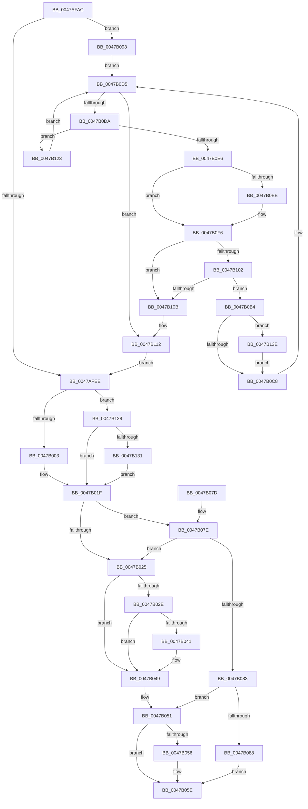

# PnpUnregisterPlugPlayNotification

- RVA: `0x0047AFAC`–`0x0047B148` (길이 `412` bytes)
- VA: `0x000000014047AFAC`
- 실행 섹션: `.text`
- PDB 이름 있음: `예`; PDB Function 태그: `아니요`
- unwind 정보 RVA: `0x000AD3DC`
- 디코드: `112`개 명령, `412/412` bytes 표시
- 미해석 바이트: `0` (있으면 어셈블리에 `.byte`로 보존)

> 이 문서는 커널 이미지의 기계어와 PDB 기호를 분석해 생성했습니다. 4번과 5번은 함수 원형과 자료형을 바이너리 사용 방식에서 추정한 C 해석이며 원본 소스 복구 결과는 아닙니다.

## 1. Dependencies

- 직접 호출 지점: **17**; 고유 호출 대상: **7**
- 직접 호출자로 확인된 함수: **7**
- RIP 상대 이미지 참조: **4**

### Outgoing calls
- `0x0047AFDC` → [ExAcquireFastMutex](../20/ExAcquireFastMutex_function_0020E5A0.md) (function, `0x0020E5A0`)
- `0x0047AFF5` → [ExReleaseFastMutex](../25/ExReleaseFastMutex_function_002519C0.md) (function, `0x002519C0`)
- `0x0047B01A` → [ExAcquireResourceExclusiveLite](../21/ExAcquireResourceExclusiveLite_function_00214E20.md) (function, `0x00214E20`)
- `0x0047B032` → [ExReleaseResourceLite](../25/ExReleaseResourceLite_function_0025FA10.md) (function, `0x0025FA10`)
- `0x0047B037` → [KeLeaveCriticalRegion](../25/KeLeaveCriticalRegion_function_0025D8B0.md) (function, `0x0025D8B0`)
- `0x0047B044` → [ExAcquireFastMutex](../20/ExAcquireFastMutex_function_0020E5A0.md) (function, `0x0020E5A0`)
- `0x0047B04C` → [PnpDereferenceNotify](../../page/95/PnpDereferenceNotify_function_00954A04.md) (function, `0x00954A04`)
- `0x0047B059` → [ExReleaseFastMutex](../25/ExReleaseFastMutex_function_002519C0.md) (function, `0x002519C0`)
- `0x0047B08C` → [ExReleaseResourceLite](../25/ExReleaseResourceLite_function_0025FA10.md) (function, `0x0025FA10`)
- `0x0047B091` → [KeLeaveCriticalRegion](../25/KeLeaveCriticalRegion_function_0025D8B0.md) (function, `0x0025D8B0`)
- `0x0047B09F` → [ExAcquireFastMutex](../20/ExAcquireFastMutex_function_0020E5A0.md) (function, `0x0020E5A0`)
- `0x0047B0BE` → [PnpDereferenceNotify](../../page/95/PnpDereferenceNotify_function_00954A04.md) (function, `0x00954A04`)
- `0x0047B0D0` → [ExFreePoolWithTag](../../poolcode/B8/ExFreePoolWithTag_function_00B82870.md) (function, `0x00B82870`)
- `0x0047B0F1` → [ExAcquireFastMutex](../20/ExAcquireFastMutex_function_0020E5A0.md) (function, `0x0020E5A0`)
- `0x0047B119` → [ExReleaseFastMutex](../25/ExReleaseFastMutex_function_002519C0.md) (function, `0x002519C0`)
- `0x0047B134` → [ExAcquireFastMutex](../20/ExAcquireFastMutex_function_0020E5A0.md) (function, `0x0020E5A0`)
- `0x0047B141` → [ExReleaseFastMutex](../25/ExReleaseFastMutex_function_002519C0.md) (function, `0x002519C0`)

### Direct callers
- [PopHandleCancelQueryRemove](../../page/75/PopHandleCancelQueryRemove_function_0075730C.md) at `0x00757438`
- [PopHandleCancelQueryRemove](../../page/75/PopHandleCancelQueryRemove_function_0075730C.md) at `0x00757447`
- [PopUnregisterCoolingNotification](../../page/75/PopUnregisterCoolingNotification_function_00757854.md) at `0x0075788B`
- [PopPolicyDeviceTargetChange](../../page/76/PopPolicyDeviceTargetChange_function_00766490.md) at `0x00766545`
- [CmpHiveCacheEntryCleanup](../../page/7F/CmpHiveCacheEntryCleanup_function_007F5B38.md) at `0x007F5C38`
- [IoUnregisterPlugPlayNotificationEx](../../page/A6/IoUnregisterPlugPlayNotificationEx_function_00A64CF0.md) at `0x00A64CF6`
- [IoUnregisterPlugPlayNotification](../../page/AA/IoUnregisterPlugPlayNotification_function_00AA5CC0.md) at `0x00AA5CD2`
- [PopCleanCoolingExtension](../../page/AD/PopCleanCoolingExtension_function_00ADF580.md) at `0x00ADF5FE`

### Static image references
- `0x0047AFCF` → RVA `0x00F8AC40` (`.data`; read)
- `0x0047AFE1` → RVA `0x00FD8003` (`PAGEDATA`; read)
- `0x0047B098` → RVA `0x00F8CD20` (`.data`; read)
- `0x0047B0A4` → RVA `0x00FD9FA8` (`PAGEDATA`; read)

## 2. Other-region calls and transfers

- 다른 실행 섹션으로 향하는 call: **3**
  - `0x0047B04C` → [PnpDereferenceNotify](../../page/95/PnpDereferenceNotify_function_00954A04.md) (`.text` → `PAGE`)
  - `0x0047B0BE` → [PnpDereferenceNotify](../../page/95/PnpDereferenceNotify_function_00954A04.md) (`.text` → `PAGE`)
  - `0x0047B0D0` → [ExFreePoolWithTag](../../poolcode/B8/ExFreePoolWithTag_function_00B82870.md) (`.text` → `POOLCODE`)
- 별도 외부 분기/꼬리 이동을 확인하지 못했습니다.

## 3. Assembly (complete function range)

```asm
0047AFAC  48 89 5C 24 08                  mov qword ptr [rsp + 8], rbx
0047AFB1  48 89 6C 24 10                  mov qword ptr [rsp + 0x10], rbp
0047AFB6  48 89 74 24 18                  mov qword ptr [rsp + 0x18], rsi
0047AFBB  57                              push rdi
0047AFBC  41 54                           push r12
0047AFBE  41 55                           push r13
0047AFC0  41 56                           push r14
0047AFC2  41 57                           push r15
0047AFC4  48 83 EC 20                     sub rsp, 0x20
0047AFC8  48 8B 59 40                     mov rbx, qword ptr [rcx + 0x40]
0047AFCC  48 8B F9                        mov rdi, rcx
0047AFCF  48 8D 0D 6A FC B0 00            lea rcx, [rip + 0xb0fc6a]
0047AFD6  40 8A EA                        mov bpl, dl
0047AFD9  45 32 E4                        xor r12b, r12b
0047AFDC  E8 BF 35 D9 FF                  call 0x14020e5a0
0047AFE1  44 38 25 1B D0 B5 00            cmp byte ptr [rip + 0xb5d01b], r12b
0047AFE8  0F 85 AA 00 00 00               jne 0x14047b098
0047AFEE  48 8D 0D 4B FC B0 00            lea rcx, [rip + 0xb0fc4b]
0047AFF5  E8 C6 69 DD FF                  call 0x1402519c0
0047AFFA  40 84 ED                        test bpl, bpl
0047AFFD  0F 84 25 01 00 00               je 0x14047b128
0047B003  65 48 8B 04 25 88 01 00 00      mov rax, qword ptr gs:[0x188]
0047B00C  B2 01                           mov dl, 1
0047B00E  66 FF 88 E4 01 00 00            dec word ptr [rax + 0x1e4]
0047B015  90                              nop
0047B016  48 8B 4F 48                     mov rcx, qword ptr [rdi + 0x48]
0047B01A  E8 01 9E D9 FF                  call 0x140214e20
0047B01F  80 7F 3A 00                     cmp byte ptr [rdi + 0x3a], 0
0047B023  75 59                           jne 0x14047b07e
0047B025  C6 47 3A 01                     mov byte ptr [rdi + 0x3a], 1
0047B029  40 84 ED                        test bpl, bpl
0047B02C  74 1B                           je 0x14047b049
0047B02E  48 8B 4F 48                     mov rcx, qword ptr [rdi + 0x48]
0047B032  E8 D9 49 DE FF                  call 0x14025fa10
0047B037  E8 74 28 DE FF                  call 0x14025d8b0
0047B03C  48 85 DB                        test rbx, rbx
0047B03F  74 08                           je 0x14047b049
0047B041  48 8B CB                        mov rcx, rbx
0047B044  E8 57 35 D9 FF                  call 0x14020e5a0
0047B049  48 8B CF                        mov rcx, rdi
0047B04C  E8 B3 99 4D 00                  call 0x140954a04
0047B051  48 85 DB                        test rbx, rbx
0047B054  74 08                           je 0x14047b05e
0047B056  48 8B CB                        mov rcx, rbx
0047B059  E8 62 69 DD FF                  call 0x1402519c0
0047B05E  48 8B 5C 24 50                  mov rbx, qword ptr [rsp + 0x50]
0047B063  33 C0                           xor eax, eax
0047B065  48 8B 6C 24 58                  mov rbp, qword ptr [rsp + 0x58]
0047B06A  48 8B 74 24 60                  mov rsi, qword ptr [rsp + 0x60]
0047B06F  48 83 C4 20                     add rsp, 0x20
0047B073  41 5F                           pop r15
0047B075  41 5E                           pop r14
0047B077  41 5D                           pop r13
0047B079  41 5C                           pop r12
0047B07B  5F                              pop rdi
0047B07C  C3                              ret
0047B07D  CC                              int3
0047B07E  45 84 E4                        test r12b, r12b
0047B081  75 A2                           jne 0x14047b025
0047B083  40 84 ED                        test bpl, bpl
0047B086  74 C9                           je 0x14047b051
0047B088  48 8B 4F 48                     mov rcx, qword ptr [rdi + 0x48]
0047B08C  E8 7F 49 DE FF                  call 0x14025fa10
0047B091  E8 1A 28 DE FF                  call 0x14025d8b0
0047B096  EB C6                           jmp 0x14047b05e
0047B098  48 8D 0D 81 1C B1 00            lea rcx, [rip + 0xb11c81]
0047B09F  E8 FC 34 D9 FF                  call 0x14020e5a0
0047B0A4  48 8B 35 FD EE B5 00            mov rsi, qword ptr [rip + 0xb5eefd]
0047B0AB  4C 8D 2D F6 EE B5 00            lea r13, [rip + 0xb5eef6]
0047B0B2  EB 21                           jmp 0x14047b0d5
0047B0B4  48 89 10                        mov qword ptr [rax], rdx
0047B0B7  48 89 42 08                     mov qword ptr [rdx + 8], rax
0047B0BB  49 8B 0F                        mov rcx, qword ptr [r15]
0047B0BE  E8 41 99 4D 00                  call 0x140954a04
0047B0C3  48 85 DB                        test rbx, rbx
0047B0C6  75 76                           jne 0x14047b13e
0047B0C8  BA 50 6E 70 37                  mov edx, 0x37706e50
0047B0CD  49 8B CE                        mov rcx, r14
0047B0D0  E8 9B 77 70 00                  call 0x140b82870
0047B0D5  49 3B F5                        cmp rsi, r13
0047B0D8  74 38                           je 0x14047b112
0047B0DA  4C 8D 7E 10                     lea r15, [rsi + 0x10]
0047B0DE  4C 8B F6                        mov r14, rsi
0047B0E1  49 39 3F                        cmp qword ptr [r15], rdi
0047B0E4  75 3D                           jne 0x14047b123
0047B0E6  41 B4 01                        mov r12b, 1
0047B0E9  48 85 DB                        test rbx, rbx
0047B0EC  74 08                           je 0x14047b0f6
0047B0EE  48 8B CB                        mov rcx, rbx
0047B0F1  E8 AA 34 D9 FF                  call 0x14020e5a0
0047B0F6  48 8B 16                        mov rdx, qword ptr [rsi]
0047B0F9  48 8B F2                        mov rsi, rdx
0047B0FC  4C 39 72 08                     cmp qword ptr [rdx + 8], r14
0047B100  75 09                           jne 0x14047b10b
0047B102  49 8B 46 08                     mov rax, qword ptr [r14 + 8]
0047B106  4C 39 30                        cmp qword ptr [rax], r14
0047B109  74 A9                           je 0x14047b0b4
0047B10B  B9 03 00 00 00                  mov ecx, 3
0047B110  CD 29                           int 0x29
0047B112  48 8D 0D 07 1C B1 00            lea rcx, [rip + 0xb11c07]
0047B119  E8 A2 68 DD FF                  call 0x1402519c0
0047B11E  E9 CB FE FF FF                  jmp 0x14047afee
0047B123  48 8B 36                        mov rsi, qword ptr [rsi]
0047B126  EB AD                           jmp 0x14047b0d5
0047B128  48 85 DB                        test rbx, rbx
0047B12B  0F 84 EE FE FF FF               je 0x14047b01f
0047B131  48 8B CB                        mov rcx, rbx
0047B134  E8 67 34 D9 FF                  call 0x14020e5a0
0047B139  E9 E1 FE FF FF                  jmp 0x14047b01f
0047B13E  48 8B CB                        mov rcx, rbx
0047B141  E8 7A 68 DD FF                  call 0x1402519c0
0047B146  EB 80                           jmp 0x14047b0c8
```

## 4. C-style interpretation (structured pseudocode)

```c
__int64 __fastcall PnpUnregisterPlugPlayNotification(__int64 a1, unsigned __int8 a2)
{
    __int64 result;
    __int64 v_r12;
    __int64 v_rsp;
    unsigned __int64 v_stack_p10;
    unsigned __int64 v_stack_p18;
    unsigned __int64 v_stack_p8;

    v_stack_p8 = v_rbx;
    v_stack_p10 = v_rbp;
    v_stack_p18 = v_rsi;
    v_rsp = (v_rsp) - (32);
    v_r12 = 0;
    result = ExAcquireFastMutex(v_rip + 11598954, a2, a3, a4);
    if ((*(unsigned __int8 *)(v_rip + 11915291)) != 0) goto loc_0047B098;
loc_0047AFEE:
    result = ExReleaseFastMutex(v_rip + 11598923, a2, a3, a4);
    if (a2 == 0) goto loc_0047B128;
    result = ExAcquireResourceExclusiveLite(*(unsigned __int64 *)(a1 + 72), 1, a3, a4);
loc_0047B01F:
    if ((*(unsigned __int8 *)(a1 + 58)) != 0) goto loc_0047B07E;
loc_0047B025:
    *(unsigned __int8 *)(a1 + 58) = 1;
    if (a2 == 0) goto loc_0047B049;
    result = ExReleaseResourceLite(*(unsigned __int64 *)(a1 + 72), 1, a3, a4);
    result = KeLeaveCriticalRegion(*(unsigned __int64 *)(a1 + 72), 1, a3, a4);
    if (*(unsigned __int64 *)(a1 + 64) != 0) {
        a1 = *(unsigned __int64 *)(a1 + 64);
        result = ExAcquireFastMutex(a1, 1, a3, a4);
    }
    result = PnpDereferenceNotify(a1, 1, a3, a4);
loc_0047B051:
    if (*(unsigned __int64 *)(a1 + 64) != 0) {
        a1 = *(unsigned __int64 *)(a1 + 64);
        result = ExReleaseFastMutex(a1, 1, a3, a4);
    }
    result = 0;
    v_rsp = (v_rsp) + (32);
    return result;
loc_0047B07E:
    if (0 != 0) goto loc_0047B025;
    if ((unsigned __int8)(v_stack_p10) == 0) goto loc_0047B051;
    result = ExReleaseResourceLite(*(unsigned __int64 *)(a1 + 72), 1, a3, a4);
    result = KeLeaveCriticalRegion(*(unsigned __int64 *)(a1 + 72), 1, a3, a4);
    goto loc_0047B05E;
loc_0047B098:
    result = ExAcquireFastMutex(v_rip + 11607169, 1, a3, a4);
    goto loc_0047B0D5;
loc_0047B0B4:
    *(unsigned __int64 *)(result) = 1;
    *(unsigned __int64 *)(1 + 8) = result;
    result = PnpDereferenceNotify(*(unsigned __int64 *)(v_r15), 1, a3, a4);
    if (v_stack_p8 != 0) goto loc_0047B13E;
loc_0047B0C8:
    result = ExFreePoolWithTag(v_r14, (unsigned int)(0x37706E50ULL), a3, a4);
loc_0047B0D5:
    if ((*(unsigned __int64 *)(v_rip + 11923197)) == (v_rip + 11923190)) goto loc_0047B112;
    if ((*(unsigned __int64 *)(*(unsigned __int64 *)(v_rip + 11923197) + 16)) != a1) goto loc_0047B123;
    if (v_stack_p8 != 0) {
        a1 = v_stack_p8;
        result = ExAcquireFastMutex(a1, (unsigned int)(0x37706E50ULL), a3, a4);
    }
    if ((*(unsigned __int64 *)(*(unsigned __int64 *)(*(unsigned __int64 *)(v_rip + 11923197)) + 8)) != (*(unsigned __int64 *)(v_rip + 11923197))) goto loc_0047B10B;
    if ((*(unsigned __int64 *)(*(unsigned __int64 *)(*(unsigned __int64 *)(v_rip + 11923197) + 8))) == (*(unsigned __int64 *)(v_rip + 11923197))) goto loc_0047B0B4;
loc_0047B10B:
loc_0047B112:
    result = ExReleaseFastMutex(v_rip + 11607047, *(unsigned __int64 *)(*(unsigned __int64 *)(v_rip + 11923197)), a3, a4);
    goto loc_0047AFEE;
loc_0047B123:
    goto loc_0047B0D5;
loc_0047B128:
    if (v_stack_p8 == 0) goto loc_0047B01F;
    result = ExAcquireFastMutex(v_stack_p8, *(unsigned __int64 *)(*(unsigned __int64 *)(v_rip + 11923197)), a3, a4);
    goto loc_0047B01F;
loc_0047B13E:
    result = ExReleaseFastMutex(v_stack_p8, *(unsigned __int64 *)(*(unsigned __int64 *)(v_rip + 11923197)), a3, a4);
    goto loc_0047B0C8;
}
```

## 5. (Beta) C Style

```c
int64_t PnpUnregisterPlugPlayNotification(void *Arg1, uint8_t Arg2)
{
    uint8_t *arg1 = (uint8_t *)Arg1;

    int64_t result;
    int64_t local_r12;
    int64_t local_rsp;
    uint64_t v_stack_p10;
    uint64_t v_stack_p18;
    uint64_t v_stack_p8;

    v_stack_p8 = local_rbx;
    v_stack_p10 = local_rbp;
    v_stack_p18 = local_rsi;
    local_rsp = (local_rsp) - (32);
    local_r12 = 0;
    result = ExAcquireFastMutex(v_rip + 11598954, Arg2, a3, a4);
    if ((*(uint8_t *)(v_rip + 0xB5D01B)) != 0) goto loc_0047B098;
loc_0047AFEE:
    result = ExReleaseFastMutex(v_rip + 11598923, Arg2, a3, a4);
    if (Arg2 == 0) goto loc_0047B128;
    result = ExAcquireResourceExclusiveLite(*(uint64_t *)(arg1 + 0x48), 1, a3, a4);
loc_0047B01F:
    if ((*(uint8_t *)(arg1 + 0x3A)) != 0) goto loc_0047B07E;
loc_0047B025:
    *(uint8_t *)(arg1 + 0x3A) = 1;
    if (Arg2 == 0) goto loc_0047B049;
    result = ExReleaseResourceLite(*(uint64_t *)(arg1 + 0x48), 1, a3, a4);
    result = KeLeaveCriticalRegion(*(uint64_t *)(arg1 + 0x48), 1, a3, a4);
    if (*(uint64_t *)(arg1 + 0x40) != 0) {
        Arg1 = *(uint64_t *)(arg1 + 0x40);
        result = ExAcquireFastMutex(Arg1, 1, a3, a4);
    }
    result = PnpDereferenceNotify(Arg1, 1, a3, a4);
loc_0047B051:
    if (*(uint64_t *)(arg1 + 0x40) != 0) {
        Arg1 = *(uint64_t *)(arg1 + 0x40);
        result = ExReleaseFastMutex(Arg1, 1, a3, a4);
    }
    result = 0;
    local_rsp = (local_rsp) + (32);
    return result;
loc_0047B07E:
    if (0 != 0) goto loc_0047B025;
    if ((uint8_t)(v_stack_p10) == 0) goto loc_0047B051;
    result = ExReleaseResourceLite(*(uint64_t *)(arg1 + 0x48), 1, a3, a4);
    result = KeLeaveCriticalRegion(*(uint64_t *)(arg1 + 0x48), 1, a3, a4);
    goto loc_0047B05E;
loc_0047B098:
    result = ExAcquireFastMutex(v_rip + 11607169, 1, a3, a4);
    goto loc_0047B0D5;
loc_0047B0B4:
    *(uint64_t *)(result) = 1;
    *(uint64_t *)(1 + 0x8) = result;
    result = PnpDereferenceNotify(*(uint64_t *)(local_r15), 1, a3, a4);
    if (v_stack_p8 != 0) goto loc_0047B13E;
loc_0047B0C8:
    result = ExFreePoolWithTag(local_r14, (uint32_t)(0x37706E50ULL), a3, a4);
loc_0047B0D5:
    if ((*(uint64_t *)(v_rip + 0xB5EEFD)) == (v_rip + 11923190)) goto loc_0047B112;
    if ((*(uint64_t *)(*(uint64_t *)(v_rip + 0xB5EEFD) + 0x10)) != Arg1) goto loc_0047B123;
    if (v_stack_p8 != 0) {
        Arg1 = v_stack_p8;
        result = ExAcquireFastMutex(Arg1, (uint32_t)(0x37706E50ULL), a3, a4);
    }
    if ((*(uint64_t *)(*(uint64_t *)(*(uint64_t *)(v_rip + 0xB5EEFD)) + 0x8)) != (*(uint64_t *)(v_rip + 0xB5EEFD))) goto loc_0047B10B;
    if ((*(uint64_t *)(*(uint64_t *)(*(uint64_t *)(v_rip + 0xB5EEFD) + 0x8))) == (*(uint64_t *)(v_rip + 0xB5EEFD))) goto loc_0047B0B4;
loc_0047B10B:
loc_0047B112:
    result = ExReleaseFastMutex(v_rip + 11607047, *(uint64_t *)(*(uint64_t *)(v_rip + 0xB5EEFD)), a3, a4);
    goto loc_0047AFEE;
loc_0047B123:
    goto loc_0047B0D5;
loc_0047B128:
    if (v_stack_p8 == 0) goto loc_0047B01F;
    result = ExAcquireFastMutex(v_stack_p8, *(uint64_t *)(*(uint64_t *)(v_rip + 0xB5EEFD)), a3, a4);
    goto loc_0047B01F;
loc_0047B13E:
    result = ExReleaseFastMutex(v_stack_p8, *(uint64_t *)(*(uint64_t *)(v_rip + 0xB5EEFD)), a3, a4);
    goto loc_0047B0C8;
}
```

### 관측된 메모리 오프셋

구조체 형식이 확인되지 않은 접근은 인자 기준의 오프셋으로만 기록했습니다.

| 기준 인자 | 오프셋 표현 | 폭 (bit) | 접근 |
|---|---:|---:|---|
| `Arg1` | `+ 0x3A` | `8` | `R` |
| `Arg1` | `+ 0x3A` | `8` | `W` |
| `Arg1` | `+ 0x40` | `64` | `R` |
| `Arg1` | `+ 0x48` | `64` | `R` |

## 6. Execution-region graph

[열기: 2D/3D 그래프와 함수 탐색 컨트롤 패널](../../../control-panel.html?section=text&rva=0x0047AFAC&view=graph)

- 2D 그래프는 위에서 아래로 흐르고, 3D 그래프는 빈 공간을 드래그해 회전합니다. Shift+드래그는 이동, 휠은 확대·축소, 함수 노드 선택은 대상 보고서 이동입니다.

### Static fallback


