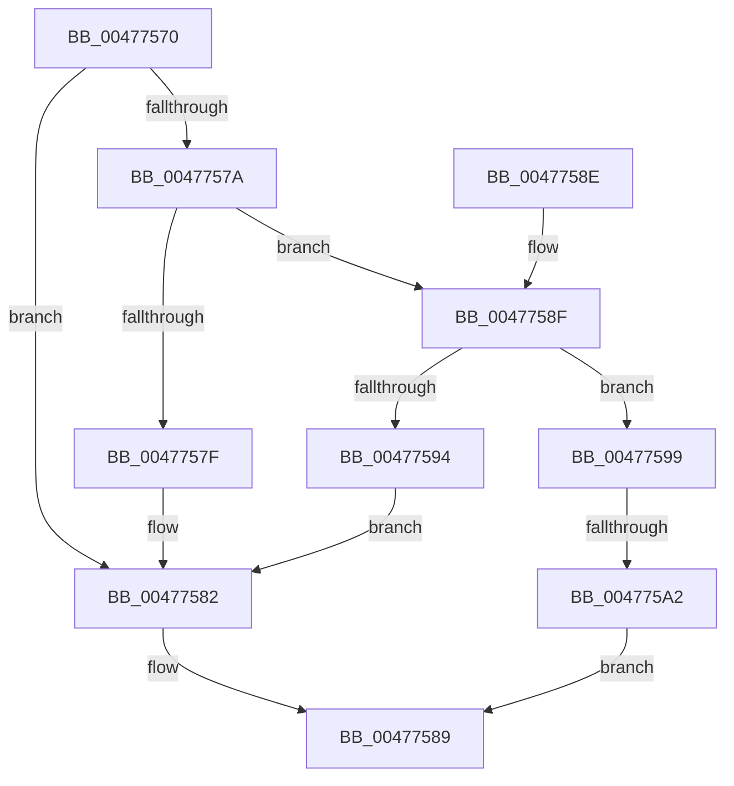

# PoClearPowerRequest

- RVA: `0x00477570`–`0x004775A9` (길이 `57` bytes)
- VA: `0x0000000140477570`
- 실행 섹션: `.text`
- PDB 이름 있음: `예`; PDB Function 태그: `예`
- unwind 정보 RVA: `0x0009D63C`
- 디코드: `20`개 명령, `57/57` bytes 표시
- 미해석 바이트: `0` (있으면 어셈블리에 `.byte`로 보존)

> 이 문서는 커널 이미지의 기계어와 PDB 기호를 분석해 생성했습니다. 4번과 5번은 함수 원형과 자료형을 바이너리 사용 방식에서 추정한 C 해석이며 원본 소스 복구 결과는 아닙니다.

## 1. Dependencies

- 직접 호출 지점: **1**; 고유 호출 대상: **1**
- 직접 호출자로 확인된 함수: **0**
- RIP 상대 이미지 참조: **0**

### Outgoing calls
- `0x00477584` → [PopPowerRequestReferenceRelease](PopPowerRequestReferenceRelease_function_004775B0.md) (function, `0x004775B0`)

### Direct callers
- 이 함수 시작 RVA로 연결되는 직접 call은 확인되지 않았습니다. 간접 호출은 완전히 역산할 수 없습니다.

### Static image references
- 디코드된 RIP-relative 메모리 참조가 없습니다.

## 2. Other-region calls and transfers

- 다른 실행 섹션으로 향하는 call: **0**
- call이 아닌 외부 분기/꼬리 이동: **1**
  - `0x0047759C` → [sub_006F44E2](../6F/Unknown_function_006F44E2.md) (`tail-transfer`)

## 3. Assembly (complete function range)

```asm
00477570  48 83 EC 28                     sub rsp, 0x28
00477574  33 C0                           xor eax, eax
00477576  85 D2                           test edx, edx
00477578  74 08                           je 0x140477582
0047757A  83 EA 01                        sub edx, 1
0047757D  75 10                           jne 0x14047758f
0047757F  8D 42 01                        lea eax, [rdx + 1]
00477582  8B D0                           mov edx, eax
00477584  E8 27 00 00 00                  call 0x1404775b0
00477589  48 83 C4 28                     add rsp, 0x28
0047758D  C3                              ret
0047758E  CC                              int3
0047758F  83 EA 01                        sub edx, 1
00477592  75 05                           jne 0x140477599
00477594  8D 42 02                        lea eax, [rdx + 2]
00477597  EB E9                           jmp 0x140477582
00477599  83 FA 01                        cmp edx, 1
0047759C  0F 84 40 CF 27 00               je 0x1406f44e2
004775A2  B8 BB 00 00 C0                  mov eax, 0xc00000bb
004775A7  EB E0                           jmp 0x140477589
```

## 4. C-style interpretation (structured pseudocode)

```c
__int64 __fastcall PoClearPowerRequest(__int64 a1, int a2)
{
    __int64 result;
    __int64 v_rsp;

    v_rsp = (v_rsp) - (40);
    result = 0;
    if (a2 == 0) goto loc_00477582;
    a2 = (unsigned int)((a2) - (1));
    if (condition_is_not_equal) goto loc_0047758F;
loc_00477582:
    result = PopPowerRequestReferenceRelease(a1, (unsigned int)((unsigned int)(a2 + 1)), a3, a4);
loc_00477589:
    v_rsp = (v_rsp) + (40);
    return result;
loc_0047758F:
    a2 = (unsigned int)(((unsigned int)((unsigned int)(a2 + 1))) - (1));
    if (condition_is_not_equal) goto loc_00477599;
    goto loc_00477582;
loc_00477599:
    goto loc_00477589;
}
```

## 5. (Beta) C Style

```c
int64_t PoClearPowerRequest(int64_t Arg1, int32_t Arg2)
{
    int64_t result;
    int64_t local_rsp;

    local_rsp = (local_rsp) - (40);
    result = 0;
    if (Arg2 == 0) goto loc_00477582;
    Arg2 = (uint32_t)((Arg2) - (1));
    if (condition_is_not_equal) goto loc_0047758F;
loc_00477582:
    result = PopPowerRequestReferenceRelease(Arg1, (uint32_t)((uint32_t)(Arg2 + 1)), a3, a4);
loc_00477589:
    local_rsp = (local_rsp) + (40);
    return result;
loc_0047758F:
    Arg2 = (uint32_t)(((uint32_t)((uint32_t)(Arg2 + 1))) - (1));
    if (condition_is_not_equal) goto loc_00477599;
    goto loc_00477582;
loc_00477599:
    goto loc_00477589;
}
```

## 6. Execution-region graph

[열기: 2D/3D 그래프와 함수 탐색 컨트롤 패널](../../../control-panel.html?section=text&rva=0x00477570&view=graph)

- 2D 그래프는 위에서 아래로 흐르고, 3D 그래프는 빈 공간을 드래그해 회전합니다. Shift+드래그는 이동, 휠은 확대·축소, 함수 노드 선택은 대상 보고서 이동입니다.

### Static fallback


