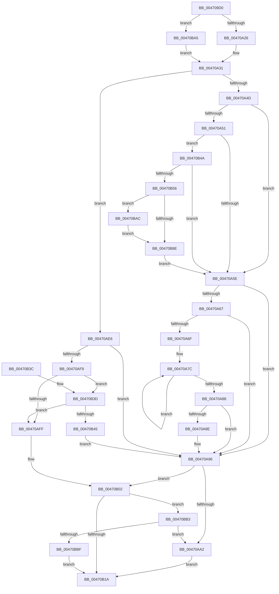

# PoHandleIrp

- RVA: `0x004709D0`–`0x00470BDB` (길이 `523` bytes)
- VA: `0x00000001404709D0`
- 실행 섹션: `.text`
- PDB 이름 있음: `예`; PDB Function 태그: `아니요`
- unwind 정보 RVA: `0x000ABD34`
- 디코드: `120`개 명령, `523/523` bytes 표시
- 미해석 바이트: `0` (있으면 어셈블리에 `.byte`로 보존)

> 이 문서는 커널 이미지의 기계어와 PDB 기호를 분석해 생성했습니다. 4번과 5번은 함수 원형과 자료형을 바이너리 사용 방식에서 추정한 C 해석이며 원본 소스 복구 결과는 아닙니다.

## 1. Dependencies

- 직접 호출 지점: **10**; 고유 호출 대상: **8**
- 직접 호출자로 확인된 함수: **1**
- RIP 상대 이미지 참조: **3**

### Outgoing calls
- `0x00470A91` → [PopDiagTraceDIrpAfterSx](PopDiagTraceDIrpAfterSx_function_00470D88.md) (function, `0x00470D88`)
- `0x00470AAE` → [KeAcquireInStackQueuedSpinLock](../27/KeAcquireInStackQueuedSpinLock_function_002757A0.md) (function, `0x002757A0`)
- `0x00470AC6` → [PopDispatchQuerySetIrp](PopDispatchQuerySetIrp_function_00470CE8.md) (function, `0x00470CE8`)
- `0x00470AD8` → [KeReleaseInStackQueuedSpinLock](../34/KeReleaseInStackQueuedSpinLock_function_00342CE0.md) (function, `0x00342CE0`)
- `0x00470AE8` → [PoDeviceReleaseIrp](../39/PoDeviceReleaseIrp_function_00391B7C.md) (function, `0x00391B7C`)
- `0x00470B0C` → [PoDeviceAcquireIrp](../38/PoDeviceAcquireIrp_function_0038FF88.md) (function, `0x0038FF88`)
- `0x00470B62` → [KeAcquireInStackQueuedSpinLock](../27/KeAcquireInStackQueuedSpinLock_function_002757A0.md) (function, `0x002757A0`)
- `0x00470B9B` → [KeReleaseInStackQueuedSpinLock](../34/KeReleaseInStackQueuedSpinLock_function_00342CE0.md) (function, `0x00342CE0`)
- `0x00470BAC` → [PopEnableIrpWatchdog](../44/PopEnableIrpWatchdog_function_00447BFC.md) (function, `0x00447BFC`)
- `0x00470BCD` → [IofCompleteRequest](../29/IofCompleteRequest_function_0029B5C0.md) (function, `0x0029B5C0`)

### Direct callers
- [IopPoHandleIrp](IopPoHandleIrp_function_0047096C.md) at `0x0047097F`

### Static image references
- `0x00470AA7` → RVA `0x00F0CA50` (`.data`; read)
- `0x00470ABC` → RVA `0x00F0BD28` (`.data`; write)
- `0x00470ACB` → RVA `0x00F0BD28` (`.data`; read/write)

## 2. Other-region calls and transfers

- 다른 실행 섹션으로 향하는 call: **0**
- 별도 외부 분기/꼬리 이동을 확인하지 못했습니다.

## 3. Assembly (complete function range)

```asm
004709D0  4C 8B DC                        mov r11, rsp
004709D3  49 89 5B 08                     mov qword ptr [r11 + 8], rbx
004709D7  49 89 6B 10                     mov qword ptr [r11 + 0x10], rbp
004709DB  49 89 73 18                     mov qword ptr [r11 + 0x18], rsi
004709DF  49 89 7B 20                     mov qword ptr [r11 + 0x20], rdi
004709E3  41 55                           push r13
004709E5  41 56                           push r14
004709E7  41 57                           push r15
004709E9  48 83 EC 40                     sub rsp, 0x40
004709ED  4C 8B A9 B8 00 00 00            mov r13, qword ptr [rcx + 0xb8]
004709F4  33 C0                           xor eax, eax
004709F6  0F 57 C0                        xorps xmm0, xmm0
004709F9  4C 8B FA                        mov r15, rdx
004709FC  0F 11 44 24 20                  movups xmmword ptr [rsp + 0x20], xmm0
00470A01  49 89 43 D8                     mov qword ptr [r11 - 0x28], rax
00470A05  48 8B D9                        mov rbx, rcx
00470A08  48 0F BE 41 42                  movsx rax, byte ptr [rcx + 0x42]
00470A0D  4C 8D 04 C0                     lea r8, [rax + rax*8]
00470A11  4A 8B B4 C1 C8 00 00 00         mov rsi, qword ptr [rcx + r8*8 + 0xc8]
00470A19  48 8B 46 18                     mov rax, qword ptr [rsi + 0x18]
00470A1D  48 85 C0                        test rax, rax
00470A20  0F 84 7F 01 00 00               je 0x140470ba5
00470A26  48 8B 80 38 01 00 00            mov rax, qword ptr [rax + 0x138]
00470A2D  48 8B 78 28                     mov rdi, qword ptr [rax + 0x28]
00470A31  4C 8B 46 28                     mov r8, qword ptr [rsi + 0x28]
00470A35  BD 01 00 00 00                  mov ebp, 1
00470A3A  4D 8B 75 28                     mov r14, qword ptr [r13 + 0x28]
00470A3E  8A 86 B8 00 00 00               mov al, byte ptr [rsi + 0xb8]
00470A44  4D 85 C0                        test r8, r8
00470A47  0F 85 99 00 00 00               jne 0x140470ae6
00470A4D  3C 02                           cmp al, 2
00470A4F  75 0D                           jne 0x140470a5e
00470A51  44 39 86 BC 00 00 00            cmp dword ptr [rsi + 0xbc], r8d
00470A58  0F 84 EC 00 00 00               je 0x140470b4a
00470A5E  80 BE B8 00 00 00 02            cmp byte ptr [rsi + 0xb8], 2
00470A65  75 2F                           jne 0x140470a96
00470A67  39 AE BC 00 00 00               cmp dword ptr [rsi + 0xbc], ebp
00470A6D  75 27                           jne 0x140470a96
00470A6F  0F 0D 8F 28 01 00 00            prefetchw byte ptr [rdi + 0x128]
00470A76  8B 87 28 01 00 00               mov eax, dword ptr [rdi + 0x128]
00470A7C  8B C8                           mov ecx, eax
00470A7E  F0 0F B1 8F 28 01 00 00         lock cmpxchg dword ptr [rdi + 0x128], ecx
00470A86  75 F4                           jne 0x140470a7c
00470A88  0F BA E0 0F                     bt eax, 0xf
00470A8C  73 08                           jae 0x140470a96
00470A8E  48 8B CB                        mov rcx, rbx
00470A91  E8 F2 02 00 00                  call 0x140470d88
00470A96  49 8D 7E 30                     lea rdi, [r14 + 0x30]
00470A9A  F7 07 00 80 00 00               test dword ptr [rdi], 0x8000
00470AA0  75 60                           jne 0x140470b02
00470AA2  48 8D 54 24 20                  lea rdx, [rsp + 0x20]
00470AA7  48 8D 0D A2 BF A9 00            lea rcx, [rip + 0xa9bfa2]
00470AAE  E8 ED 4C E0 FF                  call 0x1402757a0
00470AB3  65 48 8B 0C 25 88 01 00 00      mov rcx, qword ptr gs:[0x188]
00470ABC  48 89 0D 65 B2 A9 00            mov qword ptr [rip + 0xa9b265], rcx
00470AC3  48 8B CB                        mov rcx, rbx
00470AC6  E8 1D 02 00 00                  call 0x140470ce8
00470ACB  48 83 25 55 B2 A9 00 00         and qword ptr [rip + 0xa9b255], 0
00470AD3  48 8D 4C 24 20                  lea rcx, [rsp + 0x20]
00470AD8  E8 03 22 ED FF                  call 0x140342ce0
00470ADD  41 C7 07 03 01 00 00            mov dword ptr [r15], 0x103
00470AE4  EB 34                           jmp 0x140470b1a
00470AE6  8A D0                           mov dl, al
00470AE8  E8 8F 10 F2 FF                  call 0x140391b7c
00470AED  49 8D 7E 30                     lea rdi, [r14 + 0x30]
00470AF1  8B 07                           mov eax, dword ptr [rdi]
00470AF3  0F BA E0 0F                     bt eax, 0xf
00470AF7  72 9D                           jb 0x140470a96
00470AF9  0F BA E0 0D                     bt eax, 0xd
00470AFD  72 3E                           jb 0x140470b3d
00470AFF  40 32 ED                        xor bpl, bpl
00470B02  41 8A 55 01                     mov dl, byte ptr [r13 + 1]
00470B06  4D 8B C6                        mov r8, r14
00470B09  48 8B CB                        mov rcx, rbx
00470B0C  E8 77 F4 F1 FF                  call 0x14038ff88
00470B11  40 84 ED                        test bpl, bpl
00470B14  0F 85 99 00 00 00               jne 0x140470bb3
00470B1A  48 8B 5C 24 60                  mov rbx, qword ptr [rsp + 0x60]
00470B1F  40 8A C5                        mov al, bpl
00470B22  48 8B 6C 24 68                  mov rbp, qword ptr [rsp + 0x68]
00470B27  48 8B 74 24 70                  mov rsi, qword ptr [rsp + 0x70]
00470B2C  48 8B 7C 24 78                  mov rdi, qword ptr [rsp + 0x78]
00470B31  48 83 C4 40                     add rsp, 0x40
00470B35  41 5F                           pop r15
00470B37  41 5E                           pop r14
00470B39  41 5D                           pop r13
00470B3B  C3                              ret
00470B3C  CC                              int3
00470B3D  44 0F 20 C0                     mov rax, cr8
00470B41  3C 02                           cmp al, 2
00470B43  75 BA                           jne 0x140470aff
00470B45  E9 4C FF FF FF                  jmp 0x140470a96
00470B4A  39 AE C0 00 00 00               cmp dword ptr [rsi + 0xc0], ebp
00470B50  0F 85 08 FF FF FF               jne 0x140470a5e
00470B56  48 8D 54 24 20                  lea rdx, [rsp + 0x20]
00470B5B  48 8D 0D EE BE A9 00            lea rcx, [rip + 0xa9beee]
00470B62  E8 39 4C E0 FF                  call 0x1402757a0
00470B67  65 48 8B 04 25 88 01 00 00      mov rax, qword ptr gs:[0x188]
00470B70  48 89 05 B1 B1 A9 00            mov qword ptr [rip + 0xa9b1b1], rax
00470B77  F0 81 A7 28 01 00 00 FF 7F FF FF  lock and dword ptr [rdi + 0x128], 0xffff7fff
00470B82  48 8B 8F 08 01 00 00            mov rcx, qword ptr [rdi + 0x108]
00470B89  48 85 C9                        test rcx, rcx
00470B8C  75 1E                           jne 0x140470bac
00470B8E  48 83 25 92 B1 A9 00 00         and qword ptr [rip + 0xa9b192], 0
00470B96  48 8D 4C 24 20                  lea rcx, [rsp + 0x20]
00470B9B  E8 40 21 ED FF                  call 0x140342ce0
00470BA0  E9 B9 FE FF FF                  jmp 0x140470a5e
00470BA5  33 FF                           xor edi, edi
00470BA7  E9 85 FE FF FF                  jmp 0x140470a31
00470BAC  E8 4B 70 FD FF                  call 0x140447bfc
00470BB1  EB DB                           jmp 0x140470b8e
00470BB3  F7 07 00 80 00 00               test dword ptr [rdi], 0x8000
00470BB9  0F 84 E3 FE FF FF               je 0x140470aa2
00470BBF  83 63 30 00                     and dword ptr [rbx + 0x30], 0
00470BC3  33 D2                           xor edx, edx
00470BC5  48 83 63 38 00                  and qword ptr [rbx + 0x38], 0
00470BCA  48 8B CB                        mov rcx, rbx
00470BCD  E8 EE A9 E2 FF                  call 0x14029b5c0
00470BD2  41 83 27 00                     and dword ptr [r15], 0
00470BD6  E9 3F FF FF FF                  jmp 0x140470b1a
```

## 4. C-style interpretation (structured pseudocode)

```c
__int64 __fastcall PoHandleIrp(__int64 a1, __int64 a2)
{
    __int64 result;
    __int64 v_rbp;
    __int64 v_rdi;
    __int64 v_rsp;
    unsigned __int64 v_stack_m38;
    unsigned __int64 v_stack_p10;
    unsigned __int64 v_stack_p18;
    unsigned __int64 v_stack_p20;
    unsigned __int64 v_stack_p8;

    *(unsigned __int64 *)(v_rsp + 8) = v_rbx;
    *(unsigned __int64 *)(v_rsp + 16) = v_rbp;
    *(unsigned __int64 *)(v_rsp + 24) = v_rsi;
    *(unsigned __int64 *)(v_rsp + 32) = v_rdi;
    v_rsp = (v_rsp) - (64);
    result = 0;
    v_stack_m38 = v_xmm0;
    *(unsigned __int64 *)(v_rsp - 40) = 0;
    if (*(unsigned __int64 *)(*(unsigned __int64 *)(a1 + (__int8)(*(unsigned __int8 *)(a1 + 66)) + (__int8)(*(unsigned __int8 *)(a1 + 66)) * 8 * 8 + 200) + 24) == 0) goto loc_00470BA5;
loc_00470A31:
    if (*(unsigned __int64 *)(*(unsigned __int64 *)(a1 + (__int8)(*(unsigned __int8 *)(a1 + 66)) + (__int8)(*(unsigned __int8 *)(a1 + 66)) * 8 * 8 + 200) + 40) != 0) goto loc_00470AE6;
    if (((unsigned __int8)(*(unsigned __int8 *)(*(unsigned __int64 *)(a1 + (__int8)(*(unsigned __int8 *)(a1 + 66)) + (__int8)(*(unsigned __int8 *)(a1 + 66)) * 8 * 8 + 200) + 184))) != 2) goto loc_00470A5E;
    if ((*(unsigned int *)(*(unsigned __int64 *)(a1 + (__int8)(*(unsigned __int8 *)(a1 + 66)) + (__int8)(*(unsigned __int8 *)(a1 + 66)) * 8 * 8 + 200) + 188)) == ((unsigned int)(*(unsigned __int64 *)(*(unsigned __int64 *)(a1 + (__int8)(*(unsigned __int8 *)(a1 + 66)) + (__int8)(*(unsigned __int8 *)(a1 + 66)) * 8 * 8 + 200) + 40)))) goto loc_00470B4A;
loc_00470A5E:
    if ((*(unsigned __int8 *)(*(unsigned __int64 *)(a1 + (__int8)(*(unsigned __int8 *)(a1 + 66)) + (__int8)(*(unsigned __int8 *)(a1 + 66)) * 8 * 8 + 200) + 184)) != 2) goto loc_00470A96;
    if ((*(unsigned int *)(*(unsigned __int64 *)(a1 + (__int8)(*(unsigned __int8 *)(a1 + 66)) + (__int8)(*(unsigned __int8 *)(a1 + 66)) * 8 * 8 + 200) + 188)) != 1) goto loc_00470A96;
loc_00470A7C:
    if ((*(unsigned int *)(*(unsigned __int64 *)(a1 + (__int8)(*(unsigned __int8 *)(a1 + 66)) + (__int8)(*(unsigned __int8 *)(a1 + 66)) * 8 * 8 + 200) + 188)) != 1) goto loc_00470A7C;
    result = (unsigned int)(*(unsigned int *)(*(unsigned __int64 *)(*(unsigned __int64 *)(*(unsigned __int64 *)(*(unsigned __int64 *)(a1 + (__int8)(*(unsigned __int8 *)(a1 + 66)) + (__int8)(*(unsigned __int8 *)(a1 + 66)) * 8 * 8 + 200) + 24) + 312) + 40) + 296));
    if ((*(unsigned int *)(*(unsigned __int64 *)(a1 + (__int8)(*(unsigned __int8 *)(a1 + 66)) + (__int8)(*(unsigned __int8 *)(a1 + 66)) * 8 * 8 + 200) + 188)) < 1) {
        a1 = a1;
        result = PopDiagTraceDIrpAfterSx(a1, a2, *(unsigned __int64 *)(*(unsigned __int64 *)(a1 + (__int8)(*(unsigned __int8 *)(a1 + 66)) + (__int8)(*(unsigned __int8 *)(a1 + 66)) * 8 * 8 + 200) + 40), a4);
    }
    if (((*(unsigned int *)(*(unsigned __int64 *)(*(unsigned __int64 *)(a1 + 184) + 40) + 48)) & (0x8000ULL)) != 0) goto loc_00470B02;
loc_00470AA2:
    result = KeAcquireInStackQueuedSpinLock(v_rip + 11124642, v_stack_m38, *(unsigned __int64 *)(*(unsigned __int64 *)(a1 + (__int8)(*(unsigned __int8 *)(a1 + 66)) + (__int8)(*(unsigned __int8 *)(a1 + 66)) * 8 * 8 + 200) + 40), a4);
    *(unsigned __int64 *)(v_rip + 11121253) = *(unsigned __int64 *)(gs_base + (0 + 392));
    result = PopDispatchQuerySetIrp(a1, v_stack_m38, *(unsigned __int64 *)(*(unsigned __int64 *)(a1 + (__int8)(*(unsigned __int8 *)(a1 + 66)) + (__int8)(*(unsigned __int8 *)(a1 + 66)) * 8 * 8 + 200) + 40), a4);
    result = KeReleaseInStackQueuedSpinLock(v_stack_m38, v_stack_m38, *(unsigned __int64 *)(*(unsigned __int64 *)(a1 + (__int8)(*(unsigned __int8 *)(a1 + 66)) + (__int8)(*(unsigned __int8 *)(a1 + 66)) * 8 * 8 + 200) + 40), a4);
    *(unsigned int *)(a2) = 259;
    goto loc_00470B1A;
loc_00470AE6:
    result = PoDeviceReleaseIrp(v_stack_m38, (unsigned __int8)(result), *(unsigned __int64 *)(*(unsigned __int64 *)(a1 + (__int8)(*(unsigned __int8 *)(a1 + 66)) + (__int8)(*(unsigned __int8 *)(a1 + 66)) * 8 * 8 + 200) + 40), a4);
    if (condition_is_below) goto loc_00470A96;
    if (condition_is_below) goto loc_00470B3D;
loc_00470AFF:
    v_rbp = 0;
loc_00470B02:
    result = PoDeviceAcquireIrp(a1, *(unsigned __int8 *)(*(unsigned __int64 *)(a1 + 184) + 1), *(unsigned __int64 *)(*(unsigned __int64 *)(a1 + 184) + 40), a4);
    if (0 != 0) goto loc_00470BB3;
loc_00470B1A:
    v_rsp = (v_rsp) + (64);
    return 0;
loc_00470B3D:
    if (((unsigned __int8)(v_cr8)) != 2) goto loc_00470AFF;
    goto loc_00470A96;
loc_00470B4A:
    if ((*(unsigned int *)(v_stack_p18 + 192)) != ((unsigned int)(v_stack_p10))) goto loc_00470A5E;
    result = KeAcquireInStackQueuedSpinLock(v_rip + 11124462, v_stack_p20, *(unsigned __int64 *)(*(unsigned __int64 *)(a1 + 184) + 40), a4);
    *(unsigned __int64 *)(v_rip + 11121073) = *(unsigned __int64 *)(gs_base + (0 + 392));
    if (*(unsigned __int64 *)(v_stack_p20 + 264) != 0) goto loc_00470BAC;
loc_00470B8E:
    result = KeReleaseInStackQueuedSpinLock(v_stack_p20, v_stack_p20, *(unsigned __int64 *)(*(unsigned __int64 *)(a1 + 184) + 40), a4);
    goto loc_00470A5E;
loc_00470BA5:
    v_rdi = 0;
    goto loc_00470A31;
loc_00470BAC:
    result = PopEnableIrpWatchdog(v_stack_p20, v_stack_p20, *(unsigned __int64 *)(*(unsigned __int64 *)(a1 + 184) + 40), a4);
    goto loc_00470B8E;
loc_00470BB3:
    if (((*(unsigned int *)(v_rdi)) & (0x8000ULL)) == 0) goto loc_00470AA2;
    a2 = 0;
    result = IofCompleteRequest(v_stack_p8, a2, *(unsigned __int64 *)(*(unsigned __int64 *)(a1 + 184) + 40), a4);
    goto loc_00470B1A;
}
```

## 5. (Beta) C Style

```c
int64_t PoHandleIrp(void *Arg1, void *Arg2)
{
    uint8_t *arg1 = (uint8_t *)Arg1;
    uint8_t *arg2 = (uint8_t *)Arg2;

    int64_t result;
    int64_t local_rbp;
    int64_t local_rdi;
    int64_t local_rsp;
    uint64_t v_stack_m38;
    uint64_t v_stack_p10;
    uint64_t v_stack_p18;
    uint64_t v_stack_p20;
    uint64_t v_stack_p8;

    *(uint64_t *)(local_rsp + 0x8) = local_rbx;
    *(uint64_t *)(local_rsp + 0x10) = local_rbp;
    *(uint64_t *)(local_rsp + 0x18) = local_rsi;
    *(uint64_t *)(local_rsp + 0x20) = local_rdi;
    local_rsp = (local_rsp) - (64);
    result = 0;
    v_stack_m38 = v_xmm0;
    *(uint64_t *)(local_rsp - 0x28) = 0;
    if (*(uint64_t *)(*(uint64_t *)(arg1 + (int8_t)(*(uint8_t *)(arg1 + 0x42)) + (int8_t)(*(uint8_t *)(arg1 + 0x42)) * 8 * 8 + 0xC8) + 0x18) == 0) goto loc_00470BA5;
loc_00470A31:
    if (*(uint64_t *)(*(uint64_t *)(arg1 + (int8_t)(*(uint8_t *)(arg1 + 0x42)) + (int8_t)(*(uint8_t *)(arg1 + 0x42)) * 8 * 8 + 0xC8) + 0x28) != 0) goto loc_00470AE6;
    if (((uint8_t)(*(uint8_t *)(*(uint64_t *)(arg1 + (int8_t)(*(uint8_t *)(arg1 + 0x42)) + (int8_t)(*(uint8_t *)(arg1 + 0x42)) * 8 * 8 + 0xC8) + 0xB8))) != 2) goto loc_00470A5E;
    if ((*(uint32_t *)(*(uint64_t *)(arg1 + (int8_t)(*(uint8_t *)(arg1 + 0x42)) + (int8_t)(*(uint8_t *)(arg1 + 0x42)) * 8 * 8 + 0xC8) + 0xBC)) == ((uint32_t)(*(uint64_t *)(*(uint64_t *)(arg1 + (int8_t)(*(uint8_t *)(arg1 + 0x42)) + (int8_t)(*(uint8_t *)(arg1 + 0x42)) * 8 * 8 + 0xC8) + 0x28)))) goto loc_00470B4A;
loc_00470A5E:
    if ((*(uint8_t *)(*(uint64_t *)(arg1 + (int8_t)(*(uint8_t *)(arg1 + 0x42)) + (int8_t)(*(uint8_t *)(arg1 + 0x42)) * 8 * 8 + 0xC8) + 0xB8)) != 2) goto loc_00470A96;
    if ((*(uint32_t *)(*(uint64_t *)(arg1 + (int8_t)(*(uint8_t *)(arg1 + 0x42)) + (int8_t)(*(uint8_t *)(arg1 + 0x42)) * 8 * 8 + 0xC8) + 0xBC)) != 1) goto loc_00470A96;
loc_00470A7C:
    if ((*(uint32_t *)(*(uint64_t *)(arg1 + (int8_t)(*(uint8_t *)(arg1 + 0x42)) + (int8_t)(*(uint8_t *)(arg1 + 0x42)) * 8 * 8 + 0xC8) + 0xBC)) != 1) goto loc_00470A7C;
    result = (uint32_t)(*(uint32_t *)(*(uint64_t *)(*(uint64_t *)(*(uint64_t *)(*(uint64_t *)(arg1 + (int8_t)(*(uint8_t *)(arg1 + 0x42)) + (int8_t)(*(uint8_t *)(arg1 + 0x42)) * 8 * 8 + 0xC8) + 0x18) + 0x138) + 0x28) + 0x128));
    if ((*(uint32_t *)(*(uint64_t *)(arg1 + (int8_t)(*(uint8_t *)(arg1 + 0x42)) + (int8_t)(*(uint8_t *)(arg1 + 0x42)) * 8 * 8 + 0xC8) + 0xBC)) < 1) {
        Arg1 = Arg1;
        result = PopDiagTraceDIrpAfterSx(Arg1, Arg2, *(uint64_t *)(*(uint64_t *)(arg1 + (int8_t)(*(uint8_t *)(arg1 + 0x42)) + (int8_t)(*(uint8_t *)(arg1 + 0x42)) * 8 * 8 + 0xC8) + 0x28), a4);
    }
    if (((*(uint32_t *)(*(uint64_t *)(*(uint64_t *)(arg1 + 0xB8) + 0x28) + 0x30)) & (0x8000ULL)) != 0) goto loc_00470B02;
loc_00470AA2:
    result = KeAcquireInStackQueuedSpinLock(v_rip + 11124642, v_stack_m38, *(uint64_t *)(*(uint64_t *)(arg1 + (int8_t)(*(uint8_t *)(arg1 + 0x42)) + (int8_t)(*(uint8_t *)(arg1 + 0x42)) * 8 * 8 + 0xC8) + 0x28), a4);
    *(uint64_t *)(v_rip + 0xA9B265) = *(uint64_t *)(gs_base + (0 + 0x188));
    result = PopDispatchQuerySetIrp(Arg1, v_stack_m38, *(uint64_t *)(*(uint64_t *)(arg1 + (int8_t)(*(uint8_t *)(arg1 + 0x42)) + (int8_t)(*(uint8_t *)(arg1 + 0x42)) * 8 * 8 + 0xC8) + 0x28), a4);
    result = KeReleaseInStackQueuedSpinLock(v_stack_m38, v_stack_m38, *(uint64_t *)(*(uint64_t *)(arg1 + (int8_t)(*(uint8_t *)(arg1 + 0x42)) + (int8_t)(*(uint8_t *)(arg1 + 0x42)) * 8 * 8 + 0xC8) + 0x28), a4);
    *(uint32_t *)(arg2) = 259;
    goto loc_00470B1A;
loc_00470AE6:
    result = PoDeviceReleaseIrp(v_stack_m38, (uint8_t)(result), *(uint64_t *)(*(uint64_t *)(arg1 + (int8_t)(*(uint8_t *)(arg1 + 0x42)) + (int8_t)(*(uint8_t *)(arg1 + 0x42)) * 8 * 8 + 0xC8) + 0x28), a4);
    if (condition_is_below) goto loc_00470A96;
    if (condition_is_below) goto loc_00470B3D;
loc_00470AFF:
    local_rbp = 0;
loc_00470B02:
    result = PoDeviceAcquireIrp(Arg1, *(uint8_t *)(*(uint64_t *)(arg1 + 0xB8) + 0x1), *(uint64_t *)(*(uint64_t *)(arg1 + 0xB8) + 0x28), a4);
    if (0 != 0) goto loc_00470BB3;
loc_00470B1A:
    local_rsp = (local_rsp) + (64);
    return 0;
loc_00470B3D:
    if (((uint8_t)(v_cr8)) != 2) goto loc_00470AFF;
    goto loc_00470A96;
loc_00470B4A:
    if ((*(uint32_t *)(v_stack_p18 + 0xC0)) != ((uint32_t)(v_stack_p10))) goto loc_00470A5E;
    result = KeAcquireInStackQueuedSpinLock(v_rip + 11124462, v_stack_p20, *(uint64_t *)(*(uint64_t *)(arg1 + 0xB8) + 0x28), a4);
    *(uint64_t *)(v_rip + 0xA9B1B1) = *(uint64_t *)(gs_base + (0 + 0x188));
    if (*(uint64_t *)(v_stack_p20 + 0x108) != 0) goto loc_00470BAC;
loc_00470B8E:
    result = KeReleaseInStackQueuedSpinLock(v_stack_p20, v_stack_p20, *(uint64_t *)(*(uint64_t *)(arg1 + 0xB8) + 0x28), a4);
    goto loc_00470A5E;
loc_00470BA5:
    local_rdi = 0;
    goto loc_00470A31;
loc_00470BAC:
    result = PopEnableIrpWatchdog(v_stack_p20, v_stack_p20, *(uint64_t *)(*(uint64_t *)(arg1 + 0xB8) + 0x28), a4);
    goto loc_00470B8E;
loc_00470BB3:
    if (((*(uint32_t *)(local_rdi)) & (0x8000ULL)) == 0) goto loc_00470AA2;
    Arg2 = 0;
    result = IofCompleteRequest(v_stack_p8, Arg2, *(uint64_t *)(*(uint64_t *)(arg1 + 0xB8) + 0x28), a4);
    goto loc_00470B1A;
}
```

### 관측된 메모리 오프셋

구조체 형식이 확인되지 않은 접근은 인자 기준의 오프셋으로만 기록했습니다.

| 기준 인자 | 오프셋 표현 | 폭 (bit) | 접근 |
|---|---:|---:|---|
| `Arg1` | `+ 0x30` | `32` | `R/W` |
| `Arg1` | `+ 0x38` | `64` | `R/W` |
| `Arg1` | `+ 0x42` | `8` | `R` |
| `Arg1` | `+ 0xB8` | `64` | `R` |
| `Arg1` | `+ 0xC8 + r8*8` | `64` | `R` |
| `Arg2` | `+ 0x0` | `32` | `R/W` |
| `Arg2` | `+ 0x0` | `32` | `W` |

## 6. Execution-region graph

[열기: 2D/3D 그래프와 함수 탐색 컨트롤 패널](../../../control-panel.html?section=text&rva=0x004709D0&view=graph)

- 2D 그래프는 위에서 아래로 흐르고, 3D 그래프는 빈 공간을 드래그해 회전합니다. Shift+드래그는 이동, 휠은 확대·축소, 함수 노드 선택은 대상 보고서 이동입니다.

### Static fallback


