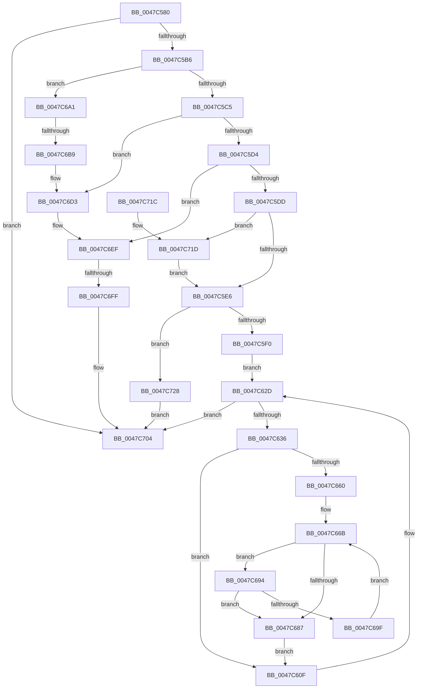

# PoSetHiberRange

- RVA: `0x0047C580`–`0x0047C74A` (길이 `458` bytes)
- VA: `0x000000014047C580`
- 실행 섹션: `.text`
- PDB 이름 있음: `예`; PDB Function 태그: `예`
- unwind 정보 RVA: `0x000AD7D8`
- 디코드: `122`개 명령, `458/458` bytes 표시
- 미해석 바이트: `0` (있으면 어셈블리에 `.byte`로 보존)

> 이 문서는 커널 이미지의 기계어와 PDB 기호를 분석해 생성했습니다. 4번과 5번은 함수 원형과 자료형을 바이너리 사용 방식에서 추정한 C 해석이며 원본 소스 복구 결과는 아닙니다.

## 1. Dependencies

- 직접 호출 지점: **7**; 고유 호출 대상: **4**
- 직접 호출자로 확인된 함수: **41**
- RIP 상대 이미지 참조: **2**

### Outgoing calls
- `0x0047C625` → [PopSetRange](PopSetRange_function_0047C750.md) (function, `0x0047C750`)
- `0x0047C645` → [MmGetPhysicalAddress](../23/MmGetPhysicalAddress_function_0023A500.md) (function, `0x0023A500`)
- `0x0047C675` → [MmGetPhysicalAddress](../23/MmGetPhysicalAddress_function_0023A500.md) (function, `0x0023A500`)
- `0x0047C6CD` → [KeBugCheckEx](../4F/KeBugCheckEx_function_004FD660.md) (function, `0x004FD660`)
- `0x0047C6E9` → [KeBugCheckEx](../4F/KeBugCheckEx_function_004FD660.md) (function, `0x004FD660`)
- `0x0047C6FF` → [MmMarkImageForHiberPhase](../../pagelk/B7/MmMarkImageForHiberPhase_function_00B748EC.md) (function, `0x00B748EC`)
- `0x0047C743` → [PopSetRange](PopSetRange_function_0047C750.md) (function, `0x0047C750`)

### Direct callers
- [HalpPciMarkHiberPhase](HalpPciMarkHiberPhase_function_0047C544.md) at `0x0047C561`
- [HalpDmaMarkHiberAdapter](../4D/HalpDmaMarkHiberAdapter_function_004DA56C.md) at `0x004DA60E`
- [HalpDmaMarkHiberAdapter](../4D/HalpDmaMarkHiberAdapter_function_004DA56C.md) at `0x004DA6AB`
- [HalpDmaMarkHiberAdapter](../4D/HalpDmaMarkHiberAdapter_function_004DA56C.md) at `0x004DA729`
- [HalpDmaMarkHiberAdapter](../4D/HalpDmaMarkHiberAdapter_function_004DA56C.md) at `0x004DA76C`
- [HalpDmaMarkHiberAdapter](../4D/HalpDmaMarkHiberAdapter_function_004DA56C.md) at `0x004DA7BF`
- [HalpDmaMarkHiberAdapter](../4D/HalpDmaMarkHiberAdapter_function_004DA56C.md) at `0x004DA7DE`
- [HalpDmaMarkHiberAdapter](../4D/HalpDmaMarkHiberAdapter_function_004DA56C.md) at `0x004DA7FA`
- [HalpDmaMarkHiberAdapter](../4D/HalpDmaMarkHiberAdapter_function_004DA56C.md) at `0x004DA824`
- [HalpDmaMarkHiberAdapter](../4D/HalpDmaMarkHiberAdapter_function_004DA56C.md) at `0x004DA85C`
- [HalpDmaMarkHiberAdapter](../4D/HalpDmaMarkHiberAdapter_function_004DA56C.md) at `0x004DA8B6`
- [HalpDmaMarkHiberAdapter](../4D/HalpDmaMarkHiberAdapter_function_004DA56C.md) at `0x004DA8DF`
- [HalpDmaMarkHiberAdapter](../4D/HalpDmaMarkHiberAdapter_function_004DA56C.md) at `0x004DA8FB`
- [HalpDmaMarkHiberAdapter](../4D/HalpDmaMarkHiberAdapter_function_004DA56C.md) at `0x004DA929`
- [HalpDmaMarkHiberAdapter](../4D/HalpDmaMarkHiberAdapter_function_004DA56C.md) at `0x004DA97C`
- [HalpExtEnvMarkHiberRegions](../4E/HalpExtEnvMarkHiberRegions_function_004E17D0.md) at `0x004E1813`
- [HalpExtEnvMarkHiberRegions](../4E/HalpExtEnvMarkHiberRegions_function_004E17D0.md) at `0x004E1859`
- [HalpTimerMarkHiberPhase](../53/HalpTimerMarkHiberPhase_function_0053D10C.md) at `0x0053D134`
- [HalpAcpiMarkHiberPhase](../53/HalpAcpiMarkHiberPhase_function_0053F23C.md) at `0x0053F266`
- [HalpIommuExtMarkHiberMemory](../55/HalpIommuExtMarkHiberMemory_function_00553604.md) at `0x0055362D`
- [HalpIommuDmarPageTableMarkHiberPhase](../56/HalpIommuDmarPageTableMarkHiberPhase_function_00568D1C.md) at `0x00568E40`
- [HvlDiscardPagesFromHibernation](../58/HvlDiscardPagesFromHibernation_function_0058A3DC.md) at `0x0058A409`
- [HvlDiscardPagesFromHibernation](../58/HvlDiscardPagesFromHibernation_function_0058A3DC.md) at `0x0058A430`
- [HvlDiscardSecurePagesFromHibernation](../58/HvlDiscardSecurePagesFromHibernation_function_0058A444.md) at `0x0058A4DF`
- [HvlMarkHiberPhase](../58/HvlMarkHiberPhase_function_0058A5EC.md) at `0x0058A62B`
- [HvlpMarkHvlPagesForHibernation](../58/HvlpMarkHvlPagesForHibernation_function_0058AD34.md) at `0x0058AD72`
- [HvlpMarkHvlPagesForHibernation](../58/HvlpMarkHvlPagesForHibernation_function_0058AD34.md) at `0x0058AD90`
- [HvlpMarkHvlPagesForHibernation](../58/HvlpMarkHvlPagesForHibernation_function_0058AD34.md) at `0x0058ADAE`
- [HvlpMarkHvlPagesForHibernation](../58/HvlpMarkHvlPagesForHibernation_function_0058AD34.md) at `0x0058ADE8`
- [HvlpMarkHypervisorPagesForHibernation](../58/HvlpMarkHypervisorPagesForHibernation_function_0058AE08.md) at `0x0058AE58`
- [IoGetDumpHiberRanges](../59/IoGetDumpHiberRanges_function_005928AC.md) at `0x0059291E`
- [IoGetDumpHiberRanges](../59/IoGetDumpHiberRanges_function_005928AC.md) at `0x00592975`
- [IoGetDumpHiberRanges](../59/IoGetDumpHiberRanges_function_005928AC.md) at `0x005929BB`
- [IoGetDumpHiberRanges](../59/IoGetDumpHiberRanges_function_005928AC.md) at `0x005929DD`
- [KeMarkDynamicTracingHiberPhase](../5C/KeMarkDynamicTracingHiberPhase_function_005CA9DC.md) at `0x005CAA19`
- [KeMarkDynamicTracingHiberPhase](../5C/KeMarkDynamicTracingHiberPhase_function_005CA9DC.md) at `0x005CAA55`
- [KeMarkDynamicTracingHiberPhase](../5C/KeMarkDynamicTracingHiberPhase_function_005CA9DC.md) at `0x005CAADE`
- [sub_005F0527](../5F/Unknown_function_005F0527.md) at `0x005F0543`
- [DifMarkHiberPhase](../61/DifMarkHiberPhase_function_0061A8FC.md) at `0x0061A945`
- [DifMarkHiberPhase](../61/DifMarkHiberPhase_function_0061A8FC.md) at `0x0061A965`
- [DifMarkHiberPhase](../61/DifMarkHiberPhase_function_0061A8FC.md) at `0x0061A989`
- [MiMarkKernelPageTablePte](../67/MiMarkKernelPageTablePte_function_00678B00.md) at `0x00678B37`
- [VslAllocateSecureHibernateResources](../../page/71/VslAllocateSecureHibernateResources_function_00718788.md) at `0x00718814`
- [PopHiberInitializeResources](../../page/75/PopHiberInitializeResources_function_0075D5FC.md) at `0x0075D826`
- [PopHiberInitializeResources](../../page/75/PopHiberInitializeResources_function_0075D5FC.md) at `0x0075D945`
- [MmMarkHiberRange](../../page/7F/MmMarkHiberRange_function_007FE3D0.md) at `0x007FE404`
- [PopAllocateHiberContext](../../page/AD/PopAllocateHiberContext_function_00ADC05C.md) at `0x00ADC3E6`
- [PopAllocateHiberContext](../../page/AD/PopAllocateHiberContext_function_00ADC05C.md) at `0x00ADC400`
- [PopAllocateHiberContext](../../page/AD/PopAllocateHiberContext_function_00ADC05C.md) at `0x00ADC4E4`
- [PopAllocateHiberContext](../../page/AD/PopAllocateHiberContext_function_00ADC05C.md) at `0x00ADC593`
- [PopAllocateHiberContext](../../page/AD/PopAllocateHiberContext_function_00ADC05C.md) at `0x00ADC60E`
- [PopBootLoaderTraceCopyPfnList](../../pagelk/B5/PopBootLoaderTraceCopyPfnList_function_00B5B24C.md) at `0x00B5B2B8`
- [HalpMmAllocCtxMarkHiberPhase](../../pagelk/B5/HalpMmAllocCtxMarkHiberPhase_function_00B5C254.md) at `0x00B5C2CE`
- [HaliLocateHiberRanges](../../pagelk/B5/HaliLocateHiberRanges_function_00B5CE50.md) at `0x00B5CE97`
- [HaliLocateHiberRanges](../../pagelk/B5/HaliLocateHiberRanges_function_00B5CE50.md) at `0x00B5CEC1`
- [HaliLocateHiberRanges](../../pagelk/B5/HaliLocateHiberRanges_function_00B5CE50.md) at `0x00B5CEEB`
- [HaliLocateHiberRanges](../../pagelk/B5/HaliLocateHiberRanges_function_00B5CE50.md) at `0x00B5CF15`
- [HaliLocateHiberRanges](../../pagelk/B5/HaliLocateHiberRanges_function_00B5CE50.md) at `0x00B5CF92`
- [HaliLocateHiberRanges](../../pagelk/B5/HaliLocateHiberRanges_function_00B5CE50.md) at `0x00B5CFA9`
- [HaliLocateHiberRanges](../../pagelk/B5/HaliLocateHiberRanges_function_00B5CE50.md) at `0x00B5CFDE`
- [HaliLocateHiberRanges](../../pagelk/B5/HaliLocateHiberRanges_function_00B5CE50.md) at `0x00B5D009`
- [HaliLocateHiberRanges](../../pagelk/B5/HaliLocateHiberRanges_function_00B5CE50.md) at `0x00B5D025`
- [HaliLocateHiberRanges](../../pagelk/B5/HaliLocateHiberRanges_function_00B5CE50.md) at `0x00B5D051`
- [HaliLocateHiberRanges](../../pagelk/B5/HaliLocateHiberRanges_function_00B5CE50.md) at `0x00B5D088`
- [HaliLocateHiberRanges](../../pagelk/B5/HaliLocateHiberRanges_function_00B5CE50.md) at `0x00B5D0B4`
- [BgkResumePrepare](../../pagelk/B6/BgkResumePrepare_function_00B63ACC.md) at `0x00B63B20`
- [BgkResumePrepare](../../pagelk/B6/BgkResumePrepare_function_00B63ACC.md) at `0x00B63B4D`
- [BgkResumePrepare](../../pagelk/B6/BgkResumePrepare_function_00B63ACC.md) at `0x00B63B67`
- [KdMarkHiberPhase](../../pagelk/B6/KdMarkHiberPhase_function_00B65770.md) at `0x00B6578F`
- [KdMarkHiberPhase](../../pagelk/B6/KdMarkHiberPhase_function_00B65770.md) at `0x00B657E1`
- [KeMarkPcrHiberPhase](../../pagelk/B6/KeMarkPcrHiberPhase_function_00B65800.md) at `0x00B65849`
- [KeMarkPcrHiberPhase](../../pagelk/B6/KeMarkPcrHiberPhase_function_00B65800.md) at `0x00B65860`
- [KeMarkPcrHiberPhase](../../pagelk/B6/KeMarkPcrHiberPhase_function_00B65800.md) at `0x00B65875`
- [KeMarkPcrHiberPhase](../../pagelk/B6/KeMarkPcrHiberPhase_function_00B65800.md) at `0x00B658B2`
- [KeMarkPcrHiberPhase](../../pagelk/B6/KeMarkPcrHiberPhase_function_00B65800.md) at `0x00B6590E`
- [KeMarkPcrHiberPhase](../../pagelk/B6/KeMarkPcrHiberPhase_function_00B65800.md) at `0x00B65936`
- [KeMarkPcrHiberPhase](../../pagelk/B6/KeMarkPcrHiberPhase_function_00B65800.md) at `0x00B6596C`
- [KeMarkPcrHiberPhase](../../pagelk/B6/KeMarkPcrHiberPhase_function_00B65800.md) at `0x00B6599D`
- [KeMarkPcrHiberPhase](../../pagelk/B6/KeMarkPcrHiberPhase_function_00B65800.md) at `0x00B659BA`
- [KeMarkPcrHiberPhase](../../pagelk/B6/KeMarkPcrHiberPhase_function_00B65800.md) at `0x00B659EF`
- [KeMarkPcrHiberPhase](../../pagelk/B6/KeMarkPcrHiberPhase_function_00B65800.md) at `0x00B65A18`
- [KeMarkPcrHiberPhase](../../pagelk/B6/KeMarkPcrHiberPhase_function_00B65800.md) at `0x00B65A45`
- [KeMarkPcrHiberPhase](../../pagelk/B6/KeMarkPcrHiberPhase_function_00B65800.md) at `0x00B65A80`
- [KeMarkPcrHiberPhase](../../pagelk/B6/KeMarkPcrHiberPhase_function_00B65800.md) at `0x00B65AA6`
- [KeMarkPcrHiberPhase](../../pagelk/B6/KeMarkPcrHiberPhase_function_00B65800.md) at `0x00B65B20`
- [KeMarkPcrHiberPhase](../../pagelk/B6/KeMarkPcrHiberPhase_function_00B65800.md) at `0x00B65B69`
- [KeMarkPcrHiberPhase](../../pagelk/B6/KeMarkPcrHiberPhase_function_00B65800.md) at `0x00B65BB0`
- [KeMarkPcrHiberPhase](../../pagelk/B6/KeMarkPcrHiberPhase_function_00B65800.md) at `0x00B65BD4`
- [KeMarkPcrHiberPhase](../../pagelk/B6/KeMarkPcrHiberPhase_function_00B65800.md) at `0x00B65C01`
- [KeMarkPcrHiberPhase](../../pagelk/B6/KeMarkPcrHiberPhase_function_00B65800.md) at `0x00B65C21`
- [KeMarkPcrHiberPhase](../../pagelk/B6/KeMarkPcrHiberPhase_function_00B65800.md) at `0x00B65C55`
- [KeMarkPcrHiberPhase](../../pagelk/B6/KeMarkPcrHiberPhase_function_00B65800.md) at `0x00B65C6E`
- [KeMarkPcrHiberPhase](../../pagelk/B6/KeMarkPcrHiberPhase_function_00B65800.md) at `0x00B65C95`
- [KeMarkPcrHiberPhase](../../pagelk/B6/KeMarkPcrHiberPhase_function_00B65800.md) at `0x00B65CD2`
- [KeMarkPcrHiberPhase](../../pagelk/B6/KeMarkPcrHiberPhase_function_00B65800.md) at `0x00B65CEE`
- [PopSstInvokeNotificationHandlers](../../pagelk/B6/PopSstInvokeNotificationHandlers_function_00B6C1D0.md) at `0x00B6C223`
- [PopSstInvokeNotificationHandlers](../../pagelk/B6/PopSstInvokeNotificationHandlers_function_00B6C1D0.md) at `0x00B6C23B`
- [PopBuildMemoryImageHeader](../../pagelk/B6/PopBuildMemoryImageHeader_function_00B6CA20.md) at `0x00B6CA66`
- [PopBuildMemoryImageHeader](../../pagelk/B6/PopBuildMemoryImageHeader_function_00B6CA20.md) at `0x00B6CC54`
- [PopHiberNotificationDiscardMemoryCallback](../../pagelk/B6/PopHiberNotificationDiscardMemoryCallback_function_00B6DC80.md) at `0x00B6DC94`
- [PopHiberNotificationDiscardPhysicalMemoryCallback](../../pagelk/B6/PopHiberNotificationDiscardPhysicalMemoryCallback_function_00B6DCB0.md) at `0x00B6DCC4`
- [PopHiberNotificationMarkBootPhaseCallback](../../pagelk/B6/PopHiberNotificationMarkBootPhaseCallback_function_00B6DCE0.md) at `0x00B6DCF6`
- [PopMarkComponentsBootPhase](../../pagelk/B6/PopMarkComponentsBootPhase_function_00B6E0E4.md) at `0x00B6E133`
- [PopMarkComponentsBootPhase](../../pagelk/B6/PopMarkComponentsBootPhase_function_00B6E0E4.md) at `0x00B6E14F`
- [PopMarkComponentsBootPhase](../../pagelk/B6/PopMarkComponentsBootPhase_function_00B6E0E4.md) at `0x00B6E177`
- [PopMarkComponentsBootPhase](../../pagelk/B6/PopMarkComponentsBootPhase_function_00B6E0E4.md) at `0x00B6E19C`
- [PopMarkComponentsBootPhase](../../pagelk/B6/PopMarkComponentsBootPhase_function_00B6E0E4.md) at `0x00B6E1C1`
- [PopMarkComponentsBootPhase](../../pagelk/B6/PopMarkComponentsBootPhase_function_00B6E0E4.md) at `0x00B6E240`
- [PopMarkComponentsBootPhase](../../pagelk/B6/PopMarkComponentsBootPhase_function_00B6E0E4.md) at `0x00B6E266`
- [PopMarkComponentsBootPhase](../../pagelk/B6/PopMarkComponentsBootPhase_function_00B6E0E4.md) at `0x00B6E2AB`
- [PopMarkComponentsBootPhase](../../pagelk/B6/PopMarkComponentsBootPhase_function_00B6E0E4.md) at `0x00B6E2DB`
- [PopMarkComponentsBootPhase](../../pagelk/B6/PopMarkComponentsBootPhase_function_00B6E0E4.md) at `0x00B6E2FB`
- [PopMarkComponentsBootPhase](../../pagelk/B6/PopMarkComponentsBootPhase_function_00B6E0E4.md) at `0x00B6E321`
- [PopMarkComponentsBootPhase](../../pagelk/B6/PopMarkComponentsBootPhase_function_00B6E0E4.md) at `0x00B6E341`
- [PopMarkComponentsBootPhase](../../pagelk/B6/PopMarkComponentsBootPhase_function_00B6E0E4.md) at `0x00B6E37F`
- [PopMarkComponentsBootPhase](../../pagelk/B6/PopMarkComponentsBootPhase_function_00B6E0E4.md) at `0x00B6E3B1`
- [PopMarkComponentsBootPhase](../../pagelk/B6/PopMarkComponentsBootPhase_function_00B6E0E4.md) at `0x00B6E3F1`
- [PopMarkHiberPhase](../../pagelk/B6/PopMarkHiberPhase_function_00B6E468.md) at `0x00B6E491`
- [PopMarkHiberPhase](../../pagelk/B6/PopMarkHiberPhase_function_00B6E468.md) at `0x00B6E4AD`
- [PopMarkHiberPhase](../../pagelk/B6/PopMarkHiberPhase_function_00B6E468.md) at `0x00B6E4CE`
- [PopMarkHiberPhase](../../pagelk/B6/PopMarkHiberPhase_function_00B6E468.md) at `0x00B6E4EE`
- [PopMarkHiberPhase](../../pagelk/B6/PopMarkHiberPhase_function_00B6E468.md) at `0x00B6E50E`
- [PopMarkHiberPhase](../../pagelk/B6/PopMarkHiberPhase_function_00B6E468.md) at `0x00B6E52A`
- [PopMarkHiberPhase](../../pagelk/B6/PopMarkHiberPhase_function_00B6E468.md) at `0x00B6E54D`
- [MiMarkHiberNotCachedPte](../../pagelk/B7/MiMarkHiberNotCachedPte_function_00B73EC0.md) at `0x00B73F47`
- [MiMarkNonPagedHiberPhasePte](../../pagelk/B7/MiMarkNonPagedHiberPhasePte_function_00B74080.md) at `0x00B74134`
- [MmMarkHiberPhase](../../pagelk/B7/MmMarkHiberPhase_function_00B74578.md) at `0x00B745BB`
- [MmMarkHiberPhase](../../pagelk/B7/MmMarkHiberPhase_function_00B74578.md) at `0x00B7463E`
- [MmMarkHiberPhase](../../pagelk/B7/MmMarkHiberPhase_function_00B74578.md) at `0x00B7466B`
- [MmMarkHiberPhase](../../pagelk/B7/MmMarkHiberPhase_function_00B74578.md) at `0x00B7469C`
- [MmMarkHiberPhase](../../pagelk/B7/MmMarkHiberPhase_function_00B74578.md) at `0x00B746BB`
- [MmMarkHiberPhase](../../pagelk/B7/MmMarkHiberPhase_function_00B74578.md) at `0x00B746F6`
- [MmMarkHiberPhase](../../pagelk/B7/MmMarkHiberPhase_function_00B74578.md) at `0x00B74730`
- [MmMarkHiberPhase](../../pagelk/B7/MmMarkHiberPhase_function_00B74578.md) at `0x00B74757`
- [MmMarkHiberPhase](../../pagelk/B7/MmMarkHiberPhase_function_00B74578.md) at `0x00B74789`
- [MmMarkHiberPhase](../../pagelk/B7/MmMarkHiberPhase_function_00B74578.md) at `0x00B747A7`
- [MmMarkHiberPhase](../../pagelk/B7/MmMarkHiberPhase_function_00B74578.md) at `0x00B747C5`
- [MmMarkHiberPhase](../../pagelk/B7/MmMarkHiberPhase_function_00B74578.md) at `0x00B747F1`
- [MmMarkHiberPhase](../../pagelk/B7/MmMarkHiberPhase_function_00B74578.md) at `0x00B74866`
- [HalpIommuMarkHiberPhase](../../pagelk/B7/HalpIommuMarkHiberPhase_function_00B7BE8C.md) at `0x00B7BEED`
- [HalpIommuMarkHiberPhase](../../pagelk/B7/HalpIommuMarkHiberPhase_function_00B7BE8C.md) at `0x00B7BF47`
- [PopCopyFirmwareRuntimeInformationPfnList](../../pagelk/B7/PopCopyFirmwareRuntimeInformationPfnList_function_00B7E774.md) at `0x00B7E801`
- [sub_00B8106E](../../pagelk/B8/Unknown_function_00B8106E.md) at `0x00B81087`
- [BgMarkHiberPhase](../../pagebgfx/BC/BgMarkHiberPhase_function_00BC078C.md) at `0x00BC07D3`

### Static image references
- `0x0047C5A8` → RVA `0x00F4754C` (`.data`; read)
- `0x0047C6A1` → RVA `0x00F0BD90` (`.data`; read)

## 2. Other-region calls and transfers

- 다른 실행 섹션으로 향하는 call: **1**
  - `0x0047C6FF` → [MmMarkImageForHiberPhase](../../pagelk/B7/MmMarkImageForHiberPhase_function_00B748EC.md) (`.text` → `PAGELK`)
- call이 아닌 외부 분기/꼬리 이동: **2**
  - `0x0047C6B3` → [sub_006F4AC2](../6F/Unknown_function_006F4AC2.md) (`tail-transfer`)
  - `0x0047C6F9` → [sub_006F4AC2 + 0x5A](../6F/Unknown_function_006F4AC2.md) (`tail-transfer`)

## 3. Assembly (complete function range)

```asm
0047C580  48 8B C4                        mov rax, rsp
0047C583  48 89 58 10                     mov qword ptr [rax + 0x10], rbx
0047C587  4C 89 40 18                     mov qword ptr [rax + 0x18], r8
0047C58B  48 89 48 08                     mov qword ptr [rax + 8], rcx
0047C58F  55                              push rbp
0047C590  56                              push rsi
0047C591  57                              push rdi
0047C592  41 54                           push r12
0047C594  41 55                           push r13
0047C596  41 56                           push r14
0047C598  41 57                           push r15
0047C59A  48 83 EC 40                     sub rsp, 0x40
0047C59E  33 FF                           xor edi, edi
0047C5A0  8B DA                           mov ebx, edx
0047C5A2  89 78 B8                        mov dword ptr [rax - 0x48], edi
0047C5A5  48 8B E9                        mov rbp, rcx
0047C5A8  8B 05 9E AF AC 00               mov eax, dword ptr [rip + 0xacaf9e]
0047C5AE  A8 03                           test al, 3
0047C5B0  0F 85 4E 01 00 00               jne 0x14047c704
0047C5B6  41 BE FF BF FF FF               mov r14d, 0xffffbfff
0047C5BC  48 85 C9                        test rcx, rcx
0047C5BF  0F 84 DC 00 00 00               je 0x14047c6a1
0047C5C5  8B C3                           mov eax, ebx
0047C5C7  B9 00 00 01 00                  mov ecx, 0x10000
0047C5CC  23 C1                           and eax, ecx
0047C5CE  0F 85 FF 00 00 00               jne 0x14047c6d3
0047C5D4  4D 85 C9                        test r9, r9
0047C5D7  0F 84 12 01 00 00               je 0x14047c6ef
0047C5DD  F6 C3 04                        test bl, 4
0047C5E0  0F 85 37 01 00 00               jne 0x14047c71d
0047C5E6  0F BA E3 0E                     bt ebx, 0xe
0047C5EA  0F 82 38 01 00 00               jb 0x14047c728
0047C5F0  48 8B 84 24 90 00 00 00         mov rax, qword ptr [rsp + 0x90]
0047C5F8  48 8B F8                        mov rdi, rax
0047C5FB  48 C1 EF 0C                     shr rdi, 0xc
0047C5FF  48 8D B0 FF 0F 00 00            lea rsi, [rax + 0xfff]
0047C606  49 03 F1                        add rsi, r9
0047C609  48 C1 EE 0C                     shr rsi, 0xc
0047C60D  EB 1E                           jmp 0x14047c62d
0047C60F  8B 84 24 A0 00 00 00            mov eax, dword ptr [rsp + 0xa0]
0047C616  4D 8B CE                        mov r9, r14
0047C619  4D 8B C4                        mov r8, r12
0047C61C  89 44 24 20                     mov dword ptr [rsp + 0x20], eax
0047C620  8B D3                           mov edx, ebx
0047C622  48 8B CD                        mov rcx, rbp
0047C625  E8 26 01 00 00                  call 0x14047c750
0047C62A  49 03 FE                        add rdi, r14
0047C62D  48 3B FE                        cmp rdi, rsi
0047C630  0F 83 CE 00 00 00               jae 0x14047c704
0047C636  48 8B C7                        mov rax, rdi
0047C639  48 C1 E0 0C                     shl rax, 0xc
0047C63D  48 8B C8                        mov rcx, rax
0047C640  48 89 44 24 30                  mov qword ptr [rsp + 0x30], rax
0047C645  E8 B6 DE DB FF                  call 0x14023a500
0047C64A  4C 8B E0                        mov r12, rax
0047C64D  4C 8D 7F 01                     lea r15, [rdi + 1]
0047C651  49 C1 EC 0C                     shr r12, 0xc
0047C655  41 BE 01 00 00 00               mov r14d, 1
0047C65B  4C 3B FE                        cmp r15, rsi
0047C65E  73 AF                           jae 0x14047c60f
0047C660  48 8B 6C 24 30                  mov rbp, qword ptr [rsp + 0x30]
0047C665  4D 8B EC                        mov r13, r12
0047C668  4C 2B EF                        sub r13, rdi
0047C66B  49 8B CE                        mov rcx, r14
0047C66E  48 C1 E1 0C                     shl rcx, 0xc
0047C672  48 03 CD                        add rcx, rbp
0047C675  E8 86 DE DB FF                  call 0x14023a500
0047C67A  48 C1 E8 0C                     shr rax, 0xc
0047C67E  4B 8D 0C 2F                     lea rcx, [r15 + r13]
0047C682  48 3B C8                        cmp rcx, rax
0047C685  74 0D                           je 0x14047c694
0047C687  48 8B AC 24 80 00 00 00         mov rbp, qword ptr [rsp + 0x80]
0047C68F  E9 7B FF FF FF                  jmp 0x14047c60f
0047C694  49 FF C6                        inc r14
0047C697  49 FF C7                        inc r15
0047C69A  4C 3B FE                        cmp r15, rsi
0047C69D  73 E8                           jae 0x14047c687
0047C69F  EB CA                           jmp 0x14047c66b
0047C6A1  48 8B 2D E8 F6 A8 00            mov rbp, qword ptr [rip + 0xa8f6e8]
0047C6A8  48 89 AC 24 80 00 00 00         mov qword ptr [rsp + 0x80], rbp
0047C6B0  48 85 ED                        test rbp, rbp
0047C6B3  0F 85 09 84 27 00               jne 0x1406f4ac2
0047C6B9  BA 0B 01 00 00                  mov edx, 0x10b
0047C6BE  48 89 7C 24 20                  mov qword ptr [rsp + 0x20], rdi
0047C6C3  45 33 C9                        xor r9d, r9d
0047C6C6  44 8D 45 0A                     lea r8d, [rbp + 0xa]
0047C6CA  8D 4A 95                        lea ecx, [rdx - 0x6b]
0047C6CD  E8 8E 0F 08 00                  call 0x1404fd660
0047C6D2  CC                              int3
0047C6D3  BA 0C 01 00 00                  mov edx, 0x10c
0047C6D8  48 89 7C 24 20                  mov qword ptr [rsp + 0x20], rdi
0047C6DD  4C 8B CB                        mov r9, rbx
0047C6E0  41 B8 0A 00 00 00               mov r8d, 0xa
0047C6E6  8D 4A 94                        lea ecx, [rdx - 0x6c]
0047C6E9  E8 72 0F 08 00                  call 0x1404fd660
0047C6EE  CC                              int3
0047C6EF  48 8B 8C 24 90 00 00 00         mov rcx, qword ptr [rsp + 0x90]
0047C6F7  85 C0                           test eax, eax
0047C6F9  0F 84 1D 84 27 00               je 0x1406f4b1c
0047C6FF  E8 E8 81 6F 00                  call 0x140b748ec
0047C704  48 8B 9C 24 88 00 00 00         mov rbx, qword ptr [rsp + 0x88]
0047C70C  48 83 C4 40                     add rsp, 0x40
0047C710  41 5F                           pop r15
0047C712  41 5E                           pop r14
0047C714  41 5D                           pop r13
0047C716  41 5C                           pop r12
0047C718  5F                              pop rdi
0047C719  5E                              pop rsi
0047C71A  5D                              pop rbp
0047C71B  C3                              ret
0047C71C  CC                              int3
0047C71D  83 E3 FB                        and ebx, 0xfffffffb
0047C720  83 CB 02                        or ebx, 2
0047C723  E9 BE FE FF FF                  jmp 0x14047c5e6
0047C728  8B 84 24 A0 00 00 00            mov eax, dword ptr [rsp + 0xa0]
0047C72F  41 23 DE                        and ebx, r14d
0047C732  4C 8B 84 24 90 00 00 00         mov r8, qword ptr [rsp + 0x90]
0047C73A  8B D3                           mov edx, ebx
0047C73C  48 8B CD                        mov rcx, rbp
0047C73F  89 44 24 20                     mov dword ptr [rsp + 0x20], eax
0047C743  E8 08 00 00 00                  call 0x14047c750
0047C748  EB BA                           jmp 0x14047c704
```

## 4. C-style interpretation (structured pseudocode)

```c
__int64 __fastcall PoSetHiberRange(__int64 a1, int a2, __int64 a3, __int64 a4, unsigned int a5)
{
    __int64 result;
    __int64 v_r12;
    __int64 v_r13;
    __int64 v_r14;
    __int64 v_r15;
    __int64 v_rbx;
    __int64 v_rdi;
    __int64 v_rsi;
    __int64 v_rsp;
    unsigned __int64 v_stack_m48;
    unsigned int v_stack_m58;
    unsigned __int64 v_stack_p10;
    unsigned __int64 v_stack_p18;
    unsigned int v_stack_p20;
    unsigned __int64 v_stack_p8;
    unsigned __int64 v_stack_p90;

    *(unsigned __int64 *)(v_rsp + 16) = v_rbx;
    *(unsigned __int64 *)(v_rsp + 24) = a3;
    *(unsigned __int64 *)(v_rsp + 8) = a1;
    v_rsp = (v_rsp) - (64);
    v_rdi = 0;
    *(unsigned int *)(v_rsp - 72) = 0;
    if ((((unsigned __int8)((unsigned int)(*(unsigned int *)(v_rip + 11317150)))) & (3)) != 0) goto loc_0047C704;
    if (a1 == 0) goto loc_0047C6A1;
    result = (unsigned int)(((unsigned int)((unsigned int)((unsigned int)(a2)))) & ((unsigned int)((unsigned int)(0x10000ULL))));
    if (condition_is_not_equal) goto loc_0047C6D3;
    if (a4 == 0) goto loc_0047C6EF;
    if ((((unsigned __int8)((unsigned int)(a2))) & (4)) != 0) goto loc_0047C71D;
loc_0047C5E6:
    if (condition_is_below) goto loc_0047C728;
    v_rdi = (v_stack_p18) >> (12);
    v_rsi = (v_stack_p18 + 4095) + (a4);
    v_rsi = (v_rsi) >> (12);
    goto loc_0047C62D;
loc_0047C60F:
    v_stack_m58 = (unsigned int)((unsigned int)(a5));
    result = PopSetRange(a1, (unsigned int)((unsigned int)((unsigned int)(a2))), v_r12, (unsigned int)(0xFFFFBFFFULL));
    v_rdi = (v_rdi) + ((unsigned int)(0xFFFFBFFFULL));
loc_0047C62D:
    if (v_rdi >= v_rsi) goto loc_0047C704;
    result = (v_rdi) << (12);
    v_stack_m48 = result;
    result = MmGetPhysicalAddress(result, (unsigned int)((unsigned int)((unsigned int)(a2))), v_r12, (unsigned int)(0xFFFFBFFFULL));
    v_r12 = (result) >> (12);
    if ((v_rdi + 1) >= v_rsi) goto loc_0047C60F;
    v_r13 = (v_r12) - (v_rdi);
loc_0047C66B:
    a1 = (1) << (12);
    a1 = (a1) + (v_stack_m48);
    result = MmGetPhysicalAddress(a1, (unsigned int)((unsigned int)((unsigned int)(a2))), v_r12, (unsigned int)(0xFFFFBFFFULL));
    result = (result) >> (12);
    if ((v_rdi + 1 + v_r13 * 1) == result) goto loc_0047C694;
loc_0047C687:
    goto loc_0047C60F;
loc_0047C694:
    v_r14 = (1) + 1;
    v_r15 = (v_rdi + 1) + 1;
    if (v_r15 >= v_rsi) goto loc_0047C687;
    goto loc_0047C66B;
loc_0047C6A1:
    v_stack_p8 = *(unsigned __int64 *)(v_rip + 11073256);
    v_stack_m58 = v_rdi;
    a4 = 0;
    result = KeBugCheckEx(267 - 107, 267, *(unsigned __int64 *)(v_rip + 11073256) + 10, a4);
loc_0047C6D3:
    v_stack_m58 = v_rdi;
    result = KeBugCheckEx(268 - 108, 268, 10, (unsigned int)(a2));
loc_0047C6EF:
    result = MmMarkImageForHiberPhase(v_stack_p18, 268, 10, (unsigned int)(a2));
loc_0047C704:
    v_rsp = (v_rsp) + (64);
    return result;
loc_0047C71D:
    v_rbx = (unsigned int)((v_stack_p10) & (0xFFFFFFFBULL));
    v_rbx = (unsigned int)((v_rbx) | (2));
    goto loc_0047C5E6;
loc_0047C728:
    v_rbx = (unsigned int)((v_rbx) & ((unsigned int)(v_r14)));
    v_stack_p20 = (unsigned int)((unsigned int)(a5));
    result = PopSetRange(*(unsigned __int64 *)(v_rip + 11073256), (unsigned int)((unsigned int)(v_rbx)), v_stack_p90, (unsigned int)(a2));
    goto loc_0047C704;
}
```

## 5. (Beta) C Style

```c
int64_t PoSetHiberRange(int64_t Arg1, int32_t Arg2, int64_t Arg3, int64_t Arg4, uint32_t Arg5)
{
    int64_t result;
    int64_t local_r12;
    int64_t local_r13;
    int64_t local_r14;
    int64_t local_r15;
    int64_t local_rbx;
    int64_t local_rdi;
    int64_t local_rsi;
    int64_t local_rsp;
    uint64_t v_stack_m48;
    uint32_t v_stack_m58;
    uint64_t v_stack_p10;
    uint64_t v_stack_p18;
    uint32_t v_stack_p20;
    uint64_t v_stack_p8;
    uint64_t v_stack_p90;

    *(uint64_t *)(local_rsp + 0x10) = local_rbx;
    *(uint64_t *)(local_rsp + 0x18) = Arg3;
    *(uint64_t *)(local_rsp + 0x8) = Arg1;
    local_rsp = (local_rsp) - (64);
    local_rdi = 0;
    *(uint32_t *)(local_rsp - 0x48) = 0;
    if ((((uint8_t)((uint32_t)(*(uint32_t *)(v_rip + 0xACAF9E)))) & (3)) != 0) goto loc_0047C704;
    if (Arg1 == 0) goto loc_0047C6A1;
    result = (uint32_t)(((uint32_t)((uint32_t)((uint32_t)(Arg2)))) & ((uint32_t)((uint32_t)(0x10000ULL))));
    if (condition_is_not_equal) goto loc_0047C6D3;
    if (Arg4 == 0) goto loc_0047C6EF;
    if ((((uint8_t)((uint32_t)(Arg2))) & (4)) != 0) goto loc_0047C71D;
loc_0047C5E6:
    if (condition_is_below) goto loc_0047C728;
    local_rdi = (v_stack_p18) >> (12);
    local_rsi = (v_stack_p18 + 4095) + (Arg4);
    local_rsi = (local_rsi) >> (12);
    goto loc_0047C62D;
loc_0047C60F:
    v_stack_m58 = (uint32_t)((uint32_t)(Arg5));
    result = PopSetRange(Arg1, (uint32_t)((uint32_t)((uint32_t)(Arg2))), local_r12, (uint32_t)(0xFFFFBFFFULL));
    local_rdi = (local_rdi) + ((uint32_t)(0xFFFFBFFFULL));
loc_0047C62D:
    if (local_rdi >= local_rsi) goto loc_0047C704;
    result = (local_rdi) << (12);
    v_stack_m48 = result;
    result = MmGetPhysicalAddress(result, (uint32_t)((uint32_t)((uint32_t)(Arg2))), local_r12, (uint32_t)(0xFFFFBFFFULL));
    local_r12 = (result) >> (12);
    if ((local_rdi + 1) >= local_rsi) goto loc_0047C60F;
    local_r13 = (local_r12) - (local_rdi);
loc_0047C66B:
    Arg1 = (1) << (12);
    Arg1 = (Arg1) + (v_stack_m48);
    result = MmGetPhysicalAddress(Arg1, (uint32_t)((uint32_t)((uint32_t)(Arg2))), local_r12, (uint32_t)(0xFFFFBFFFULL));
    result = (result) >> (12);
    if ((local_rdi + 1 + local_r13 * 1) == result) goto loc_0047C694;
loc_0047C687:
    goto loc_0047C60F;
loc_0047C694:
    local_r14 = (1) + 1;
    local_r15 = (local_rdi + 1) + 1;
    if (local_r15 >= local_rsi) goto loc_0047C687;
    goto loc_0047C66B;
loc_0047C6A1:
    v_stack_p8 = *(uint64_t *)(v_rip + 0xA8F6E8);
    v_stack_m58 = local_rdi;
    Arg4 = 0;
    result = KeBugCheckEx(267 - 107, 267, *(uint64_t *)(v_rip + 0xA8F6E8) + 10, Arg4);
loc_0047C6D3:
    v_stack_m58 = local_rdi;
    result = KeBugCheckEx(268 - 108, 268, 10, (uint32_t)(Arg2));
loc_0047C6EF:
    result = MmMarkImageForHiberPhase(v_stack_p18, 268, 10, (uint32_t)(Arg2));
loc_0047C704:
    local_rsp = (local_rsp) + (64);
    return result;
loc_0047C71D:
    local_rbx = (uint32_t)((v_stack_p10) & (0xFFFFFFFBULL));
    local_rbx = (uint32_t)((local_rbx) | (2));
    goto loc_0047C5E6;
loc_0047C728:
    local_rbx = (uint32_t)((local_rbx) & ((uint32_t)(local_r14)));
    v_stack_p20 = (uint32_t)((uint32_t)(Arg5));
    result = PopSetRange(*(uint64_t *)(v_rip + 0xA8F6E8), (uint32_t)((uint32_t)(local_rbx)), v_stack_p90, (uint32_t)(Arg2));
    goto loc_0047C704;
}
```

## 6. Execution-region graph

[열기: 2D/3D 그래프와 함수 탐색 컨트롤 패널](../../../control-panel.html?section=text&rva=0x0047C580&view=graph)

- 2D 그래프는 위에서 아래로 흐르고, 3D 그래프는 빈 공간을 드래그해 회전합니다. Shift+드래그는 이동, 휠은 확대·축소, 함수 노드 선택은 대상 보고서 이동입니다.

### Static fallback


