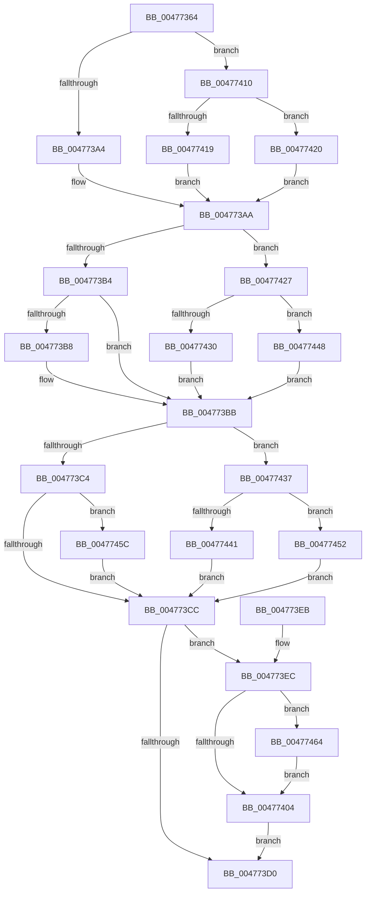

# PopApplyLegacyPowerRequestFlags

- RVA: `0x00477364`–`0x00477488` (길이 `292` bytes)
- VA: `0x0000000140477364`
- 실행 섹션: `.text`
- PDB 이름 있음: `예`; PDB Function 태그: `아니요`
- unwind 정보 RVA: `0x000ACC64`
- 디코드: `88`개 명령, `292/292` bytes 표시
- 미해석 바이트: `0` (있으면 어셈블리에 `.byte`로 보존)

> 이 문서는 커널 이미지의 기계어와 PDB 기호를 분석해 생성했습니다. 4번과 5번은 함수 원형과 자료형을 바이너리 사용 방식에서 추정한 C 해석이며 원본 소스 복구 결과는 아닙니다.

## 1. Dependencies

- 직접 호출 지점: **10**; 고유 호출 대상: **6**
- 직접 호출자로 확인된 함수: **2**
- RIP 상대 이미지 참조: **2**

### Outgoing calls
- `0x004773F8` → [KeAcquireInStackQueuedSpinLock](../27/KeAcquireInStackQueuedSpinLock_function_002757A0.md) (function, `0x002757A0`)
- `0x00477409` → [KeReleaseInStackQueuedSpinLock](../34/KeReleaseInStackQueuedSpinLock_function_00342CE0.md) (function, `0x00342CE0`)
- `0x00477419` → [PopPowerRequestReferenceAcquire](PopPowerRequestReferenceAcquire_function_004776C0.md) (function, `0x004776C0`)
- `0x00477420` → [PopPowerRequestReferenceRelease](PopPowerRequestReferenceRelease_function_004775B0.md) (function, `0x004775B0`)
- `0x00477430` → [PopPowerRequestReferenceRelease](PopPowerRequestReferenceRelease_function_004775B0.md) (function, `0x004775B0`)
- `0x00477441` → [PopPowerRequestReferenceAcquire](PopPowerRequestReferenceAcquire_function_004776C0.md) (function, `0x004776C0`)
- `0x00477448` → [PopPowerRequestReferenceAcquire](PopPowerRequestReferenceAcquire_function_004776C0.md) (function, `0x004776C0`)
- `0x00477452` → [PopPowerRequestReferenceRelease](PopPowerRequestReferenceRelease_function_004775B0.md) (function, `0x004775B0`)
- `0x00477470` → [PopPowerRequestEvaluatePendingRequestStatus](PopPowerRequestEvaluatePendingRequestStatus_function_00477914.md) (function, `0x00477914`)
- `0x0047747E` → [PopQueueWorkItem](../4A/PopQueueWorkItem_function_004A20F8.md) (function, `0x004A20F8`)

### Direct callers
- [PoRegisterSystemState](../48/PoRegisterSystemState_function_00482740.md) at `0x004827FD`
- [NtSetThreadExecutionState](../../page/AC/NtSetThreadExecutionState_function_00AC0A40.md) at `0x00AC0B86`

### Static image references
- `0x004773F1` → RVA `0x00F0ED30` (`.data`; read)
- `0x00477477` → RVA `0x00F0ED80` (`.data`; read)

## 2. Other-region calls and transfers

- 다른 실행 섹션으로 향하는 call: **0**
- 별도 외부 분기/꼬리 이동을 확인하지 못했습니다.

## 3. Assembly (complete function range)

```asm
00477364  4C 8B DC                        mov r11, rsp
00477367  49 89 5B 08                     mov qword ptr [r11 + 8], rbx
0047736B  49 89 6B 10                     mov qword ptr [r11 + 0x10], rbp
0047736F  49 89 73 18                     mov qword ptr [r11 + 0x18], rsi
00477373  49 89 7B 20                     mov qword ptr [r11 + 0x20], rdi
00477377  41 56                           push r14
00477379  48 83 EC 40                     sub rsp, 0x40
0047737D  33 C0                           xor eax, eax
0047737F  33 DB                           xor ebx, ebx
00477381  0F 57 C0                        xorps xmm0, xmm0
00477384  41 8B E8                        mov ebp, r8d
00477387  0F 11 44 24 20                  movups xmmword ptr [rsp + 0x20], xmm0
0047738C  49 89 43 E8                     mov qword ptr [r11 - 0x18], rax
00477390  8B F2                           mov esi, edx
00477392  8B C2                           mov eax, edx
00477394  44 8D 73 02                     lea r14d, [rbx + 2]
00477398  83 E0 01                        and eax, 1
0047739B  48 8B F9                        mov rdi, rcx
0047739E  41 F6 C0 01                     test r8b, 1
004773A2  75 6C                           jne 0x140477410
004773A4  85 C0                           test eax, eax
004773A6  41 0F 45 DE                     cmovne ebx, r14d
004773AA  8B C6                           mov eax, esi
004773AC  41 23 C6                        and eax, r14d
004773AF  41 84 EE                        test r14b, bpl
004773B2  75 73                           jne 0x140477427
004773B4  85 C0                           test eax, eax
004773B6  74 03                           je 0x1404773bb
004773B8  83 CB 01                        or ebx, 1
004773BB  83 E6 40                        and esi, 0x40
004773BE  40 F6 C5 40                     test bpl, 0x40
004773C2  75 73                           jne 0x140477437
004773C4  85 F6                           test esi, esi
004773C6  0F 85 90 00 00 00               jne 0x14047745c
004773CC  85 DB                           test ebx, ebx
004773CE  75 1C                           jne 0x1404773ec
004773D0  48 8B 5C 24 50                  mov rbx, qword ptr [rsp + 0x50]
004773D5  48 8B 6C 24 58                  mov rbp, qword ptr [rsp + 0x58]
004773DA  48 8B 74 24 60                  mov rsi, qword ptr [rsp + 0x60]
004773DF  48 8B 7C 24 68                  mov rdi, qword ptr [rsp + 0x68]
004773E4  48 83 C4 40                     add rsp, 0x40
004773E8  41 5E                           pop r14
004773EA  C3                              ret
004773EB  CC                              int3
004773EC  48 8D 54 24 20                  lea rdx, [rsp + 0x20]
004773F1  48 8D 0D 38 79 A9 00            lea rcx, [rip + 0xa97938]
004773F8  E8 A3 E3 DF FF                  call 0x1402757a0
004773FD  8B 47 1C                        mov eax, dword ptr [rdi + 0x1c]
00477400  85 C3                           test ebx, eax
00477402  75 60                           jne 0x140477464
00477404  48 8D 4C 24 20                  lea rcx, [rsp + 0x20]
00477409  E8 D2 B8 EC FF                  call 0x140342ce0
0047740E  EB C0                           jmp 0x1404773d0
00477410  BA 01 00 00 00                  mov edx, 1
00477415  85 C0                           test eax, eax
00477417  74 07                           je 0x140477420
00477419  E8 A2 02 00 00                  call 0x1404776c0
0047741E  EB 8A                           jmp 0x1404773aa
00477420  E8 8B 01 00 00                  call 0x1404775b0
00477425  EB 83                           jmp 0x1404773aa
00477427  33 D2                           xor edx, edx
00477429  48 8B CF                        mov rcx, rdi
0047742C  85 C0                           test eax, eax
0047742E  75 18                           jne 0x140477448
00477430  E8 7B 01 00 00                  call 0x1404775b0
00477435  EB 84                           jmp 0x1404773bb
00477437  41 8B D6                        mov edx, r14d
0047743A  48 8B CF                        mov rcx, rdi
0047743D  85 F6                           test esi, esi
0047743F  74 11                           je 0x140477452
00477441  E8 7A 02 00 00                  call 0x1404776c0
00477446  EB 84                           jmp 0x1404773cc
00477448  E8 73 02 00 00                  call 0x1404776c0
0047744D  E9 69 FF FF FF                  jmp 0x1404773bb
00477452  E8 59 01 00 00                  call 0x1404775b0
00477457  E9 70 FF FF FF                  jmp 0x1404773cc
0047745C  83 CB 04                        or ebx, 4
0047745F  E9 68 FF FF FF                  jmp 0x1404773cc
00477464  F7 D3                           not ebx
00477466  33 D2                           xor edx, edx
00477468  23 D8                           and ebx, eax
0047746A  48 8B CF                        mov rcx, rdi
0047746D  89 5F 1C                        mov dword ptr [rdi + 0x1c], ebx
00477470  E8 9F 04 00 00                  call 0x140477914
00477475  33 D2                           xor edx, edx
00477477  48 8D 0D 02 79 A9 00            lea rcx, [rip + 0xa97902]
0047747E  E8 75 AC 02 00                  call 0x1404a20f8
00477483  E9 7C FF FF FF                  jmp 0x140477404
```

## 4. C-style interpretation (structured pseudocode)

```c
__int64 __fastcall PopApplyLegacyPowerRequestFlags(__int64 a1, int a2, int a3)
{
    __int64 result;
    __int64 v_rbx;
    __int64 v_rsi;
    __int64 v_rsp;
    unsigned __int64 v_stack_m28;
    unsigned __int64 v_stack_p10;
    unsigned __int64 v_stack_p18;
    unsigned __int64 v_stack_p20;
    unsigned __int64 v_stack_p8;

    *(unsigned __int64 *)(v_rsp + 8) = v_rbx;
    *(unsigned __int64 *)(v_rsp + 16) = v_rbp;
    *(unsigned __int64 *)(v_rsp + 24) = v_rsi;
    *(unsigned __int64 *)(v_rsp + 32) = v_rdi;
    v_rsp = (v_rsp) - (64);
    result = 0;
    v_rbx = 0;
    v_stack_m28 = v_xmm0;
    *(unsigned __int64 *)(v_rsp - 24) = 0;
    result = (unsigned int)(((unsigned int)(a2)) & (1));
    if ((((unsigned __int8)(a3)) & (1)) != 0) goto loc_00477410;
    if ((unsigned int)(result) != 0) { v_rbx = (unsigned int)(v_rbx + 2); }
loc_004773AA:
    result = (unsigned int)(((unsigned int)((unsigned int)((unsigned int)(a2)))) & ((unsigned int)(v_rbx + 2)));
    if ((((unsigned __int8)(v_rbx + 2)) & ((unsigned __int8)((unsigned int)(a3)))) != 0) goto loc_00477427;
    if ((unsigned int)(result) != 0) {
        v_rbx = (unsigned int)((v_rbx) | (1));
    }
    v_rsi = (unsigned int)(((unsigned int)(a2)) & (64));
    if ((((unsigned __int8)((unsigned int)(a3))) & (64)) != 0) goto loc_00477437;
    if ((unsigned int)(v_rsi) != 0) goto loc_0047745C;
loc_004773CC:
    if ((unsigned int)(v_rbx) != 0) goto loc_004773EC;
loc_004773D0:
    v_rsp = (v_rsp) + (64);
    return result;
loc_004773EC:
    result = KeAcquireInStackQueuedSpinLock(v_rip + 11106616, v_stack_p20, a3, a4);
    if ((((unsigned int)(v_stack_p8)) & ((unsigned int)((unsigned int)(*(unsigned int *)(v_stack_p20 + 28))))) != 0) goto loc_00477464;
loc_00477404:
    result = KeReleaseInStackQueuedSpinLock(v_stack_p20, v_stack_p20, a3, a4);
    goto loc_004773D0;
loc_00477410:
    if ((unsigned int)(result) == 0) goto loc_00477420;
    result = PopPowerRequestReferenceAcquire(v_stack_p20, 1, a3, a4);
    goto loc_004773AA;
loc_00477420:
    result = PopPowerRequestReferenceRelease(v_stack_p20, 1, a3, a4);
    goto loc_004773AA;
loc_00477427:
    a2 = 0;
    if ((unsigned int)(result) != 0) goto loc_00477448;
    result = PopPowerRequestReferenceRelease(v_stack_p20, a2, a3, a4);
    goto loc_004773BB;
loc_00477437:
    if ((unsigned int)(v_stack_p18) == 0) goto loc_00477452;
    result = PopPowerRequestReferenceAcquire(v_stack_p20, (unsigned int)((unsigned int)(v_rbx + 2)), a3, a4);
    goto loc_004773CC;
loc_00477448:
    result = PopPowerRequestReferenceAcquire(v_stack_p20, (unsigned int)((unsigned int)(v_rbx + 2)), a3, a4);
    goto loc_004773BB;
loc_00477452:
    result = PopPowerRequestReferenceRelease(v_stack_p20, (unsigned int)((unsigned int)(v_rbx + 2)), a3, a4);
    goto loc_004773CC;
loc_0047745C:
    v_rbx = (unsigned int)((v_stack_p8) | (4));
    goto loc_004773CC;
loc_00477464:
    v_rbx = (unsigned int)(~(v_rbx));
    a2 = 0;
    v_rbx = (unsigned int)((v_rbx) & ((unsigned int)(result)));
    *(unsigned int *)(v_stack_p20 + 28) = (unsigned int)(v_rbx);
    result = PopPowerRequestEvaluatePendingRequestStatus(v_stack_p20, a2, a3, a4);
    a2 = 0;
    result = PopQueueWorkItem(v_rip + 11106562, a2, a3, a4);
    goto loc_00477404;
}
```

## 5. (Beta) C Style

```c
int64_t PopApplyLegacyPowerRequestFlags(void *Arg1, int32_t Arg2, int32_t Arg3)
{
    uint8_t *arg1 = (uint8_t *)Arg1;

    int64_t result;
    int64_t local_rbx;
    int64_t local_rsi;
    int64_t local_rsp;
    uint64_t v_stack_m28;
    uint64_t v_stack_p10;
    uint64_t v_stack_p18;
    uint64_t v_stack_p20;
    uint64_t v_stack_p8;

    *(uint64_t *)(local_rsp + 0x8) = local_rbx;
    *(uint64_t *)(local_rsp + 0x10) = local_rbp;
    *(uint64_t *)(local_rsp + 0x18) = local_rsi;
    *(uint64_t *)(local_rsp + 0x20) = local_rdi;
    local_rsp = (local_rsp) - (64);
    result = 0;
    local_rbx = 0;
    v_stack_m28 = v_xmm0;
    *(uint64_t *)(local_rsp - 0x18) = 0;
    result = (uint32_t)(((uint32_t)(Arg2)) & (1));
    if ((((uint8_t)(Arg3)) & (1)) != 0) goto loc_00477410;
    if ((uint32_t)(result) != 0) { local_rbx = (uint32_t)(local_rbx + 2); }
loc_004773AA:
    result = (uint32_t)(((uint32_t)((uint32_t)((uint32_t)(Arg2)))) & ((uint32_t)(local_rbx + 2)));
    if ((((uint8_t)(local_rbx + 2)) & ((uint8_t)((uint32_t)(Arg3)))) != 0) goto loc_00477427;
    if ((uint32_t)(result) != 0) {
        local_rbx = (uint32_t)((local_rbx) | (1));
    }
    local_rsi = (uint32_t)(((uint32_t)(Arg2)) & (64));
    if ((((uint8_t)((uint32_t)(Arg3))) & (64)) != 0) goto loc_00477437;
    if ((uint32_t)(local_rsi) != 0) goto loc_0047745C;
loc_004773CC:
    if ((uint32_t)(local_rbx) != 0) goto loc_004773EC;
loc_004773D0:
    local_rsp = (local_rsp) + (64);
    return result;
loc_004773EC:
    result = KeAcquireInStackQueuedSpinLock(v_rip + 11106616, v_stack_p20, Arg3, a4);
    if ((((uint32_t)(v_stack_p8)) & ((uint32_t)((uint32_t)(*(uint32_t *)(v_stack_p20 + 0x1C))))) != 0) goto loc_00477464;
loc_00477404:
    result = KeReleaseInStackQueuedSpinLock(v_stack_p20, v_stack_p20, Arg3, a4);
    goto loc_004773D0;
loc_00477410:
    if ((uint32_t)(result) == 0) goto loc_00477420;
    result = PopPowerRequestReferenceAcquire(v_stack_p20, 1, Arg3, a4);
    goto loc_004773AA;
loc_00477420:
    result = PopPowerRequestReferenceRelease(v_stack_p20, 1, Arg3, a4);
    goto loc_004773AA;
loc_00477427:
    Arg2 = 0;
    if ((uint32_t)(result) != 0) goto loc_00477448;
    result = PopPowerRequestReferenceRelease(v_stack_p20, Arg2, Arg3, a4);
    goto loc_004773BB;
loc_00477437:
    if ((uint32_t)(v_stack_p18) == 0) goto loc_00477452;
    result = PopPowerRequestReferenceAcquire(v_stack_p20, (uint32_t)((uint32_t)(local_rbx + 2)), Arg3, a4);
    goto loc_004773CC;
loc_00477448:
    result = PopPowerRequestReferenceAcquire(v_stack_p20, (uint32_t)((uint32_t)(local_rbx + 2)), Arg3, a4);
    goto loc_004773BB;
loc_00477452:
    result = PopPowerRequestReferenceRelease(v_stack_p20, (uint32_t)((uint32_t)(local_rbx + 2)), Arg3, a4);
    goto loc_004773CC;
loc_0047745C:
    local_rbx = (uint32_t)((v_stack_p8) | (4));
    goto loc_004773CC;
loc_00477464:
    local_rbx = (uint32_t)(~(local_rbx));
    Arg2 = 0;
    local_rbx = (uint32_t)((local_rbx) & ((uint32_t)(result)));
    *(uint32_t *)(v_stack_p20 + 0x1C) = (uint32_t)(local_rbx);
    result = PopPowerRequestEvaluatePendingRequestStatus(v_stack_p20, Arg2, Arg3, a4);
    Arg2 = 0;
    result = PopQueueWorkItem(v_rip + 11106562, Arg2, Arg3, a4);
    goto loc_00477404;
}
```

### 관측된 메모리 오프셋

구조체 형식이 확인되지 않은 접근은 인자 기준의 오프셋으로만 기록했습니다.

| 기준 인자 | 오프셋 표현 | 폭 (bit) | 접근 |
|---|---:|---:|---|
| `Arg1` | `+ 0x1C` | `32` | `R` |
| `Arg1` | `+ 0x1C` | `32` | `W` |

## 6. Execution-region graph

[열기: 2D/3D 그래프와 함수 탐색 컨트롤 패널](../../../control-panel.html?section=text&rva=0x00477364&view=graph)

- 2D 그래프는 위에서 아래로 흐르고, 3D 그래프는 빈 공간을 드래그해 회전합니다. Shift+드래그는 이동, 휠은 확대·축소, 함수 노드 선택은 대상 보고서 이동입니다.

### Static fallback


