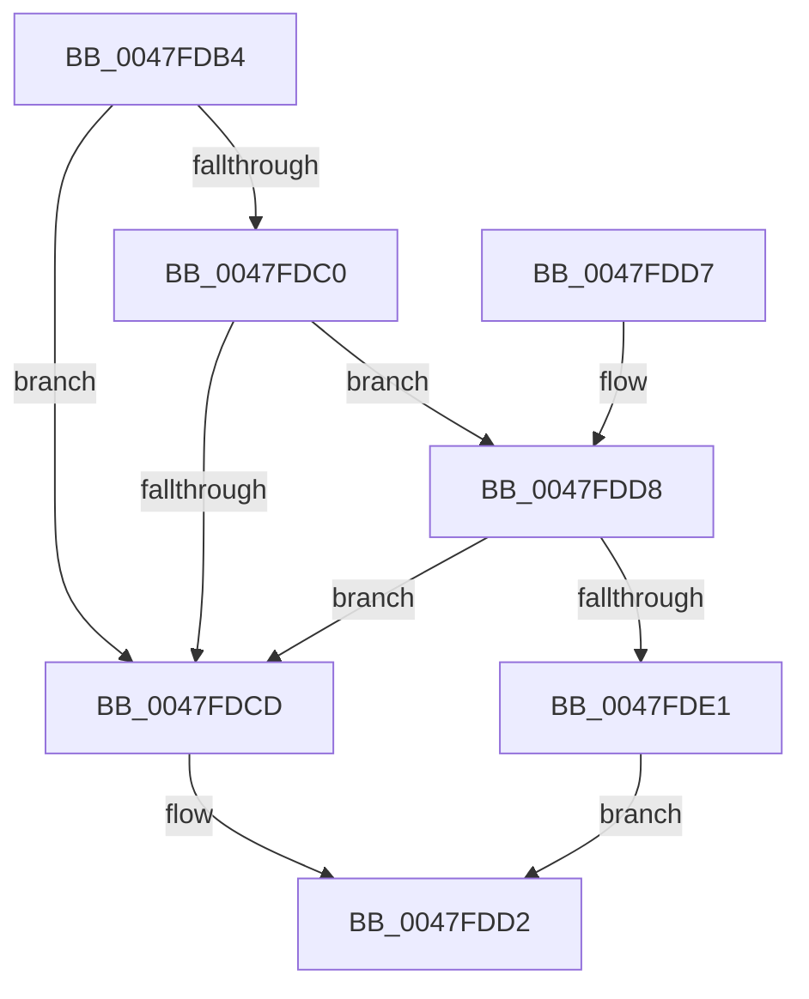

# PopDiagGetDriverName

- RVA: `0x0047FDB4`–`0x0047FDF3` (길이 `63` bytes)
- VA: `0x000000014047FDB4`
- 실행 섹션: `.text`
- PDB 이름 있음: `예`; PDB Function 태그: `아니요`
- unwind 정보 RVA: `0x00094EEC`
- 디코드: `20`개 명령, `63/63` bytes 표시
- 미해석 바이트: `0` (있으면 어셈블리에 `.byte`로 보존)

> 이 문서는 커널 이미지의 기계어와 PDB 기호를 분석해 생성했습니다. 4번과 5번은 함수 원형과 자료형을 바이너리 사용 방식에서 추정한 C 해석이며 원본 소스 복구 결과는 아닙니다.

## 1. Dependencies

- 직접 호출 지점: **1**; 고유 호출 대상: **1**
- 직접 호출자로 확인된 함수: **3**
- RIP 상대 이미지 참조: **0**

### Outgoing calls
- `0x0047FDEC` → [RtlStringCbCopyNW](../39/RtlStringCbCopyNW_function_003905E8.md) (function, `0x003905E8`)

### Direct callers
- [PopDiagTraceIrpFinishTelemetry](../26/PopDiagTraceIrpFinishTelemetry_function_0026F46C.md) at `0x0026F5AB`
- [PopRecordPoIrpBlackboxInformation](../4C/PopRecordPoIrpBlackboxInformation_function_004CE14C.md) at `0x004CE224`
- [PopRecordPoIrpBlackboxInformation](../4C/PopRecordPoIrpBlackboxInformation_function_004CE14C.md) at `0x004CE327`
- [PopDiagTraceDriverVeto](../../pagelk/B7/PopDiagTraceDriverVeto_function_00B70F48.md) at `0x00B70FB0`

### Static image references
- 디코드된 RIP-relative 메모리 참조가 없습니다.

## 2. Other-region calls and transfers

- 다른 실행 섹션으로 향하는 call: **0**
- 별도 외부 분기/꼬리 이동을 확인하지 못했습니다.

## 3. Assembly (complete function range)

```asm
0047FDB4  48 83 EC 28                     sub rsp, 0x28
0047FDB8  4C 8B D2                        mov r10, rdx
0047FDBB  48 85 C9                        test rcx, rcx
0047FDBE  74 0D                           je 0x14047fdcd
0047FDC0  48 8B 41 08                     mov rax, qword ptr [rcx + 8]
0047FDC4  4C 8B 40 40                     mov r8, qword ptr [rax + 0x40]
0047FDC8  4D 85 C0                        test r8, r8
0047FDCB  75 0B                           jne 0x14047fdd8
0047FDCD  B8 01 00 00 C0                  mov eax, 0xc0000001
0047FDD2  48 83 C4 28                     add rsp, 0x28
0047FDD6  C3                              ret
0047FDD7  CC                              int3
0047FDD8  0F B7 48 38                     movzx ecx, word ptr [rax + 0x38]
0047FDDC  66 85 C9                        test cx, cx
0047FDDF  74 EC                           je 0x14047fdcd
0047FDE1  44 8B C9                        mov r9d, ecx
0047FDE4  BA 80 00 00 00                  mov edx, 0x80
0047FDE9  49 8B CA                        mov rcx, r10
0047FDEC  E8 F7 07 F1 FF                  call 0x1403905e8
0047FDF1  EB DF                           jmp 0x14047fdd2
```

## 4. C-style interpretation (structured pseudocode)

```c
__int64 __fastcall PopDiagGetDriverName(__int64 a1, __int64 a2)
{
    __int64 result;
    __int64 v_rsp;

    v_rsp = (v_rsp) - (40);
    if (a1 == 0) goto loc_0047FDCD;
    if (*(unsigned __int64 *)(*(unsigned __int64 *)(a1 + 8) + 64) != 0) goto loc_0047FDD8;
loc_0047FDCD:
loc_0047FDD2:
    v_rsp = (v_rsp) + (40);
    return (unsigned int)(0xC0000001ULL);
loc_0047FDD8:
    if ((unsigned __int16)(*(unsigned __int16 *)((unsigned int)(0xC0000001ULL) + 56)) == 0) goto loc_0047FDCD;
    result = RtlStringCbCopyNW(a2, 128, *(unsigned __int64 *)(*(unsigned __int64 *)(a1 + 8) + 64), (unsigned int)((unsigned int)(*(unsigned __int16 *)((unsigned int)(0xC0000001ULL) + 56))));
    goto loc_0047FDD2;
}
```

## 5. (Beta) C Style

```c
int64_t PopDiagGetDriverName(int64_t Arg1, int64_t Arg2)
{
    int64_t result;
    int64_t local_rsp;

    local_rsp = (local_rsp) - (40);
    if (Arg1 == 0) goto loc_0047FDCD;
    if (*(uint64_t *)(*(uint64_t *)(Arg1 + 0x8) + 0x40) != 0) goto loc_0047FDD8;
loc_0047FDCD:
loc_0047FDD2:
    local_rsp = (local_rsp) + (40);
    return (uint32_t)(0xC0000001ULL);
loc_0047FDD8:
    if ((uint16_t)(*(uint16_t *)((uint32_t)(0xC0000001ULL) + 0x38)) == 0) goto loc_0047FDCD;
    result = RtlStringCbCopyNW(Arg2, 128, *(uint64_t *)(*(uint64_t *)(Arg1 + 0x8) + 0x40), (uint32_t)((uint32_t)(*(uint16_t *)((uint32_t)(0xC0000001ULL) + 0x38))));
    goto loc_0047FDD2;
}
```

## 6. Execution-region graph

[열기: 2D/3D 그래프와 함수 탐색 컨트롤 패널](../../../control-panel.html?section=text&rva=0x0047FDB4&view=graph)

- 2D 그래프는 위에서 아래로 흐르고, 3D 그래프는 빈 공간을 드래그해 회전합니다. Shift+드래그는 이동, 휠은 확대·축소, 함수 노드 선택은 대상 보고서 이동입니다.

### Static fallback


