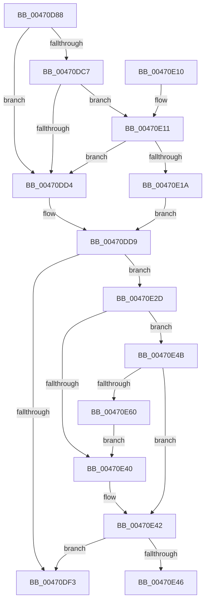

# PopDiagTraceDIrpAfterSx

- RVA: `0x00470D88`–`0x00470E62` (길이 `218` bytes)
- VA: `0x0000000140470D88`
- 실행 섹션: `.text`
- PDB 이름 있음: `예`; PDB Function 태그: `예`
- unwind 정보 RVA: `0x000ABD60`
- 디코드: `54`개 명령, `218/218` bytes 표시
- 미해석 바이트: `0` (있으면 어셈블리에 `.byte`로 보존)

> 이 문서는 커널 이미지의 기계어와 PDB 기호를 분석해 생성했습니다. 4번과 5번은 함수 원형과 자료형을 바이너리 사용 방식에서 추정한 C 해석이며 원본 소스 복구 결과는 아닙니다.

## 1. Dependencies

- 직접 호출 지점: **2**; 고유 호출 대상: **2**
- 직접 호출자로 확인된 함수: **1**
- RIP 상대 이미지 참조: **5**

### Outgoing calls
- `0x00470DFA` → [_security_check_cookie](../6A/_security_check_cookie_function_006AC640.md) (function, `0x006AC640`)
- `0x00470E26` → [RtlStringCbCopyNW](../39/RtlStringCbCopyNW_function_003905E8.md) (function, `0x003905E8`)

### Direct callers
- [PoHandleIrp](PoHandleIrp_function_004709D0.md) at `0x00470A91`

### Static image references
- `0x00470D9A` → RVA `0x00E0A740` (`.data`; read)
- `0x00470DDB` → RVA `0x006C8EC0` (` ?? ::FNODOBFM::`string'`; read)
- `0x00470DEA` → RVA `0x00E07748` (`.data`; read)
- `0x00470E37` → RVA `0x00E07758` (`.data`; read)
- `0x00470E4B` → RVA `0x00E07760` (`.data`; read)

## 2. Other-region calls and transfers

- 다른 실행 섹션으로 향하는 call: **0**
- call이 아닌 외부 분기/꼬리 이동: **1**
  - `0x00470E46` → [sub_006F3B98](../6F/Unknown_function_006F3B98.md) (`tail-transfer`)

## 3. Assembly (complete function range)

```asm
00470D88  48 89 5C 24 10                  mov qword ptr [rsp + 0x10], rbx
00470D8D  55                              push rbp
00470D8E  48 8D 6C 24 D0                  lea rbp, [rsp - 0x30]
00470D93  48 81 EC 30 01 00 00            sub rsp, 0x130
00470D9A  48 8B 05 9F 99 99 00            mov rax, qword ptr [rip + 0x99999f]
00470DA1  48 33 C4                        xor rax, rsp
00470DA4  48 89 45 20                     mov qword ptr [rbp + 0x20], rax
00470DA8  48 0F BE 41 42                  movsx rax, byte ptr [rcx + 0x42]
00470DAD  33 DB                           xor ebx, ebx
00470DAF  48 8D 14 C0                     lea rdx, [rax + rax*8]
00470DB3  4C 8B 9C D1 C8 00 00 00         mov r11, qword ptr [rcx + rdx*8 + 0xc8]
00470DBB  49 8B 83 E8 00 00 00            mov rax, qword ptr [r11 + 0xe8]
00470DC2  48 85 C0                        test rax, rax
00470DC5  74 0D                           je 0x140470dd4
00470DC7  48 8B 40 08                     mov rax, qword ptr [rax + 8]
00470DCB  4C 8B 40 40                     mov r8, qword ptr [rax + 0x40]
00470DCF  4D 85 C0                        test r8, r8
00470DD2  75 3D                           jne 0x140470e11
00470DD4  B8 01 00 00 C0                  mov eax, 0xc0000001
00470DD9  85 C0                           test eax, eax
00470DDB  48 8D 0D DE 80 25 00            lea rcx, [rip + 0x2580de]
00470DE2  48 8D 55 A0                     lea rdx, [rbp - 0x60]
00470DE6  48 0F 48 D1                     cmovs rdx, rcx
00470DEA  83 3D 57 69 99 00 05            cmp dword ptr [rip + 0x996957], 5
00470DF1  77 3A                           ja 0x140470e2d
00470DF3  48 8B 4D 20                     mov rcx, qword ptr [rbp + 0x20]
00470DF7  48 33 CC                        xor rcx, rsp
00470DFA  E8 41 B8 23 00                  call 0x1406ac640
00470DFF  48 8B 9C 24 48 01 00 00         mov rbx, qword ptr [rsp + 0x148]
00470E07  48 81 C4 30 01 00 00            add rsp, 0x130
00470E0E  5D                              pop rbp
00470E0F  C3                              ret
00470E10  CC                              int3
00470E11  0F B7 48 38                     movzx ecx, word ptr [rax + 0x38]
00470E15  66 85 C9                        test cx, cx
00470E18  74 BA                           je 0x140470dd4
00470E1A  44 8B C9                        mov r9d, ecx
00470E1D  BA 80 00 00 00                  mov edx, 0x80
00470E22  48 8D 4D A0                     lea rcx, [rbp - 0x60]
00470E26  E8 BD F7 F1 FF                  call 0x1403905e8
00470E2B  EB AC                           jmp 0x140470dd9
00470E2D  49 B8 00 00 00 00 00 40 00 00   movabs r8, 0x400000000000
00470E37  4C 85 05 1A 69 99 00            test qword ptr [rip + 0x99691a], r8
00470E3E  75 0B                           jne 0x140470e4b
00470E40  8A C3                           mov al, bl
00470E42  84 C0                           test al, al
00470E44  74 AD                           je 0x140470df3
00470E46  E9 4D 2D 28 00                  jmp 0x1406f3b98
00470E4B  48 8B 05 0E 69 99 00            mov rax, qword ptr [rip + 0x99690e]
00470E52  49 23 C0                        and rax, r8
00470E55  48 3B 05 04 69 99 00            cmp rax, qword ptr [rip + 0x996904]
00470E5C  B0 01                           mov al, 1
00470E5E  74 E2                           je 0x140470e42
00470E60  EB DE                           jmp 0x140470e40
```

## 4. C-style interpretation (structured pseudocode)

```c
__int64 __fastcall PopDiagTraceDIrpAfterSx(__int64 a1)
{
    __int64 result;
    __int64 v_rbx;
    __int64 v_rsp;
    unsigned __int64 v_stack_m18;
    unsigned __int64 v_stack_m38;
    unsigned __int64 v_stack_m98;
    unsigned __int64 v_stack_p10;

    v_stack_p10 = v_rbx;
    v_rsp = (v_rsp) - (304);
    result = (*(unsigned __int64 *)(v_rip + 10066335)) ^ (v_rsp);
    v_stack_m18 = result;
    v_rbx = 0;
    if (*(unsigned __int64 *)(*(unsigned __int64 *)(a1 + (__int8)(*(unsigned __int8 *)(a1 + 66)) + (__int8)(*(unsigned __int8 *)(a1 + 66)) * 8 * 8 + 200) + 232) == 0) goto loc_00470DD4;
    if (*(unsigned __int64 *)(*(unsigned __int64 *)(*(unsigned __int64 *)(*(unsigned __int64 *)(a1 + (__int8)(*(unsigned __int8 *)(a1 + 66)) + (__int8)(*(unsigned __int8 *)(a1 + 66)) * 8 * 8 + 200) + 232) + 8) + 64) != 0) goto loc_00470E11;
loc_00470DD4:
loc_00470DD9:
    a2 = v_stack_m98;
    if (sign_flag) { a2 = v_rip + 2457822; }
    if ((*(unsigned int *)(v_rip + 10053975)) > 5) goto loc_00470E2D;
loc_00470DF3:
    a1 = (v_stack_m18) ^ (v_rsp);
    result = _security_check_cookie(a1, a2, *(unsigned __int64 *)(*(unsigned __int64 *)(*(unsigned __int64 *)(*(unsigned __int64 *)(a1 + (__int8)(*(unsigned __int8 *)(a1 + 66)) + (__int8)(*(unsigned __int8 *)(a1 + 66)) * 8 * 8 + 200) + 232) + 8) + 64), a4);
    v_rsp = (v_rsp) + (304);
    return result;
loc_00470E11:
    if ((unsigned __int16)(*(unsigned __int16 *)(result + 56)) == 0) goto loc_00470DD4;
    result = RtlStringCbCopyNW(v_stack_m98, 128, *(unsigned __int64 *)(*(unsigned __int64 *)(*(unsigned __int64 *)(*(unsigned __int64 *)(a1 + (__int8)(*(unsigned __int8 *)(a1 + 66)) + (__int8)(*(unsigned __int8 *)(a1 + 66)) * 8 * 8 + 200) + 232) + 8) + 64), (unsigned int)((unsigned int)(*(unsigned __int16 *)(result + 56))));
    goto loc_00470DD9;
loc_00470E2D:
    if (((*(unsigned __int64 *)(v_rip + 10053914)) & (*(unsigned __int64 *)(*(unsigned __int64 *)(*(unsigned __int64 *)(*(unsigned __int64 *)(a1 + (__int8)(*(unsigned __int8 *)(a1 + 66)) + (__int8)(*(unsigned __int8 *)(a1 + 66)) * 8 * 8 + 200) + 232) + 8) + 64))) != 0) goto loc_00470E4B;
loc_00470E40:
loc_00470E42:
    if ((unsigned __int8)((unsigned __int8)(v_stack_p10)) == 0) goto loc_00470DF3;
loc_00470E4B:
    result = (*(unsigned __int64 *)(v_rip + 10053902)) & (*(unsigned __int64 *)(*(unsigned __int64 *)(*(unsigned __int64 *)(*(unsigned __int64 *)(a1 + (__int8)(*(unsigned __int8 *)(a1 + 66)) + (__int8)(*(unsigned __int8 *)(a1 + 66)) * 8 * 8 + 200) + 232) + 8) + 64));
    if (result == (*(unsigned __int64 *)(v_rip + 10053892))) goto loc_00470E42;
    goto loc_00470E40;
}
```

## 5. (Beta) C Style

```c
int64_t PopDiagTraceDIrpAfterSx(void *Arg1)
{
    uint8_t *arg1 = (uint8_t *)Arg1;

    int64_t result;
    int64_t local_rbx;
    int64_t local_rsp;
    uint64_t v_stack_m18;
    uint64_t v_stack_m38;
    uint64_t v_stack_m98;
    uint64_t v_stack_p10;

    v_stack_p10 = local_rbx;
    local_rsp = (local_rsp) - (304);
    result = (*(uint64_t *)(v_rip + 0x99999F)) ^ (local_rsp);
    v_stack_m18 = result;
    local_rbx = 0;
    if (*(uint64_t *)(*(uint64_t *)(arg1 + (int8_t)(*(uint8_t *)(arg1 + 0x42)) + (int8_t)(*(uint8_t *)(arg1 + 0x42)) * 8 * 8 + 0xC8) + 0xE8) == 0) goto loc_00470DD4;
    if (*(uint64_t *)(*(uint64_t *)(*(uint64_t *)(*(uint64_t *)(arg1 + (int8_t)(*(uint8_t *)(arg1 + 0x42)) + (int8_t)(*(uint8_t *)(arg1 + 0x42)) * 8 * 8 + 0xC8) + 0xE8) + 0x8) + 0x40) != 0) goto loc_00470E11;
loc_00470DD4:
loc_00470DD9:
    a2 = v_stack_m98;
    if (sign_flag) { a2 = v_rip + 2457822; }
    if ((*(uint32_t *)(v_rip + 0x996957)) > 5) goto loc_00470E2D;
loc_00470DF3:
    Arg1 = (v_stack_m18) ^ (local_rsp);
    result = _security_check_cookie(Arg1, a2, *(uint64_t *)(*(uint64_t *)(*(uint64_t *)(*(uint64_t *)(arg1 + (int8_t)(*(uint8_t *)(arg1 + 0x42)) + (int8_t)(*(uint8_t *)(arg1 + 0x42)) * 8 * 8 + 0xC8) + 0xE8) + 0x8) + 0x40), a4);
    local_rsp = (local_rsp) + (304);
    return result;
loc_00470E11:
    if ((uint16_t)(*(uint16_t *)(result + 0x38)) == 0) goto loc_00470DD4;
    result = RtlStringCbCopyNW(v_stack_m98, 128, *(uint64_t *)(*(uint64_t *)(*(uint64_t *)(*(uint64_t *)(arg1 + (int8_t)(*(uint8_t *)(arg1 + 0x42)) + (int8_t)(*(uint8_t *)(arg1 + 0x42)) * 8 * 8 + 0xC8) + 0xE8) + 0x8) + 0x40), (uint32_t)((uint32_t)(*(uint16_t *)(result + 0x38))));
    goto loc_00470DD9;
loc_00470E2D:
    if (((*(uint64_t *)(v_rip + 0x99691A)) & (*(uint64_t *)(*(uint64_t *)(*(uint64_t *)(*(uint64_t *)(arg1 + (int8_t)(*(uint8_t *)(arg1 + 0x42)) + (int8_t)(*(uint8_t *)(arg1 + 0x42)) * 8 * 8 + 0xC8) + 0xE8) + 0x8) + 0x40))) != 0) goto loc_00470E4B;
loc_00470E40:
loc_00470E42:
    if ((uint8_t)((uint8_t)(v_stack_p10)) == 0) goto loc_00470DF3;
loc_00470E4B:
    result = (*(uint64_t *)(v_rip + 0x99690E)) & (*(uint64_t *)(*(uint64_t *)(*(uint64_t *)(*(uint64_t *)(arg1 + (int8_t)(*(uint8_t *)(arg1 + 0x42)) + (int8_t)(*(uint8_t *)(arg1 + 0x42)) * 8 * 8 + 0xC8) + 0xE8) + 0x8) + 0x40));
    if (result == (*(uint64_t *)(v_rip + 0x996904))) goto loc_00470E42;
    goto loc_00470E40;
}
```

### 관측된 메모리 오프셋

구조체 형식이 확인되지 않은 접근은 인자 기준의 오프셋으로만 기록했습니다.

| 기준 인자 | 오프셋 표현 | 폭 (bit) | 접근 |
|---|---:|---:|---|
| `Arg1` | `+ 0x42` | `8` | `R` |
| `Arg1` | `+ 0xC8 + rdx*8` | `64` | `R` |

## 6. Execution-region graph

[열기: 2D/3D 그래프와 함수 탐색 컨트롤 패널](../../../control-panel.html?section=text&rva=0x00470D88&view=graph)

- 2D 그래프는 위에서 아래로 흐르고, 3D 그래프는 빈 공간을 드래그해 회전합니다. Shift+드래그는 이동, 휠은 확대·축소, 함수 노드 선택은 대상 보고서 이동입니다.

### Static fallback


