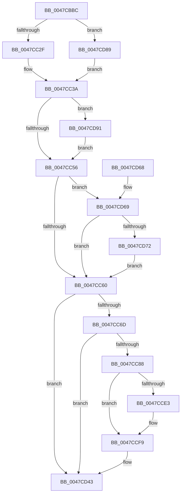

# PopDiagTraceIrpStart

- RVA: `0x0047CBBC`–`0x0047CDB1` (길이 `501` bytes)
- VA: `0x000000014047CBBC`
- 실행 섹션: `.text`
- PDB 이름 있음: `예`; PDB Function 태그: `아니요`
- unwind 정보 RVA: `0x000AD870`
- 디코드: `112`개 명령, `501/501` bytes 표시
- 미해석 바이트: `0` (있으면 어셈블리에 `.byte`로 보존)

> 이 문서는 커널 이미지의 기계어와 PDB 기호를 분석해 생성했습니다. 4번과 5번은 함수 원형과 자료형을 바이너리 사용 방식에서 추정한 C 해석이며 원본 소스 복구 결과는 아닙니다.

## 1. Dependencies

- 직접 호출 지점: **5**; 고유 호출 대상: **5**
- 직접 호출자로 확인된 함수: **3**
- RIP 상대 이미지 참조: **5**

### Outgoing calls
- `0x0047CC7B` → [EtwEventEnabled](../39/EtwEventEnabled_function_00392450.md) (function, `0x00392450`)
- `0x0047CD3E` → [EtwWriteEx](../25/EtwWriteEx_function_0025F0D0.md) (function, `0x0025F0D0`)
- `0x0047CD4A` → [_security_check_cookie](../6A/_security_check_cookie_function_006AC640.md) (function, `0x006AC640`)
- `0x0047CD7F` → [PopFxAddLogEntry](../39/PopFxAddLogEntry_function_00390B94.md) (function, `0x00390B94`)
- `0x0047CD9C` → [RtlInitUnicodeString](../42/RtlInitUnicodeString_function_0042A780.md) (function, `0x0042A780`)

### Direct callers
- [PopDequeueQuerySetIrp](../26/PopDequeueQuerySetIrp_function_0026EC34.md) at `0x0026EEC2`
- [PopRequestPowerIrp](../27/PopRequestPowerIrp_function_00270ED4.md) at `0x002710E8`
- [PopQueueQuerySetIrp](../2B/PopQueueQuerySetIrp_function_002BEF18.md) at `0x002BF08B`

### Static image references
- `0x0047CBD7` → RVA `0x00E0A740` (`.data`; read)
- `0x0047CC60` → RVA `0x00E67858` (`.data`; read)
- `0x0047CC6D` → RVA `0x00F0B408` (`.data`; read)
- `0x0047CC74` → RVA `0x0001A370` (`.rdata`; read)
- `0x0047CD91` → RVA `0x006C8EC0` (` ?? ::FNODOBFM::`string'`; read)

## 2. Other-region calls and transfers

- 다른 실행 섹션으로 향하는 call: **0**
- 별도 외부 분기/꼬리 이동을 확인하지 못했습니다.

## 3. Assembly (complete function range)

```asm
0047CBBC  48 8B C4                        mov rax, rsp
0047CBBF  48 89 58 08                     mov qword ptr [rax + 8], rbx
0047CBC3  48 89 70 18                     mov qword ptr [rax + 0x18], rsi
0047CBC7  48 89 78 20                     mov qword ptr [rax + 0x20], rdi
0047CBCB  55                              push rbp
0047CBCC  48 8D 68 A1                     lea rbp, [rax - 0x5f]
0047CBD0  48 81 EC F0 00 00 00            sub rsp, 0xf0
0047CBD7  48 8B 05 62 DB 98 00            mov rax, qword ptr [rip + 0x98db62]
0047CBDE  48 33 C4                        xor rax, rsp
0047CBE1  48 89 45 47                     mov qword ptr [rbp + 0x47], rax
0047CBE5  48 89 55 BF                     mov qword ptr [rbp - 0x41], rdx
0047CBE9  33 F6                           xor esi, esi
0047CBEB  48 0F BE 42 42                  movsx rax, byte ptr [rdx + 0x42]
0047CBF0  0F 57 C0                        xorps xmm0, xmm0
0047CBF3  0F 11 45 C7                     movups xmmword ptr [rbp - 0x39], xmm0
0047CBF7  48 8D 0C C0                     lea rcx, [rax + rax*8]
0047CBFB  48 8B BC CA C8 00 00 00         mov rdi, qword ptr [rdx + rcx*8 + 0xc8]
0047CC03  8A 97 B8 00 00 00               mov dl, byte ptr [rdi + 0xb8]
0047CC09  88 55 A7                        mov byte ptr [rbp - 0x59], dl
0047CC0C  44 8B 87 BC 00 00 00            mov r8d, dword ptr [rdi + 0xbc]
0047CC13  44 89 45 AF                     mov dword ptr [rbp - 0x51], r8d
0047CC17  8A 87 C0 00 00 00               mov al, byte ptr [rdi + 0xc0]
0047CC1D  FE C8                           dec al
0047CC1F  88 45 A8                        mov byte ptr [rbp - 0x58], al
0047CC22  48 8B 47 18                     mov rax, qword ptr [rdi + 0x18]
0047CC26  48 85 C0                        test rax, rax
0047CC29  0F 84 5A 01 00 00               je 0x14047cd89
0047CC2F  48 8B 80 38 01 00 00            mov rax, qword ptr [rax + 0x138]
0047CC36  48 8B 48 28                     mov rcx, qword ptr [rax + 0x28]
0047CC3A  48 89 4D B7                     mov qword ptr [rbp - 0x49], rcx
0047CC3E  48 8D 59 28                     lea rbx, [rcx + 0x28]
0047CC42  0F B7 03                        movzx eax, word ptr [rbx]
0047CC45  66 D1 E8                        shr ax, 1
0047CC48  66 89 45 AB                     mov word ptr [rbp - 0x55], ax
0047CC4C  48 39 71 10                     cmp qword ptr [rcx + 0x10], rsi
0047CC50  0F 84 3B 01 00 00               je 0x14047cd91
0047CC56  41 83 F8 01                     cmp r8d, 1
0047CC5A  0F 84 09 01 00 00               je 0x14047cd69
0047CC60  40 38 35 F1 AB 9E 00            cmp byte ptr [rip + 0x9eabf1], sil
0047CC67  0F 84 D6 00 00 00               je 0x14047cd43
0047CC6D  48 8B 0D 94 E7 A8 00            mov rcx, qword ptr [rip + 0xa8e794]
0047CC74  48 8D 15 F5 D6 B9 FF            lea rdx, [rip - 0x46290b]
0047CC7B  E8 D0 57 F1 FF                  call 0x140392450
0047CC80  84 C0                           test al, al
0047CC82  0F 84 BB 00 00 00               je 0x14047cd43
0047CC88  48 8D 45 BF                     lea rax, [rbp - 0x41]
0047CC8C  48 C7 45 DF 08 00 00 00         mov qword ptr [rbp - 0x21], 8
0047CC94  B9 05 00 00 00                  mov ecx, 5
0047CC99  48 89 45 D7                     mov qword ptr [rbp - 0x29], rax
0047CC9D  48 8D 45 AF                     lea rax, [rbp - 0x51]
0047CCA1  48 C7 45 EF 04 00 00 00         mov qword ptr [rbp - 0x11], 4
0047CCA9  48 89 45 E7                     mov qword ptr [rbp - 0x19], rax
0047CCAD  48 8D 45 A7                     lea rax, [rbp - 0x59]
0047CCB1  48 89 45 F7                     mov qword ptr [rbp - 9], rax
0047CCB5  48 8D 45 B7                     lea rax, [rbp - 0x49]
0047CCB9  48 89 45 07                     mov qword ptr [rbp + 7], rax
0047CCBD  48 8D 45 AB                     lea rax, [rbp - 0x55]
0047CCC1  48 89 45 17                     mov qword ptr [rbp + 0x17], rax
0047CCC5  48 C7 45 FF 01 00 00 00         mov qword ptr [rbp - 1], 1
0047CCCD  48 C7 45 0F 08 00 00 00         mov qword ptr [rbp + 0xf], 8
0047CCD5  48 C7 45 1F 02 00 00 00         mov qword ptr [rbp + 0x1f], 2
0047CCDD  66 39 75 AB                     cmp word ptr [rbp - 0x55], si
0047CCE1  76 16                           jbe 0x14047ccf9
0047CCE3  0F B7 0B                        movzx ecx, word ptr [rbx]
0047CCE6  48 8B 43 08                     mov rax, qword ptr [rbx + 8]
0047CCEA  89 4D 2F                        mov dword ptr [rbp + 0x2f], ecx
0047CCED  B9 06 00 00 00                  mov ecx, 6
0047CCF2  48 89 45 27                     mov qword ptr [rbp + 0x27], rax
0047CCF6  89 75 33                        mov dword ptr [rbp + 0x33], esi
0047CCF9  8B C1                           mov eax, ecx
0047CCFB  4C 8D 45 A8                     lea r8, [rbp - 0x58]
0047CCFF  48 03 C0                        add rax, rax
0047CD02  48 8D 15 67 D6 B9 FF            lea rdx, [rip - 0x462999]
0047CD09  45 33 C9                        xor r9d, r9d
0047CD0C  4C 89 44 C5 D7                  mov qword ptr [rbp + rax*8 - 0x29], r8
0047CD11  45 33 C0                        xor r8d, r8d
0047CD14  48 C7 44 C5 DF 01 00 00 00      mov qword ptr [rbp + rax*8 - 0x21], 1
0047CD1D  8D 41 01                        lea eax, [rcx + 1]
0047CD20  48 8D 4D D7                     lea rcx, [rbp - 0x29]
0047CD24  48 89 4C 24 38                  mov qword ptr [rsp + 0x38], rcx
0047CD29  48 8B 0D D8 E6 A8 00            mov rcx, qword ptr [rip + 0xa8e6d8]
0047CD30  89 44 24 30                     mov dword ptr [rsp + 0x30], eax
0047CD34  48 89 74 24 28                  mov qword ptr [rsp + 0x28], rsi
0047CD39  48 89 74 24 20                  mov qword ptr [rsp + 0x20], rsi
0047CD3E  E8 8D 23 DE FF                  call 0x14025f0d0
0047CD43  48 8B 4D 47                     mov rcx, qword ptr [rbp + 0x47]
0047CD47  48 33 CC                        xor rcx, rsp
0047CD4A  E8 F1 F8 22 00                  call 0x1406ac640
0047CD4F  4C 8D 9C 24 F0 00 00 00         lea r11, [rsp + 0xf0]
0047CD57  49 8B 5B 10                     mov rbx, qword ptr [r11 + 0x10]
0047CD5B  49 8B 73 20                     mov rsi, qword ptr [r11 + 0x20]
0047CD5F  49 8B 7B 28                     mov rdi, qword ptr [r11 + 0x28]
0047CD63  49 8B E3                        mov rsp, r11
0047CD66  5D                              pop rbp
0047CD67  C3                              ret
0047CD68  CC                              int3
0047CD69  80 FA 02                        cmp dl, 2
0047CD6C  0F 85 EE FE FF FF               jne 0x14047cc60
0047CD72  4C 63 8F C0 00 00 00            movsxd r9, dword ptr [rdi + 0xc0]
0047CD79  33 D2                           xor edx, edx
0047CD7B  44 8D 42 16                     lea r8d, [rdx + 0x16]
0047CD7F  E8 10 3E F1 FF                  call 0x140390b94
0047CD84  E9 D7 FE FF FF                  jmp 0x14047cc60
0047CD89  48 8B CE                        mov rcx, rsi
0047CD8C  E9 A9 FE FF FF                  jmp 0x14047cc3a
0047CD91  48 8D 15 28 C1 24 00            lea rdx, [rip + 0x24c128]
0047CD98  48 8D 4D C7                     lea rcx, [rbp - 0x39]
0047CD9C  E8 DF D9 FA FF                  call 0x14042a780
0047CDA1  48 8B 4D B7                     mov rcx, qword ptr [rbp - 0x49]
0047CDA5  8A 55 A7                        mov dl, byte ptr [rbp - 0x59]
0047CDA8  44 8B 45 AF                     mov r8d, dword ptr [rbp - 0x51]
0047CDAC  E9 A5 FE FF FF                  jmp 0x14047cc56
```

## 4. C-style interpretation (structured pseudocode)

```c
__int64 __fastcall PopDiagTraceIrpStart(__int64 a1, __int64 a2, __int64 a3, int a4)
{
    __int64 result;
    __int64 v_rsi;
    __int64 v_rsp;
    unsigned __int64 v_stack_m8;
    unsigned __int64 v_stack_mC0;
    unsigned int v_stack_mC8;
    unsigned __int64 v_stack_mD0;
    unsigned __int64 v_stack_mD8;

    *(unsigned __int64 *)(v_rsp + 8) = v_rbx;
    *(unsigned __int64 *)(v_rsp + 24) = v_rsi;
    *(unsigned __int64 *)(v_rsp + 32) = v_rdi;
    v_rsp = (v_rsp) - (240);
    result = (*(unsigned __int64 *)(v_rip + 10017634)) ^ (v_rsp);
    *(unsigned __int64 *)(v_rsp - 95 + 71) = result;
    *(unsigned __int64 *)(v_rsp - 95 - 65) = a2;
    v_rsi = 0;
    *(unsigned __int64 *)(v_rsp - 95 - 57) = v_xmm0;
    *(unsigned __int8 *)(v_rsp - 95 - 89) = (unsigned __int8)(*(unsigned __int8 *)(*(unsigned __int64 *)(a2 + (__int8)(*(unsigned __int8 *)(a2 + 66)) + (__int8)(*(unsigned __int8 *)(a2 + 66)) * 8 * 8 + 200) + 184));
    *(unsigned int *)(v_rsp - 95 - 81) = (unsigned int)((unsigned int)(*(unsigned int *)(*(unsigned __int64 *)(a2 + (__int8)(*(unsigned __int8 *)(a2 + 66)) + (__int8)(*(unsigned __int8 *)(a2 + 66)) * 8 * 8 + 200) + 188)));
    result = (unsigned __int8)((*(unsigned __int8 *)(*(unsigned __int64 *)(a2 + (__int8)(*(unsigned __int8 *)(a2 + 66)) + (__int8)(*(unsigned __int8 *)(a2 + 66)) * 8 * 8 + 200) + 192)) - 1);
    *(unsigned __int8 *)(v_rsp - 95 - 88) = (unsigned __int8)(result);
    if (*(unsigned __int64 *)(*(unsigned __int64 *)(a2 + (__int8)(*(unsigned __int8 *)(a2 + 66)) + (__int8)(*(unsigned __int8 *)(a2 + 66)) * 8 * 8 + 200) + 24) == 0) goto loc_0047CD89;
loc_0047CC3A:
    *(unsigned __int64 *)(v_rsp - 95 - 73) = *(unsigned __int64 *)(*(unsigned __int64 *)(*(unsigned __int64 *)(*(unsigned __int64 *)(a2 + (__int8)(*(unsigned __int8 *)(a2 + 66)) + (__int8)(*(unsigned __int8 *)(a2 + 66)) * 8 * 8 + 200) + 24) + 312) + 40);
    result = (unsigned __int16)((*(unsigned __int16 *)(*(unsigned __int64 *)(*(unsigned __int64 *)(*(unsigned __int64 *)(*(unsigned __int64 *)(a2 + (__int8)(*(unsigned __int8 *)(a2 + 66)) + (__int8)(*(unsigned __int8 *)(a2 + 66)) * 8 * 8 + 200) + 24) + 312) + 40) + 40)) >> (1));
    *(unsigned __int16 *)(v_rsp - 95 - 85) = (unsigned __int16)(result);
    if ((*(unsigned __int64 *)(*(unsigned __int64 *)(*(unsigned __int64 *)(*(unsigned __int64 *)(*(unsigned __int64 *)(a2 + (__int8)(*(unsigned __int8 *)(a2 + 66)) + (__int8)(*(unsigned __int8 *)(a2 + 66)) * 8 * 8 + 200) + 24) + 312) + 40) + 16)) == 0) goto loc_0047CD91;
loc_0047CC56:
    if (((unsigned int)((unsigned int)(*(unsigned int *)(*(unsigned __int64 *)(a2 + (__int8)(*(unsigned __int8 *)(a2 + 66)) + (__int8)(*(unsigned __int8 *)(a2 + 66)) * 8 * 8 + 200) + 188)))) == 1) goto loc_0047CD69;
loc_0047CC60:
    if ((*(unsigned __int8 *)(v_rip + 10398705)) == 0) goto loc_0047CD43;
    result = EtwEventEnabled(*(unsigned __int64 *)(v_rip + 11069332), v_rip - 4598027, (unsigned int)(*(unsigned int *)(*(unsigned __int64 *)(a2 + (__int8)(*(unsigned __int8 *)(a2 + 66)) + (__int8)(*(unsigned __int8 *)(a2 + 66)) * 8 * 8 + 200) + 188)), a4);
    if ((unsigned __int8)(result) == 0) goto loc_0047CD43;
    *(unsigned __int64 *)(v_rsp - 95 - 33) = 8;
    *(unsigned __int64 *)(v_rsp - 95 - 41) = v_rsp - 95 - 65;
    *(unsigned __int64 *)(v_rsp - 95 - 17) = 4;
    *(unsigned __int64 *)(v_rsp - 95 - 25) = v_rsp - 95 - 81;
    *(unsigned __int64 *)(v_rsp - 95 - 9) = v_rsp - 95 - 89;
    *(unsigned __int64 *)(v_rsp - 95 + 7) = v_rsp - 95 - 73;
    *(unsigned __int64 *)(v_rsp - 95 + 23) = v_rsp - 95 - 85;
    *(unsigned __int64 *)(v_rsp - 95 - 1) = 1;
    *(unsigned __int64 *)(v_rsp - 95 + 15) = 8;
    *(unsigned __int64 *)(v_rsp - 95 + 31) = 2;
    result = v_rsp - 95 - 85;
    if ((*(unsigned __int16 *)(v_rsp - 95 - 85)) >= = 0) {
        a1 = *(unsigned __int16 *)(*(unsigned __int64 *)(*(unsigned __int64 *)(*(unsigned __int64 *)(*(unsigned __int64 *)(a2 + (__int8)(*(unsigned __int8 *)(a2 + 66)) + (__int8)(*(unsigned __int8 *)(a2 + 66)) * 8 * 8 + 200) + 24) + 312) + 40) + 40);
        result = *(unsigned __int64 *)(*(unsigned __int64 *)(*(unsigned __int64 *)(*(unsigned __int64 *)(*(unsigned __int64 *)(a2 + (__int8)(*(unsigned __int8 *)(a2 + 66)) + (__int8)(*(unsigned __int8 *)(a2 + 66)) * 8 * 8 + 200) + 24) + 312) + 40) + 40 + 8);
        *(unsigned int *)(v_rsp - 95 + 47) = (unsigned int)(a1);
        a1 = 6;
        *(unsigned __int64 *)(v_rsp - 95 + 39) = result;
        *(unsigned int *)(v_rsp - 95 + 51) = 0;
    }
    result = ((unsigned int)((unsigned int)(a1))) + ((unsigned int)((unsigned int)(a1)));
    a4 = 0;
    *(unsigned __int64 *)(v_rsp - 95 + result * 8 - 41) = v_rsp - 95 - 88;
    a3 = 0;
    *(unsigned __int64 *)(v_rsp - 95 + result * 8 - 33) = 1;
    v_stack_mC0 = v_rsp - 95 - 41;
    v_stack_mC8 = (unsigned int)(a1 + 1);
    v_stack_mD0 = 0;
    v_stack_mD8 = 0;
    result = EtwWriteEx(*(unsigned __int64 *)(v_rip + 11069144), v_rip - 4598169, a3, a4);
loc_0047CD43:
    a1 = (*(unsigned __int64 *)(v_rsp - 95 + 71)) ^ (v_rsp);
    result = _security_check_cookie(a1, v_rip - 4598169, a3, a4);
    return result;
loc_0047CD69:
    if (((unsigned __int8)(v_rip - 4598169)) != 2) goto loc_0047CC60;
    a2 = 0;
    result = PopFxAddLogEntry(a1, a2, a2 + 22, (int)(*(unsigned int *)(*(unsigned __int64 *)(v_stack_m8 + 40) + 192)));
    goto loc_0047CC60;
loc_0047CD89:
    goto loc_0047CC3A;
loc_0047CD91:
    result = RtlInitUnicodeString(v_rsp - 95 - 57, v_rip + 2408744, a2 + 22, (int)(*(unsigned int *)(*(unsigned __int64 *)(v_stack_m8 + 40) + 192)));
    goto loc_0047CC56;
}
```

## 5. (Beta) C Style

```c
int64_t PopDiagTraceIrpStart(int64_t Arg1, void *Arg2, int64_t Arg3, int32_t Arg4)
{
    uint8_t *arg2 = (uint8_t *)Arg2;

    int64_t result;
    int64_t local_rsi;
    int64_t local_rsp;
    uint64_t v_stack_m8;
    uint64_t v_stack_mC0;
    uint32_t v_stack_mC8;
    uint64_t v_stack_mD0;
    uint64_t v_stack_mD8;

    *(uint64_t *)(local_rsp + 0x8) = local_rbx;
    *(uint64_t *)(local_rsp + 0x18) = local_rsi;
    *(uint64_t *)(local_rsp + 0x20) = local_rdi;
    local_rsp = (local_rsp) - (240);
    result = (*(uint64_t *)(v_rip + 0x98DB62)) ^ (local_rsp);
    *(uint64_t *)(local_rsp - 0x5F + 0x47) = result;
    *(void **)(local_rsp - 0x5F - 0x41) = Arg2;
    local_rsi = 0;
    *(uint64_t *)(local_rsp - 0x5F - 0x39) = v_xmm0;
    *(uint8_t *)(local_rsp - 0x5F - 0x59) = (uint8_t)(*(uint8_t *)(*(uint64_t *)(arg2 + (int8_t)(*(uint8_t *)(arg2 + 0x42)) + (int8_t)(*(uint8_t *)(arg2 + 0x42)) * 8 * 8 + 0xC8) + 0xB8));
    *(uint32_t *)(local_rsp - 0x5F - 0x51) = (uint32_t)((uint32_t)(*(uint32_t *)(*(uint64_t *)(arg2 + (int8_t)(*(uint8_t *)(arg2 + 0x42)) + (int8_t)(*(uint8_t *)(arg2 + 0x42)) * 8 * 8 + 0xC8) + 0xBC)));
    result = (uint8_t)((*(uint8_t *)(*(uint64_t *)(arg2 + (int8_t)(*(uint8_t *)(arg2 + 0x42)) + (int8_t)(*(uint8_t *)(arg2 + 0x42)) * 8 * 8 + 0xC8) + 0xC0)) - 1);
    *(uint8_t *)(local_rsp - 0x5F - 0x58) = (uint8_t)(result);
    if (*(uint64_t *)(*(uint64_t *)(arg2 + (int8_t)(*(uint8_t *)(arg2 + 0x42)) + (int8_t)(*(uint8_t *)(arg2 + 0x42)) * 8 * 8 + 0xC8) + 0x18) == 0) goto loc_0047CD89;
loc_0047CC3A:
    *(uint64_t *)(local_rsp - 0x5F - 0x49) = *(uint64_t *)(*(uint64_t *)(*(uint64_t *)(*(uint64_t *)(arg2 + (int8_t)(*(uint8_t *)(arg2 + 0x42)) + (int8_t)(*(uint8_t *)(arg2 + 0x42)) * 8 * 8 + 0xC8) + 0x18) + 0x138) + 0x28);
    result = (uint16_t)((*(uint16_t *)(*(uint64_t *)(*(uint64_t *)(*(uint64_t *)(*(uint64_t *)(arg2 + (int8_t)(*(uint8_t *)(arg2 + 0x42)) + (int8_t)(*(uint8_t *)(arg2 + 0x42)) * 8 * 8 + 0xC8) + 0x18) + 0x138) + 0x28) + 0x28)) >> (1));
    *(uint16_t *)(local_rsp - 0x5F - 0x55) = (uint16_t)(result);
    if ((*(uint64_t *)(*(uint64_t *)(*(uint64_t *)(*(uint64_t *)(*(uint64_t *)(arg2 + (int8_t)(*(uint8_t *)(arg2 + 0x42)) + (int8_t)(*(uint8_t *)(arg2 + 0x42)) * 8 * 8 + 0xC8) + 0x18) + 0x138) + 0x28) + 0x10)) == 0) goto loc_0047CD91;
loc_0047CC56:
    if (((uint32_t)((uint32_t)(*(uint32_t *)(*(uint64_t *)(arg2 + (int8_t)(*(uint8_t *)(arg2 + 0x42)) + (int8_t)(*(uint8_t *)(arg2 + 0x42)) * 8 * 8 + 0xC8) + 0xBC)))) == 1) goto loc_0047CD69;
loc_0047CC60:
    if ((*(uint8_t *)(v_rip + 0x9EABF1)) == 0) goto loc_0047CD43;
    result = EtwEventEnabled(*(uint64_t *)(v_rip + 0xA8E794), v_rip - 4598027, (uint32_t)(*(uint32_t *)(*(uint64_t *)(arg2 + (int8_t)(*(uint8_t *)(arg2 + 0x42)) + (int8_t)(*(uint8_t *)(arg2 + 0x42)) * 8 * 8 + 0xC8) + 0xBC)), Arg4);
    if ((uint8_t)(result) == 0) goto loc_0047CD43;
    *(uint64_t *)(local_rsp - 0x5F - 0x21) = 8;
    *(uint64_t *)(local_rsp - 0x5F - 0x29) = local_rsp - 95 - 65;
    *(uint64_t *)(local_rsp - 0x5F - 0x11) = 4;
    *(uint64_t *)(local_rsp - 0x5F - 0x19) = local_rsp - 95 - 81;
    *(uint64_t *)(local_rsp - 0x5F - 0x9) = local_rsp - 95 - 89;
    *(uint64_t *)(local_rsp - 0x5F + 0x7) = local_rsp - 95 - 73;
    *(uint64_t *)(local_rsp - 0x5F + 0x17) = local_rsp - 95 - 85;
    *(uint64_t *)(local_rsp - 0x5F - 0x1) = 1;
    *(uint64_t *)(local_rsp - 0x5F + 0xF) = 8;
    *(uint64_t *)(local_rsp - 0x5F + 0x1F) = 2;
    result = local_rsp - 95 - 85;
    if ((*(uint16_t *)(local_rsp - 0x5F - 0x55)) >= = 0) {
        Arg1 = *(uint16_t *)(*(uint64_t *)(*(uint64_t *)(*(uint64_t *)(*(uint64_t *)(arg2 + (int8_t)(*(uint8_t *)(arg2 + 0x42)) + (int8_t)(*(uint8_t *)(arg2 + 0x42)) * 8 * 8 + 0xC8) + 0x18) + 0x138) + 0x28) + 0x28);
        result = *(uint64_t *)(*(uint64_t *)(*(uint64_t *)(*(uint64_t *)(*(uint64_t *)(arg2 + (int8_t)(*(uint8_t *)(arg2 + 0x42)) + (int8_t)(*(uint8_t *)(arg2 + 0x42)) * 8 * 8 + 0xC8) + 0x18) + 0x138) + 0x28) + 0x28 + 0x8);
        *(uint32_t *)(local_rsp - 0x5F + 0x2F) = (uint32_t)(Arg1);
        Arg1 = 6;
        *(uint64_t *)(local_rsp - 0x5F + 0x27) = result;
        *(uint32_t *)(local_rsp - 0x5F + 0x33) = 0;
    }
    result = ((uint32_t)((uint32_t)(Arg1))) + ((uint32_t)((uint32_t)(Arg1)));
    Arg4 = 0;
    *(uint64_t *)(local_rsp - 0x5F + result * 8 - 0x29) = local_rsp - 95 - 88;
    Arg3 = 0;
    *(uint64_t *)(local_rsp - 0x5F + result * 8 - 0x21) = 1;
    v_stack_mC0 = local_rsp - 95 - 41;
    v_stack_mC8 = (uint32_t)(Arg1 + 1);
    v_stack_mD0 = 0;
    v_stack_mD8 = 0;
    result = EtwWriteEx(*(uint64_t *)(v_rip + 0xA8E6D8), v_rip - 4598169, Arg3, Arg4);
loc_0047CD43:
    Arg1 = (*(uint64_t *)(local_rsp - 0x5F + 0x47)) ^ (local_rsp);
    result = _security_check_cookie(Arg1, v_rip - 4598169, Arg3, Arg4);
    return result;
loc_0047CD69:
    if (((uint8_t)(v_rip - 4598169)) != 2) goto loc_0047CC60;
    Arg2 = 0;
    result = PopFxAddLogEntry(Arg1, Arg2, Arg2 + 22, (int32_t)(*(uint32_t *)(*(uint64_t *)(v_stack_m8 + 0x28) + 0xC0)));
    goto loc_0047CC60;
loc_0047CD89:
    goto loc_0047CC3A;
loc_0047CD91:
    result = RtlInitUnicodeString(local_rsp - 95 - 57, v_rip + 2408744, Arg2 + 22, (int32_t)(*(uint32_t *)(*(uint64_t *)(v_stack_m8 + 0x28) + 0xC0)));
    goto loc_0047CC56;
}
```

### 관측된 메모리 오프셋

구조체 형식이 확인되지 않은 접근은 인자 기준의 오프셋으로만 기록했습니다.

| 기준 인자 | 오프셋 표현 | 폭 (bit) | 접근 |
|---|---:|---:|---|
| `Arg2` | `+ 0x42` | `8` | `R` |
| `Arg2` | `+ 0xC8 + rcx*8` | `64` | `R` |

## 6. Execution-region graph

[열기: 2D/3D 그래프와 함수 탐색 컨트롤 패널](../../../control-panel.html?section=text&rva=0x0047CBBC&view=graph)

- 2D 그래프는 위에서 아래로 흐르고, 3D 그래프는 빈 공간을 드래그해 회전합니다. Shift+드래그는 이동, 휠은 확대·축소, 함수 노드 선택은 대상 보고서 이동입니다.

### Static fallback


