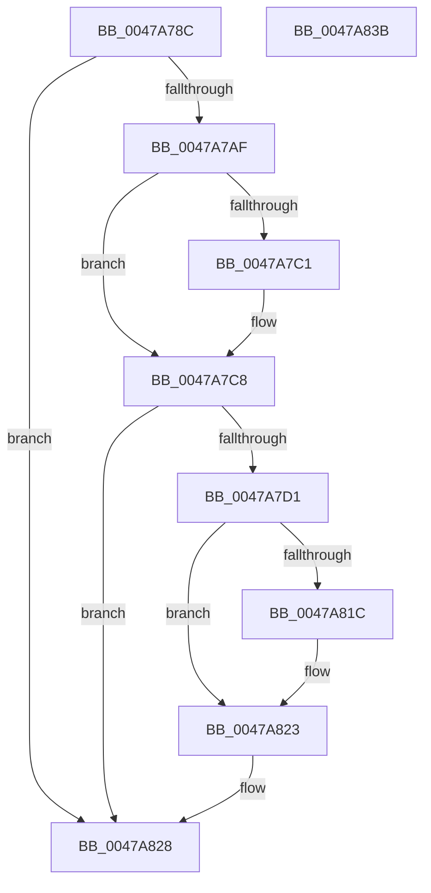

# PopDiagTraceSystemLatencyUpdate

- RVA: `0x0047A78C`–`0x0047A83C` (길이 `176` bytes)
- VA: `0x000000014047A78C`
- 실행 섹션: `.text`
- PDB 이름 있음: `예`; PDB Function 태그: `아니요`
- unwind 정보 RVA: `0x000AD30C`
- 디코드: `41`개 명령, `176/176` bytes 표시
- 미해석 바이트: `0` (있으면 어셈블리에 `.byte`로 보존)

> 이 문서는 커널 이미지의 기계어와 PDB 기호를 분석해 생성했습니다. 4번과 5번은 함수 원형과 자료형을 바이너리 사용 방식에서 추정한 C 해석이며 원본 소스 복구 결과는 아닙니다.

## 1. Dependencies

- 직접 호출 지점: **3**; 고유 호출 대상: **3**
- 직접 호출자로 확인된 함수: **1**
- RIP 상대 이미지 참조: **5**

### Outgoing calls
- `0x0047A7C8` → [EtwEventEnabled](../39/EtwEventEnabled_function_00392450.md) (function, `0x00392450`)
- `0x0047A823` → [EtwWriteEx](../25/EtwWriteEx_function_0025F0D0.md) (function, `0x0025F0D0`)
- `0x0047A830` → [_security_check_cookie](../6A/_security_check_cookie_function_006AC640.md) (function, `0x006AC640`)

### Direct callers
- [PopDiagTraceControlCallback](../../page/A3/PopDiagTraceControlCallback_function_00A38CB0.md) at `0x00A38D0E`

### Static image references
- `0x0047A795` → RVA `0x00E0A740` (`.data`; read)
- `0x0047A7A4` → RVA `0x00E67858` (`.data`; read)
- `0x0047A7AF` → RVA `0x00F0B408` (`.data`; read)
- `0x0047A7B6` → RVA `0x0001A2D0` (`.rdata`; read)
- `0x0047A7C1` → RVA `0x0001A2E0` (`.rdata`; read)

## 2. Other-region calls and transfers

- 다른 실행 섹션으로 향하는 call: **0**
- 별도 외부 분기/꼬리 이동을 확인하지 못했습니다.

## 3. Assembly (complete function range)

```asm
0047A78C  89 54 24 10                     mov dword ptr [rsp + 0x10], edx
0047A790  53                              push rbx
0047A791  48 83 EC 60                     sub rsp, 0x60
0047A795  48 8B 05 A4 FF 98 00            mov rax, qword ptr [rip + 0x98ffa4]
0047A79C  48 33 C4                        xor rax, rsp
0047A79F  48 89 44 24 50                  mov qword ptr [rsp + 0x50], rax
0047A7A4  80 3D AD D0 9E 00 00            cmp byte ptr [rip + 0x9ed0ad], 0
0047A7AB  8A D9                           mov bl, cl
0047A7AD  74 79                           je 0x14047a828
0047A7AF  48 8B 0D 52 0C A9 00            mov rcx, qword ptr [rip + 0xa90c52]
0047A7B6  48 8D 15 13 FB B9 FF            lea rdx, [rip - 0x4604ed]
0047A7BD  84 DB                           test bl, bl
0047A7BF  74 07                           je 0x14047a7c8
0047A7C1  48 8D 15 18 FB B9 FF            lea rdx, [rip - 0x4604e8]
0047A7C8  E8 83 7C F1 FF                  call 0x140392450
0047A7CD  84 C0                           test al, al
0047A7CF  74 57                           je 0x14047a828
0047A7D1  83 64 24 4C 00                  and dword ptr [rsp + 0x4c], 0
0047A7D6  48 8D 44 24 78                  lea rax, [rsp + 0x78]
0047A7DB  48 8B 0D 26 0C A9 00            mov rcx, qword ptr [rip + 0xa90c26]
0047A7E2  48 8D 15 F7 FA B9 FF            lea rdx, [rip - 0x460509]
0047A7E9  45 33 C0                        xor r8d, r8d
0047A7EC  48 89 44 24 40                  mov qword ptr [rsp + 0x40], rax
0047A7F1  48 8D 44 24 40                  lea rax, [rsp + 0x40]
0047A7F6  C7 44 24 48 04 00 00 00         mov dword ptr [rsp + 0x48], 4
0047A7FE  48 89 44 24 38                  mov qword ptr [rsp + 0x38], rax
0047A803  45 33 C9                        xor r9d, r9d
0047A806  C7 44 24 30 01 00 00 00         mov dword ptr [rsp + 0x30], 1
0047A80E  4C 21 44 24 28                  and qword ptr [rsp + 0x28], r8
0047A813  4C 21 44 24 20                  and qword ptr [rsp + 0x20], r8
0047A818  84 DB                           test bl, bl
0047A81A  75 07                           jne 0x14047a823
0047A81C  48 8D 15 AD FA B9 FF            lea rdx, [rip - 0x460553]
0047A823  E8 A8 48 DE FF                  call 0x14025f0d0
0047A828  48 8B 4C 24 50                  mov rcx, qword ptr [rsp + 0x50]
0047A82D  48 33 CC                        xor rcx, rsp
0047A830  E8 0B 1E 23 00                  call 0x1406ac640
0047A835  48 83 C4 60                     add rsp, 0x60
0047A839  5B                              pop rbx
0047A83A  C3                              ret
0047A83B  CC                              int3
```

## 4. C-style interpretation (structured pseudocode)

```c
__int64 __fastcall PopDiagTraceSystemLatencyUpdate(unsigned __int8 a1, int a2, int a3, int a4)
{
    __int64 result;
    __int64 v_rsp;
    unsigned __int64 v_stack_m18;
    unsigned int v_stack_m1C;
    unsigned int v_stack_m20;
    unsigned __int64 v_stack_m28;
    unsigned __int64 v_stack_m30;
    unsigned int v_stack_m38;
    unsigned __int64 v_stack_m40;
    unsigned __int64 v_stack_m48;
    unsigned int v_stack_p10;

    v_stack_p10 = a2;
    v_rsp = (v_rsp) - (96);
    result = (*(unsigned __int64 *)(v_rip + 10026916)) ^ (v_rsp);
    v_stack_m18 = result;
    if ((*(unsigned __int8 *)(v_rip + 10408109)) == 0) goto loc_0047A828;
    if (a1 != 0) {
        a2 = v_rip - 4588776;
    }
    result = EtwEventEnabled(*(unsigned __int64 *)(v_rip + 11078738), a2, a3, a4);
    if ((unsigned __int8)(result) == 0) goto loc_0047A828;
    a3 = 0;
    v_stack_m28 = v_stack_p10;
    v_stack_m20 = 4;
    v_stack_m30 = v_stack_m28;
    a4 = 0;
    v_stack_m38 = 1;
    if (a1 == 0) {
        a2 = v_rip - 4588883;
    }
    result = EtwWriteEx(*(unsigned __int64 *)(v_rip + 11078694), a2, a3, a4);
loc_0047A828:
    a1 = (v_stack_m18) ^ (v_rsp);
    result = _security_check_cookie(a1, a2, a3, a4);
    v_rsp = (v_rsp) + (96);
    return result;
}
```

## 5. (Beta) C Style

```c
int64_t PopDiagTraceSystemLatencyUpdate(uint8_t Arg1, int32_t Arg2, int32_t Arg3, int32_t Arg4)
{
    int64_t result;
    int64_t local_rsp;
    uint64_t v_stack_m18;
    uint32_t v_stack_m1C;
    uint32_t v_stack_m20;
    uint64_t v_stack_m28;
    uint64_t v_stack_m30;
    uint32_t v_stack_m38;
    uint64_t v_stack_m40;
    uint64_t v_stack_m48;
    uint32_t v_stack_p10;

    v_stack_p10 = Arg2;
    local_rsp = (local_rsp) - (96);
    result = (*(uint64_t *)(v_rip + 0x98FFA4)) ^ (local_rsp);
    v_stack_m18 = result;
    if ((*(uint8_t *)(v_rip + 0x9ED0AD)) == 0) goto loc_0047A828;
    if (Arg1 != 0) {
        Arg2 = v_rip - 4588776;
    }
    result = EtwEventEnabled(*(uint64_t *)(v_rip + 0xA90C52), Arg2, Arg3, Arg4);
    if ((uint8_t)(result) == 0) goto loc_0047A828;
    Arg3 = 0;
    v_stack_m28 = v_stack_p10;
    v_stack_m20 = 4;
    v_stack_m30 = v_stack_m28;
    Arg4 = 0;
    v_stack_m38 = 1;
    if (Arg1 == 0) {
        Arg2 = v_rip - 4588883;
    }
    result = EtwWriteEx(*(uint64_t *)(v_rip + 0xA90C26), Arg2, Arg3, Arg4);
loc_0047A828:
    Arg1 = (v_stack_m18) ^ (local_rsp);
    result = _security_check_cookie(Arg1, Arg2, Arg3, Arg4);
    local_rsp = (local_rsp) + (96);
    return result;
}
```

## 6. Execution-region graph

[열기: 2D/3D 그래프와 함수 탐색 컨트롤 패널](../../../control-panel.html?section=text&rva=0x0047A78C&view=graph)

- 2D 그래프는 위에서 아래로 흐르고, 3D 그래프는 빈 공간을 드래그해 회전합니다. Shift+드래그는 이동, 휠은 확대·축소, 함수 노드 선택은 대상 보고서 이동입니다.

### Static fallback


