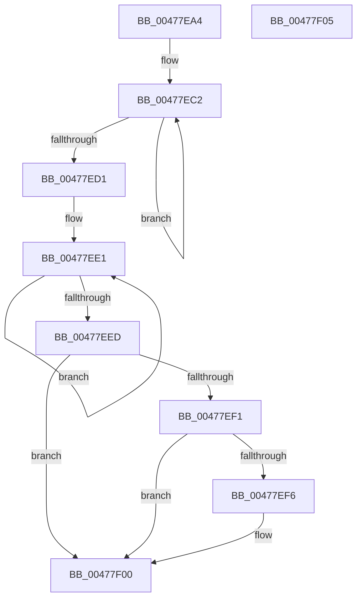

# PopDirectedDripsClearDisengageReason

- RVA: `0x00477EA4`–`0x00477F06` (길이 `98` bytes)
- VA: `0x0000000140477EA4`
- 실행 섹션: `.text`
- PDB 이름 있음: `예`; PDB Function 태그: `아니요`
- unwind 정보 RVA: `0x0005C788`
- 디코드: `26`개 명령, `98/98` bytes 표시
- 미해석 바이트: `0` (있으면 어셈블리에 `.byte`로 보존)

> 이 문서는 커널 이미지의 기계어와 PDB 기호를 분석해 생성했습니다. 4번과 5번은 함수 원형과 자료형을 바이너리 사용 방식에서 추정한 C 해석이며 원본 소스 복구 결과는 아닙니다.

## 1. Dependencies

- 직접 호출 지점: **1**; 고유 호출 대상: **1**
- 직접 호출자로 확인된 함수: **7**
- RIP 상대 이미지 참조: **2**

### Outgoing calls
- `0x00477EFB` → [PopQueueDirectedDripsWork](PopQueueDirectedDripsWork_function_00478DC4.md) (function, `0x00478DC4`)

### Direct callers
- [PnpDeviceActionWorker](PnpDeviceActionWorker_function_00478400.md) at `0x00478944`
- [PnpRemoveDeviceActionRequests](../4E/PnpRemoveDeviceActionRequests_function_004E89A4.md) at `0x004E8A77`
- [PnpRemoveDeviceActionRequestFromQueue](../5A/PnpRemoveDeviceActionRequestFromQueue_function_005A83E0.md) at `0x005A845C`
- [PopDirectedDripsDisengageTimerCallback](../5D/PopDirectedDripsDisengageTimerCallback_function_005D11E0.md) at `0x005D1206`
- [PopPowerAggregatorEngageModernStandby](../../page/76/PopPowerAggregatorEngageModernStandby_function_00764784.md) at `0x0076485B`
- [PopDripsWatchdogCallbackWorker](../../page/76/PopDripsWatchdogCallbackWorker_function_0076C360.md) at `0x0076C444`
- [sub_00B4309E](../../page/B4/Unknown_function_00B4309E.md) at `0x00B43185`

### Static image references
- `0x00477EB5` → RVA `0x00F0EB58` (`.data`; read)
- `0x00477ED4` → RVA `0x00F0EAC0` (`.data`; read)

## 2. Other-region calls and transfers

- 다른 실행 섹션으로 향하는 call: **0**
- 별도 외부 분기/꼬리 이동을 확인하지 못했습니다.

## 3. Assembly (complete function range)

```asm
00477EA4  48 83 EC 28                     sub rsp, 0x28
00477EA8  BA 01 00 00 00                  mov edx, 1
00477EAD  D3 E2                           shl edx, cl
00477EAF  44 8B C2                        mov r8d, edx
00477EB2  41 F7 D0                        not r8d
00477EB5  0F 0D 0D 9C 6C A9 00            prefetchw byte ptr [rip + 0xa96c9c]
00477EBC  8B 05 96 6C A9 00               mov eax, dword ptr [rip + 0xa96c96]
00477EC2  8B C8                           mov ecx, eax
00477EC4  41 23 C8                        and ecx, r8d
00477EC7  F0 0F B1 0D 89 6C A9 00         lock cmpxchg dword ptr [rip + 0xa96c89], ecx
00477ECF  75 F1                           jne 0x140477ec2
00477ED1  44 8B C0                        mov r8d, eax
00477ED4  0F 0D 0D E5 6B A9 00            prefetchw byte ptr [rip + 0xa96be5]
00477EDB  8B 05 DF 6B A9 00               mov eax, dword ptr [rip + 0xa96bdf]
00477EE1  8B C8                           mov ecx, eax
00477EE3  F0 0F B1 0D D5 6B A9 00         lock cmpxchg dword ptr [rip + 0xa96bd5], ecx
00477EEB  75 F4                           jne 0x140477ee1
00477EED  A8 01                           test al, 1
00477EEF  74 0F                           je 0x140477f00
00477EF1  44 85 C2                        test edx, r8d
00477EF4  74 0A                           je 0x140477f00
00477EF6  BA 02 00 00 00                  mov edx, 2
00477EFB  E8 C4 0E 00 00                  call 0x140478dc4
00477F00  48 83 C4 28                     add rsp, 0x28
00477F04  C3                              ret
00477F05  CC                              int3
```

## 4. C-style interpretation (structured pseudocode)

```c
__int64 __fastcall PopDirectedDripsClearDisengageReason(unsigned __int8 a1)
{
    __int64 result;
    __int64 v_rsp;

    v_rsp = (v_rsp) - (40);
    a2 = (unsigned int)((1) << (a1));
    a3 = (unsigned int)(~((unsigned int)((unsigned int)(a2))));
loc_00477EC2:
    a1 = (unsigned int)(((unsigned int)((unsigned int)((unsigned int)(*(unsigned int *)(v_rip + 11103382))))) & ((unsigned int)(a3)));
    if (condition_is_not_equal) goto loc_00477EC2;
loc_00477EE1:
    if (condition_is_not_equal) goto loc_00477EE1;
    if ((((unsigned __int8)((unsigned int)(*(unsigned int *)(v_rip + 11103199)))) & (1)) == 0) goto loc_00477F00;
    result = (unsigned int)(*(unsigned int *)(v_rip + 11103199));
    if ((((unsigned int)(a2)) & ((unsigned int)((unsigned int)((unsigned int)((unsigned int)(*(unsigned int *)(v_rip + 11103382))))))) != 0) {
        a2 = 2;
        result = PopQueueDirectedDripsWork((unsigned int)((unsigned int)((unsigned int)(*(unsigned int *)(v_rip + 11103199)))), a2, (unsigned int)((unsigned int)((unsigned int)(*(unsigned int *)(v_rip + 11103382)))), a4);
    }
    v_rsp = (v_rsp) + (40);
    return result;
}
```

## 5. (Beta) C Style

```c
int64_t PopDirectedDripsClearDisengageReason(uint8_t Arg1)
{
    int64_t result;
    int64_t local_rsp;

    local_rsp = (local_rsp) - (40);
    a2 = (uint32_t)((1) << (Arg1));
    a3 = (uint32_t)(~((uint32_t)((uint32_t)(a2))));
loc_00477EC2:
    Arg1 = (uint32_t)(((uint32_t)((uint32_t)((uint32_t)(*(uint32_t *)(v_rip + 0xA96C96))))) & ((uint32_t)(a3)));
    if (condition_is_not_equal) goto loc_00477EC2;
loc_00477EE1:
    if (condition_is_not_equal) goto loc_00477EE1;
    if ((((uint8_t)((uint32_t)(*(uint32_t *)(v_rip + 0xA96BDF)))) & (1)) == 0) goto loc_00477F00;
    result = (uint32_t)(*(uint32_t *)(v_rip + 0xA96BDF));
    if ((((uint32_t)(a2)) & ((uint32_t)((uint32_t)((uint32_t)((uint32_t)(*(uint32_t *)(v_rip + 0xA96C96))))))) != 0) {
        a2 = 2;
        result = PopQueueDirectedDripsWork((uint32_t)((uint32_t)((uint32_t)(*(uint32_t *)(v_rip + 0xA96BDF)))), a2, (uint32_t)((uint32_t)((uint32_t)(*(uint32_t *)(v_rip + 0xA96C96)))), a4);
    }
    local_rsp = (local_rsp) + (40);
    return result;
}
```

## 6. Execution-region graph

[열기: 2D/3D 그래프와 함수 탐색 컨트롤 패널](../../../control-panel.html?section=text&rva=0x00477EA4&view=graph)

- 2D 그래프는 위에서 아래로 흐르고, 3D 그래프는 빈 공간을 드래그해 회전합니다. Shift+드래그는 이동, 휠은 확대·축소, 함수 노드 선택은 대상 보고서 이동입니다.

### Static fallback


