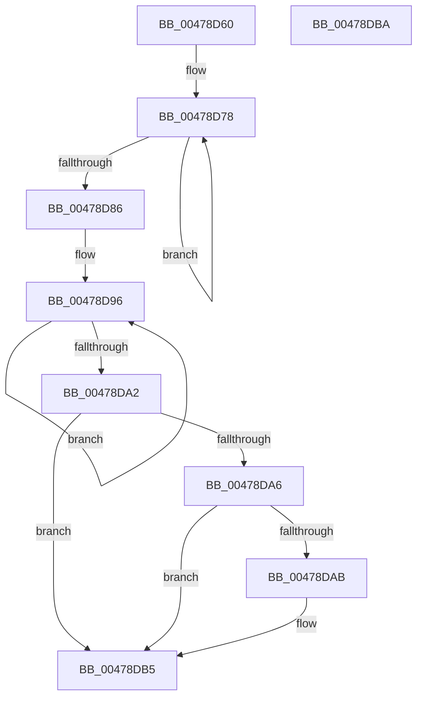

# PopDirectedDripsSetDisengageReason

- RVA: `0x00478D60`–`0x00478DBB` (길이 `91` bytes)
- VA: `0x0000000140478D60`
- 실행 섹션: `.text`
- PDB 이름 있음: `예`; PDB Function 태그: `아니요`
- unwind 정보 RVA: `0x0005C788`
- 디코드: `24`개 명령, `91/91` bytes 표시
- 미해석 바이트: `0` (있으면 어셈블리에 `.byte`로 보존)

> 이 문서는 커널 이미지의 기계어와 PDB 기호를 분석해 생성했습니다. 4번과 5번은 함수 원형과 자료형을 바이너리 사용 방식에서 추정한 C 해석이며 원본 소스 복구 결과는 아닙니다.

## 1. Dependencies

- 직접 호출 지점: **1**; 고유 호출 대상: **1**
- 직접 호출자로 확인된 함수: **4**
- RIP 상대 이미지 참조: **2**

### Outgoing calls
- `0x00478DB0` → [PopQueueDirectedDripsWork](PopQueueDirectedDripsWork_function_00478DC4.md) (function, `0x00478DC4`)

### Direct callers
- [PnpRequestDeviceAction](PnpRequestDeviceAction_function_00477FF8.md) at `0x004781AD`
- [PopDirectedDripsStartDisengageTimer](../5D/PopDirectedDripsStartDisengageTimer_function_005D1230.md) at `0x005D128B`
- [PopDripsWatchdogCallbackWorker](../../page/76/PopDripsWatchdogCallbackWorker_function_0076C360.md) at `0x0076C42F`
- [sub_00B4309E](../../page/B4/Unknown_function_00B4309E.md) at `0x00B431DF`

### Static image references
- `0x00478D6B` → RVA `0x00F0EB58` (`.data`; read)
- `0x00478D89` → RVA `0x00F0EAC0` (`.data`; read)

## 2. Other-region calls and transfers

- 다른 실행 섹션으로 향하는 call: **0**
- 별도 외부 분기/꼬리 이동을 확인하지 못했습니다.

## 3. Assembly (complete function range)

```asm
00478D60  48 83 EC 28                     sub rsp, 0x28
00478D64  BA 01 00 00 00                  mov edx, 1
00478D69  D3 E2                           shl edx, cl
00478D6B  0F 0D 0D E6 5D A9 00            prefetchw byte ptr [rip + 0xa95de6]
00478D72  8B 05 E0 5D A9 00               mov eax, dword ptr [rip + 0xa95de0]
00478D78  8B C8                           mov ecx, eax
00478D7A  0B CA                           or ecx, edx
00478D7C  F0 0F B1 0D D4 5D A9 00         lock cmpxchg dword ptr [rip + 0xa95dd4], ecx
00478D84  75 F2                           jne 0x140478d78
00478D86  44 8B C0                        mov r8d, eax
00478D89  0F 0D 0D 30 5D A9 00            prefetchw byte ptr [rip + 0xa95d30]
00478D90  8B 05 2A 5D A9 00               mov eax, dword ptr [rip + 0xa95d2a]
00478D96  8B C8                           mov ecx, eax
00478D98  F0 0F B1 0D 20 5D A9 00         lock cmpxchg dword ptr [rip + 0xa95d20], ecx
00478DA0  75 F4                           jne 0x140478d96
00478DA2  A8 01                           test al, 1
00478DA4  74 0F                           je 0x140478db5
00478DA6  44 85 C2                        test edx, r8d
00478DA9  75 0A                           jne 0x140478db5
00478DAB  BA 02 00 00 00                  mov edx, 2
00478DB0  E8 0F 00 00 00                  call 0x140478dc4
00478DB5  48 83 C4 28                     add rsp, 0x28
00478DB9  C3                              ret
00478DBA  CC                              int3
```

## 4. C-style interpretation (structured pseudocode)

```c
__int64 __fastcall PopDirectedDripsSetDisengageReason(unsigned __int8 a1)
{
    __int64 result;
    __int64 v_rsp;

    v_rsp = (v_rsp) - (40);
    a2 = (unsigned int)((1) << (a1));
loc_00478D78:
    a1 = (unsigned int)(((unsigned int)((unsigned int)((unsigned int)(*(unsigned int *)(v_rip + 11099616))))) | ((unsigned int)(a2)));
    if (condition_is_not_equal) goto loc_00478D78;
loc_00478D96:
    if (condition_is_not_equal) goto loc_00478D96;
    if ((((unsigned __int8)((unsigned int)(*(unsigned int *)(v_rip + 11099434)))) & (1)) == 0) goto loc_00478DB5;
    result = (unsigned int)(*(unsigned int *)(v_rip + 11099434));
    if ((((unsigned int)(a2)) & ((unsigned int)((unsigned int)((unsigned int)((unsigned int)(*(unsigned int *)(v_rip + 11099616))))))) == 0) {
        a2 = 2;
        result = PopQueueDirectedDripsWork((unsigned int)((unsigned int)((unsigned int)(*(unsigned int *)(v_rip + 11099434)))), a2, (unsigned int)((unsigned int)((unsigned int)(*(unsigned int *)(v_rip + 11099616)))), a4);
    }
    v_rsp = (v_rsp) + (40);
    return result;
}
```

## 5. (Beta) C Style

```c
int64_t PopDirectedDripsSetDisengageReason(uint8_t Arg1)
{
    int64_t result;
    int64_t local_rsp;

    local_rsp = (local_rsp) - (40);
    a2 = (uint32_t)((1) << (Arg1));
loc_00478D78:
    Arg1 = (uint32_t)(((uint32_t)((uint32_t)((uint32_t)(*(uint32_t *)(v_rip + 0xA95DE0))))) | ((uint32_t)(a2)));
    if (condition_is_not_equal) goto loc_00478D78;
loc_00478D96:
    if (condition_is_not_equal) goto loc_00478D96;
    if ((((uint8_t)((uint32_t)(*(uint32_t *)(v_rip + 0xA95D2A)))) & (1)) == 0) goto loc_00478DB5;
    result = (uint32_t)(*(uint32_t *)(v_rip + 0xA95D2A));
    if ((((uint32_t)(a2)) & ((uint32_t)((uint32_t)((uint32_t)((uint32_t)(*(uint32_t *)(v_rip + 0xA95DE0))))))) == 0) {
        a2 = 2;
        result = PopQueueDirectedDripsWork((uint32_t)((uint32_t)((uint32_t)(*(uint32_t *)(v_rip + 0xA95D2A)))), a2, (uint32_t)((uint32_t)((uint32_t)(*(uint32_t *)(v_rip + 0xA95DE0)))), a4);
    }
    local_rsp = (local_rsp) + (40);
    return result;
}
```

## 6. Execution-region graph

[열기: 2D/3D 그래프와 함수 탐색 컨트롤 패널](../../../control-panel.html?section=text&rva=0x00478D60&view=graph)

- 2D 그래프는 위에서 아래로 흐르고, 3D 그래프는 빈 공간을 드래그해 회전합니다. Shift+드래그는 이동, 휠은 확대·축소, 함수 노드 선택은 대상 보고서 이동입니다.

### Static fallback


