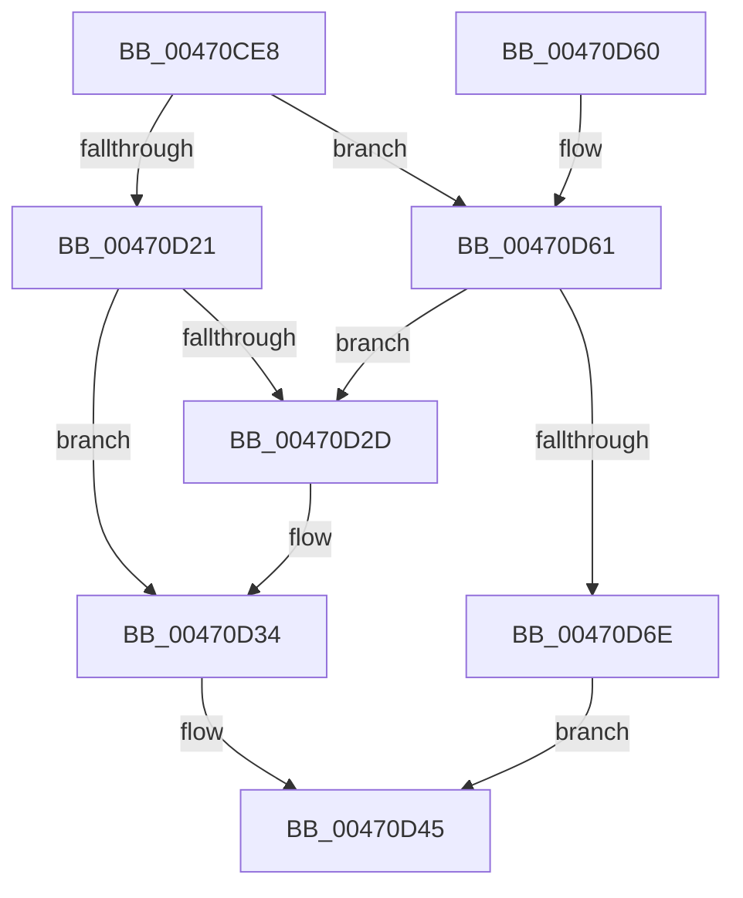

# PopDispatchQuerySetIrp

- RVA: `0x00470CE8`–`0x00470D82` (길이 `154` bytes)
- VA: `0x0000000140470CE8`
- 실행 섹션: `.text`
- PDB 이름 있음: `예`; PDB Function 태그: `아니요`
- unwind 정보 RVA: `0x000ABD54`
- 디코드: `38`개 명령, `154/154` bytes 표시
- 미해석 바이트: `0` (있으면 어셈블리에 `.byte`로 보존)

> 이 문서는 커널 이미지의 기계어와 PDB 기호를 분석해 생성했습니다. 4번과 5번은 함수 원형과 자료형을 바이너리 사용 방식에서 추정한 C 해석이며 원본 소스 복구 결과는 아닙니다.

## 1. Dependencies

- 직접 호출 지점: **2**; 고유 호출 대상: **2**
- 직접 호출자로 확인된 함수: **1**
- RIP 상대 이미지 참조: **6**

### Outgoing calls
- `0x00470D05` → [ObfReferenceObjectWithTag](../21/ObfReferenceObjectWithTag_function_00210710.md) (function, `0x00210710`)
- `0x00470D55` → [KeReleaseSemaphore](../39/KeReleaseSemaphore_function_00397080.md) (function, `0x00397080`)

### Direct callers
- [PoHandleIrp](PoHandleIrp_function_004709D0.md) at `0x00470AC6`

### Static image references
- `0x00470D0A` → RVA `0x00F0BCE8` (`.data`; read)
- `0x00470D18` → RVA `0x00F0BCF0` (`.data`; read)
- `0x00470D21` → RVA `0x00F0BCF8` (`.data`; read)
- `0x00470D3E` → RVA `0x00F0BCF8` (`.data`; write)
- `0x00470D48` → RVA `0x00F0BD00` (`.data`; read)
- `0x00470D79` → RVA `0x00F0BCF0` (`.data`; write)

## 2. Other-region calls and transfers

- 다른 실행 섹션으로 향하는 call: **0**
- 별도 외부 분기/꼬리 이동을 확인하지 못했습니다.

## 3. Assembly (complete function range)

```asm
00470CE8  40 53                           push rbx
00470CEA  48 83 EC 20                     sub rsp, 0x20
00470CEE  48 8B D9                        mov rbx, rcx
00470CF1  BA 50 6F 49 72                  mov edx, 0x72496f50
00470CF6  48 8B 89 B8 00 00 00            mov rcx, qword ptr [rcx + 0xb8]
00470CFD  80 49 03 01                     or byte ptr [rcx + 3], 1
00470D01  48 8B 49 28                     mov rcx, qword ptr [rcx + 0x28]
00470D05  E8 06 FA D9 FF                  call 0x140210710
00470D0A  48 3B 1D D7 AF A9 00            cmp rbx, qword ptr [rip + 0xa9afd7]
00470D11  48 8D 83 A8 00 00 00            lea rax, [rbx + 0xa8]
00470D18  48 8D 0D D1 AF A9 00            lea rcx, [rip + 0xa9afd1]
00470D1F  74 40                           je 0x140470d61
00470D21  48 8B 15 D0 AF A9 00            mov rdx, qword ptr [rip + 0xa9afd0]
00470D28  48 39 0A                        cmp qword ptr [rdx], rcx
00470D2B  74 07                           je 0x140470d34
00470D2D  B9 03 00 00 00                  mov ecx, 3
00470D32  CD 29                           int 0x29
00470D34  48 89 08                        mov qword ptr [rax], rcx
00470D37  48 89 50 08                     mov qword ptr [rax + 8], rdx
00470D3B  48 89 02                        mov qword ptr [rdx], rax
00470D3E  48 89 05 B3 AF A9 00            mov qword ptr [rip + 0xa9afb3], rax
00470D45  45 33 C9                        xor r9d, r9d
00470D48  48 8D 0D B1 AF A9 00            lea rcx, [rip + 0xa9afb1]
00470D4F  33 D2                           xor edx, edx
00470D51  45 8D 41 01                     lea r8d, [r9 + 1]
00470D55  E8 26 63 F2 FF                  call 0x140397080
00470D5A  48 83 C4 20                     add rsp, 0x20
00470D5E  5B                              pop rbx
00470D5F  C3                              ret
00470D60  CC                              int3
00470D61  48 8B 15 88 AF A9 00            mov rdx, qword ptr [rip + 0xa9af88]
00470D68  48 39 4A 08                     cmp qword ptr [rdx + 8], rcx
00470D6C  75 BF                           jne 0x140470d2d
00470D6E  48 89 10                        mov qword ptr [rax], rdx
00470D71  48 89 48 08                     mov qword ptr [rax + 8], rcx
00470D75  48 89 42 08                     mov qword ptr [rdx + 8], rax
00470D79  48 89 05 70 AF A9 00            mov qword ptr [rip + 0xa9af70], rax
00470D80  EB C3                           jmp 0x140470d45
```

## 4. C-style interpretation (structured pseudocode)

```c
__int64 __fastcall PopDispatchQuerySetIrp(__int64 a1, __int64 a2, __int64 a3, int a4)
{
    __int64 result;
    __int64 v_rsp;

    v_rsp = (v_rsp) - (32);
    result = ObfReferenceObjectWithTag(*(unsigned __int64 *)(*(unsigned __int64 *)(a1 + 184) + 40), (unsigned int)(0x72496F50ULL), a3, a4);
    if (a1 == (*(unsigned __int64 *)(v_rip + 11120599))) goto loc_00470D61;
    if ((*(unsigned __int64 *)(*(unsigned __int64 *)(v_rip + 11120592))) != (v_rip + 11120593)) {
        a1 = 3;
    }
    *(unsigned __int64 *)(a1 + 168) = a1;
    *(unsigned __int64 *)(a1 + 168 + 8) = *(unsigned __int64 *)(v_rip + 11120592);
    *(unsigned __int64 *)(*(unsigned __int64 *)(v_rip + 11120592)) = a1 + 168;
    *(unsigned __int64 *)(v_rip + 11120563) = a1 + 168;
loc_00470D45:
    a4 = 0;
    a2 = 0;
    result = KeReleaseSemaphore(v_rip + 11120561, a2, a4 + 1, a4);
    v_rsp = (v_rsp) + (32);
    return result;
loc_00470D61:
    if ((*(unsigned __int64 *)(*(unsigned __int64 *)(v_rip + 11120520) + 8)) != (v_rip + 11120561)) goto loc_00470D2D;
    *(unsigned __int64 *)(result) = *(unsigned __int64 *)(v_rip + 11120520);
    *(unsigned __int64 *)(result + 8) = v_rip + 11120561;
    *(unsigned __int64 *)(*(unsigned __int64 *)(v_rip + 11120520) + 8) = result;
    *(unsigned __int64 *)(v_rip + 11120496) = result;
    goto loc_00470D45;
}
```

## 5. (Beta) C Style

```c
int64_t PopDispatchQuerySetIrp(void *Arg1, int64_t Arg2, int64_t Arg3, int32_t Arg4)
{
    uint8_t *arg1 = (uint8_t *)Arg1;

    int64_t result;
    int64_t local_rsp;

    local_rsp = (local_rsp) - (32);
    result = ObfReferenceObjectWithTag(*(uint64_t *)(*(uint64_t *)(arg1 + 0xB8) + 0x28), (uint32_t)(0x72496F50ULL), Arg3, Arg4);
    if (Arg1 == (*(uint64_t *)(v_rip + 0xA9AFD7))) goto loc_00470D61;
    if ((*(uint64_t *)(*(uint64_t *)(v_rip + 0xA9AFD0))) != (v_rip + 11120593)) {
        Arg1 = 3;
    }
    *(void **)(arg1 + 0xA8) = Arg1;
    *(uint64_t *)(arg1 + 0xA8 + 0x8) = *(uint64_t *)(v_rip + 0xA9AFD0);
    *(void **)(*(uint64_t *)(v_rip + 0xA9AFD0)) = Arg1 + 168;
    *(void **)(v_rip + 0xA9AFB3) = Arg1 + 168;
loc_00470D45:
    Arg4 = 0;
    Arg2 = 0;
    result = KeReleaseSemaphore(v_rip + 11120561, Arg2, Arg4 + 1, Arg4);
    local_rsp = (local_rsp) + (32);
    return result;
loc_00470D61:
    if ((*(uint64_t *)(*(uint64_t *)(v_rip + 0xA9AF88) + 0x8)) != (v_rip + 11120561)) goto loc_00470D2D;
    *(uint64_t *)(result) = *(uint64_t *)(v_rip + 0xA9AF88);
    *(uint64_t *)(result + 0x8) = v_rip + 11120561;
    *(uint64_t *)(*(uint64_t *)(v_rip + 0xA9AF88) + 0x8) = result;
    *(uint64_t *)(v_rip + 0xA9AF70) = result;
    goto loc_00470D45;
}
```

### 관측된 메모리 오프셋

구조체 형식이 확인되지 않은 접근은 인자 기준의 오프셋으로만 기록했습니다.

| 기준 인자 | 오프셋 표현 | 폭 (bit) | 접근 |
|---|---:|---:|---|
| `Arg1` | `+ 0xB8` | `64` | `R` |

## 6. Execution-region graph

[열기: 2D/3D 그래프와 함수 탐색 컨트롤 패널](../../../control-panel.html?section=text&rva=0x00470CE8&view=graph)

- 2D 그래프는 위에서 아래로 흐르고, 3D 그래프는 빈 공간을 드래그해 회전합니다. Shift+드래그는 이동, 휠은 확대·축소, 함수 노드 선택은 대상 보고서 이동입니다.

### Static fallback


