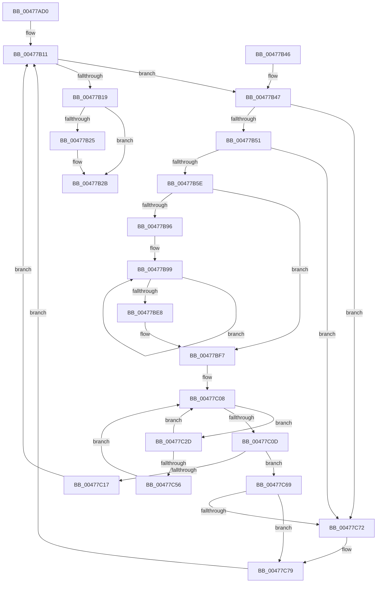

# PopPowerRequestCallbackWorker

- RVA: `0x00477AD0`–`0x00477C94` (길이 `452` bytes)
- VA: `0x0000000140477AD0`
- 실행 섹션: `.text`
- PDB 이름 있음: `예`; PDB Function 태그: `아니요`
- unwind 정보 RVA: `0x000ACD08`
- 디코드: `126`개 명령, `452/452` bytes 표시
- 미해석 바이트: `0` (있으면 어셈블리에 `.byte`로 보존)

> 이 문서는 커널 이미지의 기계어와 PDB 기호를 분석해 생성했습니다. 4번과 5번은 함수 원형과 자료형을 바이너리 사용 방식에서 추정한 C 해석이며 원본 소스 복구 결과는 아닙니다.

## 1. Dependencies

- 직접 호출 지점: **10**; 고유 호출 대상: **8**
- 직접 호출자로 확인된 함수: **3**
- RIP 상대 이미지 참조: **4**

### Outgoing calls
- `0x00477B03` → [KeAcquireInStackQueuedSpinLock](../27/KeAcquireInStackQueuedSpinLock_function_002757A0.md) (function, `0x002757A0`)
- `0x00477B30` → [KeReleaseInStackQueuedSpinLock](../34/KeReleaseInStackQueuedSpinLock_function_00342CE0.md) (function, `0x00342CE0`)
- `0x00477B89` → [KeReleaseInStackQueuedSpinLock](../34/KeReleaseInStackQueuedSpinLock_function_00342CE0.md) (function, `0x00342CE0`)
- `0x00477BBF` → [PopAcquirePowerRequestPushLock](../../page/A6/PopAcquirePowerRequestPushLock_function_00A66D94.md) (function, `0x00A66D94`)
- `0x00477BCC` → [PopPowerRequestStatsSetActive](../../page/A7/PopPowerRequestStatsSetActive_function_00A7DAC0.md) (function, `0x00A7DAC0`)
- `0x00477BD9` → [PopPowerRequestHandleRequestUpdate](../../page/A6/PopPowerRequestHandleRequestUpdate_function_00A652D8.md) (function, `0x00A652D8`)
- `0x00477BDE` → [PopReleasePowerRequestPushLock](../../page/A7/PopReleasePowerRequestPushLock_function_00A712DC.md) (function, `0x00A712DC`)
- `0x00477C03` → [KeAcquireInStackQueuedSpinLock](../27/KeAcquireInStackQueuedSpinLock_function_002757A0.md) (function, `0x002757A0`)
- `0x00477C23` → [ObfDereferenceObjectWithTag](../2F/ObfDereferenceObjectWithTag_function_002F78E0.md) (function, `0x002F78E0`)
- `0x00477C62` → [KeSetEvent](../33/KeSetEvent_function_0033F310.md) (function, `0x0033F310`)

### Direct callers
- [PopPowerRequestReferenceRelease](PopPowerRequestReferenceRelease_function_004775B0.md) at `0x00477678`
- [PopPowerRequestReferenceAcquire](PopPowerRequestReferenceAcquire_function_004776C0.md) at `0x00477784`
- [PopPowerRequestHandleClose](PopPowerRequestHandleClose_function_00477894.md) at `0x004778FD`

### Static image references
- `0x00477AF0` → RVA `0x00F0ED30` (`.data`; read)
- `0x00477B0A` → RVA `0x00E019C0` (`.data`; read)
- `0x00477B19` → RVA `0x00F0ED60` (`.data`; read)
- `0x00477B25` → RVA `0x00F0EDA0` (`.data`; read/write)

## 2. Other-region calls and transfers

- 다른 실행 섹션으로 향하는 call: **4**
  - `0x00477BBF` → [PopAcquirePowerRequestPushLock](../../page/A6/PopAcquirePowerRequestPushLock_function_00A66D94.md) (`.text` → `PAGE`)
  - `0x00477BCC` → [PopPowerRequestStatsSetActive](../../page/A7/PopPowerRequestStatsSetActive_function_00A7DAC0.md) (`.text` → `PAGE`)
  - `0x00477BD9` → [PopPowerRequestHandleRequestUpdate](../../page/A6/PopPowerRequestHandleRequestUpdate_function_00A652D8.md) (`.text` → `PAGE`)
  - `0x00477BDE` → [PopReleasePowerRequestPushLock](../../page/A7/PopReleasePowerRequestPushLock_function_00A712DC.md) (`.text` → `PAGE`)
- 별도 외부 분기/꼬리 이동을 확인하지 못했습니다.

## 3. Assembly (complete function range)

```asm
00477AD0  48 89 4C 24 08                  mov qword ptr [rsp + 8], rcx
00477AD5  53                              push rbx
00477AD6  55                              push rbp
00477AD7  56                              push rsi
00477AD8  57                              push rdi
00477AD9  41 54                           push r12
00477ADB  41 55                           push r13
00477ADD  41 56                           push r14
00477ADF  41 57                           push r15
00477AE1  48 83 EC 48                     sub rsp, 0x48
00477AE5  4C 8B F1                        mov r14, rcx
00477AE8  48 8D 54 24 20                  lea rdx, [rsp + 0x20]
00477AED  0F 57 C0                        xorps xmm0, xmm0
00477AF0  48 8D 0D 39 72 A9 00            lea rcx, [rip + 0xa97239]
00477AF7  33 C0                           xor eax, eax
00477AF9  0F 11 44 24 20                  movups xmmword ptr [rsp + 0x20], xmm0
00477AFE  48 89 44 24 30                  mov qword ptr [rsp + 0x30], rax
00477B03  E8 98 DC DF FF                  call 0x1402757a0
00477B08  33 ED                           xor ebp, ebp
00477B0A  48 8D 3D AF 9E 98 00            lea rdi, [rip + 0x989eaf]
00477B11  49 8B 36                        mov rsi, qword ptr [r14]
00477B14  49 3B F6                        cmp rsi, r14
00477B17  75 2E                           jne 0x140477b47
00477B19  48 8D 05 40 72 A9 00            lea rax, [rip + 0xa97240]
00477B20  4C 3B F0                        cmp r14, rax
00477B23  75 06                           jne 0x140477b2b
00477B25  87 2D 75 72 A9 00               xchg dword ptr [rip + 0xa97275], ebp
00477B2B  48 8D 4C 24 20                  lea rcx, [rsp + 0x20]
00477B30  E8 AB B1 EC FF                  call 0x140342ce0
00477B35  48 83 C4 48                     add rsp, 0x48
00477B39  41 5F                           pop r15
00477B3B  41 5E                           pop r14
00477B3D  41 5D                           pop r13
00477B3F  41 5C                           pop r12
00477B41  5F                              pop rdi
00477B42  5E                              pop rsi
00477B43  5D                              pop rbp
00477B44  5B                              pop rbx
00477B45  C3                              ret
00477B46  CC                              int3
00477B47  4C 39 76 08                     cmp qword ptr [rsi + 8], r14
00477B4B  0F 85 21 01 00 00               jne 0x140477c72
00477B51  48 8B 06                        mov rax, qword ptr [rsi]
00477B54  48 39 70 08                     cmp qword ptr [rax + 8], rsi
00477B58  0F 85 14 01 00 00               jne 0x140477c72
00477B5E  49 89 06                        mov qword ptr [r14], rax
00477B61  4C 8D 7E C0                     lea r15, [rsi - 0x40]
00477B65  4C 89 70 08                     mov qword ptr [rax + 8], r14
00477B69  48 8D 4C 24 20                  lea rcx, [rsp + 0x20]
00477B6E  48 89 76 08                     mov qword ptr [rsi + 8], rsi
00477B72  48 89 36                        mov qword ptr [rsi], rsi
00477B75  45 8B 67 54                     mov r12d, dword ptr [r15 + 0x54]
00477B79  41 8B 5F 50                     mov ebx, dword ptr [r15 + 0x50]
00477B7D  41 89 5F 54                     mov dword ptr [r15 + 0x54], ebx
00477B81  41 C7 47 58 02 00 00 00         mov dword ptr [r15 + 0x58], 2
00477B89  E8 52 B1 EC FF                  call 0x140342ce0
00477B8E  44 33 E3                        xor r12d, ebx
00477B91  45 8B EC                        mov r13d, r12d
00477B94  74 61                           je 0x140477bf7
00477B96  44 8B F3                        mov r14d, ebx
00477B99  41 0F BC FD                     bsf edi, r13d
00477B9D  41 B8 01 00 00 00               mov r8d, 1
00477BA3  8B CF                           mov ecx, edi
00477BA5  89 BC 24 A0 00 00 00            mov dword ptr [rsp + 0xa0], edi
00477BAC  41 D3 E0                        shl r8d, cl
00477BAF  B1 01                           mov cl, 1
00477BB1  41 8B C0                        mov eax, r8d
00477BB4  F7 D0                           not eax
00477BB6  44 23 E8                        and r13d, eax
00477BB9  45 85 C6                        test r14d, r8d
00477BBC  0F 95 C3                        setne bl
00477BBF  E8 D0 F1 5E 00                  call 0x140a66d94
00477BC4  44 8A C3                        mov r8b, bl
00477BC7  8B D7                           mov edx, edi
00477BC9  49 8B CF                        mov rcx, r15
00477BCC  E8 EF 5E 60 00                  call 0x140a7dac0
00477BD1  44 8A C3                        mov r8b, bl
00477BD4  8B D7                           mov edx, edi
00477BD6  49 8B CF                        mov rcx, r15
00477BD9  E8 FA D6 5E 00                  call 0x140a652d8
00477BDE  E8 F9 96 5F 00                  call 0x140a712dc
00477BE3  45 85 ED                        test r13d, r13d
00477BE6  75 B1                           jne 0x140477b99
00477BE8  4C 8B B4 24 90 00 00 00         mov r14, qword ptr [rsp + 0x90]
00477BF0  48 8D 3D C9 9D 98 00            lea rdi, [rip + 0x989dc9]
00477BF7  48 8D 54 24 20                  lea rdx, [rsp + 0x20]
00477BFC  48 8D 0D 2D 71 A9 00            lea rcx, [rip + 0xa9712d]
00477C03  E8 98 DB DF FF                  call 0x1402757a0
00477C08  45 85 E4                        test r12d, r12d
00477C0B  75 20                           jne 0x140477c2d
00477C0D  41 8B 47 54                     mov eax, dword ptr [r15 + 0x54]
00477C11  41 39 47 50                     cmp dword ptr [r15 + 0x50], eax
00477C15  75 52                           jne 0x140477c69
00477C17  BA 50 6F 50 72                  mov edx, 0x72506f50
00477C1C  41 89 6F 58                     mov dword ptr [r15 + 0x58], ebp
00477C20  49 8B CF                        mov rcx, r15
00477C23  E8 B8 FC E7 FF                  call 0x1402f78e0
00477C28  E9 E4 FE FF FF                  jmp 0x140477b11
00477C2D  41 0F BC CC                     bsf ecx, r12d
00477C31  B8 01 00 00 00                  mov eax, 1
00477C36  D3 E0                           shl eax, cl
00477C38  F7 D0                           not eax
00477C3A  89 8C 24 A8 00 00 00            mov dword ptr [rsp + 0xa8], ecx
00477C41  44 23 E0                        and r12d, eax
00477C44  48 63 C1                        movsxd rax, ecx
00477C47  48 8D 0C 40                     lea rcx, [rax + rax*2]
00477C4B  48 C1 E1 04                     shl rcx, 4
00477C4F  83 44 39 10 FF                  add dword ptr [rcx + rdi + 0x10], -1
00477C54  75 B2                           jne 0x140477c08
00477C56  48 83 C1 18                     add rcx, 0x18
00477C5A  45 33 C0                        xor r8d, r8d
00477C5D  48 03 CF                        add rcx, rdi
00477C60  33 D2                           xor edx, edx
00477C62  E8 A9 76 EC FF                  call 0x14033f310
00477C67  EB 9F                           jmp 0x140477c08
00477C69  49 8B 46 08                     mov rax, qword ptr [r14 + 8]
00477C6D  4C 39 30                        cmp qword ptr [rax], r14
00477C70  74 07                           je 0x140477c79
00477C72  B9 03 00 00 00                  mov ecx, 3
00477C77  CD 29                           int 0x29
00477C79  4C 89 36                        mov qword ptr [rsi], r14
00477C7C  48 89 46 08                     mov qword ptr [rsi + 8], rax
00477C80  48 89 30                        mov qword ptr [rax], rsi
00477C83  49 89 76 08                     mov qword ptr [r14 + 8], rsi
00477C87  41 C7 47 58 01 00 00 00         mov dword ptr [r15 + 0x58], 1
00477C8F  E9 7D FE FF FF                  jmp 0x140477b11
```

## 4. C-style interpretation (structured pseudocode)

```c
__int64 __fastcall PopPowerRequestCallbackWorker(__int64 a1)
{
    __int64 result;
    __int64 v_r12;
    __int64 v_r13;
    __int64 v_rbp;
    __int64 v_rbx;
    __int64 v_rsp;
    unsigned __int64 v_stack_m58;
    unsigned __int64 v_stack_m68;
    unsigned __int64 v_stack_p20;
    unsigned __int64 v_stack_p8;
    unsigned __int64 v_stack_p90;
    unsigned int v_stack_pA0;
    unsigned int v_stack_pA8;

    v_stack_p8 = a1;
    v_rsp = (v_rsp) - (72);
    result = 0;
    v_stack_m68 = v_xmm0;
    v_stack_m58 = 0;
    result = KeAcquireInStackQueuedSpinLock(v_rip + 11104825, v_stack_m68, a3, a4);
    v_rbp = 0;
loc_00477B11:
    if ((*(unsigned __int64 *)(a1)) != a1) goto loc_00477B47;
    if (a1 == (v_rip + 11104832)) {
    }
    result = KeReleaseInStackQueuedSpinLock(v_stack_m68, v_stack_m68, a3, a4);
    v_rsp = (v_rsp) + (72);
    return result;
loc_00477B47:
    if ((*(unsigned __int64 *)(*(unsigned __int64 *)(a1) + 8)) != a1) goto loc_00477C72;
    if ((*(unsigned __int64 *)(*(unsigned __int64 *)(*(unsigned __int64 *)(a1)) + 8)) != (*(unsigned __int64 *)(a1))) goto loc_00477C72;
    *(unsigned __int64 *)(a1) = *(unsigned __int64 *)(*(unsigned __int64 *)(a1));
    *(unsigned __int64 *)(*(unsigned __int64 *)(*(unsigned __int64 *)(a1)) + 8) = a1;
    *(unsigned __int64 *)(*(unsigned __int64 *)(a1) + 8) = *(unsigned __int64 *)(a1);
    *(unsigned __int64 *)(*(unsigned __int64 *)(a1)) = *(unsigned __int64 *)(a1);
    *(unsigned int *)(*(unsigned __int64 *)(a1) - 64 + 84) = (unsigned int)((unsigned int)(*(unsigned int *)(*(unsigned __int64 *)(a1) - 64 + 80)));
    *(unsigned int *)(*(unsigned __int64 *)(a1) - 64 + 88) = 2;
    result = KeReleaseInStackQueuedSpinLock(v_stack_p20, v_stack_m68, a3, a4);
    v_r12 = (unsigned int)(((unsigned int)(*(unsigned int *)(*(unsigned __int64 *)(a1) - 64 + 84))) ^ ((unsigned int)((unsigned int)(*(unsigned int *)(*(unsigned __int64 *)(a1) - 64 + 80)))));
    if (condition_is_equal) goto loc_00477BF7;
loc_00477B99:
    v_stack_pA0 = (unsigned int)(v_rip + 10002095);
    a3 = (unsigned int)((1) << ((unsigned __int8)((unsigned int)((unsigned int)(v_rip + 10002095)))));
    result = (unsigned int)(~((unsigned int)((unsigned int)(a3))));
    v_r13 = (unsigned int)(((unsigned int)((unsigned int)(v_r12))) & ((unsigned int)(result)));
    v_rbx = ((((unsigned int)((unsigned int)((unsigned int)((unsigned int)(*(unsigned int *)(*(unsigned __int64 *)(a1) - 64 + 80)))))) & ((unsigned int)(a3))) != 0) ? 1 : 0;
    result = PopAcquirePowerRequestPushLock(1, v_stack_m68, a3, a4);
    result = PopPowerRequestStatsSetActive(*(unsigned __int64 *)(a1) - 64, (unsigned int)((unsigned int)(v_rip + 10002095)), (unsigned __int8)(v_rbx), a4);
    result = PopPowerRequestHandleRequestUpdate(*(unsigned __int64 *)(a1) - 64, (unsigned int)((unsigned int)(v_rip + 10002095)), (unsigned __int8)(v_rbx), a4);
    result = PopReleasePowerRequestPushLock(*(unsigned __int64 *)(a1) - 64, (unsigned int)((unsigned int)(v_rip + 10002095)), (unsigned __int8)(v_rbx), a4);
    if ((unsigned int)(v_r13) != 0) goto loc_00477B99;
loc_00477BF7:
    result = KeAcquireInStackQueuedSpinLock(v_rip + 11104557, v_stack_p20, (unsigned __int8)(v_rbx), a4);
loc_00477C08:
    if ((unsigned int)(v_r12) != 0) goto loc_00477C2D;
    if ((*(unsigned int *)(*(unsigned __int64 *)(a1) - 64 + 80)) != ((unsigned int)((unsigned int)(*(unsigned int *)(*(unsigned __int64 *)(a1) - 64 + 84))))) goto loc_00477C69;
    *(unsigned int *)(*(unsigned __int64 *)(a1) - 64 + 88) = 0;
    result = ObfDereferenceObjectWithTag(*(unsigned __int64 *)(a1) - 64, (unsigned int)(0x72506F50ULL), (unsigned __int8)(v_rbx), a4);
    goto loc_00477B11;
loc_00477C2D:
    result = (unsigned int)((1) << ((unsigned __int8)(*(unsigned __int64 *)(a1) - 64)));
    result = (unsigned int)(~(result));
    v_stack_pA8 = (unsigned int)(*(unsigned __int64 *)(a1) - 64);
    v_r12 = (unsigned int)((v_r12) & ((unsigned int)(result)));
    a1 = ((int)((unsigned int)(*(unsigned __int64 *)(a1) - 64)) + (int)((unsigned int)(*(unsigned __int64 *)(a1) - 64)) * 2) << (4);
    if (condition_is_not_equal) goto loc_00477C08;
    a1 = (a1) + (24);
    a3 = 0;
    a1 = (a1) + (v_rip + 10001865);
    a2 = 0;
    result = KeSetEvent(a1, a2, a3, a4);
    goto loc_00477C08;
loc_00477C69:
    if ((*(unsigned __int64 *)(*(unsigned __int64 *)(v_stack_p90 + 8))) != v_stack_p90) {
        a1 = 3;
    }
    *(unsigned __int64 *)(*(unsigned __int64 *)(a1)) = v_stack_p90;
    *(unsigned __int64 *)(*(unsigned __int64 *)(a1) + 8) = *(unsigned __int64 *)(v_stack_p90 + 8);
    *(unsigned __int64 *)(*(unsigned __int64 *)(v_stack_p90 + 8)) = *(unsigned __int64 *)(a1);
    *(unsigned __int64 *)(v_stack_p90 + 8) = *(unsigned __int64 *)(a1);
    *(unsigned int *)(*(unsigned __int64 *)(a1) - 64 + 88) = 1;
    goto loc_00477B11;
}
```

## 5. (Beta) C Style

```c
int64_t PopPowerRequestCallbackWorker(int64_t Arg1)
{
    int64_t result;
    int64_t local_r12;
    int64_t local_r13;
    int64_t local_rbp;
    int64_t local_rbx;
    int64_t local_rsp;
    uint64_t v_stack_m58;
    uint64_t v_stack_m68;
    uint64_t v_stack_p20;
    uint64_t v_stack_p8;
    uint64_t v_stack_p90;
    uint32_t v_stack_pA0;
    uint32_t v_stack_pA8;

    v_stack_p8 = Arg1;
    local_rsp = (local_rsp) - (72);
    result = 0;
    v_stack_m68 = v_xmm0;
    v_stack_m58 = 0;
    result = KeAcquireInStackQueuedSpinLock(v_rip + 11104825, v_stack_m68, a3, a4);
    local_rbp = 0;
loc_00477B11:
    if ((*(uint64_t *)(Arg1)) != Arg1) goto loc_00477B47;
    if (Arg1 == (v_rip + 11104832)) {
    }
    result = KeReleaseInStackQueuedSpinLock(v_stack_m68, v_stack_m68, a3, a4);
    local_rsp = (local_rsp) + (72);
    return result;
loc_00477B47:
    if ((*(uint64_t *)(*(uint64_t *)(Arg1) + 0x8)) != Arg1) goto loc_00477C72;
    if ((*(uint64_t *)(*(uint64_t *)(*(uint64_t *)(Arg1)) + 0x8)) != (*(uint64_t *)(Arg1))) goto loc_00477C72;
    *(uint64_t *)(Arg1) = *(uint64_t *)(*(uint64_t *)(Arg1));
    *(uint64_t *)(*(uint64_t *)(*(uint64_t *)(Arg1)) + 0x8) = Arg1;
    *(uint64_t *)(*(uint64_t *)(Arg1) + 0x8) = *(uint64_t *)(Arg1);
    *(uint64_t *)(*(uint64_t *)(Arg1)) = *(uint64_t *)(Arg1);
    *(uint32_t *)(*(uint64_t *)(Arg1) - 0x40 + 0x54) = (uint32_t)((uint32_t)(*(uint32_t *)(*(uint64_t *)(Arg1) - 0x40 + 0x50)));
    *(uint32_t *)(*(uint64_t *)(Arg1) - 0x40 + 0x58) = 2;
    result = KeReleaseInStackQueuedSpinLock(v_stack_p20, v_stack_m68, a3, a4);
    local_r12 = (uint32_t)(((uint32_t)(*(uint32_t *)(*(uint64_t *)(Arg1) - 0x40 + 0x54))) ^ ((uint32_t)((uint32_t)(*(uint32_t *)(*(uint64_t *)(Arg1) - 0x40 + 0x50)))));
    if (condition_is_equal) goto loc_00477BF7;
loc_00477B99:
    v_stack_pA0 = (uint32_t)(v_rip + 10002095);
    a3 = (uint32_t)((1) << ((uint8_t)((uint32_t)((uint32_t)(v_rip + 10002095)))));
    result = (uint32_t)(~((uint32_t)((uint32_t)(a3))));
    local_r13 = (uint32_t)(((uint32_t)((uint32_t)(local_r12))) & ((uint32_t)(result)));
    local_rbx = ((((uint32_t)((uint32_t)((uint32_t)((uint32_t)(*(uint32_t *)(*(uint64_t *)(Arg1) - 0x40 + 0x50)))))) & ((uint32_t)(a3))) != 0) ? 1 : 0;
    result = PopAcquirePowerRequestPushLock(1, v_stack_m68, a3, a4);
    result = PopPowerRequestStatsSetActive(*(uint64_t *)(Arg1) - 64, (uint32_t)((uint32_t)(v_rip + 10002095)), (uint8_t)(local_rbx), a4);
    result = PopPowerRequestHandleRequestUpdate(*(uint64_t *)(Arg1) - 64, (uint32_t)((uint32_t)(v_rip + 10002095)), (uint8_t)(local_rbx), a4);
    result = PopReleasePowerRequestPushLock(*(uint64_t *)(Arg1) - 64, (uint32_t)((uint32_t)(v_rip + 10002095)), (uint8_t)(local_rbx), a4);
    if ((uint32_t)(local_r13) != 0) goto loc_00477B99;
loc_00477BF7:
    result = KeAcquireInStackQueuedSpinLock(v_rip + 11104557, v_stack_p20, (uint8_t)(local_rbx), a4);
loc_00477C08:
    if ((uint32_t)(local_r12) != 0) goto loc_00477C2D;
    if ((*(uint32_t *)(*(uint64_t *)(Arg1) - 0x40 + 0x50)) != ((uint32_t)((uint32_t)(*(uint32_t *)(*(uint64_t *)(Arg1) - 0x40 + 0x54))))) goto loc_00477C69;
    *(uint32_t *)(*(uint64_t *)(Arg1) - 0x40 + 0x58) = 0;
    result = ObfDereferenceObjectWithTag(*(uint64_t *)(Arg1) - 64, (uint32_t)(0x72506F50ULL), (uint8_t)(local_rbx), a4);
    goto loc_00477B11;
loc_00477C2D:
    result = (uint32_t)((1) << ((uint8_t)(*(uint64_t *)(Arg1) - 64)));
    result = (uint32_t)(~(result));
    v_stack_pA8 = (uint32_t)(*(uint64_t *)(Arg1) - 64);
    local_r12 = (uint32_t)((local_r12) & ((uint32_t)(result)));
    Arg1 = ((int32_t)((uint32_t)(*(uint64_t *)(Arg1) - 64)) + (int32_t)((uint32_t)(*(uint64_t *)(Arg1) - 64)) * 2) << (4);
    if (condition_is_not_equal) goto loc_00477C08;
    Arg1 = (Arg1) + (24);
    a3 = 0;
    Arg1 = (Arg1) + (v_rip + 10001865);
    a2 = 0;
    result = KeSetEvent(Arg1, a2, a3, a4);
    goto loc_00477C08;
loc_00477C69:
    if ((*(uint64_t *)(*(uint64_t *)(v_stack_p90 + 0x8))) != v_stack_p90) {
        Arg1 = 3;
    }
    *(uint64_t *)(*(uint64_t *)(Arg1)) = v_stack_p90;
    *(uint64_t *)(*(uint64_t *)(Arg1) + 0x8) = *(uint64_t *)(v_stack_p90 + 0x8);
    *(uint64_t *)(*(uint64_t *)(v_stack_p90 + 0x8)) = *(uint64_t *)(Arg1);
    *(uint64_t *)(v_stack_p90 + 0x8) = *(uint64_t *)(Arg1);
    *(uint32_t *)(*(uint64_t *)(Arg1) - 0x40 + 0x58) = 1;
    goto loc_00477B11;
}
```

## 6. Execution-region graph

[열기: 2D/3D 그래프와 함수 탐색 컨트롤 패널](../../../control-panel.html?section=text&rva=0x00477AD0&view=graph)

- 2D 그래프는 위에서 아래로 흐르고, 3D 그래프는 빈 공간을 드래그해 회전합니다. Shift+드래그는 이동, 휠은 확대·축소, 함수 노드 선택은 대상 보고서 이동입니다.

### Static fallback


