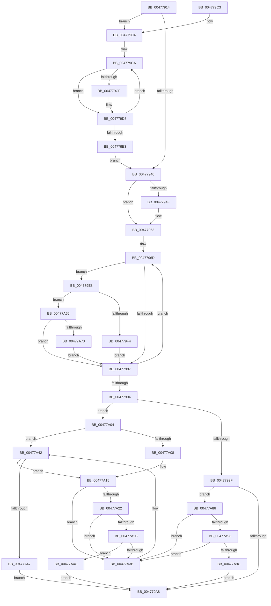

# PopPowerRequestEvaluatePendingRequestStatus

- RVA: `0x00477914`–`0x00477AC0` (길이 `428` bytes)
- VA: `0x0000000140477914`
- 실행 섹션: `.text`
- PDB 이름 있음: `예`; PDB Function 태그: `아니요`
- unwind 정보 RVA: `0x000ACCEC`
- 디코드: `127`개 명령, `428/428` bytes 표시
- 미해석 바이트: `0` (있으면 어셈블리에 `.byte`로 보존)

> 이 문서는 커널 이미지의 기계어와 PDB 기호를 분석해 생성했습니다. 4번과 5번은 함수 원형과 자료형을 바이너리 사용 방식에서 추정한 C 해석이며 원본 소스 복구 결과는 아닙니다.

## 1. Dependencies

- 직접 호출 지점: **4**; 고유 호출 대상: **4**
- 직접 호출자로 확인된 함수: **7**
- RIP 상대 이미지 참조: **3**

### Outgoing calls
- `0x004779FD` → [KeResetEvent](../24/KeResetEvent_function_00248350.md) (function, `0x00248350`)
- `0x00477A10` → [ObfReferenceObjectWithTag](../21/ObfReferenceObjectWithTag_function_00210710.md) (function, `0x00210710`)
- `0x00477A7C` → [KeSetEvent](../33/KeSetEvent_function_0033F310.md) (function, `0x0033F310`)
- `0x00477AB6` → [ObfDereferenceObjectWithTag](../2F/ObfDereferenceObjectWithTag_function_002F78E0.md) (function, `0x002F78E0`)

### Direct callers
- [PopApplyLegacyPowerRequestFlags](PopApplyLegacyPowerRequestFlags_function_00477364.md) at `0x00477470`
- [PopPowerRequestReferenceRelease](PopPowerRequestReferenceRelease_function_004775B0.md) at `0x0047764E`
- [PopPowerRequestReferenceAcquire](PopPowerRequestReferenceAcquire_function_004776C0.md) at `0x0047775A`
- [PopPowerRequestHandleRequestOverrideQueryResponse](PopPowerRequestHandleRequestOverrideQueryResponse_function_004777FC.md) at `0x0047784A`
- [PopPowerRequestHandleClose](PopPowerRequestHandleClose_function_00477894.md) at `0x004778DC`
- [PopPowerRequestRevokeRequests](../4C/PopPowerRequestRevokeRequests_function_004C0158.md) at `0x004C0224`
- [sub_006FCB58](../6F/Unknown_function_006FCB58.md) at `0x006FCB5D`

### Static image references
- `0x00477930` → RVA `0x00F0ED60` (`.data`; read)
- `0x00477955` → RVA `0x00F0EE28` (`.data`; read)
- `0x00477966` → RVA `0x00E019D0` (`.data`; read)

## 2. Other-region calls and transfers

- 다른 실행 섹션으로 향하는 call: **0**
- 별도 외부 분기/꼬리 이동을 확인하지 못했습니다.

## 3. Assembly (complete function range)

```asm
00477914  48 8B C4                        mov rax, rsp
00477917  48 89 58 08                     mov qword ptr [rax + 8], rbx
0047791B  48 89 68 10                     mov qword ptr [rax + 0x10], rbp
0047791F  48 89 70 18                     mov qword ptr [rax + 0x18], rsi
00477923  48 89 78 20                     mov qword ptr [rax + 0x20], rdi
00477927  41 56                           push r14
00477929  48 83 EC 20                     sub rsp, 0x20
0047792D  48 85 D2                        test rdx, rdx
00477930  48 8D 2D 29 74 A9 00            lea rbp, [rip + 0xa97429]
00477937  48 8B D9                        mov rbx, rcx
0047793A  48 0F 45 EA                     cmovne rbp, rdx
0047793E  33 F6                           xor esi, esi
00477940  40 38 71 20                     cmp byte ptr [rcx + 0x20], sil
00477944  74 7E                           je 0x1404779c4
00477946  80 BB 98 00 00 00 00            cmp byte ptr [rbx + 0x98], 0
0047794D  75 14                           jne 0x140477963
0047794F  8B 4B 1C                        mov ecx, dword ptr [rbx + 0x1c]
00477952  0B 4B 18                        or ecx, dword ptr [rbx + 0x18]
00477955  8B 05 CD 74 A9 00               mov eax, dword ptr [rip + 0xa974cd]
0047795B  F7 D1                           not ecx
0047795D  F7 D0                           not eax
0047795F  23 C8                           and ecx, eax
00477961  23 F1                           and esi, ecx
00477963  45 33 F6                        xor r14d, r14d
00477966  48 8D 3D 63 A0 98 00            lea rdi, [rip + 0x98a063]
0047796D  8B 43 50                        mov eax, dword ptr [rbx + 0x50]
00477970  41 8B CE                        mov ecx, r14d
00477973  BA 01 00 00 00                  mov edx, 1
00477978  D3 E2                           shl edx, cl
0047797A  44 8B C2                        mov r8d, edx
0047797D  23 C2                           and eax, edx
0047797F  44 23 C6                        and r8d, esi
00477982  41 3B C0                        cmp eax, r8d
00477985  75 61                           jne 0x1404779e8
00477987  41 FF C6                        inc r14d
0047798A  48 83 C7 30                     add rdi, 0x30
0047798E  41 83 FE 06                     cmp r14d, 6
00477992  72 D9                           jb 0x14047796d
00477994  8B 4B 58                        mov ecx, dword ptr [rbx + 0x58]
00477997  89 73 50                        mov dword ptr [rbx + 0x50], esi
0047799A  3B 73 54                        cmp esi, dword ptr [rbx + 0x54]
0047799D  75 65                           jne 0x140477a04
0047799F  83 F9 01                        cmp ecx, 1
004779A2  0F 84 DE 00 00 00               je 0x140477a86
004779A8  48 8B 5C 24 30                  mov rbx, qword ptr [rsp + 0x30]
004779AD  48 8B 6C 24 38                  mov rbp, qword ptr [rsp + 0x38]
004779B2  48 8B 74 24 40                  mov rsi, qword ptr [rsp + 0x40]
004779B7  48 8B 7C 24 48                  mov rdi, qword ptr [rsp + 0x48]
004779BC  48 83 C4 20                     add rsp, 0x20
004779C0  41 5E                           pop r14
004779C2  C3                              ret
004779C3  CC                              int3
004779C4  33 C9                           xor ecx, ecx
004779C6  48 8D 53 28                     lea rdx, [rbx + 0x28]
004779CA  83 3A 00                        cmp dword ptr [rdx], 0
004779CD  74 09                           je 0x1404779d8
004779CF  B8 01 00 00 00                  mov eax, 1
004779D4  D3 E0                           shl eax, cl
004779D6  0B F0                           or esi, eax
004779D8  FF C1                           inc ecx
004779DA  48 83 C2 04                     add rdx, 4
004779DE  83 F9 06                        cmp ecx, 6
004779E1  72 E7                           jb 0x1404779ca
004779E3  E9 5E FF FF FF                  jmp 0x140477946
004779E8  8B 43 54                        mov eax, dword ptr [rbx + 0x54]
004779EB  8B 0F                           mov ecx, dword ptr [rdi]
004779ED  23 C2                           and eax, edx
004779EF  41 3B C0                        cmp eax, r8d
004779F2  74 72                           je 0x140477a66
004779F4  8D 41 01                        lea eax, [rcx + 1]
004779F7  48 8D 4F 08                     lea rcx, [rdi + 8]
004779FB  89 07                           mov dword ptr [rdi], eax
004779FD  E8 4E 09 DD FF                  call 0x140248350
00477A02  EB 83                           jmp 0x140477987
00477A04  85 C9                           test ecx, ecx
00477A06  75 3A                           jne 0x140477a42
00477A08  BA 50 6F 50 72                  mov edx, 0x72506f50
00477A0D  48 8B CB                        mov rcx, rbx
00477A10  E8 FB 8C D9 FF                  call 0x140210710
00477A15  48 8D 43 40                     lea rax, [rbx + 0x40]
00477A19  48 8B 10                        mov rdx, qword ptr [rax]
00477A1C  48 39 42 08                     cmp qword ptr [rdx + 8], rax
00477A20  75 19                           jne 0x140477a3b
00477A22  48 8B 48 08                     mov rcx, qword ptr [rax + 8]
00477A26  48 39 01                        cmp qword ptr [rcx], rax
00477A29  75 10                           jne 0x140477a3b
00477A2B  48 89 11                        mov qword ptr [rcx], rdx
00477A2E  48 89 4A 08                     mov qword ptr [rdx + 8], rcx
00477A32  48 8B 4D 08                     mov rcx, qword ptr [rbp + 8]
00477A36  48 39 29                        cmp qword ptr [rcx], rbp
00477A39  74 11                           je 0x140477a4c
00477A3B  B9 03 00 00 00                  mov ecx, 3
00477A40  CD 29                           int 0x29
00477A42  83 F9 01                        cmp ecx, 1
00477A45  74 CE                           je 0x140477a15
00477A47  E9 5C FF FF FF                  jmp 0x1404779a8
00477A4C  48 89 28                        mov qword ptr [rax], rbp
00477A4F  48 89 48 08                     mov qword ptr [rax + 8], rcx
00477A53  48 89 01                        mov qword ptr [rcx], rax
00477A56  48 89 45 08                     mov qword ptr [rbp + 8], rax
00477A5A  C7 43 58 01 00 00 00            mov dword ptr [rbx + 0x58], 1
00477A61  E9 42 FF FF FF                  jmp 0x1404779a8
00477A66  8D 41 FF                        lea eax, [rcx - 1]
00477A69  89 07                           mov dword ptr [rdi], eax
00477A6B  85 C0                           test eax, eax
00477A6D  0F 85 14 FF FF FF               jne 0x140477987
00477A73  48 8D 4F 08                     lea rcx, [rdi + 8]
00477A77  45 33 C0                        xor r8d, r8d
00477A7A  33 D2                           xor edx, edx
00477A7C  E8 8F 78 EC FF                  call 0x14033f310
00477A81  E9 01 FF FF FF                  jmp 0x140477987
00477A86  48 8D 43 40                     lea rax, [rbx + 0x40]
00477A8A  48 8B 08                        mov rcx, qword ptr [rax]
00477A8D  48 39 41 08                     cmp qword ptr [rcx + 8], rax
00477A91  75 A8                           jne 0x140477a3b
00477A93  48 8B 50 08                     mov rdx, qword ptr [rax + 8]
00477A97  48 39 02                        cmp qword ptr [rdx], rax
00477A9A  75 9F                           jne 0x140477a3b
00477A9C  48 89 0A                        mov qword ptr [rdx], rcx
00477A9F  48 89 51 08                     mov qword ptr [rcx + 8], rdx
00477AA3  BA 50 6F 50 72                  mov edx, 0x72506f50
00477AA8  48 89 40 08                     mov qword ptr [rax + 8], rax
00477AAC  48 8B CB                        mov rcx, rbx
00477AAF  48 89 00                        mov qword ptr [rax], rax
00477AB2  83 63 58 00                     and dword ptr [rbx + 0x58], 0
00477AB6  E8 25 FE E7 FF                  call 0x1402f78e0
00477ABB  E9 E8 FE FF FF                  jmp 0x1404779a8
```

## 4. C-style interpretation (structured pseudocode)

```c
__int64 __fastcall PopPowerRequestEvaluatePendingRequestStatus(__int64 a1, __int64 a2)
{
    __int64 result;
    __int64 v_r14;
    __int64 v_rbp;
    __int64 v_rdi;
    __int64 v_rsi;
    __int64 v_rsp;
    unsigned __int64 v_stack_p10;
    unsigned __int64 v_stack_p18;
    unsigned __int64 v_stack_p20;
    unsigned __int64 v_stack_p8;

    *(unsigned __int64 *)(v_rsp + 8) = v_rbx;
    *(unsigned __int64 *)(v_rsp + 16) = v_rbp;
    *(unsigned __int64 *)(v_rsp + 24) = v_rsi;
    *(unsigned __int64 *)(v_rsp + 32) = v_rdi;
    v_rsp = (v_rsp) - (32);
    v_rbp = v_rip + 11105321;
    if (a2 != 0) { v_rbp = a2; }
    v_rsi = 0;
    if ((*(unsigned __int8 *)(a1 + 32)) == 0) goto loc_004779C4;
loc_00477946:
    result = v_rsp;
    if ((*(unsigned __int8 *)(a1 + 152)) == 0) {
        a1 = *(unsigned int *)(a1 + 28);
        a1 = (unsigned int)((a1) | (*(unsigned int *)(a1 + 24)));
        result = *(unsigned int *)(v_rip + 11105485);
        a1 = (unsigned int)(~(a1));
        result = (unsigned int)(~(result));
        a1 = (unsigned int)((a1) & ((unsigned int)(result)));
        v_rsi = (unsigned int)((v_rsi) & ((unsigned int)(a1)));
    }
    v_r14 = 0;
loc_0047796D:
    a2 = (unsigned int)((1) << (0));
    result = (unsigned int)(((unsigned int)(*(unsigned int *)(a1 + 80))) & ((unsigned int)(a2)));
    a3 = (unsigned int)(((unsigned int)((unsigned int)(a2))) & ((unsigned int)(v_rsi)));
    if (((unsigned int)(result)) != ((unsigned int)(a3))) goto loc_004779E8;
loc_00477987:
    v_r14 = (unsigned int)((v_r14) + 1);
    v_rdi = (v_rip + 10002531) + (48);
    if (((unsigned int)(v_r14)) < 6) goto loc_0047796D;
    *(unsigned int *)(a1 + 80) = (unsigned int)(v_rsi);
    if (((unsigned int)(v_rsi)) != (*(unsigned int *)(a1 + 84))) goto loc_00477A04;
    if (((unsigned int)((unsigned int)(*(unsigned int *)(a1 + 88)))) == 1) goto loc_00477A86;
loc_004779A8:
    v_rsp = (v_rsp) + (32);
    return result;
loc_004779C4:
    a1 = 0;
loc_004779CA:
    v_rsi = v_stack_p18;
    if ((*(unsigned int *)(v_stack_p8 + 40)) != 0) {
        result = 1;
        result = (unsigned int)((result) << (0));
        v_rsi = (unsigned int)((v_stack_p18) | ((unsigned int)(result)));
    }
    a1 = (unsigned int)((a1) + 1);
    a2 = (v_stack_p8 + 40) + (4);
    if (((unsigned int)(a1)) < 6) goto loc_004779CA;
    goto loc_00477946;
loc_004779E8:
    result = (unsigned int)(((unsigned int)(*(unsigned int *)(v_stack_p8 + 84))) & ((unsigned int)(a2)));
    if (((unsigned int)(result)) == ((unsigned int)(a3))) goto loc_00477A66;
    *(unsigned int *)(v_stack_p20) = (unsigned int)((unsigned int)(*(unsigned int *)(v_stack_p20)) + 1);
    result = KeResetEvent(v_stack_p20 + 8, a2, a3, a4);
    goto loc_00477987;
loc_00477A04:
    if ((unsigned int)(v_stack_p20 + 8) != 0) goto loc_00477A42;
    result = ObfReferenceObjectWithTag(v_stack_p8, (unsigned int)(0x72506F50ULL), a3, a4);
loc_00477A15:
    if ((*(unsigned __int64 *)(*(unsigned __int64 *)(v_stack_p8 + 64) + 8)) != (v_stack_p8 + 64)) goto loc_00477A3B;
    if ((*(unsigned __int64 *)(*(unsigned __int64 *)(v_stack_p8 + 64 + 8))) != (v_stack_p8 + 64)) goto loc_00477A3B;
    *(unsigned __int64 *)(*(unsigned __int64 *)(v_stack_p8 + 64 + 8)) = *(unsigned __int64 *)(v_stack_p8 + 64);
    *(unsigned __int64 *)(*(unsigned __int64 *)(v_stack_p8 + 64) + 8) = *(unsigned __int64 *)(v_stack_p8 + 64 + 8);
    if ((*(unsigned __int64 *)(*(unsigned __int64 *)(v_stack_p10 + 8))) == v_stack_p10) goto loc_00477A4C;
loc_00477A3B:
loc_00477A42:
    if (3 == 1) goto loc_00477A15;
    goto loc_004779A8;
loc_00477A4C:
    *(unsigned __int64 *)(v_stack_p8 + 64) = v_stack_p10;
    *(unsigned __int64 *)(v_stack_p8 + 64 + 8) = 3;
    *(unsigned __int64 *)(3) = v_stack_p8 + 64;
    *(unsigned __int64 *)(v_stack_p10 + 8) = v_stack_p8 + 64;
    *(unsigned int *)(v_stack_p8 + 88) = 1;
    goto loc_004779A8;
loc_00477A66:
    *(unsigned int *)(v_stack_p20) = (unsigned int)(3 - 1);
    if ((unsigned int)(3 - 1) != 0) goto loc_00477987;
    a3 = 0;
    a2 = 0;
    result = KeSetEvent(v_stack_p20 + 8, a2, a3, a4);
    goto loc_00477987;
loc_00477A86:
    if ((*(unsigned __int64 *)(*(unsigned __int64 *)(v_stack_p8 + 64) + 8)) != (v_stack_p8 + 64)) goto loc_00477A3B;
    if ((*(unsigned __int64 *)(*(unsigned __int64 *)(v_stack_p8 + 64 + 8))) != (v_stack_p8 + 64)) goto loc_00477A3B;
    *(unsigned __int64 *)(*(unsigned __int64 *)(v_stack_p8 + 64 + 8)) = *(unsigned __int64 *)(v_stack_p8 + 64);
    *(unsigned __int64 *)(*(unsigned __int64 *)(v_stack_p8 + 64) + 8) = *(unsigned __int64 *)(v_stack_p8 + 64 + 8);
    *(unsigned __int64 *)(v_stack_p8 + 64 + 8) = v_stack_p8 + 64;
    *(unsigned __int64 *)(v_stack_p8 + 64) = v_stack_p8 + 64;
    result = ObfDereferenceObjectWithTag(v_stack_p8, (unsigned int)(0x72506F50ULL), a3, a4);
    goto loc_004779A8;
}
```

## 5. (Beta) C Style

```c
int64_t PopPowerRequestEvaluatePendingRequestStatus(void *Arg1, int64_t Arg2)
{
    uint8_t *arg1 = (uint8_t *)Arg1;

    int64_t result;
    int64_t local_r14;
    int64_t local_rbp;
    int64_t local_rdi;
    int64_t local_rsi;
    int64_t local_rsp;
    uint64_t v_stack_p10;
    uint64_t v_stack_p18;
    uint64_t v_stack_p20;
    uint64_t v_stack_p8;

    *(uint64_t *)(local_rsp + 0x8) = local_rbx;
    *(uint64_t *)(local_rsp + 0x10) = local_rbp;
    *(uint64_t *)(local_rsp + 0x18) = local_rsi;
    *(uint64_t *)(local_rsp + 0x20) = local_rdi;
    local_rsp = (local_rsp) - (32);
    local_rbp = v_rip + 11105321;
    if (Arg2 != 0) { local_rbp = Arg2; }
    local_rsi = 0;
    if ((*(uint8_t *)(arg1 + 0x20)) == 0) goto loc_004779C4;
loc_00477946:
    result = local_rsp;
    if ((*(uint8_t *)(arg1 + 0x98)) == 0) {
        Arg1 = *(uint32_t *)(arg1 + 0x1C);
        Arg1 = (uint32_t)((Arg1) | (*(uint32_t *)(arg1 + 0x18)));
        result = *(uint32_t *)(v_rip + 0xA974CD);
        Arg1 = (uint32_t)(~(Arg1));
        result = (uint32_t)(~(result));
        Arg1 = (uint32_t)((Arg1) & ((uint32_t)(result)));
        local_rsi = (uint32_t)((local_rsi) & ((uint32_t)(Arg1)));
    }
    local_r14 = 0;
loc_0047796D:
    Arg2 = (uint32_t)((1) << (0));
    result = (uint32_t)(((uint32_t)(*(uint32_t *)(arg1 + 0x50))) & ((uint32_t)(Arg2)));
    a3 = (uint32_t)(((uint32_t)((uint32_t)(Arg2))) & ((uint32_t)(local_rsi)));
    if (((uint32_t)(result)) != ((uint32_t)(a3))) goto loc_004779E8;
loc_00477987:
    local_r14 = (uint32_t)((local_r14) + 1);
    local_rdi = (v_rip + 10002531) + (48);
    if (((uint32_t)(local_r14)) < 6) goto loc_0047796D;
    *(uint32_t *)(arg1 + 0x50) = (uint32_t)(local_rsi);
    if (((uint32_t)(local_rsi)) != (*(uint32_t *)(arg1 + 0x54))) goto loc_00477A04;
    if (((uint32_t)((uint32_t)(*(uint32_t *)(arg1 + 0x58)))) == 1) goto loc_00477A86;
loc_004779A8:
    local_rsp = (local_rsp) + (32);
    return result;
loc_004779C4:
    Arg1 = 0;
loc_004779CA:
    local_rsi = v_stack_p18;
    if ((*(uint32_t *)(v_stack_p8 + 0x28)) != 0) {
        result = 1;
        result = (uint32_t)((result) << (0));
        local_rsi = (uint32_t)((v_stack_p18) | ((uint32_t)(result)));
    }
    Arg1 = (uint32_t)((Arg1) + 1);
    Arg2 = (v_stack_p8 + 40) + (4);
    if (((uint32_t)(Arg1)) < 6) goto loc_004779CA;
    goto loc_00477946;
loc_004779E8:
    result = (uint32_t)(((uint32_t)(*(uint32_t *)(v_stack_p8 + 0x54))) & ((uint32_t)(Arg2)));
    if (((uint32_t)(result)) == ((uint32_t)(a3))) goto loc_00477A66;
    *(uint32_t *)(v_stack_p20) = (uint32_t)((uint32_t)(*(uint32_t *)(v_stack_p20)) + 1);
    result = KeResetEvent(v_stack_p20 + 8, Arg2, a3, a4);
    goto loc_00477987;
loc_00477A04:
    if ((uint32_t)(v_stack_p20 + 8) != 0) goto loc_00477A42;
    result = ObfReferenceObjectWithTag(v_stack_p8, (uint32_t)(0x72506F50ULL), a3, a4);
loc_00477A15:
    if ((*(uint64_t *)(*(uint64_t *)(v_stack_p8 + 0x40) + 0x8)) != (v_stack_p8 + 64)) goto loc_00477A3B;
    if ((*(uint64_t *)(*(uint64_t *)(v_stack_p8 + 0x40 + 0x8))) != (v_stack_p8 + 64)) goto loc_00477A3B;
    *(uint64_t *)(*(uint64_t *)(v_stack_p8 + 0x40 + 0x8)) = *(uint64_t *)(v_stack_p8 + 0x40);
    *(uint64_t *)(*(uint64_t *)(v_stack_p8 + 0x40) + 0x8) = *(uint64_t *)(v_stack_p8 + 0x40 + 0x8);
    if ((*(uint64_t *)(*(uint64_t *)(v_stack_p10 + 0x8))) == v_stack_p10) goto loc_00477A4C;
loc_00477A3B:
loc_00477A42:
    if (3 == 1) goto loc_00477A15;
    goto loc_004779A8;
loc_00477A4C:
    *(uint64_t *)(v_stack_p8 + 0x40) = v_stack_p10;
    *(uint64_t *)(v_stack_p8 + 0x40 + 0x8) = 3;
    *(uint64_t *)(3) = v_stack_p8 + 64;
    *(uint64_t *)(v_stack_p10 + 0x8) = v_stack_p8 + 64;
    *(uint32_t *)(v_stack_p8 + 0x58) = 1;
    goto loc_004779A8;
loc_00477A66:
    *(uint32_t *)(v_stack_p20) = (uint32_t)(3 - 1);
    if ((uint32_t)(3 - 1) != 0) goto loc_00477987;
    a3 = 0;
    Arg2 = 0;
    result = KeSetEvent(v_stack_p20 + 8, Arg2, a3, a4);
    goto loc_00477987;
loc_00477A86:
    if ((*(uint64_t *)(*(uint64_t *)(v_stack_p8 + 0x40) + 0x8)) != (v_stack_p8 + 64)) goto loc_00477A3B;
    if ((*(uint64_t *)(*(uint64_t *)(v_stack_p8 + 0x40 + 0x8))) != (v_stack_p8 + 64)) goto loc_00477A3B;
    *(uint64_t *)(*(uint64_t *)(v_stack_p8 + 0x40 + 0x8)) = *(uint64_t *)(v_stack_p8 + 0x40);
    *(uint64_t *)(*(uint64_t *)(v_stack_p8 + 0x40) + 0x8) = *(uint64_t *)(v_stack_p8 + 0x40 + 0x8);
    *(uint64_t *)(v_stack_p8 + 0x40 + 0x8) = v_stack_p8 + 64;
    *(uint64_t *)(v_stack_p8 + 0x40) = v_stack_p8 + 64;
    result = ObfDereferenceObjectWithTag(v_stack_p8, (uint32_t)(0x72506F50ULL), a3, a4);
    goto loc_004779A8;
}
```

### 관측된 메모리 오프셋

구조체 형식이 확인되지 않은 접근은 인자 기준의 오프셋으로만 기록했습니다.

| 기준 인자 | 오프셋 표현 | 폭 (bit) | 접근 |
|---|---:|---:|---|
| `Arg1` | `+ 0x0` | `32` | `R` |
| `Arg1` | `+ 0x0` | `64` | `R` |
| `Arg1` | `+ 0x0` | `64` | `W` |
| `Arg1` | `+ 0x8` | `64` | `R` |
| `Arg1` | `+ 0x8` | `64` | `W` |
| `Arg1` | `+ 0x18` | `32` | `R` |
| `Arg1` | `+ 0x1C` | `32` | `R` |
| `Arg1` | `+ 0x20` | `8` | `R` |
| `Arg1` | `+ 0x28` | `64` | `R` |
| `Arg1` | `+ 0x40` | `64` | `R` |
| `Arg1` | `+ 0x50` | `32` | `R` |
| `Arg1` | `+ 0x50` | `32` | `W` |
| `Arg1` | `+ 0x54` | `32` | `R` |
| `Arg1` | `+ 0x58` | `32` | `R` |
| `Arg1` | `+ 0x58` | `32` | `R/W` |
| `Arg1` | `+ 0x58` | `32` | `W` |
| `Arg1` | `+ 0x98` | `8` | `R` |

## 6. Execution-region graph

[열기: 2D/3D 그래프와 함수 탐색 컨트롤 패널](../../../control-panel.html?section=text&rva=0x00477914&view=graph)

- 2D 그래프는 위에서 아래로 흐르고, 3D 그래프는 빈 공간을 드래그해 회전합니다. Shift+드래그는 이동, 휠은 확대·축소, 함수 노드 선택은 대상 보고서 이동입니다.

### Static fallback


