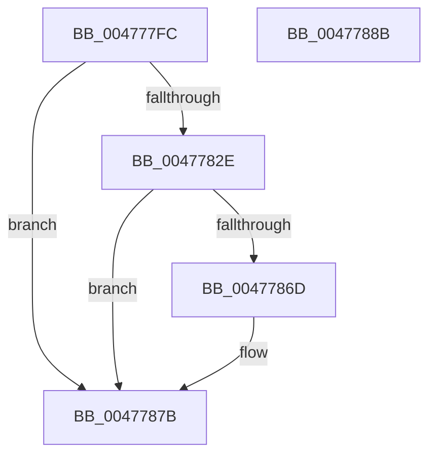

# PopPowerRequestHandleRequestOverrideQueryResponse

- RVA: `0x004777FC`–`0x0047788C` (길이 `144` bytes)
- VA: `0x00000001404777FC`
- 실행 섹션: `.text`
- PDB 이름 있음: `예`; PDB Function 태그: `아니요`
- unwind 정보 RVA: `0x00065960`
- 디코드: `39`개 명령, `144/144` bytes 표시
- 미해석 바이트: `0` (있으면 어셈블리에 `.byte`로 보존)

> 이 문서는 커널 이미지의 기계어와 PDB 기호를 분석해 생성했습니다. 4번과 5번은 함수 원형과 자료형을 바이너리 사용 방식에서 추정한 C 해석이며 원본 소스 복구 결과는 아닙니다.

## 1. Dependencies

- 직접 호출 지점: **7**; 고유 호출 대상: **7**
- 직접 호출자로 확인된 함수: **1**
- RIP 상대 이미지 참조: **3**

### Outgoing calls
- `0x0047781A` → [PopAcquirePowerRequestPushLock](../../page/A6/PopAcquirePowerRequestPushLock_function_00A66D94.md) (function, `0x00A66D94`)
- `0x00477821` → [PopPowerRequestTableLookupEntry](../../page/A7/PopPowerRequestTableLookupEntry_function_00A78864.md) (function, `0x00A78864`)
- `0x0047783D` → [KeAcquireInStackQueuedSpinLock](../27/KeAcquireInStackQueuedSpinLock_function_002757A0.md) (function, `0x002757A0`)
- `0x0047784A` → [PopPowerRequestEvaluatePendingRequestStatus](PopPowerRequestEvaluatePendingRequestStatus_function_00477914.md) (function, `0x00477914`)
- `0x00477854` → [KeReleaseInStackQueuedSpinLock](../34/KeReleaseInStackQueuedSpinLock_function_00342CE0.md) (function, `0x00342CE0`)
- `0x00477876` → [ExQueueWorkItem](../2F/ExQueueWorkItem_function_002F9520.md) (function, `0x002F9520`)
- `0x0047787B` → [PopReleasePowerRequestPushLock](../../page/A7/PopReleasePowerRequestPushLock_function_00A712DC.md) (function, `0x00A712DC`)

### Direct callers
- [PopUmpoProcessPowerMessage](../../page/A2/PopUmpoProcessPowerMessage_function_00A2E9B4.md) at `0x00A2EA04`

### Static image references
- `0x00477836` → RVA `0x00F0ED30` (`.data`; read)
- `0x0047785E` → RVA `0x00F0EDA0` (`.data`; read/write)
- `0x0047786F` → RVA `0x00F0ED80` (`.data`; read)

## 2. Other-region calls and transfers

- 다른 실행 섹션으로 향하는 call: **3**
  - `0x0047781A` → [PopAcquirePowerRequestPushLock](../../page/A6/PopAcquirePowerRequestPushLock_function_00A66D94.md) (`.text` → `PAGE`)
  - `0x00477821` → [PopPowerRequestTableLookupEntry](../../page/A7/PopPowerRequestTableLookupEntry_function_00A78864.md) (`.text` → `PAGE`)
  - `0x0047787B` → [PopReleasePowerRequestPushLock](../../page/A7/PopReleasePowerRequestPushLock_function_00A712DC.md) (`.text` → `PAGE`)
- 별도 외부 분기/꼬리 이동을 확인하지 못했습니다.

## 3. Assembly (complete function range)

```asm
004777FC  48 89 5C 24 08                  mov qword ptr [rsp + 8], rbx
00477801  57                              push rdi
00477802  48 83 EC 40                     sub rsp, 0x40
00477806  48 8B D9                        mov rbx, rcx
00477809  0F 57 C0                        xorps xmm0, xmm0
0047780C  33 C0                           xor eax, eax
0047780E  B1 01                           mov cl, 1
00477810  0F 11 44 24 20                  movups xmmword ptr [rsp + 0x20], xmm0
00477815  48 89 44 24 30                  mov qword ptr [rsp + 0x30], rax
0047781A  E8 75 F5 5E 00                  call 0x140a66d94
0047781F  8B 0B                           mov ecx, dword ptr [rbx]
00477821  E8 3E 10 60 00                  call 0x140a78864
00477826  48 8B F8                        mov rdi, rax
00477829  48 85 C0                        test rax, rax
0047782C  74 4D                           je 0x14047787b
0047782E  8B 5B 08                        mov ebx, dword ptr [rbx + 8]
00477831  48 8D 54 24 20                  lea rdx, [rsp + 0x20]
00477836  48 8D 0D F3 74 A9 00            lea rcx, [rip + 0xa974f3]
0047783D  E8 5E DF DF FF                  call 0x1402757a0
00477842  33 D2                           xor edx, edx
00477844  89 5F 18                        mov dword ptr [rdi + 0x18], ebx
00477847  48 8B CF                        mov rcx, rdi
0047784A  E8 C5 00 00 00                  call 0x140477914
0047784F  48 8D 4C 24 20                  lea rcx, [rsp + 0x20]
00477854  E8 87 B4 EC FF                  call 0x140342ce0
00477859  B8 01 00 00 00                  mov eax, 1
0047785E  F0 0F C1 05 3A 75 A9 00         lock xadd dword ptr [rip + 0xa9753a], eax
00477866  FF C0                           inc eax
00477868  83 F8 01                        cmp eax, 1
0047786B  75 0E                           jne 0x14047787b
0047786D  33 D2                           xor edx, edx
0047786F  48 8D 0D 0A 75 A9 00            lea rcx, [rip + 0xa9750a]
00477876  E8 A5 1C E8 FF                  call 0x1402f9520
0047787B  E8 5C 9A 5F 00                  call 0x140a712dc
00477880  48 8B 5C 24 50                  mov rbx, qword ptr [rsp + 0x50]
00477885  48 83 C4 40                     add rsp, 0x40
00477889  5F                              pop rdi
0047788A  C3                              ret
0047788B  CC                              int3
```

## 4. C-style interpretation (structured pseudocode)

```c
__int64 __fastcall PopPowerRequestHandleRequestOverrideQueryResponse(__int64 a1)
{
    __int64 result;
    __int64 v_rsp;
    unsigned __int64 v_stack_m18;
    unsigned __int64 v_stack_m28;
    unsigned __int64 v_stack_p8;

    v_stack_p8 = v_rbx;
    v_rsp = (v_rsp) - (64);
    result = 0;
    v_stack_m28 = v_xmm0;
    v_stack_m18 = 0;
    result = PopAcquirePowerRequestPushLock(1, a2, a3, a4);
    result = PopPowerRequestTableLookupEntry((unsigned int)(*(unsigned int *)(a1)), a2, a3, a4);
    if (result == 0) goto loc_0047787B;
    result = KeAcquireInStackQueuedSpinLock(v_rip + 11105523, v_stack_m28, a3, a4);
    a2 = 0;
    *(unsigned int *)(result + 24) = (unsigned int)((unsigned int)(*(unsigned int *)(a1 + 8)));
    result = PopPowerRequestEvaluatePendingRequestStatus(result, a2, a3, a4);
    result = KeReleaseInStackQueuedSpinLock(v_stack_m28, a2, a3, a4);
    result = (unsigned int)((1) + 1);
    if (((unsigned int)(result)) == 1) {
        a2 = 0;
        a1 = v_rip + 11105546;
        result = ExQueueWorkItem(a1, a2, a3, a4);
    }
    result = PopReleasePowerRequestPushLock(a1, a2, a3, a4);
    v_rsp = (v_rsp) + (64);
    return result;
}
```

## 5. (Beta) C Style

```c
int64_t PopPowerRequestHandleRequestOverrideQueryResponse(void *Arg1)
{
    uint8_t *arg1 = (uint8_t *)Arg1;

    int64_t result;
    int64_t local_rsp;
    uint64_t v_stack_m18;
    uint64_t v_stack_m28;
    uint64_t v_stack_p8;

    v_stack_p8 = local_rbx;
    local_rsp = (local_rsp) - (64);
    result = 0;
    v_stack_m28 = v_xmm0;
    v_stack_m18 = 0;
    result = PopAcquirePowerRequestPushLock(1, a2, a3, a4);
    result = PopPowerRequestTableLookupEntry((uint32_t)(*(uint32_t *)(arg1)), a2, a3, a4);
    if (result == 0) goto loc_0047787B;
    result = KeAcquireInStackQueuedSpinLock(v_rip + 11105523, v_stack_m28, a3, a4);
    a2 = 0;
    *(uint32_t *)(result + 0x18) = (uint32_t)((uint32_t)(*(uint32_t *)(arg1 + 0x8)));
    result = PopPowerRequestEvaluatePendingRequestStatus(result, a2, a3, a4);
    result = KeReleaseInStackQueuedSpinLock(v_stack_m28, a2, a3, a4);
    result = (uint32_t)((1) + 1);
    if (((uint32_t)(result)) == 1) {
        a2 = 0;
        Arg1 = v_rip + 11105546;
        result = ExQueueWorkItem(Arg1, a2, a3, a4);
    }
    result = PopReleasePowerRequestPushLock(Arg1, a2, a3, a4);
    local_rsp = (local_rsp) + (64);
    return result;
}
```

### 관측된 메모리 오프셋

구조체 형식이 확인되지 않은 접근은 인자 기준의 오프셋으로만 기록했습니다.

| 기준 인자 | 오프셋 표현 | 폭 (bit) | 접근 |
|---|---:|---:|---|
| `Arg1` | `+ 0x0` | `32` | `R` |
| `Arg1` | `+ 0x8` | `32` | `R` |

## 6. Execution-region graph

[열기: 2D/3D 그래프와 함수 탐색 컨트롤 패널](../../../control-panel.html?section=text&rva=0x004777FC&view=graph)

- 2D 그래프는 위에서 아래로 흐르고, 3D 그래프는 빈 공간을 드래그해 회전합니다. Shift+드래그는 이동, 휠은 확대·축소, 함수 노드 선택은 대상 보고서 이동입니다.

### Static fallback


