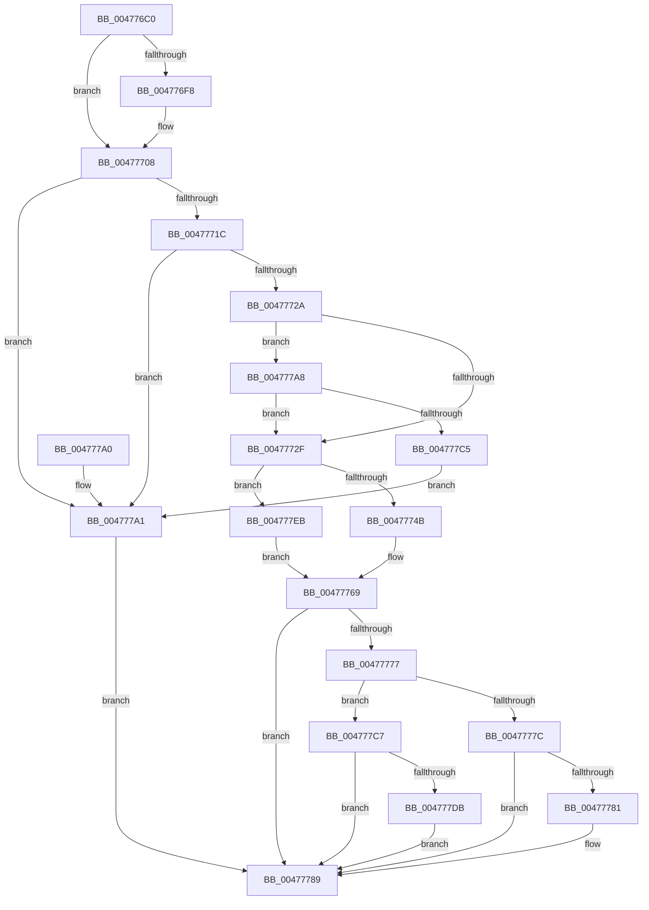

# PopPowerRequestReferenceAcquire

- RVA: `0x004776C0`–`0x004777F5` (길이 `309` bytes)
- VA: `0x00000001404776C0`
- 실행 섹션: `.text`
- PDB 이름 있음: `예`; PDB Function 태그: `아니요`
- unwind 정보 RVA: `0x000ACCC4`
- 디코드: `83`개 명령, `309/309` bytes 표시
- 미해석 바이트: `0` (있으면 어셈블리에 `.byte`로 보존)

> 이 문서는 커널 이미지의 기계어와 PDB 기호를 분석해 생성했습니다. 4번과 5번은 함수 원형과 자료형을 바이너리 사용 방식에서 추정한 C 해석이며 원본 소스 복구 결과는 아닙니다.

## 1. Dependencies

- 직접 호출 지점: **6**; 고유 호출 대상: **6**
- 직접 호출자로 확인된 함수: **6**
- RIP 상대 이미지 참조: **3**

### Outgoing calls
- `0x0047773B` → [KeAcquireInStackQueuedSpinLock](../27/KeAcquireInStackQueuedSpinLock_function_002757A0.md) (function, `0x002757A0`)
- `0x0047775A` → [PopPowerRequestEvaluatePendingRequestStatus](PopPowerRequestEvaluatePendingRequestStatus_function_00477914.md) (function, `0x00477914`)
- `0x00477762` → [PopDiagTracePowerRequestChange](PopDiagTracePowerRequestChange_function_00477C9C.md) (function, `0x00477C9C`)
- `0x0047776E` → [KeReleaseInStackQueuedSpinLock](../34/KeReleaseInStackQueuedSpinLock_function_00342CE0.md) (function, `0x00342CE0`)
- `0x00477784` → [PopPowerRequestCallbackWorker](PopPowerRequestCallbackWorker_function_00477AD0.md) (function, `0x00477AD0`)
- `0x004777E4` → [ExQueueWorkItem](../2F/ExQueueWorkItem_function_002F9520.md) (function, `0x002F9520`)

### Direct callers
- [PopApplyLegacyPowerRequestFlags](PopApplyLegacyPowerRequestFlags_function_00477364.md) at `0x00477419`
- [PopApplyLegacyPowerRequestFlags](PopApplyLegacyPowerRequestFlags_function_00477364.md) at `0x00477441`
- [PopApplyLegacyPowerRequestFlags](PopApplyLegacyPowerRequestFlags_function_00477364.md) at `0x00477448`
- [PpmBeginHighPerfRequest](PpmBeginHighPerfRequest_function_004774FC.md) at `0x00477511`
- [PoSetPowerRequest](PoSetPowerRequest_function_00477530.md) at `0x00477544`
- [NtPowerInformation](../../page/95/NtPowerInformation_function_00955D80.md) at `0x00957A31`
- [PopPowerAggregatorEnterScreenOff](../../page/98/PopPowerAggregatorEnterScreenOff_function_00989F38.md) at `0x0098A0B2`
- [PopPowerRequestActionInfo](../../page/A2/PopPowerRequestActionInfo_function_00A21968.md) at `0x00A219F2`

### Static image references
- `0x00477734` → RVA `0x00F0ED30` (`.data`; read)
- `0x004777CC` → RVA `0x00F0EDA0` (`.data`; read/write)
- `0x004777DD` → RVA `0x00F0ED80` (`.data`; read)

## 2. Other-region calls and transfers

- 다른 실행 섹션으로 향하는 call: **0**
- 별도 외부 분기/꼬리 이동을 확인하지 못했습니다.

## 3. Assembly (complete function range)

```asm
004776C0  4C 8B DC                        mov r11, rsp
004776C3  49 89 5B 08                     mov qword ptr [r11 + 8], rbx
004776C7  49 89 6B 10                     mov qword ptr [r11 + 0x10], rbp
004776CB  49 89 73 18                     mov qword ptr [r11 + 0x18], rsi
004776CF  57                              push rdi
004776D0  48 83 EC 50                     sub rsp, 0x50
004776D4  0F 57 C9                        xorps xmm1, xmm1
004776D7  48 63 EA                        movsxd rbp, edx
004776DA  0F 57 C0                        xorps xmm0, xmm0
004776DD  33 C0                           xor eax, eax
004776DF  0F 11 4C 24 30                  movups xmmword ptr [rsp + 0x30], xmm1
004776E4  49 89 43 E8                     mov qword ptr [r11 - 0x18], rax
004776E8  48 8B D9                        mov rbx, rcx
004776EB  0F 11 44 24 20                  movups xmmword ptr [rsp + 0x20], xmm0
004776F0  44 0F 20 C0                     mov rax, cr8
004776F4  3C 02                           cmp al, 2
004776F6  73 10                           jae 0x140477708
004776F8  49 8D 4B C8                     lea rcx, [r11 - 0x38]
004776FC  49 89 4B D0                     mov qword ptr [r11 - 0x30], rcx
00477700  49 8D 4B C8                     lea rcx, [r11 - 0x38]
00477704  49 89 4B C8                     mov qword ptr [r11 - 0x38], rcx
00477708  48 1B FF                        sbb rdi, rdi
0047770B  48 8D 44 24 20                  lea rax, [rsp + 0x20]
00477710  48 23 F8                        and rdi, rax
00477713  83 FD 05                        cmp ebp, 5
00477716  0F 87 85 00 00 00               ja 0x1404777a1
0047771C  8B CD                           mov ecx, ebp
0047771E  BE 01 00 00 00                  mov esi, 1
00477723  D3 E6                           shl esi, cl
00477725  85 73 14                        test dword ptr [rbx + 0x14], esi
00477728  74 77                           je 0x1404777a1
0047772A  83 FD 03                        cmp ebp, 3
0047772D  74 79                           je 0x1404777a8
0047772F  48 8D 54 24 30                  lea rdx, [rsp + 0x30]
00477734  48 8D 0D F5 75 A9 00            lea rcx, [rip + 0xa975f5]
0047773B  E8 60 E0 DF FF                  call 0x1402757a0
00477740  83 7C AB 28 FF                  cmp dword ptr [rbx + rbp*4 + 0x28], -1
00477745  0F 84 A0 00 00 00               je 0x1404777eb
0047774B  F7 D6                           not esi
0047774D  48 8B D7                        mov rdx, rdi
00477750  21 73 1C                        and dword ptr [rbx + 0x1c], esi
00477753  48 8B CB                        mov rcx, rbx
00477756  FF 44 AB 28                     inc dword ptr [rbx + rbp*4 + 0x28]
0047775A  E8 B5 01 00 00                  call 0x140477914
0047775F  48 8B CB                        mov rcx, rbx
00477762  E8 35 05 00 00                  call 0x140477c9c
00477767  33 DB                           xor ebx, ebx
00477769  48 8D 4C 24 30                  lea rcx, [rsp + 0x30]
0047776E  E8 6D B5 EC FF                  call 0x140342ce0
00477773  85 DB                           test ebx, ebx
00477775  78 12                           js 0x140477789
00477777  48 85 FF                        test rdi, rdi
0047777A  74 4B                           je 0x1404777c7
0047777C  48 39 3F                        cmp qword ptr [rdi], rdi
0047777F  74 08                           je 0x140477789
00477781  48 8B CF                        mov rcx, rdi
00477784  E8 47 03 00 00                  call 0x140477ad0
00477789  48 8B 6C 24 68                  mov rbp, qword ptr [rsp + 0x68]
0047778E  8B C3                           mov eax, ebx
00477790  48 8B 5C 24 60                  mov rbx, qword ptr [rsp + 0x60]
00477795  48 8B 74 24 70                  mov rsi, qword ptr [rsp + 0x70]
0047779A  48 83 C4 50                     add rsp, 0x50
0047779E  5F                              pop rdi
0047779F  C3                              ret
004777A0  CC                              int3
004777A1  BB BB 00 00 C0                  mov ebx, 0xc00000bb
004777A6  EB E1                           jmp 0x140477789
004777A8  65 48 8B 04 25 88 01 00 00      mov rax, qword ptr gs:[0x188]
004777B1  48 8B 88 B8 00 00 00            mov rcx, qword ptr [rax + 0xb8]
004777B8  48 39 8B 88 00 00 00            cmp qword ptr [rbx + 0x88], rcx
004777BF  0F 84 6A FF FF FF               je 0x14047772f
004777C5  EB DA                           jmp 0x1404777a1
004777C7  B8 01 00 00 00                  mov eax, 1
004777CC  F0 0F C1 05 CC 75 A9 00         lock xadd dword ptr [rip + 0xa975cc], eax
004777D4  FF C0                           inc eax
004777D6  83 F8 01                        cmp eax, 1
004777D9  75 AE                           jne 0x140477789
004777DB  33 D2                           xor edx, edx
004777DD  48 8D 0D 9C 75 A9 00            lea rcx, [rip + 0xa9759c]
004777E4  E8 37 1D E8 FF                  call 0x1402f9520
004777E9  EB 9E                           jmp 0x140477789
004777EB  BB 95 00 00 C0                  mov ebx, 0xc0000095
004777F0  E9 74 FF FF FF                  jmp 0x140477769
```

## 4. C-style interpretation (structured pseudocode)

```c
__int64 __fastcall PopPowerRequestReferenceAcquire(__int64 a1, int a2)
{
    __int64 result;
    __int64 v_rbx;
    __int64 v_rdi;
    __int64 v_rsi;
    __int64 v_rsp;
    unsigned __int64 v_stack_m28;
    unsigned __int64 v_stack_m38;
    unsigned __int64 v_stack_p10;
    unsigned __int64 v_stack_p18;
    unsigned __int64 v_stack_p8;

    *(unsigned __int64 *)(v_rsp + 8) = v_rbx;
    *(unsigned __int64 *)(v_rsp + 16) = v_rbp;
    *(unsigned __int64 *)(v_rsp + 24) = v_rsi;
    v_rsp = (v_rsp) - (80);
    result = 0;
    v_stack_m28 = v_xmm1;
    *(unsigned __int64 *)(v_rsp - 24) = 0;
    v_stack_m38 = v_xmm0;
    if (((unsigned __int8)(v_cr8)) < 2) {
        a1 = v_rsp - 56;
        *(unsigned __int64 *)(v_rsp - 48) = a1;
        a1 = v_rsp - 56;
        *(unsigned __int64 *)(v_rsp - 56) = a1;
    }
    v_rdi = (v_rdi) & (v_stack_m38);
    if (((unsigned int)((int)(a2))) > 5) goto loc_004777A1;
    v_rsi = (unsigned int)((1) << ((unsigned __int8)((unsigned int)((unsigned int)((int)(a2))))));
    if (((*(unsigned int *)(a1 + 20)) & ((unsigned int)(v_rsi))) == 0) goto loc_004777A1;
    if (((unsigned int)((int)(a2))) == 3) goto loc_004777A8;
loc_0047772F:
    result = KeAcquireInStackQueuedSpinLock(v_rip + 11105781, v_stack_m28, a3, a4);
    if ((*(unsigned int *)(a1 + (int)(a2) * 4 + 40)) == -1) goto loc_004777EB;
    v_rsi = (unsigned int)(~(v_rsi));
    result = PopPowerRequestEvaluatePendingRequestStatus(a1, v_rdi, a3, a4);
    result = PopDiagTracePowerRequestChange(a1, v_rdi, a3, a4);
    v_rbx = 0;
loc_00477769:
    result = KeReleaseInStackQueuedSpinLock(v_stack_m28, v_rdi, a3, a4);
    if (sign_flag) goto loc_00477789;
    if (v_rdi == 0) goto loc_004777C7;
    if ((*(unsigned __int64 *)(v_rdi)) != v_rdi) {
        a1 = v_rdi;
        result = PopPowerRequestCallbackWorker(a1, v_rdi, a3, a4);
    }
    v_rsp = (v_rsp) + (80);
    return 0;
loc_004777A1:
    goto loc_00477789;
loc_004777A8:
    if ((*(unsigned __int64 *)((unsigned int)(0xC00000BBULL) + 136)) == (*(unsigned __int64 *)(*(unsigned __int64 *)(gs_base + (0 + 392)) + 184))) goto loc_0047772F;
    goto loc_004777A1;
loc_004777C7:
    result = (unsigned int)((1) + 1);
    if (((unsigned int)(result)) != 1) goto loc_00477789;
    a2 = 0;
    result = ExQueueWorkItem(v_rip + 11105692, a2, a3, a4);
    goto loc_00477789;
loc_004777EB:
    goto loc_00477769;
}
```

## 5. (Beta) C Style

```c
int64_t PopPowerRequestReferenceAcquire(void *Arg1, int32_t Arg2)
{
    uint8_t *arg1 = (uint8_t *)Arg1;

    int64_t result;
    int64_t local_rbx;
    int64_t local_rdi;
    int64_t local_rsi;
    int64_t local_rsp;
    uint64_t v_stack_m28;
    uint64_t v_stack_m38;
    uint64_t v_stack_p10;
    uint64_t v_stack_p18;
    uint64_t v_stack_p8;

    *(uint64_t *)(local_rsp + 0x8) = local_rbx;
    *(uint64_t *)(local_rsp + 0x10) = local_rbp;
    *(uint64_t *)(local_rsp + 0x18) = local_rsi;
    local_rsp = (local_rsp) - (80);
    result = 0;
    v_stack_m28 = v_xmm1;
    *(uint64_t *)(local_rsp - 0x18) = 0;
    v_stack_m38 = v_xmm0;
    if (((uint8_t)(v_cr8)) < 2) {
        Arg1 = local_rsp - 56;
        *(void **)(local_rsp - 0x30) = Arg1;
        Arg1 = local_rsp - 56;
        *(void **)(local_rsp - 0x38) = Arg1;
    }
    local_rdi = (local_rdi) & (v_stack_m38);
    if (((uint32_t)((int32_t)(Arg2))) > 5) goto loc_004777A1;
    local_rsi = (uint32_t)((1) << ((uint8_t)((uint32_t)((uint32_t)((int32_t)(Arg2))))));
    if (((*(uint32_t *)(arg1 + 0x14)) & ((uint32_t)(local_rsi))) == 0) goto loc_004777A1;
    if (((uint32_t)((int32_t)(Arg2))) == 3) goto loc_004777A8;
loc_0047772F:
    result = KeAcquireInStackQueuedSpinLock(v_rip + 11105781, v_stack_m28, a3, a4);
    if ((*(uint32_t *)(arg1 + (int32_t)(Arg2) * 4 + 0x28)) == -1) goto loc_004777EB;
    local_rsi = (uint32_t)(~(local_rsi));
    result = PopPowerRequestEvaluatePendingRequestStatus(Arg1, local_rdi, a3, a4);
    result = PopDiagTracePowerRequestChange(Arg1, local_rdi, a3, a4);
    local_rbx = 0;
loc_00477769:
    result = KeReleaseInStackQueuedSpinLock(v_stack_m28, local_rdi, a3, a4);
    if (sign_flag) goto loc_00477789;
    if (local_rdi == 0) goto loc_004777C7;
    if ((*(uint64_t *)(local_rdi)) != local_rdi) {
        Arg1 = local_rdi;
        result = PopPowerRequestCallbackWorker(Arg1, local_rdi, a3, a4);
    }
    local_rsp = (local_rsp) + (80);
    return 0;
loc_004777A1:
    goto loc_00477789;
loc_004777A8:
    if ((*(uint64_t *)((uint32_t)(0xC00000BBULL) + 0x88)) == (*(uint64_t *)(*(uint64_t *)(gs_base + (0 + 0x188)) + 0xB8))) goto loc_0047772F;
    goto loc_004777A1;
loc_004777C7:
    result = (uint32_t)((1) + 1);
    if (((uint32_t)(result)) != 1) goto loc_00477789;
    Arg2 = 0;
    result = ExQueueWorkItem(v_rip + 11105692, Arg2, a3, a4);
    goto loc_00477789;
loc_004777EB:
    goto loc_00477769;
}
```

### 관측된 메모리 오프셋

구조체 형식이 확인되지 않은 접근은 인자 기준의 오프셋으로만 기록했습니다.

| 기준 인자 | 오프셋 표현 | 폭 (bit) | 접근 |
|---|---:|---:|---|
| `Arg1` | `+ 0x14` | `32` | `R` |
| `Arg1` | `+ 0x1C` | `32` | `R/W` |
| `Arg1` | `+ 0x28 + rbp*4` | `32` | `R` |
| `Arg1` | `+ 0x28 + rbp*4` | `32` | `R/W` |
| `Arg1` | `+ 0x88` | `64` | `R` |

## 6. Execution-region graph

[열기: 2D/3D 그래프와 함수 탐색 컨트롤 패널](../../../control-panel.html?section=text&rva=0x004776C0&view=graph)

- 2D 그래프는 위에서 아래로 흐르고, 3D 그래프는 빈 공간을 드래그해 회전합니다. Shift+드래그는 이동, 휠은 확대·축소, 함수 노드 선택은 대상 보고서 이동입니다.

### Static fallback


