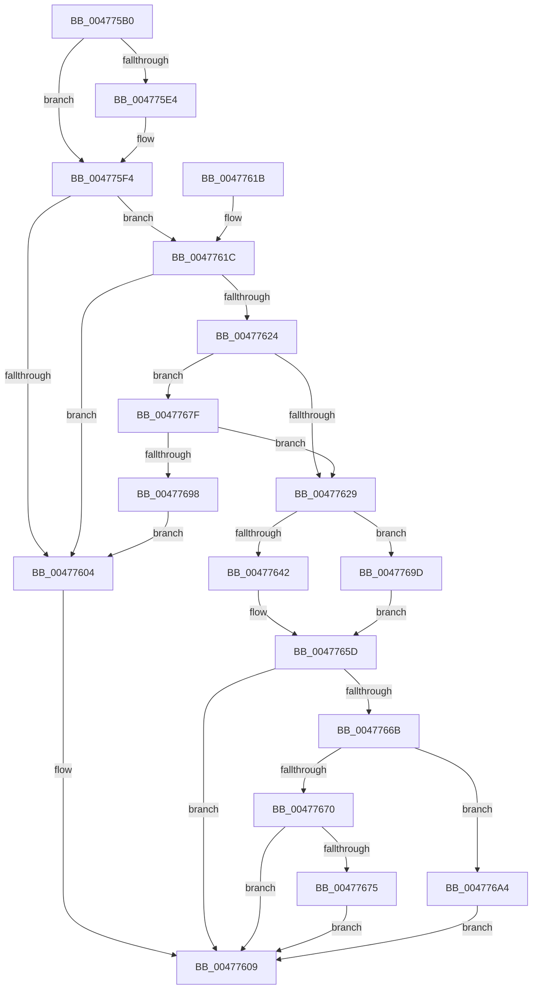

# PopPowerRequestReferenceRelease

- RVA: `0x004775B0`–`0x004776B7` (길이 `263` bytes)
- VA: `0x00000001404775B0`
- 실행 섹션: `.text`
- PDB 이름 있음: `예`; PDB Function 태그: `아니요`
- unwind 정보 RVA: `0x000ACCB0`
- 디코드: `74`개 명령, `263/263` bytes 표시
- 미해석 바이트: `0` (있으면 어셈블리에 `.byte`로 보존)

> 이 문서는 커널 이미지의 기계어와 PDB 기호를 분석해 생성했습니다. 4번과 5번은 함수 원형과 자료형을 바이너리 사용 방식에서 추정한 C 해석이며 원본 소스 복구 결과는 아닙니다.

## 1. Dependencies

- 직접 호출 지점: **6**; 고유 호출 대상: **6**
- 직접 호출자로 확인된 함수: **8**
- RIP 상대 이미지 참조: **2**

### Outgoing calls
- `0x00477635` → [KeAcquireInStackQueuedSpinLock](../27/KeAcquireInStackQueuedSpinLock_function_002757A0.md) (function, `0x002757A0`)
- `0x0047764E` → [PopPowerRequestEvaluatePendingRequestStatus](PopPowerRequestEvaluatePendingRequestStatus_function_00477914.md) (function, `0x00477914`)
- `0x00477656` → [PopDiagTracePowerRequestChange](PopDiagTracePowerRequestChange_function_00477C9C.md) (function, `0x00477C9C`)
- `0x00477662` → [KeReleaseInStackQueuedSpinLock](../34/KeReleaseInStackQueuedSpinLock_function_00342CE0.md) (function, `0x00342CE0`)
- `0x00477678` → [PopPowerRequestCallbackWorker](PopPowerRequestCallbackWorker_function_00477AD0.md) (function, `0x00477AD0`)
- `0x004776AD` → [PopQueueWorkItem](../4A/PopQueueWorkItem_function_004A20F8.md) (function, `0x004A20F8`)

### Direct callers
- [PopApplyLegacyPowerRequestFlags](PopApplyLegacyPowerRequestFlags_function_00477364.md) at `0x00477420`
- [PopApplyLegacyPowerRequestFlags](PopApplyLegacyPowerRequestFlags_function_00477364.md) at `0x00477430`
- [PopApplyLegacyPowerRequestFlags](PopApplyLegacyPowerRequestFlags_function_00477364.md) at `0x00477452`
- [PpmEndHighPerfRequest](PpmEndHighPerfRequest_function_00477490.md) at `0x004774C5`
- [PoClearPowerRequest](PoClearPowerRequest_function_00477570.md) at `0x00477584`
- [PpmDisableHighPerfRequestDeferredExpiration](../4B/PpmDisableHighPerfRequestDeferredExpiration_function_004BA678.md) at `0x004BA700`
- [PpmHighPerfRequestExpiration](../5D/PpmHighPerfRequestExpiration_function_005D90F0.md) at `0x005D9132`
- [NtPowerInformation](../../page/95/NtPowerInformation_function_00955D80.md) at `0x00957A3B`
- [PopPowerAggregatorEnterScreenOff](../../page/98/PopPowerAggregatorEnterScreenOff_function_00989F38.md) at `0x00989FFE`
- [PopPowerAggregatorEnterScreenOff](../../page/98/PopPowerAggregatorEnterScreenOff_function_00989F38.md) at `0x0098A0D1`
- [PopPowerRequestActionInfo](../../page/A2/PopPowerRequestActionInfo_function_00A21968.md) at `0x00A21A44`

### Static image references
- `0x0047762E` → RVA `0x00F0ED30` (`.data`; read)
- `0x004776A6` → RVA `0x00F0ED80` (`.data`; read)

## 2. Other-region calls and transfers

- 다른 실행 섹션으로 향하는 call: **0**
- 별도 외부 분기/꼬리 이동을 확인하지 못했습니다.

## 3. Assembly (complete function range)

```asm
004775B0  4C 8B DC                        mov r11, rsp
004775B3  49 89 5B 08                     mov qword ptr [r11 + 8], rbx
004775B7  49 89 73 10                     mov qword ptr [r11 + 0x10], rsi
004775BB  57                              push rdi
004775BC  48 83 EC 50                     sub rsp, 0x50
004775C0  0F 57 C9                        xorps xmm1, xmm1
004775C3  48 63 F2                        movsxd rsi, edx
004775C6  0F 57 C0                        xorps xmm0, xmm0
004775C9  33 C0                           xor eax, eax
004775CB  0F 11 4C 24 30                  movups xmmword ptr [rsp + 0x30], xmm1
004775D0  49 89 43 E8                     mov qword ptr [r11 - 0x18], rax
004775D4  48 8B D9                        mov rbx, rcx
004775D7  0F 11 44 24 20                  movups xmmword ptr [rsp + 0x20], xmm0
004775DC  44 0F 20 C0                     mov rax, cr8
004775E0  3C 02                           cmp al, 2
004775E2  73 10                           jae 0x1404775f4
004775E4  49 8D 4B C8                     lea rcx, [r11 - 0x38]
004775E8  49 89 4B D0                     mov qword ptr [r11 - 0x30], rcx
004775EC  49 8D 4B C8                     lea rcx, [r11 - 0x38]
004775F0  49 89 4B C8                     mov qword ptr [r11 - 0x38], rcx
004775F4  48 1B FF                        sbb rdi, rdi
004775F7  48 8D 44 24 20                  lea rax, [rsp + 0x20]
004775FC  48 23 F8                        and rdi, rax
004775FF  83 FE 05                        cmp esi, 5
00477602  76 18                           jbe 0x14047761c
00477604  BB BB 00 00 C0                  mov ebx, 0xc00000bb
00477609  48 8B 74 24 68                  mov rsi, qword ptr [rsp + 0x68]
0047760E  8B C3                           mov eax, ebx
00477610  48 8B 5C 24 60                  mov rbx, qword ptr [rsp + 0x60]
00477615  48 83 C4 50                     add rsp, 0x50
00477619  5F                              pop rdi
0047761A  C3                              ret
0047761B  CC                              int3
0047761C  8B 43 14                        mov eax, dword ptr [rbx + 0x14]
0047761F  0F A3 F0                        bt eax, esi
00477622  73 E0                           jae 0x140477604
00477624  83 FE 03                        cmp esi, 3
00477627  74 56                           je 0x14047767f
00477629  48 8D 54 24 30                  lea rdx, [rsp + 0x30]
0047762E  48 8D 0D FB 76 A9 00            lea rcx, [rip + 0xa976fb]
00477635  E8 66 E1 DF FF                  call 0x1402757a0
0047763A  8B 44 B3 28                     mov eax, dword ptr [rbx + rsi*4 + 0x28]
0047763E  85 C0                           test eax, eax
00477640  74 5B                           je 0x14047769d
00477642  FF C8                           dec eax
00477644  48 8B D7                        mov rdx, rdi
00477647  48 8B CB                        mov rcx, rbx
0047764A  89 44 B3 28                     mov dword ptr [rbx + rsi*4 + 0x28], eax
0047764E  E8 C1 02 00 00                  call 0x140477914
00477653  48 8B CB                        mov rcx, rbx
00477656  E8 41 06 00 00                  call 0x140477c9c
0047765B  33 DB                           xor ebx, ebx
0047765D  48 8D 4C 24 30                  lea rcx, [rsp + 0x30]
00477662  E8 79 B6 EC FF                  call 0x140342ce0
00477667  85 DB                           test ebx, ebx
00477669  78 9E                           js 0x140477609
0047766B  48 85 FF                        test rdi, rdi
0047766E  74 34                           je 0x1404776a4
00477670  48 39 3F                        cmp qword ptr [rdi], rdi
00477673  74 94                           je 0x140477609
00477675  48 8B CF                        mov rcx, rdi
00477678  E8 53 04 00 00                  call 0x140477ad0
0047767D  EB 8A                           jmp 0x140477609
0047767F  65 48 8B 04 25 88 01 00 00      mov rax, qword ptr gs:[0x188]
00477688  48 8B 88 B8 00 00 00            mov rcx, qword ptr [rax + 0xb8]
0047768F  48 39 8B 88 00 00 00            cmp qword ptr [rbx + 0x88], rcx
00477696  74 91                           je 0x140477629
00477698  E9 67 FF FF FF                  jmp 0x140477604
0047769D  BB BB 00 00 C0                  mov ebx, 0xc00000bb
004776A2  EB B9                           jmp 0x14047765d
004776A4  33 D2                           xor edx, edx
004776A6  48 8D 0D D3 76 A9 00            lea rcx, [rip + 0xa976d3]
004776AD  E8 46 AA 02 00                  call 0x1404a20f8
004776B2  E9 52 FF FF FF                  jmp 0x140477609
```

## 4. C-style interpretation (structured pseudocode)

```c
__int64 __fastcall PopPowerRequestReferenceRelease(__int64 a1, int a2)
{
    __int64 result;
    __int64 v_rbx;
    __int64 v_rdi;
    __int64 v_rsp;
    unsigned __int64 v_stack_m28;
    unsigned __int64 v_stack_m38;
    unsigned __int64 v_stack_p10;
    unsigned __int64 v_stack_p30;
    unsigned __int64 v_stack_p8;

    *(unsigned __int64 *)(v_rsp + 8) = v_rbx;
    *(unsigned __int64 *)(v_rsp + 16) = v_rsi;
    v_rsp = (v_rsp) - (80);
    result = 0;
    v_stack_m28 = v_xmm1;
    *(unsigned __int64 *)(v_rsp - 24) = 0;
    v_stack_m38 = v_xmm0;
    if (((unsigned __int8)(v_cr8)) < 2) {
        a1 = v_rsp - 56;
        *(unsigned __int64 *)(v_rsp - 48) = a1;
        a1 = v_rsp - 56;
        *(unsigned __int64 *)(v_rsp - 56) = a1;
    }
    v_rdi = (v_rdi) & (v_stack_m38);
    if (((unsigned int)((int)(a2))) <= 5) goto loc_0047761C;
loc_00477604:
loc_00477609:
    v_rsp = (v_rsp) + (80);
    return (unsigned int)((unsigned int)((unsigned int)(0xC00000BBULL)));
loc_0047761C:
    if (condition_is_above_or_equal) goto loc_00477604;
    if (((unsigned int)(v_stack_p10)) == 3) goto loc_0047767F;
loc_00477629:
    result = KeAcquireInStackQueuedSpinLock(v_rip + 11106043, v_stack_p30, a3, a4);
    if ((unsigned int)((unsigned int)(*(unsigned int *)(v_stack_p8 + v_stack_p10 * 4 + 40))) == 0) goto loc_0047769D;
    result = (unsigned int)(((unsigned int)(*(unsigned int *)(v_stack_p8 + v_stack_p10 * 4 + 40))) - 1);
    *(unsigned int *)(v_stack_p8 + v_stack_p10 * 4 + 40) = (unsigned int)(result);
    result = PopPowerRequestEvaluatePendingRequestStatus(v_stack_p8, v_rdi, a3, a4);
    result = PopDiagTracePowerRequestChange(v_stack_p8, v_rdi, a3, a4);
    v_rbx = 0;
loc_0047765D:
    result = KeReleaseInStackQueuedSpinLock(v_stack_p30, v_rdi, a3, a4);
    if (sign_flag) goto loc_00477609;
    if (v_rdi == 0) goto loc_004776A4;
    if ((*(unsigned __int64 *)(v_rdi)) == v_rdi) goto loc_00477609;
    result = PopPowerRequestCallbackWorker(v_rdi, v_rdi, a3, a4);
    goto loc_00477609;
loc_0047767F:
    if ((*(unsigned __int64 *)(v_rbx + 136)) == (*(unsigned __int64 *)(*(unsigned __int64 *)(gs_base + (0 + 392)) + 184))) goto loc_00477629;
    goto loc_00477604;
loc_0047769D:
    goto loc_0047765D;
loc_004776A4:
    a2 = 0;
    result = PopQueueWorkItem(v_rip + 11106003, a2, a3, a4);
    goto loc_00477609;
}
```

## 5. (Beta) C Style

```c
int64_t PopPowerRequestReferenceRelease(void *Arg1, int32_t Arg2)
{
    uint8_t *arg1 = (uint8_t *)Arg1;

    int64_t result;
    int64_t local_rbx;
    int64_t local_rdi;
    int64_t local_rsp;
    uint64_t v_stack_m28;
    uint64_t v_stack_m38;
    uint64_t v_stack_p10;
    uint64_t v_stack_p30;
    uint64_t v_stack_p8;

    *(uint64_t *)(local_rsp + 0x8) = local_rbx;
    *(uint64_t *)(local_rsp + 0x10) = local_rsi;
    local_rsp = (local_rsp) - (80);
    result = 0;
    v_stack_m28 = v_xmm1;
    *(uint64_t *)(local_rsp - 0x18) = 0;
    v_stack_m38 = v_xmm0;
    if (((uint8_t)(v_cr8)) < 2) {
        Arg1 = local_rsp - 56;
        *(void **)(local_rsp - 0x30) = Arg1;
        Arg1 = local_rsp - 56;
        *(void **)(local_rsp - 0x38) = Arg1;
    }
    local_rdi = (local_rdi) & (v_stack_m38);
    if (((uint32_t)((int32_t)(Arg2))) <= 5) goto loc_0047761C;
loc_00477604:
loc_00477609:
    local_rsp = (local_rsp) + (80);
    return (uint32_t)((uint32_t)((uint32_t)(0xC00000BBULL)));
loc_0047761C:
    if (condition_is_above_or_equal) goto loc_00477604;
    if (((uint32_t)(v_stack_p10)) == 3) goto loc_0047767F;
loc_00477629:
    result = KeAcquireInStackQueuedSpinLock(v_rip + 11106043, v_stack_p30, a3, a4);
    if ((uint32_t)((uint32_t)(*(uint32_t *)(v_stack_p8 + v_stack_p10 * 4 + 0x28))) == 0) goto loc_0047769D;
    result = (uint32_t)(((uint32_t)(*(uint32_t *)(v_stack_p8 + v_stack_p10 * 4 + 0x28))) - 1);
    *(uint32_t *)(v_stack_p8 + v_stack_p10 * 4 + 0x28) = (uint32_t)(result);
    result = PopPowerRequestEvaluatePendingRequestStatus(v_stack_p8, local_rdi, a3, a4);
    result = PopDiagTracePowerRequestChange(v_stack_p8, local_rdi, a3, a4);
    local_rbx = 0;
loc_0047765D:
    result = KeReleaseInStackQueuedSpinLock(v_stack_p30, local_rdi, a3, a4);
    if (sign_flag) goto loc_00477609;
    if (local_rdi == 0) goto loc_004776A4;
    if ((*(uint64_t *)(local_rdi)) == local_rdi) goto loc_00477609;
    result = PopPowerRequestCallbackWorker(local_rdi, local_rdi, a3, a4);
    goto loc_00477609;
loc_0047767F:
    if ((*(uint64_t *)(local_rbx + 0x88)) == (*(uint64_t *)(*(uint64_t *)(gs_base + (0 + 0x188)) + 0xB8))) goto loc_00477629;
    goto loc_00477604;
loc_0047769D:
    goto loc_0047765D;
loc_004776A4:
    Arg2 = 0;
    result = PopQueueWorkItem(v_rip + 11106003, Arg2, a3, a4);
    goto loc_00477609;
}
```

### 관측된 메모리 오프셋

구조체 형식이 확인되지 않은 접근은 인자 기준의 오프셋으로만 기록했습니다.

| 기준 인자 | 오프셋 표현 | 폭 (bit) | 접근 |
|---|---:|---:|---|
| `Arg1` | `+ 0x14` | `32` | `R` |
| `Arg1` | `+ 0x28 + rsi*4` | `32` | `R` |
| `Arg1` | `+ 0x28 + rsi*4` | `32` | `W` |
| `Arg1` | `+ 0x88` | `64` | `R` |

## 6. Execution-region graph

[열기: 2D/3D 그래프와 함수 탐색 컨트롤 패널](../../../control-panel.html?section=text&rva=0x004775B0&view=graph)

- 2D 그래프는 위에서 아래로 흐르고, 3D 그래프는 빈 공간을 드래그해 회전합니다. Shift+드래그는 이동, 휠은 확대·축소, 함수 노드 선택은 대상 보고서 이동입니다.

### Static fallback


