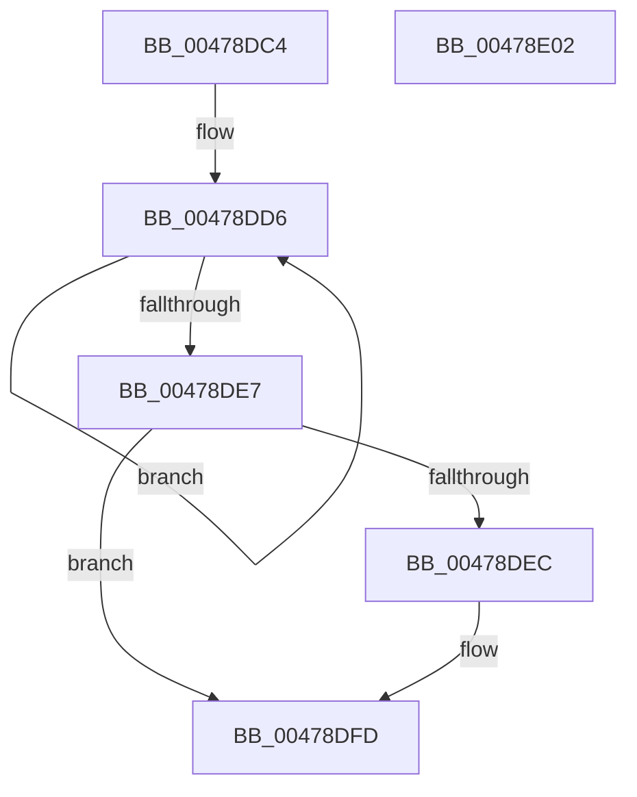

# PopQueueDirectedDripsWork

- RVA: `0x00478DC4`–`0x00478E03` (길이 `63` bytes)
- VA: `0x0000000140478DC4`
- 실행 섹션: `.text`
- PDB 이름 있음: `예`; PDB Function 태그: `아니요`
- unwind 정보 RVA: `0x0005C788`
- 디코드: `16`개 명령, `63/63` bytes 표시
- 미해석 바이트: `0` (있으면 어셈블리에 `.byte`로 보존)

> 이 문서는 커널 이미지의 기계어와 PDB 기호를 분석해 생성했습니다. 4번과 5번은 함수 원형과 자료형을 바이너리 사용 방식에서 추정한 C 해석이며 원본 소스 복구 결과는 아닙니다.

## 1. Dependencies

- 직접 호출 지점: **1**; 고유 호출 대상: **1**
- 직접 호출자로 확인된 함수: **5**
- RIP 상대 이미지 참조: **2**

### Outgoing calls
- `0x00478DF8` → [KeSetEvent](../33/KeSetEvent_function_0033F310.md) (function, `0x0033F310`)

### Direct callers
- [PopDirectedDripsClearDisengageReason](PopDirectedDripsClearDisengageReason_function_00477EA4.md) at `0x00477EFB`
- [PopDirectedDripsSetDisengageReason](PopDirectedDripsSetDisengageReason_function_00478D60.md) at `0x00478DB0`
- [PopDirectedDripsIdleResiliencyCallback](../../page/A3/PopDirectedDripsIdleResiliencyCallback_function_00A31884.md) at `0x00A3191A`
- [sub_00B4309E](../../page/B4/Unknown_function_00B4309E.md) at `0x00B4311B`
- [PopInitializeDirectedDrips](../../init/C3/PopInitializeDirectedDrips_function_00C3E6B4.md) at `0x00C3E6D6`

### Static image references
- `0x00478DC8` → RVA `0x00F0EAC8` (`.data`; read)
- `0x00478DEF` → RVA `0x00F0EAD8` (`.data`; read)

## 2. Other-region calls and transfers

- 다른 실행 섹션으로 향하는 call: **0**
- 별도 외부 분기/꼬리 이동을 확인하지 못했습니다.

## 3. Assembly (complete function range)

```asm
00478DC4  48 83 EC 28                     sub rsp, 0x28
00478DC8  0F 0D 0D F9 5C A9 00            prefetchw byte ptr [rip + 0xa95cf9]
00478DCF  48 8B 05 F2 5C A9 00            mov rax, qword ptr [rip + 0xa95cf2]
00478DD6  48 8B C8                        mov rcx, rax
00478DD9  48 0B CA                        or rcx, rdx
00478DDC  F0 48 0F B1 0D E3 5C A9 00      lock cmpxchg qword ptr [rip + 0xa95ce3], rcx
00478DE5  75 EF                           jne 0x140478dd6
00478DE7  48 85 C0                        test rax, rax
00478DEA  75 11                           jne 0x140478dfd
00478DEC  45 33 C0                        xor r8d, r8d
00478DEF  48 8D 0D E2 5C A9 00            lea rcx, [rip + 0xa95ce2]
00478DF6  33 D2                           xor edx, edx
00478DF8  E8 13 65 EC FF                  call 0x14033f310
00478DFD  48 83 C4 28                     add rsp, 0x28
00478E01  C3                              ret
00478E02  CC                              int3
```

## 4. C-style interpretation (structured pseudocode)

```c
__int64 __fastcall PopQueueDirectedDripsWork(__int64 a1, __int64 a2, int a3)
{
    __int64 result;
    __int64 v_rsp;

    v_rsp = (v_rsp) - (40);
loc_00478DD6:
    a1 = (*(unsigned __int64 *)(v_rip + 11099378)) | (a2);
    if (condition_is_not_equal) goto loc_00478DD6;
    result = *(unsigned __int64 *)(v_rip + 11099378);
    if (*(unsigned __int64 *)(v_rip + 11099378) == 0) {
        a3 = 0;
        a1 = v_rip + 11099362;
        a2 = 0;
        result = KeSetEvent(a1, a2, a3, a4);
    }
    v_rsp = (v_rsp) + (40);
    return result;
}
```

## 5. (Beta) C Style

```c
int64_t PopQueueDirectedDripsWork(int64_t Arg1, int64_t Arg2, int32_t Arg3)
{
    int64_t result;
    int64_t local_rsp;

    local_rsp = (local_rsp) - (40);
loc_00478DD6:
    Arg1 = (*(uint64_t *)(v_rip + 0xA95CF2)) | (Arg2);
    if (condition_is_not_equal) goto loc_00478DD6;
    result = *(uint64_t *)(v_rip + 0xA95CF2);
    if (*(uint64_t *)(v_rip + 0xA95CF2) == 0) {
        Arg3 = 0;
        Arg1 = v_rip + 11099362;
        Arg2 = 0;
        result = KeSetEvent(Arg1, Arg2, Arg3, a4);
    }
    local_rsp = (local_rsp) + (40);
    return result;
}
```

## 6. Execution-region graph

[열기: 2D/3D 그래프와 함수 탐색 컨트롤 패널](../../../control-panel.html?section=text&rva=0x00478DC4&view=graph)

- 2D 그래프는 위에서 아래로 흐르고, 3D 그래프는 빈 공간을 드래그해 회전합니다. Shift+드래그는 이동, 휠은 확대·축소, 함수 노드 선택은 대상 보고서 이동입니다.

### Static fallback


