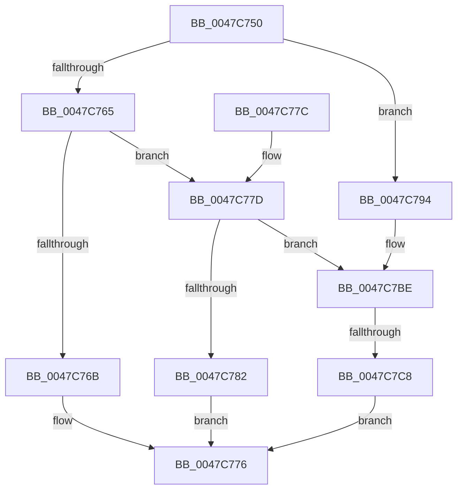

# PopSetRange

- RVA: `0x0047C750`–`0x0047C7D5` (길이 `133` bytes)
- VA: `0x000000014047C750`
- 실행 섹션: `.text`
- PDB 이름 있음: `예`; PDB Function 태그: `예`
- unwind 정보 RVA: `0x000AD804`
- 디코드: `39`개 명령, `133/133` bytes 표시
- 미해석 바이트: `0` (있으면 어셈블리에 `.byte`로 보존)

> 이 문서는 커널 이미지의 기계어와 PDB 기호를 분석해 생성했습니다. 4번과 5번은 함수 원형과 자료형을 바이너리 사용 방식에서 추정한 C 해석이며 원본 소스 복구 결과는 아닙니다.

## 1. Dependencies

- 직접 호출 지점: **5**; 고유 호출 대상: **5**
- 직접 호출자로 확인된 함수: **2**
- RIP 상대 이미지 참조: **0**

### Outgoing calls
- `0x0047C771` → [PopDiscardRange](../../pagelk/B7/PopDiscardRange_function_00B794F8.md) (function, `0x00B794F8`)
- `0x0047C78D` → [PopCloneRange](../../pagelk/B7/PopCloneRange_function_00B7BBB8.md) (function, `0x00B7BBB8`)
- `0x0047C79C` → [PopInternalAddToDumpFile](../5C/PopInternalAddToDumpFile_function_005CE634.md) (function, `0x005CE634`)
- `0x0047C7B8` → [KeBugCheckEx](../4F/KeBugCheckEx_function_004FD660.md) (function, `0x004FD660`)
- `0x0047C7CE` → [PopSetBootPhaseRange](../../pagelk/B6/PopSetBootPhaseRange_function_00B6FB0C.md) (function, `0x00B6FB0C`)

### Direct callers
- [PoSetHiberRange](PoSetHiberRange_function_0047C580.md) at `0x0047C625`
- [PoSetHiberRange](PoSetHiberRange_function_0047C580.md) at `0x0047C743`
- [sub_005F0477](../5F/Unknown_function_005F0477.md) at `0x005F04F7`

### Static image references
- 디코드된 RIP-relative 메모리 참조가 없습니다.

## 2. Other-region calls and transfers

- 다른 실행 섹션으로 향하는 call: **3**
  - `0x0047C771` → [PopDiscardRange](../../pagelk/B7/PopDiscardRange_function_00B794F8.md) (`.text` → `PAGELK`)
  - `0x0047C78D` → [PopCloneRange](../../pagelk/B7/PopCloneRange_function_00B7BBB8.md) (`.text` → `PAGELK`)
  - `0x0047C7CE` → [PopSetBootPhaseRange](../../pagelk/B6/PopSetBootPhaseRange_function_00B6FB0C.md) (`.text` → `PAGELK`)
- call이 아닌 외부 분기/꼬리 이동: **1**
  - `0x0047C7C2` → [sub_006F4B48](../6F/Unknown_function_006F4B48.md) (`tail-transfer`)

## 3. Assembly (complete function range)

```asm
0047C750  40 53                           push rbx
0047C752  48 83 EC 30                     sub rsp, 0x30
0047C756  80 79 18 00                     cmp byte ptr [rcx + 0x18], 0
0047C75A  49 8B C1                        mov rax, r9
0047C75D  4D 8B D0                        mov r10, r8
0047C760  48 8B D9                        mov rbx, rcx
0047C763  75 2F                           jne 0x14047c794
0047C765  0F BA E2 0F                     bt edx, 0xf
0047C769  73 12                           jae 0x14047c77d
0047C76B  4C 8B C0                        mov r8, rax
0047C76E  49 8B D2                        mov rdx, r10
0047C771  E8 82 CD 6F 00                  call 0x140b794f8
0047C776  48 83 C4 30                     add rsp, 0x30
0047C77A  5B                              pop rbx
0047C77B  C3                              ret
0047C77C  CC                              int3
0047C77D  F6 C2 02                        test dl, 2
0047C780  74 3C                           je 0x14047c7be
0047C782  44 8B 4C 24 60                  mov r9d, dword ptr [rsp + 0x60]
0047C787  4C 8B C0                        mov r8, rax
0047C78A  49 8B D2                        mov rdx, r10
0047C78D  E8 26 F4 6F 00                  call 0x140b7bbb8
0047C792  EB E2                           jmp 0x14047c776
0047C794  45 33 C0                        xor r8d, r8d
0047C797  BA F0 01 00 00                  mov edx, 0x1f0
0047C79C  E8 93 1E 15 00                  call 0x1405ce634
0047C7A1  48 83 64 24 20 00               and qword ptr [rsp + 0x20], 0
0047C7A7  BA 04 01 00 00                  mov edx, 0x104
0047C7AC  4C 8B CB                        mov r9, rbx
0047C7AF  41 B8 0A 00 00 00               mov r8d, 0xa
0047C7B5  8D 4A 9C                        lea ecx, [rdx - 0x64]
0047C7B8  E8 A3 0E 08 00                  call 0x1404fd660
0047C7BD  CC                              int3
0047C7BE  0F BA E2 10                     bt edx, 0x10
0047C7C2  0F 83 80 83 27 00               jae 0x1406f4b48
0047C7C8  4C 8B C0                        mov r8, rax
0047C7CB  49 8B D2                        mov rdx, r10
0047C7CE  E8 39 33 6F 00                  call 0x140b6fb0c
0047C7D3  EB A1                           jmp 0x14047c776
```

## 4. C-style interpretation (structured pseudocode)

```c
__int64 __fastcall PopSetRange(__int64 a1, int a2, __int64 a3, __int64 a4, unsigned int a5)
{
    __int64 result;
    __int64 v_rsp;
    unsigned __int64 v_stack_p20;

    v_rsp = (v_rsp) - (48);
    if ((*(unsigned __int8 *)(a1 + 24)) != 0) goto loc_0047C794;
    if ((*(unsigned __int8 *)(a1 + 24)) >= 0) goto loc_0047C77D;
    result = PopDiscardRange(a1, a3, a4, a4);
loc_0047C776:
    v_rsp = (v_rsp) + (48);
    return result;
loc_0047C77D:
    if ((((unsigned __int8)(a3)) & (2)) == 0) goto loc_0047C7BE;
    result = PopCloneRange(a1, a3, result, (unsigned int)(a5));
    goto loc_0047C776;
loc_0047C794:
    a3 = 0;
    result = PopInternalAddToDumpFile(a1, 496, a3, (unsigned int)(a5));
    result = KeBugCheckEx(260 - 100, 260, 10, a1);
loc_0047C7BE:
    result = PopSetBootPhaseRange(260 - 100, 0, result, a1);
    goto loc_0047C776;
}
```

## 5. (Beta) C Style

```c
int64_t PopSetRange(void *Arg1, int32_t Arg2, int64_t Arg3, int64_t Arg4, uint32_t Arg5)
{
    uint8_t *arg1 = (uint8_t *)Arg1;

    int64_t result;
    int64_t local_rsp;
    uint64_t v_stack_p20;

    local_rsp = (local_rsp) - (48);
    if ((*(uint8_t *)(arg1 + 0x18)) != 0) goto loc_0047C794;
    if ((*(uint8_t *)(arg1 + 0x18)) >= 0) goto loc_0047C77D;
    result = PopDiscardRange(Arg1, Arg3, Arg4, Arg4);
loc_0047C776:
    local_rsp = (local_rsp) + (48);
    return result;
loc_0047C77D:
    if ((((uint8_t)(Arg3)) & (2)) == 0) goto loc_0047C7BE;
    result = PopCloneRange(Arg1, Arg3, result, (uint32_t)(Arg5));
    goto loc_0047C776;
loc_0047C794:
    Arg3 = 0;
    result = PopInternalAddToDumpFile(Arg1, 496, Arg3, (uint32_t)(Arg5));
    result = KeBugCheckEx(260 - 100, 260, 10, Arg1);
loc_0047C7BE:
    result = PopSetBootPhaseRange(260 - 100, 0, result, Arg1);
    goto loc_0047C776;
}
```

### 관측된 메모리 오프셋

구조체 형식이 확인되지 않은 접근은 인자 기준의 오프셋으로만 기록했습니다.

| 기준 인자 | 오프셋 표현 | 폭 (bit) | 접근 |
|---|---:|---:|---|
| `Arg1` | `+ 0x18` | `8` | `R` |

## 6. Execution-region graph

[열기: 2D/3D 그래프와 함수 탐색 컨트롤 패널](../../../control-panel.html?section=text&rva=0x0047C750&view=graph)

- 2D 그래프는 위에서 아래로 흐르고, 3D 그래프는 빈 공간을 드래그해 회전합니다. Shift+드래그는 이동, 휠은 확대·축소, 함수 노드 선택은 대상 보고서 이동입니다.

### Static fallback


