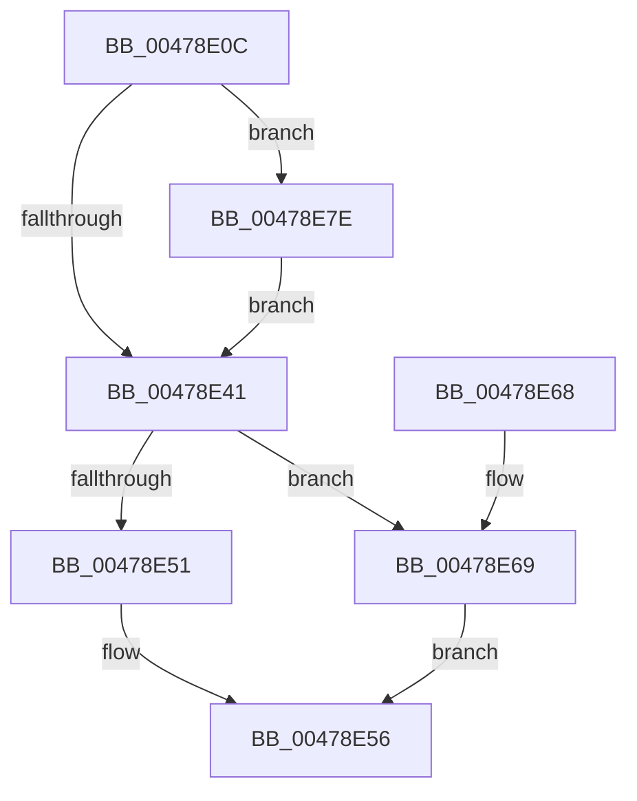

# PpProcessClearProblem

- RVA: `0x00478E0C`–`0x00478E8B` (길이 `127` bytes)
- VA: `0x0000000140478E0C`
- 실행 섹션: `.text`
- PDB 이름 있음: `예`; PDB Function 태그: `아니요`
- unwind 정보 RVA: `0x000ACE88`
- 디코드: `31`개 명령, `127/127` bytes 표시
- 미해석 바이트: `0` (있으면 어셈블리에 `.byte`로 보존)

> 이 문서는 커널 이미지의 기계어와 PDB 기호를 분석해 생성했습니다. 4번과 5번은 함수 원형과 자료형을 바이너리 사용 방식에서 추정한 C 해석이며 원본 소스 복구 결과는 아닙니다.

## 1. Dependencies

- 직접 호출 지점: **2**; 고유 호출 대상: **2**
- 직접 호출자로 확인된 함수: **1**
- RIP 상대 이미지 참조: **2**

### Outgoing calls
- `0x00478E5E` → [_security_check_cookie](../6A/_security_check_cookie_function_006AC640.md) (function, `0x006AC640`)
- `0x00478E75` → [PipForDeviceNodeSubtree](../../page/A5/PipForDeviceNodeSubtree_function_00A51920.md) (function, `0x00A51920`)

### Direct callers
- [PnpDeviceActionWorker](PnpDeviceActionWorker_function_00478400.md) at `0x0047896D`

### Static image references
- `0x00478E10` → RVA `0x00E0A740` (`.data`; read)
- `0x00478E6E` → RVA `0x00A68BE0` (`PiResetProblemDevicesWorker`; read)

## 2. Other-region calls and transfers

- 다른 실행 섹션으로 향하는 call: **1**
  - `0x00478E75` → [PipForDeviceNodeSubtree](../../page/A5/PipForDeviceNodeSubtree_function_00A51920.md) (`.text` → `PAGE`)
- 별도 외부 분기/꼬리 이동을 확인하지 못했습니다.

## 3. Assembly (complete function range)

```asm
00478E0C  48 83 EC 48                     sub rsp, 0x48
00478E10  48 8B 05 29 19 99 00            mov rax, qword ptr [rip + 0x991929]
00478E17  48 33 C4                        xor rax, rsp
00478E1A  48 89 44 24 30                  mov qword ptr [rsp + 0x30], rax
00478E1F  8B 41 28                        mov eax, dword ptr [rcx + 0x28]
00478E22  89 44 24 20                     mov dword ptr [rsp + 0x20], eax
00478E26  48 8B 41 10                     mov rax, qword ptr [rcx + 0x10]
00478E2A  33 C9                           xor ecx, ecx
00478E2C  C7 44 24 24 01 00 00 00         mov dword ptr [rsp + 0x24], 1
00478E34  C7 44 24 28 05 00 00 00         mov dword ptr [rsp + 0x28], 5
00478E3C  48 85 C0                        test rax, rax
00478E3F  75 3D                           jne 0x140478e7e
00478E41  8B 81 2C 01 00 00               mov eax, dword ptr [rcx + 0x12c]
00478E47  2D 15 03 00 00                  sub eax, 0x315
00478E4C  83 F8 01                        cmp eax, 1
00478E4F  77 18                           ja 0x140478e69
00478E51  B8 56 00 00 C0                  mov eax, 0xc0000056
00478E56  48 8B 4C 24 30                  mov rcx, qword ptr [rsp + 0x30]
00478E5B  48 33 CC                        xor rcx, rsp
00478E5E  E8 DD 37 23 00                  call 0x1406ac640
00478E63  48 83 C4 48                     add rsp, 0x48
00478E67  C3                              ret
00478E68  CC                              int3
00478E69  4C 8D 44 24 20                  lea r8, [rsp + 0x20]
00478E6E  48 8D 15 6B FD 5E 00            lea rdx, [rip + 0x5efd6b]
00478E75  E8 A6 8A 5D 00                  call 0x140a51920
00478E7A  33 C0                           xor eax, eax
00478E7C  EB D8                           jmp 0x140478e56
00478E7E  48 8B 80 38 01 00 00            mov rax, qword ptr [rax + 0x138]
00478E85  48 8B 48 28                     mov rcx, qword ptr [rax + 0x28]
00478E89  EB B6                           jmp 0x140478e41
```

## 4. C-style interpretation (structured pseudocode)

```c
__int64 __fastcall PpProcessClearProblem(__int64 a1)
{
    __int64 result;
    __int64 v_rsp;
    unsigned __int64 v_stack_m18;
    unsigned int v_stack_m20;
    unsigned int v_stack_m24;
    unsigned int v_stack_m28;
    unsigned __int64 v_stack_p20;

    v_rsp = (v_rsp) - (72);
    result = (*(unsigned __int64 *)(v_rip + 10033449)) ^ (v_rsp);
    v_stack_m18 = result;
    v_stack_m28 = (unsigned int)((unsigned int)(*(unsigned int *)(a1 + 40)));
    a1 = 0;
    v_stack_m24 = 1;
    v_stack_m20 = 5;
    if (*(unsigned __int64 *)(a1 + 16) != 0) goto loc_00478E7E;
loc_00478E41:
    result = (unsigned int)(((unsigned int)(*(unsigned int *)(a1 + 300))) - (789));
    if (((unsigned int)(result)) > 1) goto loc_00478E69;
loc_00478E56:
    a1 = (v_stack_m18) ^ (v_rsp);
    result = _security_check_cookie(a1, a2, a3, a4);
    v_rsp = (v_rsp) + (72);
    return result;
loc_00478E69:
    result = PipForDeviceNodeSubtree(a1, v_rip + 6225259, v_stack_p20, a4);
    result = 0;
    goto loc_00478E56;
loc_00478E7E:
    goto loc_00478E41;
}
```

## 5. (Beta) C Style

```c
int64_t PpProcessClearProblem(void *Arg1)
{
    uint8_t *arg1 = (uint8_t *)Arg1;

    int64_t result;
    int64_t local_rsp;
    uint64_t v_stack_m18;
    uint32_t v_stack_m20;
    uint32_t v_stack_m24;
    uint32_t v_stack_m28;
    uint64_t v_stack_p20;

    local_rsp = (local_rsp) - (72);
    result = (*(uint64_t *)(v_rip + 0x991929)) ^ (local_rsp);
    v_stack_m18 = result;
    v_stack_m28 = (uint32_t)((uint32_t)(*(uint32_t *)(arg1 + 0x28)));
    Arg1 = 0;
    v_stack_m24 = 1;
    v_stack_m20 = 5;
    if (*(uint64_t *)(arg1 + 0x10) != 0) goto loc_00478E7E;
loc_00478E41:
    result = (uint32_t)(((uint32_t)(*(uint32_t *)(arg1 + 0x12C))) - (789));
    if (((uint32_t)(result)) > 1) goto loc_00478E69;
loc_00478E56:
    Arg1 = (v_stack_m18) ^ (local_rsp);
    result = _security_check_cookie(Arg1, a2, a3, a4);
    local_rsp = (local_rsp) + (72);
    return result;
loc_00478E69:
    result = PipForDeviceNodeSubtree(Arg1, v_rip + 6225259, v_stack_p20, a4);
    result = 0;
    goto loc_00478E56;
loc_00478E7E:
    goto loc_00478E41;
}
```

### 관측된 메모리 오프셋

구조체 형식이 확인되지 않은 접근은 인자 기준의 오프셋으로만 기록했습니다.

| 기준 인자 | 오프셋 표현 | 폭 (bit) | 접근 |
|---|---:|---:|---|
| `Arg1` | `+ 0x10` | `64` | `R` |
| `Arg1` | `+ 0x28` | `32` | `R` |

## 6. Execution-region graph

[열기: 2D/3D 그래프와 함수 탐색 컨트롤 패널](../../../control-panel.html?section=text&rva=0x00478E0C&view=graph)

- 2D 그래프는 위에서 아래로 흐르고, 3D 그래프는 빈 공간을 드래그해 회전합니다. Shift+드래그는 이동, 휠은 확대·축소, 함수 노드 선택은 대상 보고서 이동입니다.

### Static fallback


