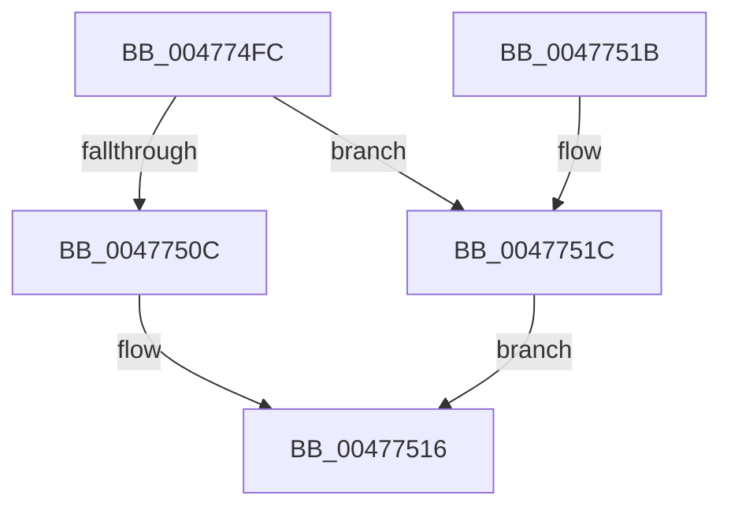

# PpmBeginHighPerfRequest

- RVA: `0x004774FC`–`0x00477523` (길이 `39` bytes)
- VA: `0x00000001404774FC`
- 실행 섹션: `.text`
- PDB 이름 있음: `예`; PDB Function 태그: `아니요`
- unwind 정보 RVA: `0x0005CEE8`
- 디코드: `11`개 명령, `39/39` bytes 표시
- 미해석 바이트: `0` (있으면 어셈블리에 `.byte`로 보존)

> 이 문서는 커널 이미지의 기계어와 PDB 기호를 분석해 생성했습니다. 4번과 5번은 함수 원형과 자료형을 바이너리 사용 방식에서 추정한 C 해석이며 원본 소스 복구 결과는 아닙니다.

## 1. Dependencies

- 직접 호출 지점: **1**; 고유 호출 대상: **1**
- 직접 호출자로 확인된 함수: **5**
- RIP 상대 이미지 참조: **1**

### Outgoing calls
- `0x00477511` → [PopPowerRequestReferenceAcquire](PopPowerRequestReferenceAcquire_function_004776C0.md) (function, `0x004776C0`)

### Direct callers
- [PopSetupHighPerfPowerRequest](../../page/75/PopSetupHighPerfPowerRequest_function_00753AE0.md) at `0x00753AFF`
- [PopSwitchUpdateUserShutdownScenarioState](../../page/75/PopSwitchUpdateUserShutdownScenarioState_function_0075F260.md) at `0x0075F323`
- [PdcPoPerfOverride](../../page/98/PdcPoPerfOverride_function_00989D34.md) at `0x00989D38`
- [PoInitializeBroadcast](../../page/A4/PoInitializeBroadcast_function_00A4DD98.md) at `0x00A4DE37`
- [PopIssueActionRequest](../../page/A9/PopIssueActionRequest_function_00A9CE54.md) at `0x00A9D018`

### Static image references
- `0x00477500` → RVA `0x00F0CFB8` (`.data`; read)

## 2. Other-region calls and transfers

- 다른 실행 섹션으로 향하는 call: **0**
- 별도 외부 분기/꼬리 이동을 확인하지 못했습니다.

## 3. Assembly (complete function range)

```asm
004774FC  48 83 EC 28                     sub rsp, 0x28
00477500  48 8B 0D B1 5A A9 00            mov rcx, qword ptr [rip + 0xa95ab1]
00477507  48 85 C9                        test rcx, rcx
0047750A  74 10                           je 0x14047751c
0047750C  BA 04 00 00 00                  mov edx, 4
00477511  E8 AA 01 00 00                  call 0x1404776c0
00477516  48 83 C4 28                     add rsp, 0x28
0047751A  C3                              ret
0047751B  CC                              int3
0047751C  B8 01 00 00 C0                  mov eax, 0xc0000001
00477521  EB F3                           jmp 0x140477516
```

## 4. C-style interpretation (structured pseudocode)

```c
__int64 __fastcall PpmBeginHighPerfRequest(void)
{
    __int64 result;
    __int64 v_rsp;

    v_rsp = (v_rsp) - (40);
    if (*(unsigned __int64 *)(v_rip + 11098801) == 0) goto loc_0047751C;
    result = PopPowerRequestReferenceAcquire(*(unsigned __int64 *)(v_rip + 11098801), 4, a3, a4);
loc_00477516:
    v_rsp = (v_rsp) + (40);
    return result;
loc_0047751C:
    goto loc_00477516;
}
```

## 5. (Beta) C Style

```c
void PpmBeginHighPerfRequest(void)
{
    int64_t result;
    int64_t local_rsp;

    local_rsp = (local_rsp) - (40);
    if (*(uint64_t *)(v_rip + 0xA95AB1) == 0) goto loc_0047751C;
    result = PopPowerRequestReferenceAcquire(*(uint64_t *)(v_rip + 0xA95AB1), 4, a3, a4);
loc_00477516:
    local_rsp = (local_rsp) + (40);
    return result;
loc_0047751C:
    goto loc_00477516;
}
```

## 6. Execution-region graph

[열기: 2D/3D 그래프와 함수 탐색 컨트롤 패널](../../../control-panel.html?section=text&rva=0x004774FC&view=graph)

- 2D 그래프는 위에서 아래로 흐르고, 3D 그래프는 빈 공간을 드래그해 회전합니다. Shift+드래그는 이동, 휠은 확대·축소, 함수 노드 선택은 대상 보고서 이동입니다.

### Static fallback


