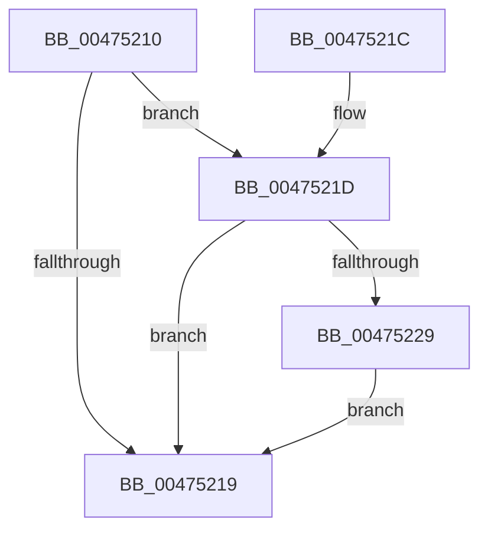

# PpmCheckAdjustNextPerfCheck

- RVA: `0x00475210`–`0x0047523F` (길이 `47` bytes)
- VA: `0x0000000140475210`
- 실행 섹션: `.text`
- PDB 이름 있음: `예`; PDB Function 태그: `아니요`
- unwind 정보 RVA: `0x000DB714`
- 디코드: `12`개 명령, `47/47` bytes 표시
- 미해석 바이트: `0` (있으면 어셈블리에 `.byte`로 보존)

> 이 문서는 커널 이미지의 기계어와 PDB 기호를 분석해 생성했습니다. 4번과 5번은 함수 원형과 자료형을 바이너리 사용 방식에서 추정한 C 해석이며 원본 소스 복구 결과는 아닙니다.

## 1. Dependencies

- 직접 호출 지점: **0**; 고유 호출 대상: **0**
- 직접 호출자로 확인된 함수: **0**
- RIP 상대 이미지 참조: **3**

### Outgoing calls
- 직접 디코드된 call 명령이 없습니다.

### Direct callers
- 이 함수 시작 RVA로 연결되는 직접 call은 확인되지 않았습니다. 간접 호출은 완전히 역산할 수 없습니다.

### Static image references
- `0x00475210` → RVA `0x00F0B244` (`.data`; read)
- `0x0047521D` → RVA `0x00F0B270` (`.data`; read)
- `0x00475236` → RVA `0x00F0B270` (`.data`; read/write)

## 2. Other-region calls and transfers

- 다른 실행 섹션으로 향하는 call: **0**
- 별도 외부 분기/꼬리 이동을 확인하지 못했습니다.

## 3. Assembly (complete function range)

```asm
00475210  83 3D 2D 60 A9 00 05            cmp dword ptr [rip + 0xa9602d], 5
00475217  74 04                           je 0x14047521d
00475219  B0 01                           mov al, 1
0047521B  C3                              ret
0047521C  CC                              int3
0047521D  48 8B 05 4C 60 A9 00            mov rax, qword ptr [rip + 0xa9604c]
00475224  48 85 C0                        test rax, rax
00475227  74 F0                           je 0x140475219
00475229  48 B8 08 00 00 00 80 F7 FF FF   movabs rax, 0xfffff78000000008
00475233  48 8B 00                        mov rax, qword ptr [rax]
00475236  48 87 05 33 60 A9 00            xchg qword ptr [rip + 0xa96033], rax
0047523D  EB DA                           jmp 0x140475219
```

## 4. C-style interpretation (structured pseudocode)

```c
__int64 __fastcall PpmCheckAdjustNextPerfCheck(void)
{
    if ((*(unsigned int *)(v_rip + 11100205)) == 5) goto loc_0047521D;
loc_00475219:
    return 1;
loc_0047521D:
    if (*(unsigned __int64 *)(v_rip + 11100236) == 0) goto loc_00475219;
    goto loc_00475219;
}
```

## 5. (Beta) C Style

```c
void PpmCheckAdjustNextPerfCheck(void)
{
    if ((*(uint32_t *)(v_rip + 0xA9602D)) == 5) goto loc_0047521D;
loc_00475219:
    return 1;
loc_0047521D:
    if (*(uint64_t *)(v_rip + 0xA9604C) == 0) goto loc_00475219;
    goto loc_00475219;
}
```

## 6. Execution-region graph

[열기: 2D/3D 그래프와 함수 탐색 컨트롤 패널](../../../control-panel.html?section=text&rva=0x00475210&view=graph)

- 2D 그래프는 위에서 아래로 흐르고, 3D 그래프는 빈 공간을 드래그해 회전합니다. Shift+드래그는 이동, 휠은 확대·축소, 함수 노드 선택은 대상 보고서 이동입니다.

### Static fallback


