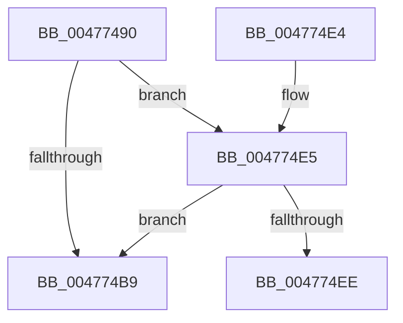

# PpmEndHighPerfRequest

- RVA: `0x00477490`–`0x004774F3` (길이 `99` bytes)
- VA: `0x0000000140477490`
- 실행 섹션: `.text`
- PDB 이름 있음: `예`; PDB Function 태그: `예`
- unwind 정보 RVA: `0x00078754`
- 디코드: `24`개 명령, `99/99` bytes 표시
- 미해석 바이트: `0` (있으면 어셈블리에 `.byte`로 보존)

> 이 문서는 커널 이미지의 기계어와 PDB 기호를 분석해 생성했습니다. 4번과 5번은 함수 원형과 자료형을 바이너리 사용 방식에서 추정한 C 해석이며 원본 소스 복구 결과는 아닙니다.

## 1. Dependencies

- 직접 호출 지점: **3**; 고유 호출 대상: **3**
- 직접 호출자로 확인된 함수: **5**
- RIP 상대 이미지 참조: **4**

### Outgoing calls
- `0x004774A4` → [KeAcquireSpinLockRaiseToDpc](../20/KeAcquireSpinLockRaiseToDpc_function_00208470.md) (function, `0x00208470`)
- `0x004774C5` → [PopPowerRequestReferenceRelease](PopPowerRequestReferenceRelease_function_004775B0.md) (function, `0x004775B0`)
- `0x004774D4` → [KeReleaseSpinLock](../39/KeReleaseSpinLock_function_00392BA0.md) (function, `0x00392BA0`)

### Direct callers
- [PopSetupHighPerfPowerRequest](../../page/75/PopSetupHighPerfPowerRequest_function_00753AE0.md) at `0x00753B0C`
- [PopSwitchUpdateUserShutdownScenarioState](../../page/75/PopSwitchUpdateUserShutdownScenarioState_function_0075F260.md) at `0x0075F37E`
- [PdcPoPerfOverride](../../page/98/PdcPoPerfOverride_function_00989D34.md) at `0x00989D49`
- [PopIssueActionRequest](../../page/A9/PopIssueActionRequest_function_00A9CE54.md) at `0x00A9D2F9`
- [PoClearBroadcast](../../page/AA/PoClearBroadcast_function_00AA3CE8.md) at `0x00AA3D20`

### Static image references
- `0x0047749D` → RVA `0x00F0CFA0` (`.data`; read)
- `0x004774AC` → RVA `0x00FC53A0` (`ALMOSTRO`; read)
- `0x004774B9` → RVA `0x00F0CFB8` (`.data`; read)
- `0x004774E5` → RVA `0x00F0C8CC` (`.data`; read)

## 2. Other-region calls and transfers

- 다른 실행 섹션으로 향하는 call: **0**
- call이 아닌 외부 분기/꼬리 이동: **1**
  - `0x004774EE` → [sub_006F4466](../6F/Unknown_function_006F4466.md) (`tail-transfer`)

## 3. Assembly (complete function range)

```asm
00477490  48 89 5C 24 08                  mov qword ptr [rsp + 8], rbx
00477495  57                              push rdi
00477496  48 83 EC 30                     sub rsp, 0x30
0047749A  48 63 D9                        movsxd rbx, ecx
0047749D  48 8D 0D FC 5A A9 00            lea rcx, [rip + 0xa95afc]
004774A4  E8 C7 0F D9 FF                  call 0x140208470
004774A9  40 8A F8                        mov dil, al
004774AC  48 8D 05 ED DE B4 00            lea rax, [rip + 0xb4deed]
004774B3  83 3C 98 00                     cmp dword ptr [rax + rbx*4], 0
004774B7  75 2C                           jne 0x1404774e5
004774B9  48 8B 0D F8 5A A9 00            mov rcx, qword ptr [rip + 0xa95af8]
004774C0  BA 04 00 00 00                  mov edx, 4
004774C5  E8 E6 00 00 00                  call 0x1404775b0
004774CA  40 8A D7                        mov dl, dil
004774CD  48 8D 0D CC 5A A9 00            lea rcx, [rip + 0xa95acc]
004774D4  E8 C7 B6 F1 FF                  call 0x140392ba0
004774D9  48 8B 5C 24 40                  mov rbx, qword ptr [rsp + 0x40]
004774DE  48 83 C4 30                     add rsp, 0x30
004774E2  5F                              pop rdi
004774E3  C3                              ret
004774E4  CC                              int3
004774E5  80 3D E0 53 A9 00 00            cmp byte ptr [rip + 0xa953e0], 0
004774EC  75 CB                           jne 0x1404774b9
004774EE  E9 73 CF 27 00                  jmp 0x1406f4466
```

## 4. C-style interpretation (structured pseudocode)

```c
__int64 __fastcall PpmEndHighPerfRequest(int a1)
{
    __int64 result;
    __int64 v_rsp;
    unsigned __int64 v_stack_p8;

    v_stack_p8 = v_rbx;
    v_rsp = (v_rsp) - (48);
    result = KeAcquireSpinLockRaiseToDpc(v_rip + 11098876, a2, a3, a4);
    if ((*(unsigned int *)(v_rip + 11853549 + (int)(a1) * 4)) != 0) goto loc_004774E5;
loc_004774B9:
    result = PopPowerRequestReferenceRelease(*(unsigned __int64 *)(v_rip + 11098872), 4, a3, a4);
    result = KeReleaseSpinLock(v_rip + 11098828, (unsigned __int8)((unsigned __int8)(result)), a3, a4);
    v_rsp = (v_rsp) + (48);
    return result;
loc_004774E5:
    if ((*(unsigned __int8 *)(v_rip + 11097056)) != 0) goto loc_004774B9;
}
```

## 5. (Beta) C Style

```c
int64_t PpmEndHighPerfRequest(int32_t Arg1)
{
    int64_t result;
    int64_t local_rsp;
    uint64_t v_stack_p8;

    v_stack_p8 = local_rbx;
    local_rsp = (local_rsp) - (48);
    result = KeAcquireSpinLockRaiseToDpc(v_rip + 11098876, a2, a3, a4);
    if ((*(uint32_t *)(v_rip + 0xB4DEED + (int32_t)(Arg1) * 4)) != 0) goto loc_004774E5;
loc_004774B9:
    result = PopPowerRequestReferenceRelease(*(uint64_t *)(v_rip + 0xA95AF8), 4, a3, a4);
    result = KeReleaseSpinLock(v_rip + 11098828, (uint8_t)((uint8_t)(result)), a3, a4);
    local_rsp = (local_rsp) + (48);
    return result;
loc_004774E5:
    if ((*(uint8_t *)(v_rip + 0xA953E0)) != 0) goto loc_004774B9;
}
```

## 6. Execution-region graph

[열기: 2D/3D 그래프와 함수 탐색 컨트롤 패널](../../../control-panel.html?section=text&rva=0x00477490&view=graph)

- 2D 그래프는 위에서 아래로 흐르고, 3D 그래프는 빈 공간을 드래그해 회전합니다. Shift+드래그는 이동, 휠은 확대·축소, 함수 노드 선택은 대상 보고서 이동입니다.

### Static fallback


